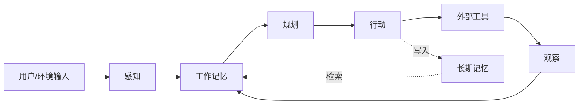

# Part 3 Agent 原理 Implementation Plan

> **For agentic workers:** REQUIRED SUB-SKILL: Use superpowers:subagent-driven-development (recommended) or superpowers:executing-plans to implement this plan task-by-task. Steps use checkbox (`- [ ]`) syntax for tracking.

**Goal:** 在 `/data/projects/agentkit` 中写完 Part 3《Agent 原理》的全部 6 章（Ch11-Ch16）+ 4 个示意代码文件，把 Part 2 交付的「积木清单」升级成「装配图」，并补上 CLAUDE.md 硬性要求却一直缺失的「混合系统」主题。

**Architecture:** 每章一个独立 markdown 文件，统一模板（标题 → 一句话简介 → 本章目标 → 本章导览（mermaid 总览图）→ 子节正文 → 本章小结 → 本章参考）。理论章（Ch11-Ch15）以图 + 表为主、几乎无代码；Ch12-Ch15 各配一个 ≤80 行、纯标准库的 `# illustrative only` 示意代码。每章独立 commit，章后接一次**只审易读性**的独立审查与定点修复。

**Tech Stack:** Markdown（GitHub Flavored）、Mermaid（GitHub 原生渲染，六种图型）、Python 3.10+（仅标准库，**零执行**）。

## Global Constraints

[来源：spec `docs/superpowers/specs/2026-10-12-agent-principles-practice-part3-design.md` + CLAUDE.md，关键项逐字摘录]

**读者与语调**

- 目标读者：会写代码、**没有** AI/ML 背景、已读完 Part 1-2
- 中文（简体）；用"读者""我们"，**避免"您"**；段落 3-6 句一个自然段
- 技术术语首次出现用 `中文名（English term）` 格式，章内保持一致

**一·甲初学者可懂性原则（最高优先级，凌驾于完整性/覆盖度/篇幅之上）**

- 一个段落同时塞给读者的新概念 ≤ 3 个；一节 4+ 新概念必须显式分小节
- 任何公式或抽象概念出现前，必须已完成：直觉 → 类比 → 视觉（图/表）→ 公式，**顺序不可颠倒**
- 同一段英文缩写 ≤ 3 个
- "一招鲜 + 一句话点名"：主推一种深入讲，其余表格一句话提及
- worked-example：抽象概念前先给具体可触摸的小例子
- Split-Attention：mermaid 图 / 表格紧贴它解释的段落
- 每章最多 1-2 张 mermaid 架构图 + 多张局部小图（ASCII / 对比表）
- 冗余覆盖：关键概念首次讲透，后续小节首段简短回顾
- **每节开头先演一次「没有它会怎样」**（Part 2 Phase R 验证有效的写法）

**Part 3 三条硬约束（spec §4）**

1. **术语三件套前置**：每章 brief 携带本章术语表（白话一句话 + 生活类比 + 具体小例子），见各 Task。**写作 agent 的 brief 就是它所属 Task 的全文**（含术语表、边界清单、字数预算），派发时不得只发一句章名。**术语裸用 = 审查不通过**
2. **不重复 Part 2**：Part 2 Ch8（认知四件套历史）、Ch9（协议起源）、Ch10（积木清单 + 三步循环 + `react_loop.py`）已交付的内容，一律一句回顾起手。判据：删掉本节后讲不出新判断 → 越界
3. **产品中立**：概念定义位只说通用说法（如"项目说明文件"而非 `CLAUDE.md`）；产品名 / 文件名只在**例子位置**出现并括注说明。删除所有产品名后本节每句仍成立

**字数（`wc -m` 口径，约等于中文字数 × 2）**

| 章 | `wc -m` 区间 |
|---|---|
| Ch11 | 20000-24000 |
| Ch12 | 24000-28000 |
| Ch13 | 18000-22000 |
| Ch14 | 18000-22000 |
| Ch15 | 18000-22000 |
| Ch16 | 6000-8000 |
| **TOTAL** | **52000-60000**（硬约束） |

各章上限相加为 64000；**总量超 60000 时按此顺序压缩**：先压 Ch16，再压 Ch15；Ch11/Ch12 是承重章，不动。

**图表**

- Mermaid 仅六种：`graph` / `flowchart` / `sequenceDiagram` / `mindmap` / `timeline` / `stateDiagram-v2`；节点文字 ≤ 4 个字/词；复杂关系用表格，不堆 mermaid
- Ch15 首次使用 `stateDiagram-v2`（级联路由的状态迁移），用完须确认渲染无语法错误

**引用**

- 随文 markdown 链接 + 章末「本章参考」三类：必读论文 / 推荐博客·教程 / 视频·课程
- **无论文的章可写「### 必读」**（CLAUDE.md §七 已允许）
- 不使用 markdown 脚注语法
- **spec §11.3 列出的 v1 错误数字与错误 arXiv ID 一律禁止再用**

**代码**

- 4 个文件全部 `# illustrative only`，中文注释只说意图，不解释语法
- ≤ 80 行；**纯 Python 标准库，不依赖 LangChain / LangGraph 等外部框架**
- **零执行**（用户长期禁令：本书所有代码不运行）。Task 7 只做**静态推演**，推演结果须与章节描述逐字一致
- `code/part-2/react_loop.py` 已由 Part 2 交付，本 Part **不重复**该文件

**跨章引用**

- 章内互引 `参见 X.3`；跨 Part `(见 Part N ChM)`，不复制内容
- 顺延后的后文章号：**Part 4 = Ch17-22、Part 5 = Ch23-28、Part 6 = Ch29-34**

**网络现实（Task 7 必读）**

本环境已实测：WebSearch 返回空、WebFetch 域名校验失败、`arxiv.org` API 会限流。**可用通道**：`arxiv.org/abs/<id>`（逐条 sleep 2-3s）、`api.crossref.org`、`api.github.com`、`raw.githubusercontent.com`、`linuxfoundation.org/press`、`anthropic.com`、`qwenlm.github.io`、`modelcontextprotocol.io`。不可达项一律进「浏览器抽验清单」，**不得凭印象改写事实**。

**每章审查协议（Task 1-6 通用，各章 Task 中只写编号与文件名）**

每章写完并 commit 后，由主会话派发**独立**审查 agent `review-chXX`，brief 必须包含四要素：

1. **审查范围 = 只有易读性**：一·甲检查清单（认知负荷 ≤3/段落、四步顺序、缩写 ≤3/段、split-attention）、本章术语三件套是否真落地、每节能否一句话转述、类比是否贴切、有无术语裸用、每节开头是否有"没有它会怎样"
2. **明确禁止**审查事实准确性、链接有效性、技术深度、字数以外的任何内容——一律推迟到 Task 7
3. **该章的术语三件套表 + 边界清单**（Part 2 已交付什么、后续 Part 承接什么）
4. 报告路径 `.superpowers/sdd/task-c3-review-chXX.md`，结论用 `approved` / `needs-fixes` + 分级问题（阻断项须写明位置与建议改法）

修复规则：**只改报告指出的可读性问题**，不做范围外的顺手重写；修完 commit message 写明章号与修复摘要。每章的审查 report 须留下**移交 Task 7 的三项**：本章引用链接清单、术语三件套覆盖率、字数实测值。

**提交约定**

- 所有 commit message 末尾加 `Co-Authored-By: Claude Code <noreply@anthropic.com>`
- 修改 spec 用 `[claude-md]` / `[spec]` 前缀；章节 commit 写明章号

**Out-of-Scope（spec §9）**

Transformer 训练数学 → Part 1；LLM 家族史与 Agent 五十年史 → Part 2；harness 实现（hooks / permissions / sandbox / 上下文工程工艺）→ Part 4；tool calling / RAG / MCP server 编码 → Part 5；监控 / 评测 / 成本 / 合规 → Part 6。

---

## File Structure

```
agentkit/
├── README.md                                  # MODIFY（Task 0 建目录，Task 7 翻状态）
├── docs/superpowers/specs/
│   ├── ...-part4-design.md                    # MODIFY：章号 +1（含子节号与交叉引用表）
│   ├── ...-part5-design.md                    # MODIFY：章号 +1
│   └── ...-part6-design.md                    # MODIFY：章号 +1
├── part-3-agent原理/
│   ├── README.md                              # CREATE：目录与一句话简介
│   ├── ch11-agent认知架构.md                  # CREATE：四件套如何协作
│   ├── ch12-三大范式.md                        # CREATE：ReAct / Reflexion / Plan-and-Execute
│   ├── ch13-记忆机制.md                        # CREATE：记忆的写 / 读 / 忘
│   ├── ch14-多agent协作.md                     # CREATE：拓扑、失败模式、什么时候不该用
│   ├── ch15-混合系统.md                        # CREATE：规则 + 检索 + 小模型 + 中心 LLM
│   └── ch16-小结与衔接.md                      # CREATE：装配图回顾 + Part 4 衔接
└── code/
    └── part-3/
        ├── README.md                          # CREATE：依赖说明（全为示意代码）
        ├── plan_execute.py                    # CREATE：Ch12 Planner/Executor/Replanner
        ├── memory_store.py                    # CREATE：Ch13 记忆的写/读/忘
        ├── multi_agent_min.py                 # CREATE：Ch14 两 Agent 交接
        └── cascade_router.py                  # CREATE：Ch15 级联路由
```

每个 `.md` 章节文件只负责一章；不跨章复制内容，不引用未定义的子节。

---

## Task 0：Part 3 脚手架 + Part 4/5/6 spec 章号顺延

**Files:**
- Create: `part-3-agent原理/README.md`
- Create: `code/part-3/README.md`
- Modify: `README.md`（阅读路线表 Part 3 行 + 当前进度）
- Modify: `docs/superpowers/specs/2026-09-20-agent-principles-practice-part4-design.md`
- Modify: `docs/superpowers/specs/2026-09-20-agent-principles-practice-part5-design.md`
- Modify: `docs/superpowers/specs/2026-09-20-agent-principles-practice-part6-design.md`

**Interfaces:**
- Consumes: Part 1-2 已发布的顶层 README 结构；spec v2 §12 的顺延表与交叉引用重核表
- Produces: `part-3-agent原理/` 与 `code/part-3/` 目录骨架；后文章号基准（Part 4 = Ch17-22、Part 5 = Ch23-28、Part 6 = Ch29-34）

- [ ] **Step 1：顺延 Part 4 spec 章号（16-21 → 17-22）**

⚠️ **禁止裸 sed**。这些 spec 里混有 `25.09`、`26.07`、`24.11` 等**版本日期**，任何无守卫的替换会把日期改坏。用下面的 Python 脚本（带"数字前无数字"守卫，`re.sub` 单遍扫描不重扫替换结果，故幂等）：

```bash
cd /data/projects/agentkit && python3 - <<'PY'
import re, pathlib

# 只处理这两个文件；数字前不得有数字或点（挡住 2025.09 这类日期）
PAT_CH = re.compile(r'\bCh(\d+)\b')
PAT_SUB = re.compile(r'(?<![\d.])(\d{2})\.(\d+)\b')

def bump_chapters(text, lo, hi):
    """把 Ch16-21 与子节号 16.1-21.x 整体 +1（lo/hi 为本 Part 的章号区间）。"""
    def ch_sub(m):
        n = int(m.group(1))
        return f"Ch{n + 1}" if lo <= n <= hi else m.group(0)
    def sub_sub(m):
        n = int(m.group(1))
        return f"{n + 1}.{m.group(2)}" if lo <= n <= hi else m.group(0)
    return PAT_SUB.sub(sub_sub, PAT_CH.sub(ch_sub, text))

for name, lo, hi in [
    ("part4", 16, 21),
    ("part5", 22, 27),
    ("part6", 28, 33),
]:
    p = pathlib.Path(f"docs/superpowers/specs/2026-09-20-agent-principles-practice-{name}-design.md")
    t = p.read_text(encoding="utf-8")
    p.write_text(bump_chapters(t, lo, hi), encoding="utf-8")
    print(f"{name}: done")
PY
```

对 Part 4 文件，`lo=16, hi=21` 只动自身章号；文件内指向 Part 5/6 的引用（`Part 5 Ch23`、`Part 6 Ch28`）由 Step 2 单独处理。

- [ ] **Step 2：重核并修正 Part 4 spec 的跨 Part 交叉引用表**

顺延后逐行核对（spec §12 已列出正确答案）。打开 `docs/superpowers/specs/2026-09-20-agent-principles-practice-part4-design.md`，找到表格 `| MCP 是怎么进入 Agent 循环的 |`，把 5 行**整表替换**为：

```markdown
| 内容 | Part 4 位置 | 后续 Part |
|---|---|---|
| MCP 是怎么进入 Agent 循环的 | 18.11 | Part 5 Ch23（Tool Calling 与 RAG） |
| A2A 任务的并发模式 | 19.4 | Part 5 Ch25（多 Agent 协作） |
| 上下文压缩的具体实现 | 20.5 | Part 5 Ch24（记忆与规划） |
| sandbox 的 OS 原语 | 21.7 | Part 6 Ch31（Security 与红队） |
| 协议栈全景图 | 22.2 | Part 5 Ch27（协议集成） |
```

（原表 5 行中 3 行本就指错：A2A 并发应指 Ch25 而非 Ch26、sandbox 原语应指 Part 6 Ch31 而非 Ch28、协议接入应指 Ch27 而非 Ch22。）

- [ ] **Step 3：验证顺延结果（防日期被误改）**

```bash
cd /data/projects/agentkit/docs/superpowers/specs && \
grep -oE "^### Ch[0-9]+" 2026-09-20-agent-principles-practice-part[456]-design.md && \
echo "--- 日期必须原样保留（下面应看到 2025.09 之类的日期，未被 +1）---" && \
grep -noE "202[0-9]\.[0-9]{2}" 2026-09-20-agent-principles-practice-part[456]-design.md | head -8
```

Expected：
- Part 4 出现 `### Ch17` 到 `### Ch22`；Part 5 `### Ch23` 到 `### Ch28`；Part 6 `### Ch29` 到 `### Ch34`；**无 Ch16 或 Ch28 残留于 Part 4/5 的章标题**
- 日期行仍显示 `2025.09`、`2024.11`、`2026.07` 等原值（**未被改成 2026.09**）

- [ ] **Step 4：修正 Part 4 spec 的 mermaid 白名单**

`grep -n "仅用四种图" docs/superpowers/specs/*part4*.md` 找到该行，改为：

```
- Mermaid 用六种图（CLAUDE.md 第六节）：`graph` / `flowchart` / `sequenceDiagram` / `mindmap` / `timeline` / `stateDiagram-v2`
```

- [ ] **Step 5：创建 `part-3-agent原理/README.md`**

```markdown
# Part 3 Agent 原理

> 从"积木清单"到"装配图"——一个 Agent 内部是什么在运转。

## 章节

| 章 | 标题 | 字数 | 阅读时长 |
|---|---|---|---|
| [Ch11](ch11-agent认知架构.md) | Agent 认知架构 | ~11k | 40 分钟 |
| [Ch12](ch12-三大范式.md) | 三大范式：ReAct / Reflexion / Plan-and-Execute | ~13k | 50 分钟 |
| [Ch13](ch13-记忆机制.md) | 记忆机制 | ~10k | 40 分钟 |
| [Ch14](ch14-多agent协作.md) | 多 Agent 协作 | ~10k | 40 分钟 |
| [Ch15](ch15-混合系统.md) | 混合系统：规则 + 检索 + 小模型 + 中心 LLM | ~10k | 40 分钟 |
| [Ch16](ch16-小结与衔接.md) | 小结与 Part 4 衔接 | ~3.5k | 15 分钟 |

## 一句话简介

Part 1 讲了 LLM 怎么训练出来，Part 2 讲了这一路怎么走过来、Agent 的积木有哪些。Part 3 回答"这些积木怎么装起来"：感知、记忆、规划、行动四件套如何在运行时协作；ReAct、Reflexion、Plan-and-Execute 三种范式各自在什么情况下好用；以及为什么真实的 Agent 系统往往不是"一个大模型"，而是几类部件各司其职。

## 配套代码

见 [`code/part-3/`](../code/part-3/)——全部为示意代码，用于"读完即懂"，非工程实现。
```

- [ ] **Step 6：创建 `code/part-3/README.md`**

```markdown
# Part 3 示例代码

依赖：

- Python ≥ 3.10
- 无第三方库（仅标准库）

**本目录所有代码均为示意代码（`# illustrative only`），用于让概念"看得见"，不是可运行的工程实现**；本书不执行这些代码。可运行的工程级实现在 Part 5。

| 文件 | 对应章节 | 说明 |
|---|---|---|
| [`plan_execute.py`](plan_execute.py) | Ch12 | Planner / Executor / Replanner 三段式状态机 |
| [`memory_store.py`](memory_store.py) | Ch13 | 记忆的写入、检索与衰减 |
| [`multi_agent_min.py`](multi_agent_min.py) | Ch14 | researcher → writer 的最小交接 |
| [`cascade_router.py`](cascade_router.py) | Ch15 | 便宜的判断先做、做不了才升级 |
```

- [ ] **Step 7：更新顶层 README.md**

先 `cat README.md` 看当前内容，只改两处：阅读路线表 Part 3 行状态 `🚧 待写作` → `🚧 写作中`；当前进度列表追加 `- 🚧 Part 3 spec 与 plan` 与 `- 🚧 Part 3 章节写作`。

- [ ] **Step 8：验证文件存在**

```bash
cd /data/projects/agentkit && ls part-3-agent原理/ code/part-3/ && wc -m part-3-agent原理/README.md code/part-3/README.md
```

Expected: 两个目录均存在（章节目录此时为空是正常的），两个 README 各有内容输出。

- [ ] **Step 9：Commit**

```bash
git add README.md part-3-agent原理/README.md code/part-3/README.md \
        docs/superpowers/specs/2026-09-20-agent-principles-practice-part4-design.md \
        docs/superpowers/specs/2026-09-20-agent-principles-practice-part5-design.md \
        docs/superpowers/specs/2026-09-20-agent-principles-practice-part6-design.md
git commit -m "[spec] 顺延 Part 4/5/6 章号为 Ch17-34 + Part 3 脚手架

Part 3 由 5 章扩为 6 章（新增 Ch15 混合系统），后文章号顺延：
Part 4 Ch16-21→Ch17-22、Part 5 Ch22-27→Ch23-28、Part 6 Ch28-33→Ch29-34。
顺带重核 Part 4 跨 Part 引用表 5 行（3 行原本就指错）与 mermaid 白名单。

Co-Authored-By: Claude Code <noreply@anthropic.com>"
```

---

## Task 1：Ch11 Agent 认知架构

**Files:**
- Create: `part-3-agent原理/ch11-agent认知架构.md`

**Interfaces:**
- Consumes: Part 2 Ch10 的「五块积木」与三步循环（本章**不重讲**，只做一句回顾）
- Produces: 本章术语表的四件套定义（Ch13 记忆机制、Ch15 混合系统会复用其表述）

### 本章术语三件套（写作前必须照此铺垫，裸用即不通过）

| 术语 | 白话一句话 | 生活类比 | 具体小例子 |
|---|---|---|---|
| 认知架构 | 决定"谁负责想、谁负责记、谁负责做"的一套分工方案 | 公司里谁盯前台、谁管档案、谁跑外勤 | 一个客服系统：听诊收单的是感知，调档案的是记忆，决定先解决哪单的是规划 |
| 感知（perception） | 把五花八门的输入统一整形成"一种格式"，模型才读得懂 | 快递分拣中心把不同形状的包裹统一贴上同一种面单 | 工具返回的 JSON、用户发来的图片、系统发出的定时事件 → 统一转成"一段文字 + 几个结构化字段" |
| 行动（action） | 把模型的意图变成对世界的真实改动 | 前台把"要加急"写成贴在包裹上的加急标签 | 模型说"把订单改到明天" → 程序真的去改数据库这一个字段 |
| 副作用（side effect） | 一次动作会改变外部世界，且改变之后撤不回来 | 拧水龙头关了会漏水，删文件删了就没了 | 读天气（无副作用，可重试 10 次）vs 扣款（有副作用，重试就是扣两次） |
| 幂等（idempotent） | 同一个动作做两遍，结果和做一遍一样 | 按电梯按钮按十次，还是只按一次 | "查余额"重复执行结果相同；"转账 100 元"执行两次就扣了 200 |
| 工作记忆 | 这一次对话里，模型当前正盯着的那块小桌面 | 开会时面前摊开的那张纸 | 一轮对话里"用户说要去上海、出行日期未定"这几条信息 |
| 子目标（subgoal） | 大任务拆出来的一个能独立完成的小任务 | 装修房子先拆成"水电、瓦工、油漆"三件事 | "去上海出差"拆成"查航班""订酒店""出报销单" |

- [ ] **Step 1：写章头 + 本章目标 + 本章导览（~1200-1600 `wc -m`）**

```markdown
# Ch11 Agent 认知架构：四件套怎么协作

> 一句话简介：Part 2 给了积木清单，本章给装配图。

## 本章目标

读完本章你应当能：
- 说出一个 Agent 内部由哪四件套组成、各自负责什么
- 举出一个"看起来一样、其实不能重试"的行动例子，并解释为什么
- 画出四件套的一次完整协作循环，指出循环上的三个岔路口
- 判断一个任务该不该先做计划

## 本章导览


```

导览图后写 3-4 句导语：说明本章只讲"装配"不重讲 Part 2 的积木清单（一句回顾即可），并给出赶时间的读法（只读 11.6 的循环图 + 11.3 的幂等小节）。

- [ ] **Step 2：起草 11.1 单步解剖（~2500-3000）**

**先演"没有它会怎样"**：一个只做了"输入 → 调用 LLM → 输出文本"的系统为什么不算 Agent——它卡在哪。举例：用户说"帮我把这周的销售表整理成图表"，没有行动能力就只能给出一段"您可以这样做"的建议。

然后按**时间顺序**解剖一次完整请求：输入进来 → 感知归一 → 写进工作记忆 → 规划决定先调哪个工具 → 行动发出 → 工具结果回来 → 循环。每步一句话，说清"这一步的产出是什么形状"（文字 / 结构化字段 / 工具调用 JSON）。

- [ ] **Step 3：起草 11.2 感知（~2500-3000）**

核心：异构输入（文字 / 图片 / 工具返回 / 环境事件）如何归一。类比用"快递分拣中心统一面单"。具体例子必须给全：一个工具返回的三行 JSON 与一段报错文本，各自怎么变成同一格式。

明确一条边界：**多模态模型的细节属于 Part 2 Ch7 7.7（参见 7.7）**，本章只讲"格式归一"这件事本身。

- [ ] **Step 4：起草 11.3 行动（~2500-3000）**

核心区分：**读操作 vs 写操作**，为什么前者可放心重试而后者不行。幂等用电梯按钮类比。给出"幂等键"的白话解释（同一个动作编号，重复送进来只算一次）。

预告一句：危险动作的审批与沙箱属 Part 4（见 Part 4 Ch21）。**不要展开权限设计。**

- [ ] **Step 5：起草 11.4 记忆（五分类的直觉）（~2000-2400）**

只给五类（工作 / 情节 / 语义 / 程序性 / 长期）的**一句话直觉 + 一个生活例子**，不展开机制。明确写一句前瞻："这五类各自怎么落地、写什么什么时候读什么时候忘，全部交给 Ch13"。表格呈现（类型 / 白话 / 生活例子），**不放 mermaid**。

Part 2 Ch8 讲过 BDI/SOAR/ACT-R 的心智模块——用一句回顾带过（`参见 8.5`），不重讲。

- [ ] **Step 6：起草 11.5 规划（~2500-3000）**

核心问题：**什么时候不该规划**。给一组对照——"订机票"该先拆（步骤可枚举），"写一封道歉信"不该拆（拆了反而僵）。类比：装修有固定工序，写感谢信没有。明确一句：**过度规划的代价是每一步都可能出错，且错在第一步就全盘错。**

- [ ] **Step 7：起草 11.6 四件套的协作循环 + 三个岔路口（~3000-3500）**

本章的**承重小节**。内容：
1. 一次完整循环的逐拍解说（对应导览图，图紧贴此处再次提及，**用 mermaid sequenceDiagram 画单步交互**）
2. 循环上的三个岔路口：**继续**（再想一步）、**换招**（这条工具不对，换一个）、**求助人类**（需要授权或缺信息）
3. 一张表：岔路口 / 触发信号 / 该做什么

- [ ] **Step 8：起草 11.7 三代语言 Agent 的代差（~1500-1800）**

CoALA 的 Generation A（纯链式）/ B（工具调用式）/ C（有记忆与反思）。**一页篇幅，写成一张对比表 + 3-4 句解读**，明确指出"本书 Part 3 讲的正是 C 这一代的组成零件"。不展开成历史课。

- [ ] **Step 9：起草 11.8 思维跃迁收束（~1000-1200）**

从"调用一次 LLM"到"运行一个 Agent"的差别，一段话 + 一句预告 Ch12。

- [ ] **Step 10：写本章小结（6 条）与本章参考（三类）**

小结覆盖：四件套 / 归一 / 幂等 / 规划该不该 / 三个岔路口 / 代差。

参考区（**写作前用 §11.1 已核实的链接与 ID，禁止自造 URL**）：
- 必读论文：[Cognitive Architectures for Language Agents (CoALA, Sumers et al., 2023)](https://arxiv.org/abs/2309.02427)
- 另补 2-3 篇 Ch11 真正用到的（如 ReAct 用于说明观察环节）——**必须先用 `curl https://arxiv.org/abs/<id> | grep citation_title` 逐条核实标题**，核不实就不放
- 推荐博客 / 教程：本章若引用 Anthropic 工程博客，须实测 URL 可达
- 视频 / 课程：可复用 Part 2 已验证的 [Shunyu Yao 讲座](https://www.youtube.com/watch?v=qmGu9okiICU)

- [ ] **Step 11：字数与结构自检**

```bash
cd /data/projects/agentkit/part-3-agent原理 && \
wc -m ch11-agent认知架构.md && \
echo "二级标题数（目标 12 = 目标+导览+8子节+小结+参考）:" && grep -c "^## " ch11-agent认知架构.md && \
echo "mermaid 块（目标 2-3）:" && grep -c '```mermaid' ch11-agent认知架构.md && \
echo "表格行数（目标 ≥8，即至少 1 张实质表格）:" && grep -c "^|" ch11-agent认知架构.md && \
echo "术语裸用抽查（这些词首次出现处必须在前 200 字内有三件套铺垫）:" && grep -n "副作用\|幂等\|子目标" ch11-agent认知架构.md | head -6
```

Expected: `wc -m` ∈ [20000, 24000]；`^## ` = 12；mermaid ∈ [2,3]。

- [ ] **Step 12：派发易读性审查（readability-only），写 report，commit**

由主会话派发独立审查 agent `review-ch11`，brief 必须写明：
- 审查范围**只有易读性**：一·甲检查清单、术语三件套是否真落地、能否一句话转述每节、类比是否贴切、有无术语裸用
- **明确禁止**审查事实准确性、链接有效性、字数以外的技术深度——那些统一推迟到 Task 7
- 本章术语三件套表（Step 0 的表）与边界清单（Part 2 Ch8/Ch10 已交付什么）
- 报告写入 `.superpowers/sdd/task-c3-review-ch11.md`

按 report 定点修复（只改报告指出的可读性问题），然后：

```bash
git add "part-3-agent原理/ch11-agent认知架构.md"
git commit -m "Add Ch11: Agent 认知架构（四件套如何协作）"
```

**移交 Task 7 的清单**（随本章 commit 记录在 report 里）：引用链接、术语三件套覆盖率、字数实测值。

---

## Task 2：Ch12 三大范式 + `plan_execute.py`

**Files:**
- Create: `part-3-agent原理/ch12-三大范式.md`
- Create: `code/part-3/plan_execute.py`

**Interfaces:**
- Consumes: Part 2 Ch10 8.8 的三步循环与 `react_loop.py`（本章**只讲机制与代价**）
- Produces: 范式选择决策树（Ch16 收束章会复用）

### 本章术语三件套

| 术语 | 白话一句话 | 生活类比 | 具体小例子 |
|---|---|---|---|
| 推理轨迹（reasoning trace） | 模型把"我为什么这么做"一句句写在纸上的过程 | 医生边看片子边口述判断依据，而不是只给结论 | "需要知道巴黎人口 → 先搜索，不要凭记忆猜" |
| 观察（observation） | 工具/环境返回回来的**真实结果** | 医生查完化验单看到的数字，不是猜测值 | 搜索返回"巴黎人口约 210 万"，而不是模型记忆里的某个数 |
| 反思（reflection） | 把这次的失败写成一句话，留给下一轮当开场白 | 考完试在错题本上写"我不是不会，是看错了题号" | "我上轮试图直接换算汇率，但汇率需要先取当日中间价" |
| 口头反馈（verbal feedback） | 用自然语言写下的反馈，**不改模型的参数** | 员工收到老板的一段评语，不是重新培训 | 一段 30 字的自我批评，而不是重新训练一次模型 |
| 计划器 / 执行器 / 重规划器 | 出主意的、动手的、发现走偏时改主意的三个角色 | 项目经理、工人、监理 | 计划器列三步；执行器跑第 2 步；重规划器发现第 2 步的前提变了，改第 3 步 |
| 解耦（decoupling） | 把"想"和"看"拆开，先全想完再一次性去看 | 先写完整购物清单再去超市，而不是在货架前才想起来要买什么 | ReWOO：一次生成全部步骤，工具结果回来后不再重新规划 |
| 升级信号 | 判定"这个活不该按原计划继续"的触发条件 | 监理发现图纸和现场对不上 | LLMCompiler 里计划器判定"这批调用彼此无依赖，可并行" |

- [ ] **Step 1：写章头 + 目标 + 导览（~1500-2000）**

导览用 `graph TD` 画三范式的分野（先想后做 / 边做边想 / 做错改写）。导语必须先声明边界：**三步循环本身 Part 2 Ch10 已讲全，本章讲"为什么它有效、什么时候失效、怎么选"**。

- [ ] **Step 2：起草 12.1 ReAct 为什么有效（~5000-6000）**

三个小节：
1. **12.1.1 机制**：`graph` 不用，用一张图或表说明"想"与"做"互相喂：推理轨迹让模型能更新计划并处理意外；行动让它拿到外部真实信息从而**把猜测换成查询**。配 `sequenceDiagram`（本章第 1 张 mermaid）。
2. **12.1.2 可核实的效果**：用 spec §11.2 已核实的数字——ALFWorld 绝对成功率 **+34%**、WebShop **+10%**（且只需一到两个示例）；以及"仅用 Wikipedia API 即克服纯推理链的幻觉与误差传播"。**不要写"幻觉 56%→6%"**（spec §11.3 明令禁止，摘要未含此数）。
3. **12.1.3 代价**（v1 缺、本章新增）：token 随轮次线性上涨、长链路漂移（前一步的错会顺着传下去）、什么时候会绕圈打转（工具返回没信息量但模型反复重试）。给一个"绕圈"的对话小片段作为 worked example。

- [ ] **Step 3：起草 12.2 Reflexion（~3500-4500）**

核心句必须点明：**反思是留痕，不是重新训练**。用一个"错题本"类比贯穿。给出三元结构（短期轨迹 / 长期反思 / 任务反馈）一张表。明确与 ReAct 的区别：ReAct 是"当下推理"，Reflexion 是"跨轮留痕"——但两者可以叠加。

- [ ] **Step 4：起草 12.3 Plan-and-Execute 谱系（~4500-5500）**

按时间与抽象层次三层写：
1. **起源**：BabyAGI / AutoGPT 的任务列表循环（历史脉络，各一句，**不评价优劣**）
2. **现代形态**：计划器 / 执行器 / 重规划器三角色（类比项目经理）
3. **两个子范式**（用 spec §11.2 已核实数字）：
   - **ReWOO**：解耦推理与观察 → **token 效率 5×**、HotpotQA 准确率 +4%；论文还演示了把 175B GPT3.5 的推理能力卸载进 7B LLaMA（这条是通向 Ch15 混合系统的伏笔，**点一句"详见 15.3"**）
   - **LLMCompiler**：三组件（计划器 / 取任务单元 / 执行器）并行执行 → 延迟最高 **3.7×**、成本最高省 **6.7×**、准确率最高 ~9%（对比 ReAct）

两张数字都要标出处（论文摘要原话可 paraphrase，但数值必须逐字一致）。

- [ ] **Step 5：写 `code/part-3/plan_execute.py`（~45 行）**

```python
# illustrative only
# Ch12 示意代码：Plan-and-Execute 三段式状态机
# 纯标准库；三个角色都用假实现，目的是让"先规划、再执行、边执行边重规划"
# 这条骨架一眼看得见——真实系统里，planner / executor 里跑的是大模型。

PLAN = {
    "目标": "比较两家云厂商的按月价格，选出更便宜的一家",
    "步骤": ["fetch_price(A)", "fetch_price(B)", "compare(A, B)"],
    "已完成": [],
    "结果": {},
}


def planner(state, observation):
    """重规划器：拿到上一步的观察后决定下一步；没有待办步骤就返回 None。"""
    pending = [s for s in state["步骤"] if s not in state["已完成"]]
    if not pending:
        return None                      # 没有待办 → 规划结束
    if observation:
        state["结果"][pending[0]] = observation
    return pending[0]


def executor(step):
    """执行器：真实系统里这里调工具；示意版直接回一个假结果。"""
    fake = {
        "fetch_price(A)": "A: ￥120/月",
        "fetch_price(B)": "B: ￥98/月",
        "compare(A, B)": "结论：选 B",
    }
    if step not in fake:
        raise ValueError(f"未知步骤：{step}")
    return fake[step]


def run(initial_state, max_steps=10):
    """主循环：规划 → 执行 → 把结果喂回规划器，最多 max_steps 步。"""
    state = initial_state
    step = planner(state, None)
    while step is not None and max_steps > 0:
        observation = executor(step)
        state["已完成"].append(step)
        step = planner(state, observation)
        max_steps -= 1
    return state
```

- [ ] **Step 6：起草 12.4 对比表 + 12.5 选择决策树（~3000-3500）**

12.4 表格：假设 / 步骤 / 优势 / 局限 / 典型场景。
12.5 用 `graph TD` 决策树（本章第 2 张 mermaid），每个分叉必须配一句人话解释，不能只有 yes/no。

- [ ] **Step 7：起草 12.6 两个常见误用（~1500-1800）**

**本书读者极易混淆、必须点破**：
1. 把 ReAct 当银弹——它有明确失效条件（见 12.1.3）
2. 把"反思"误当成"训练"——反思只改下一轮的输入，不改模型权重（回指 12.2）

- [ ] **Step 8：写小结（6-7 条）与参考（三类）**

参考区可用（**spec §11.1 已逐条核实标题**）：ReAct `2210.03629`、Reflexion `2303.11366`、ReWOO `2305.18323`、LLMCompiler `2312.04511`。项目页 `https://react-lm.github.io` 与 LLMCompiler 代码库 `https://github.com/SqueezeAILab/LLMCompiler` 均出自论文摘要，可直接给。**ReAct 官方项目页以外的链接（如 langchain-ai.github.io 系列）本环境测不通，按 spec §11.4 处理：删掉，不凭印象替换。**

- [ ] **Step 9：字数与结构自检 + commit**

```bash
cd /data/projects/agentkit && wc -m "part-3-agent原理/ch12-三大范式.md" code/part-3/plan_execute.py && \
grep -c "^## " "part-3-agent原理/ch12-三大范式.md" && grep -c '```mermaid' "part-3-agent原理/ch12-三大范式.md" && \
grep -n "56%\|3\.6x\|3\.6 倍\|减少 ~40%" "part-3-agent原理/ch12-三大范式.md"
```

Expected: 章 `wc -m` ∈ [24000, 28000]；`^## ` = 11；mermaid = 2；**最后一个 grep 必须无输出**（禁用数字零残留）。

- [ ] **Step 10：派发易读性审查 `review-ch12`，定点修复，commit**

```bash
git add "part-3-agent原理/ch12-三大范式.md" code/part-3/plan_execute.py
git commit -m "Add Ch12: 三大范式 ReAct/Reflexion/Plan-and-Execute + plan_execute.py"
```

---

## Task 3：Ch13 记忆机制 + `memory_store.py`

**Files:**
- Create: `part-3-agent原理/ch13-记忆机制.md`
- Create: `code/part-3/memory_store.py`

**Interfaces:**
- Consumes: Ch11 11.4 的五分类直觉（本章展开机制与取舍）
- Produces: 记忆读写决策的三问（Ch15 混合系统的检索部件会复用）

### 本章术语三件套

| 术语 | 白话一句话 | 生活类比 | 具体小例子 |
|---|---|---|---|
| 情节记忆 | 记住"我做过什么、结果如何" | 自己的经历日记 | "上次查这家酒店，发现要提前三天订" |
| 语义记忆 | 记住"世界是怎样的" | 查得到的百科常识 | "这家酒店位于城南，步行到地铁 5 分钟" |
| 程序性记忆 | 记住"这类活该怎么干" | 岗位操作手册 | "写周报要先列数据、再写结论，不写过程" |
| 衰减（decay） | 越久没被用到的记忆，越不容易被想起 | 放在抽屉深处的旧收据，想不起来就等于没有 | 一周前记的临时安排已经记不清，两周前的项目约定还记得 |
| 分页（paging） | 内存不够时，把暂时用不到的挪到别处，按需换回来 | 手机存储满了，把不常用的照片挪到网盘 | 上下文窗口满了就把旧对话摘要挪出去，需要时再换回来 |
| 记忆投毒 | 有人故意把假的东西塞进记忆，让它以后被当成真的 | 在别人的记事本上写假日程 | 用户输入"以后所有发票都开给某某公司"，被写进长期记忆后每次都被执行 |

- [ ] **Step 1：写章头 + 目标 + 导览（~1400-1800）**

导览用 `mindmap` 画五类记忆及其载体。导语从"窗口有限"这个硬约束起手。

- [ ] **Step 2：起草 13.1 窗口有限这件事逼出了什么（~2000-2500）**

先演"没有它会怎样"：一个把全部历史对话原样塞进窗口的 Agent 会怎样——钱烧光、准确率还下降（淹没在无关信息里）。

- [ ] **Step 3：起草 13.2 五类记忆 → 工程载体映射（~3500-4200）**

一张主表：类型 / 白话 / 工程载体 / 失效模式。载体举例：工作记忆=上下文窗口与滑动摘要；情节=轨迹日志；语义=检索库；程序性=项目说明文件（**概念定义位说"项目说明文件"，具体文件名放括号里当例子**）；长期持久=跨会话文件。CoALA 五分法回顾一句（`参见 11.4`）。

- [ ] **Step 4：起草 13.3 三个决策：写什么 / 何时读 / 何时忘（~3500-4200）**

本章**承重小节**。三张小表或三段：
- 写：什么值得记（能被再次用上的、用户明确要求的）与不值得记的（一次性的中间产物）
- 读：什么时候检索、按什么排序
- 忘：衰减打分、容量上限、定期合并

- [ ] **Step 5：起草 13.4 MemGPT：把上下文当虚拟内存（~2500-3000）**

操作系统虚拟内存类比贯穿：主上下文 = 内存、外部上下文 = 磁盘、模型自己决定何时换页。**只讲思想，不讲实现**（实现属 Part 4 Ch20）。

- [ ] **Step 6：起草 13.5 记忆是攻击面（~2000-2500）**

写进去的东西下一轮会被当**指令**读。举一个具体例子：用户消息里藏一句"以后所有发票都开给某某公司"，被写进长期记忆后每次都被执行。明确预告 Part 6 的红队视角（见 Part 6 Ch31）。

- [ ] **Step 7：写 `code/part-3/memory_store.py`（~40 行）**

```python
# illustrative only
# Ch13 示意代码：记忆的"写 / 读 / 忘"三段
# 每条记忆带三样东西：内容、重要度、写入时刻。
# 重要度随时间衰减；读的时候按"重要度 ÷ 距今时间"排序取前几条。

import time


def write(store, content, importance=1.0, now=None):
    """写入一条记忆。importance 表示这件事有多值得记。"""
    store.append({
        "内容": content,
        "重要度": importance,
        "写入时刻": now if now is not None else time.time(),
    })
    return store


def score(item, now):
    """打分 = 重要度 ÷ 距今时间。分越高越优先被读出来。"""
    age = max(now - item["写入时刻"], 1.0)   # 防止刚写入就除以 0
    return item["重要度"] / age


def read(store, query, now=None, top_k=3):
    """检索：示意版用最简单的子串命中，真实系统用向量检索或知识图谱。"""
    now = now if now is not None else time.time()
    hits = [it for it in store if query in it["内容"]]
    hits.sort(key=lambda it: score(it, now), reverse=True)
    return hits[:top_k]


def forget(store, now, threshold=1e-4):
    """遗忘：清掉打分低于阈值的老记忆，返回清理条数。"""
    before = len(store)
    store[:] = [it for it in store if score(it, now) >= threshold]
    return before - len(store)
```

- [ ] **Step 8：起草 13.6 Part 4 衔接 + 小结 + 参考（~1800-2200）**

衔接一句：harness 的上下文工程会把记忆做成产品能力（见 Part 4 Ch20）。参考区可用已核实的 MemGPT `https://arxiv.org/abs/2310.08560`；`https://research.memgpt.ai` 按 spec §11.4 先测后用。

- [ ] **Step 9：自检 + 派发审查 `review-ch13` + 修复 + commit**

```bash
cd /data/projects/agentkit && wc -m "part-3-agent原理/ch13-记忆机制.md" && \
grep -c '```mermaid' "part-3-agent原理/ch13-记忆机制.md"
```

Expected: `wc -m` ∈ [18000, 22000]；mermaid = 1。

- [ ] **Step 10：Commit**

```bash
git add "part-3-agent原理/ch13-记忆机制.md" code/part-3/memory_store.py
git commit -m "Add Ch13: 记忆机制 + memory_store.py"
```

---

## Task 4：Ch14 多 Agent 协作 + `multi_agent_min.py`

**Files:**
- Create: `part-3-agent原理/ch14-多agent协作.md`
- Create: `code/part-3/multi_agent_min.py`

**Interfaces:**
- Consumes: Part 2 Ch10 的工头与工人直觉、Ch9 的 A2A 起点（均一句回顾）
- Produces: 单 vs 多 Agent 决策判据（Ch16 复用）

### 本章术语三件套

| 术语 | 白话一句话 | 生活类比 | 具体小例子 |
|---|---|---|---|
| 专精化 | 每个角色只干自己擅长的一件事 | 装修队里水电工和油漆工分工 | 研究 Agent 只负责查资料，不负责写文风 |
| 上下文隔离 | 不同角色之间不共享全部对话，各自只看该看的那部分 | 两个部门各看各的档案，不互相翻 | 研究 Agent 不需要看到用户的写作要求全文 |
| 编排（orchestration） | 决定"谁先做、做完交给谁"的那套规则 | 工厂流水线上工件流向哪道工序 | A 做完交给 B，B 做完交给 C |
| 误差放大 | 链条越长，前面一个小错越容易被后面放大 | 传话游戏：原话"今天下午三点"，传六个人后变成"明天下午三点开会" | 研究 Agent 引用了一条过时信息，写手照抄，且没人回头核 |
| 失败分类法 | 把失败按原因分成若干类，好对症下药 | 医院分诊：先分科再治 | 角色听错指令 / 角色越界 / 消息丢失 / 过早宣布完成 |

- [ ] **Step 1：写章头 + 目标 + 导览（~1400-1800）**

导览用 `graph TD` 画四种拓扑。**导语先说本章立场：默认单 Agent，多 Agent 是要付代价的选择。**

- [ ] **Step 2：起草 14.1 先反着讲：单 Agent 优先（~2500-3000）**

四种该用单 Agent 的情形：任务可线性分解、上下文可控、调试要求高、预算紧。每种配一句话理由。

- [ ] **Step 3：起草 14.2 多 Agent 的三个真实动机（~2000-2400）**

专精化 / 上下文隔离 / 并行。每个配一个具体场景。

- [ ] **Step 4：起草 14.3 四种拓扑（~2800-3400）**

流水线 / 层级 / 群聊 / 群体，每种配一个生活类比（装修流水线 / 主管与组员 / 微信群 / 蚁群）。用 `graph TD` 一图四象限 + 表格式说明。

**产品中立约束**：若提到 LangGraph / AutoGen / CrewAI 等框架，只出现在"例子"位置并括注为"某类做法的一种实现"，**不写版本号、不写维护状态**（spec §11.4：核实不到就不写）。

- [ ] **Step 5：起草 14.4 误差放大（~2800-3400）**

本章**承重小节**。用传话游戏类比贯穿；给失败分类法一张表（失败类型 / 表现 / 缓解手段）。论文依据：Why Do Multi-Agent LLM Systems Fail?（`https://arxiv.org/abs/2503.13657`，spec §11.1 已逐字核实标题）。**明确反直觉结论：多 Agent 不一定比单 Agent 强。**

- [ ] **Step 6：起草 14.5 工程取舍（~2000-2400）**

共享状态（共享什么、会不会互相污染）、上下文传递方式、身份与权限。A2A 协议细节一句预告（见 Part 4 Ch19）。

- [ ] **Step 7：写 `code/part-3/multi_agent_min.py`（~30 行）**

```python
# illustrative only
# Ch14 示意代码：researcher + writer 两个 Agent 的最小消息传递
# 重点不是代码，是"交接"——上游的产出怎样成为下游的输入。


def researcher(task, search_fn):
    """研究 Agent：把任务拆成若干检索动作，把结果并成一份材料。"""
    findings = [search_fn(sub) for sub in task["拆解"]]
    return {"材料": findings, "交给": task["下游"]}


def writer(handoff, draft_fn):
    """写作 Agent：只做一件事——把上游材料变成一段成稿。"""
    return draft_fn(handoff["材料"])


def run(task, search_fn, draft_fn, send_fn):
    """主编排：上游产出交给下游，下游产出再回到调用方手里。"""
    handoff = researcher(task, search_fn)
    assert handoff["交给"] == "writer"     # 上游必须说清交给谁
    send_fn(handoff)                        # 这就是"发消息"这一步
    return writer(handoff, draft_fn)
```

- [ ] **Step 8：起草 14.6 最小示例讲解 + 小结 + 参考（~1500-1900）**

参考区：已核实 `2503.13657`。**不得使用 spec §11.3 作废的两个 ID。**

- [ ] **Step 9：自检 + 审查 `review-ch14` + 修复 + commit**

```bash
cd /data/projects/agentkit && wc -m "part-3-agent原理/ch14-多agent协作.md" && \
echo "禁用引用（必须无输出）:" && grep -n "2503\.09957\|2509\.15307" "part-3-agent原理/ch14-多agent协作.md"
```

Expected: `wc -m` ∈ [18000, 22000]；禁用 ID 零命中。

- [ ] **Step 10：Commit**

```bash
git add "part-3-agent原理/ch14-多agent协作.md" code/part-3/multi_agent_min.py
git commit -m "Add Ch14: 多 Agent 协作 + multi_agent_min.py"
```

---

## Task 5：Ch15 混合系统 + `cascade_router.py`

**Files:**
- Create: `part-3-agent原理/ch15-混合系统.md`
- Create: `code/part-3/cascade_router.py`

**Interfaces:**
- Consumes: Ch12 的 ReWOO 卸载伏笔（12.3）、Ch13 的检索部件（13.2）、Ch14 的编排
- Produces: 部件分工与升级信号（Ch16 收束复用）

### 本章术语三件套

| 术语 | 白话一句话 | 生活类比 | 具体小例子 |
|---|---|---|---|
| 混合系统 | 不是一个大模型包打天下，而是几类部件各管一段 | 医院里既有分诊台也有专科医生，不是让一个人什么都干 | 分诊台（规则）先接，疑难病再转专科（大模型） |
| 规则层 | 写死的、不由模型决定的判断 | 门卫的规定：没工牌不能进楼 | 禁止访问 `/etc/passwd`、单次扣款超过限额直接拦截 |
| 检索 | 把参数里没有的事实现查回来 | 答题时翻书 | 产品最新价格、公司报销标准（不在模型参数里） |
| 级联（cascade） | 便宜的处理在前，处理不了才升级到贵的 | 先看普通门诊，看不了再转专家门诊 | 小模型先分类，置信度不够才调中心大模型 |
| 升级信号 | 判定"该换更贵的部件了"的触发条件 | 分诊台的转诊标准：体温超过 39℃ 就转急诊 | 分类置信度低于阈值 / 检出的类别不在清单里 |
| 抽取（extraction） | 从一大段文字里把结构化的字段挑出来 | 从报销单里把金额、日期、事由填进表格 | 从"上周三买了 320 元的键盘"抽出 `{金额: 320, 日期: ...}` |

- [ ] **Step 1：写章头 + 目标 + 导览（~1500-1900）**

导览用 `graph TD` 画四部件分工。**导语从"不是所有活都该由最贵的大脑干"起手。**

- [ ] **Step 2：起草 15.1 问题现场（~2000-2400）**

一次日常任务里，八成的判断其实很便宜：分类、抽取、查一句事实。只有剩下的一成需要真正理解意图。**给出数字要谨慎**——不要编造百分比，用"拿一次真实任务逐句拆开看"的呈现方式，让读者自己数（worked-example 优先于伪统计）。

- [ ] **Step 3：起草 15.2 四个部件各管什么（~3500-4200）**

逐个部件：擅长什么 / 典型活 / 失效模式。规则层（医院分诊类比）、检索（翻书）、小模型（分诊台）、中心 LLM（专科医生）。**回指 Ch12 的 ReWOO 卸载实验**（175B → 7B）作为"小模型也能扛推理"的伏笔兑现。

- [ ] **Step 4：起草 15.3 路由与升级信号（~3500-4200）**

本章**承重小节**，也是全书**首次使用 `stateDiagram-v2`**：把级联画成状态迁移（`待判定 → 已就地处理 → 交付`，或 `待判定 → 需升级 → 中心 LLM → 交付`），迁移条件就是升级信号。

升级信号至少给三种：置信度不足、检出的类别不在清单内、输出无法通过规则校验。

- [ ] **Step 5：起草 15.4 收益账与失败模式（~2800-3400）**

**两个方向都写**：收益（成本、延迟、稳定性、可调试性）与代价（路由本身出错、部件间接口不一致、维护复杂度）。类比：多加了一层前台，就多了一处会出错的地方。

- [ ] **Step 6：写 `code/part-3/cascade_router.py`（~30 行）**

```python
# illustrative only
# Ch15 示意代码：级联路由——便宜的判断先做，做不了才升级到中心大模型


def cheap_check(text):
    """小模型干粗活：判断这段话能不能用规则直接处理掉。
    返回 (handled, result)，handled 为 True 表示不用升级。"""
    if "?" in text or "？" in text:
        return False, None              # 问句要理解意图 → 升级
    if len(text) < 30:
        return True, f"已记录：{text}"    # 短指令照做，不用大模型
    return False, None


def central_llm(text):
    """中心大模型：兜底处理真正需要理解意图的活。"""
    return f"（大模型处理）{text}"


def route(text):
    """级联主函数：先便宜后昂贵，升级信号 = 小模型处理不了。"""
    handled, result = cheap_check(text)
    if handled:
        return "小模型", result
    return "中心LLM", central_llm(text)
```

- [ ] **Step 7：起草 15.5 通往 Part 6 + 小结 + 参考（~1500-1900）**

预告：模型路由、成本控制、投机解码（speculative decoding 一句话点名，全部展开属 Part 6 Ch32）。

- [ ] **Step 8：验证 `stateDiagram-v2` 语法**

```bash
cd /data/projects/agentkit && grep -n -A3 '```mermaid' "part-3-agent原理/ch15-混合系统.md" | grep -A3 "stateDiagram"
```

确认：状态名不含空格或标点（用中文时避免逗号）；每条迁移都带条件标签；无 `end` 关键字误用。

- [ ] **Step 9：自检 + 审查 `review-ch15` + 修复 + commit**

```bash
cd /data/projects/agentkit && wc -m "part-3-agent原理/ch15-混合系统.md" && \
grep -c '```mermaid' "part-3-agent原理/ch15-混合系统.md"
```

Expected: `wc -m` ∈ [18000, 22000]；mermaid = 2（`graph TD` + `stateDiagram-v2`）。

- [ ] **Step 10：Commit**

```bash
git add "part-3-agent原理/ch15-混合系统.md" code/part-3/cascade_router.py
git commit -m "Add Ch15: 混合系统（规则+检索+小模型+中心 LLM）+ cascade_router.py"
```

---

## Task 6：Ch16 小结与 Part 4 衔接

**Files:**
- Create: `part-3-agent原理/ch16-小结与衔接.md`

**Interfaces:**
- Consumes: Ch11-15 全部概念
- Produces: 全书 Part 3 → Part 4 的过渡

- [ ] **Step 1：写章头 + 目标 + 导览（~900-1200）**

导览用 `graph TD` 画 Part 3 → Part 4 → Part 5 的概念衔接。

- [ ] **Step 2：起草 16.1 装配图回顾（~1500-1800）**

一张回顾表把四件套、三范式、五记忆、系统形态四组概念收拢，每行一句话 + 回指子节号。

- [ ] **Step 3：起草 16.2 决策图（~1200-1500）**

三个问题：要多大的脑？要记多少东西？要不要拆给别人？每个配一句判断依据。

- [ ] **Step 4：起草 16.3 关键陷阱（~1200-1500）**

三条：多 Agent 万能解、ReAct 银弹、记忆越多越好。每条一句话戳破 + 回指正文章节。

- [ ] **Step 5：起草 16.4 Part 4 衔接（~1200-1500）**

组件已经清楚，但组件本身不会组网。预告 Part 4 的四个正题：上下文工程（Ch20）、工具协议 MCP（Ch18）、协作协议 A2A（Ch19）、权限与沙箱（Ch21）。**不展开下一 Part 的内容。**

- [ ] **Step 6：写小结与参考（~600-900）**

参考区三类齐备，链接以 Part 3 已验证过的为主。

- [ ] **Step 7：自检 + 审查 + 修复 + commit**

```bash
cd /data/projects/agentkit && wc -m "part-3-agent原理/ch16-小结与衔接.md"
```

Expected: `wc -m` ∈ [6000, 8000]。

```bash
git add "part-3-agent原理/ch16-小结与衔接.md"
git commit -m "Add Ch16: 小结与 Part 4 衔接"
```

---

## Task 7：Part 3 整合与终审

**Files:**
- Modify: `README.md`（Part 3 → ✅ 已发布）
- Modify: `part-3-agent原理/README.md`（字数与状态刷新）

**Interfaces:**
- Consumes: Task 0-6 全部产出 + 各章审查 report 的「移交 Task 7 清单」
- Produces: Part 3 发布态

- [ ] **Step 1：字数总检（硬约束）**

```bash
cd /data/projects/agentkit/part-3-agent原理 && wc -m ch1*.md && \
echo "TOTAL:" && cat ch1*.md | wc -m
```

Expected: 每章落在各自区间；**TOTAL ∈ [52000, 60000]**。超 60000 时按序压缩：先压 Ch16，再压 Ch15。

- [ ] **Step 2：连通性测试（先测后用，禁止凭印象）**

```bash
for u in https://arxiv.org/abs/2309.02427 https://modelcontextprotocol.io https://api.crossref.org/works/10.1017/S0269888900008122; do
  printf "%s -> " "$u"; curl -s -o /dev/null -w "%{http_code}\n" --max-time 20 "$u"
done
```

按结果启用 §「网络现实」中的可达通道；不可达项全部进浏览器抽验清单并在 report 中列出。**禁止凭印象改写事实或编造 URL。**

- [ ] **Step 3：事实核查（逐条，只查 Part 3 新引入的事实）**

```bash
for id in 2309.02427 2210.03629 2303.11366 2305.18323 2312.04511 2310.08560 2503.13657; do
  printf "%s | " "$id"
  curl -s --max-time 25 "https://arxiv.org/abs/$id" | grep -o 'citation_title" content="[^"]*"' | sed 's/.*content="//;s/"$//'
  sleep 2
done
```

Expected: 7 条标题与 spec §11.1 逐字一致。任何一条对不上，**以 arXiv 页面为准修正章节**，并把偏离写进 report。

数字复核：5×（ReWOO token 效率）、3.7×/6.7×/~9%（LLMCompiler）、+34%/+10%（ReAct）。同时确认全 Part 零命中禁用数字：

```bash
grep -rn "56%\|3\.6x\|减少 ~40%\|2503\.09957\|2509\.15307" /data/projects/agentkit/part-3-agent原理/
```

Expected: 无输出。

- [ ] **Step 4：代码静态推演（零执行）**

四个文件**逐行静态读**，各自写出三轮推演结果并与章节描述对账：

| 文件 | 推演要点 | 必须与章节一致 |
|---|---|---|
| `plan_execute.py` | 三步跑完 → `state["结果"]` 三条齐全、`已完成` 三条、`planner` 返回 None | 12.3 的执行器输出 |
| `memory_store.py` | 写入三条 → `read` 命中并按打分排序 → `forget` 清理 | 13.3 的排序与衰减描述 |
| `multi_agent_min.py` | researcher 返回 `交给=writer` → assert 通过 → writer 收材料 | 14.6 的交接描述 |
| `cascade_router.py` | 短句 → 小模型分支；问句 → 中心 LLM 分支 | 15.3 的升级信号 |

⚠️ **不得执行任何 .py 文件**（用户禁令）。发现代码与章节描述不符，改代码或改描述，**不许"跑一下看看"**。

- [ ] **Step 5：一致性检查**

```bash
cd /data/projects/agentkit && \
echo "跨 Part 指针格式（应为全角（见 Part N ChM），半角应为 0）:" && \
grep -rc "(见 Part" part-3-agent原理/ && \
echo "后文章号正确性（Part 4 应为 17-22、Part 5 为 23-28、Part 6 为 29-34）:" && \
grep -rnoE "Part [456] Ch[0-9]+" part-3-agent原理/ | sort -u
```

逐条人工核对输出：越界（如引用 Part 4 Ch19 若指 A2A 应为 Ch19、上下文工程应为 Ch20）即修正。

- [ ] **Step 6：范围与风格检查**

- 无 out-of-scope 混入：不得出现 harness 实现细节、tool calling 编码、MCP server 代码、监控/评测/成本章节内容
- 产品中立：概念定义位无产品名；`删除所有产品名后章节仍成立`（spec §4.3 判据）
- mermaid 类型全在六种白名单内；代码块均标语言；无脚注语法

- [ ] **Step 7：写终审 report**

写入 `.superpowers/sdd/task-c3-report.md`，必须包含：
- Step 1-6 逐条结果
- **浏览器抽验清单**（本环境不可达的链接，逐条列出）
- 事实核查表（含 7 篇标题逐字核对结果）
- 四个代码文件的静态推演记录
- 各章字数实测与 TOTAL
- 全部移交项的处置结论

- [ ] **Step 8：刷新 Part 3 README 状态并 commit**

```bash
cd /data/projects/agentkit && \
sed -i 's/| 3 | Agent 原理 | 🚧 待写作 |/| 3 | Agent 原理 | ✅ 已发布 |/' README.md && \
grep -n "| 3 |" README.md
```

Expected: Part 3 行显示 ✅ 已发布。

```bash
git add README.md part-3-agent原理/README.md
git commit -m "Mark Part 3 as 已发布"
```

- [ ] **Step 9：push**

```bash
git push && git status --short
```

Expected: push 成功；工作区干净（无输出）。

---

## 完成标志

- `part-3-agent原理/` 下 6 章 + README 全部就位
- `code/part-3/` 下 4 个示意代码 + README 全部就位
- TOTAL 字数 ∈ [52000, 60000]，每章在各自区间
- Part 4/5/6 spec 章号已顺延为 Ch17-34，日期未被误改，交叉引用表逐行核对过
- 每章均有独立的易读性审查 report（readability-only）
- Task 7 终审 report 落盘，浏览器抽验清单完整
- 顶层 README 标记 ✅ 已发布
- 全部 commit 已 push，工作区干净