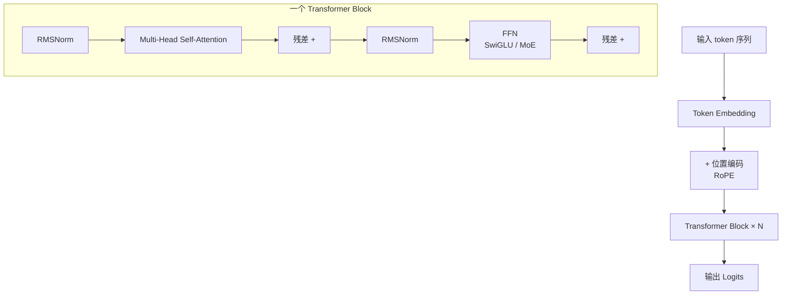
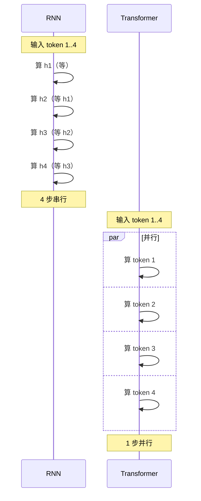
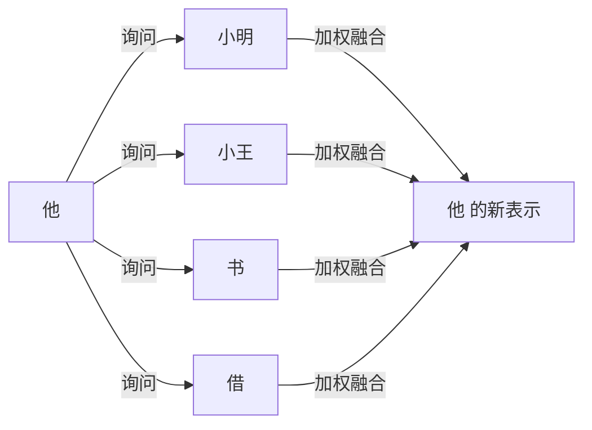
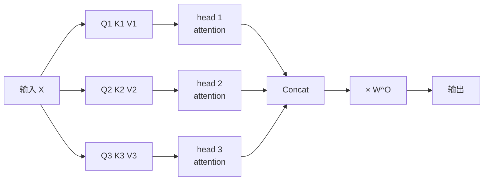
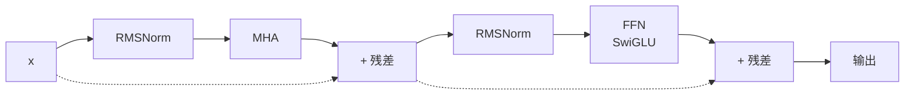
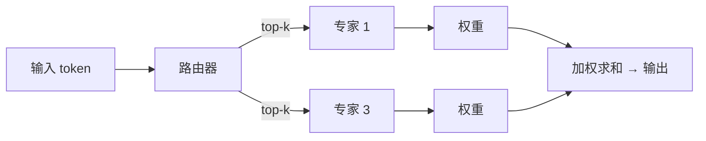

# Ch3 Transformer 与注意力

> 一句话简介：从 RNN 的痛点讲起，到 self-attention 的直觉，再到 Transformer block 的标准结构，为理解现代 LLM 打地基。

## 本章目标

读完本章你应当能：
- 用"工程师痛点"解释为什么 Transformer 取代了 RNN
- 用一句话说出 self-attention 在做什么
- 解释 Q/K/V 三个角色，并理解 scaled dot-product attention 公式每一项的含义
- 说出多头注意力为什么有效
- 解释位置编码的必要性，说出现代 LLM 默认用 RoPE 的原因
- 画出一个标准 Transformer block（Pre-Norm + Attention + FFN + 残差）
- 区分 Decoder-only / Encoder-only / Encoder-Decoder 三种架构
- 描述 KV cache 的作用与代价
- 用"分诊台 + 专家"类比解释 MoE 的稀疏激活思想

## 本章导览



## 3.1 为什么需要新架构

Transformer（2017）之前，主流方法是 **RNN**（循环神经网络）及其升级版 LSTM / GRU。核心思想：**第 $t$ 步隐藏状态 $h_t$ 依赖 $h_{t-1}$，像流水线一节传一节**。

这个设计在工程上撞了三堵墙：**训练慢**（GPU 几千核只用 1 个）、**长文丢信息**（信息沿链传 999 次被"稀释"）、**扩不动**（隐藏状态维度固定）。

2017 年 Google 用一个改动同时解决：**抛弃递归，让序列里任意两个位置直接"对话"**。这种机制叫 **self-attention（自注意力）**。今天所有主流 LLM——GPT、LLaMA、Qwen、DeepSeek、Claude——共同的基石就是由此诞生的 **Transformer** 架构。



左边 RNN 像只有 1 个窗口的快递站，前一个没办完后面的都得排队；右边 Transformer 像开了 8 个窗口，所有包裹同时办。**加速的秘密就是去掉"顺序依赖"**——但代价是用 3.5 节的"位置编码"把顺序补回来。

## 3.2 Self-attention 的直觉

Self-attention 的核心想法一句话：**序列里每个位置都要"看一看"其它所有位置，根据相关性重新组合自己的表示。**

读这句话："小明借了小王的书，**他**说下周还。" 人脑会下意识回上文找"小明"或"小王"判断指代。Self-attention 让模型做同样的事——"他"去"询问"句子里所有 token，每个给出一个相关性分数（**注意力权重**），最后"他"的新表示是所有位置的加权平均。



这种机制有两个非常优雅的性质：**任意两个位置一次"询问"就能交换信息**（不像 RNN 要沿链传），**注意力权重可视化常常能直接看出句法结构**（主谓、指代关系自动浮现）。

## 3.3 Q/K/V 与 attention 公式

Self-attention 在工程上借鉴了**信息检索**的思路：用"查询词"去和所有"索引标签"比对相关性，按相关性从对应的"内容"里取信息。这三个角色就是 **Query（查询）、Key（键）、Value（值）**。

**图书馆类比。** 想象你走进图书馆找关于"小王"的指代信息：
- **Q** 是你的检索词："我在找关于'他'的指代"
- **K** 是每本书脊背上的索引标签
- **V** 是每本书的实际内容

你把自己的 Q 和所有书的 K 逐一比对，相关性高的书就多取一点内容。这就是 attention 在做的事。

**一个能拿计算器按出来的小例子。** 回到「小明借了小王的书，**他**说下周还」这句话，为演示只取其中 4 个 token：「他」「借」「小王」「书」。为了能手算，把每个 token 简化成**只有 2 个数字的向量**（真实模型是几百维，逻辑完全一样，只是数字多）。Q、K、V 三个角色本来都是由输入 $X$ 乘上三张不同的权重表 $W^Q, W^K, W^V$ 算出来的（这三张表是训练学出来的），这里为了看得清，直接把算好的向量给出来。

**第一步：打分。** 用「他」的查询向量和每个位置的键向量做**点积**。

> **点积是什么？** 两个向量按位置两两相乘，再把乘积全部加起来。$(1,0)$ 和 $(0.5,0)$ 的点积就是 $1\times0.5 + 0\times0 = 0.5$。名字听着吓人，其实就是"这两组数字有多像"的一个总分。

「他」的查询向量是 $(1, 0)$，四个位置的键向量是：

| 位置 | 键向量 K | 和 $(1,0)$ 的点积 |
|---|---|---|
| 他 | $(1, 0)$ | $1\times1 + 0\times0 = 1.0$ |
| 借 | $(0, 1)$ | $1\times0 + 0\times1 = 0.0$ |
| 小王 | $(0.5, 0)$ | $1\times0.5 + 0\times0 = 0.5$ |
| 书 | $(0.2, 0)$ | $1\times0.2 + 0\times0 = 0.2$ |

打完分得到 `[1.0, 0.0, 0.5, 0.2]`。

**第二步：softmax 转成百分比。** softmax 的规则只有两步：**每个数先算 $e^x$（$e \approx 2.718$，指数每大 1，结果就乘以 2.718），再各自除以总和。**

$$e^{1.0}=2.72,\quad e^{0.0}=1.00,\quad e^{0.5}=1.65,\quad e^{0.2}=1.22 \qquad (\text{总和} = 6.59)$$

$$[0.41,\ 0.15,\ 0.25,\ 0.19]$$

**第三步：读结果。** 这四个数加起来正好是 1，可以当成**注意力分配的比例**来读：「他」把 41% 的注意力分给了自己、25% 分给了「小王」，最少的是「借」。人读"他"的时候也是先回头找上文的主语，模型算出来的比例同样把「小王」排到了前面——**这个机制不靠规则，是从数据里自己学出来的**。

（「他」分给自己的那一格最高是正常现象：任何位置都会天然留一部分注意力在自己身上，这一点到 Ch4 讲"注意力汇"时还会再遇到。）

每个 token 都要这么算一遍，四个 token 排成矩阵就是 **attention matrix**（行 = 查询者，列 = 被查询者）。下面只把第一行真算了出来，其余三行同理、这里只示意形状：

```text
         他     借     小王    书
   他  [0.41,  0.15,  0.25,  0.19]   ← 真算出来的，就是上面那一步
   借  [ ...   ...    ...    ...  ]   ┐
  小王 [ ...   ...    ...    ...  ]   ├ 同样步骤，此处省略
   书  [ ...   ...    ...    ...  ]   ┘
```

**每行都加起来等于 1**——softmax 保证了这一点，也是 attention 能当"软检索"用（按比例混合，而不是只挑一个）的前提。

现在把上面三步写成公式——这就是 Transformer 的"心脏"：

$$\text{Attention}(Q, K, V) = \text{softmax}\!\left(\frac{Q K^\top}{\sqrt{d_k}}\right) V$$

公式右边四个符号，正好对应刚才手算的三步加一个缩放。逐项拆解（**$L$ 是当前序列的 token 数量，$d_k$ 是每个 token 向量的维数**）：

- **$Q K^\top$**（对应第一步打分）：把 $L$ 个查询和 $L$ 个键两两做点积，得到一张 $(L, L)$ 的表——也就是 $L$ 行 $L$ 列。第 $i$ 行第 $j$ 格就是"位置 $i$ 对位置 $j$ 有多相关"。上标 $\top$ 表示把矩阵转置（行列互换），这是矩阵乘法里一种固定的摆放约定。
- **除以 $\sqrt{d_k}$**（缩放）：维度大时点积结果会变得很大，全挤在一两个位置上，softmax 就变成"非 0 即 1"，训练时线索丢光。$\sqrt{d_k}$ 是维数的平方根，除完把数值拉回"正常大小"。**实测经验值，不用推导。**
- **softmax**（第二步）：把打分转成概率，每行加起来等于 1。
- **乘以 $V$**（第三步）：用这行概率对所有位置的 value 加权求和——位置 1 拿到的是"全句内容按比例混合"的结果。每个位置最后都融合了全局信息。

> $V$ 在上面的小例子里没出现，因为注意力权重已经算完了；**乘 $V$ 那一步就是拿 `[0.41, 0.15, 0.25, 0.19]` 去给四个位置的内容加权平均**，得到「他」的新表示。

配套的最小 PyTorch 实现在 `code/part-1/attention.py`（3.9 节进一步解读）。

## 3.4 多头注意力

单头 attention 只能从一个"视角"看序列——就像只用一盏灯照房间。**多头注意力（MHA）** 同时开多盏"灯"，每盏灯专注一种关系（主谓、动宾、局部语法...）。



工程上的做法：把 Q/K/V **竖着切成 $h$ 份**（每份的维度是原来的 $1/h$，公式里写作 $d/h$），每一份独立走一遍 3.3 的 attention 流程，然后**横着拼回一条长向量**，最后乘一张叫 $W^O$（输出投影）的表映射回原来的维度——这样后面的 FFN 就不用改任何东西。

$$\text{MultiHead}(Q, K, V) = \text{Concat}(\text{head}_1, \dots, \text{head}_h)\, W^O$$

（**Concat** 就是"拼接"，把 $h$ 条短向量首尾接成一条长的；这个式子读作"**每一份各算各的，拼起来过一道 $W^O$**"。）

**一个必须记住的数字：多头几乎不增加参数量。** 原来一个 $d \times d$ 的大矩阵，切成 $h$ 个 $d/h \times d$ 的小矩阵，参数总量还是 $d^2$——**没多一个**。多头不是"多加几个头占更多内存"，而是**把同样多的预算重新分配给了 $h$ 个不同的视角**。LLM 通常有 16~128 个 head。

## 3.5 位置编码

Self-attention 有一个隐藏的、但极其致命的弱点：**它对序列顺序完全不敏感**。把"猫吃鱼"和"鱼吃猫"分别喂给 attention 层，输出会完全一样——因为 attention 只按"两两相关程度"加权，压根不看谁在前谁在后。可"猫吃鱼"和"鱼吃猫"是两件完全不同的事，语言明明是有顺序的。

**信封类比。** 3.3 里我们把每个 token 写成了一串数字，这串数字在正式术语里叫 **token embedding（词嵌入）**——它是每个 token 的"身份证号码"，模型内部从头到尾认的都是这串数字，而不是"他""猫"这些字。**位置编码（Positional Encoding）** 则是信封外面的**邮政编码**：光有信件内容，没有邮编，邮局不知道该把这封信投到序列里的哪一格。

主流方案：**RoPE（Rotary Position Embedding，旋转式位置编码）**。现代 LLM 几乎都用它（LLaMA / Qwen / DeepSeek / Mistral）。

**它做了什么？** 一句话：**按位置把 query 和 key 向量转一个角度，转的角度跟位置成正比。**

这个"转角度"听起来很玄，但效果很直白：位置 $m$ 的向量先转 $m \times \theta$、位置 $n$ 的先转 $n \times \theta$，两个都转完再算点积，**结果里就自动带上了两个角度之差 $(m-n) \times \theta$**——也就是说，它不告诉你"我在第几格"，直接告诉你"我离你几格"。这叫编码**相对位置**，也正是语言真正需要的：重要的是"离多远"，不是"绝对在哪"。

其他两种一句话点名：

- **Sinusoidal**：原始 Transformer 方案，用不同频率的 sin/cos 生成位置向量。已被淘汰。
- **ALiBi**：保持 attention 不变，在打分上加一个与距离成正比的负偏置。MPT、BLOOM 采用。

| 方案 | 编码对象 | 是否需参数 | 代表模型 | 现状 |
|---|---|---|---|---|
| Sinusoidal | 绝对位置 | 否 | 原始 Transformer | 已淘汰 |
| **RoPE** | **相对位置** | **否** | **LLaMA / Qwen / DeepSeek** | **当前主流** |
| ALiBi | 距离偏置 | 否 | MPT / BLOOM | 长上下文场景 |

**记法：RoPE 主流，ALiBi 长上下文，Sinusoidal 已淘汰。**

## 3.6 Transformer block

Transformer block 由两大部分组成：**多头自注意力（MHA）** 和**前馈网络（FFN）**，各包一层归一化和一条残差连接。

**先说这两块积木各自在干什么。**

- **MHA（注意力）**：**看别的 token**。它去翻整个句子里其它位置，按相关程度把信息抄回来（3.3、3.4 节）。
- **FFN（前馈网络）**：**自己琢磨**。它不看别的 token，只把当前这一个 token 的向量过一遍三层小网络，算出一个新向量。前馈网络占了模型三分之二的参数，是"知识"主要存放的地方——可以理解成"注意力负责取信息，FFN 负责消化信息"。

一块 block 就是"**先抄别人的 → 再自己消化 → 把结果加回原来那份**"，然后整块叠几十上百遍。



**那两条斜线（残差连接）是什么？** 图上那两条虚线箭头跳过中间、直接把 $x$ 送进相加的圆圈，这叫**残差连接（Residual Connection）**，Ch1 那张表里 2015 年的 ResNet 就是靠它才把网络堆到上百层。道理很朴素：**一层只负责"在原来那份上做点修改"，而不是"推倒重来算一份新的"。**

- 类比：修一篇文章是"在原稿上批注几处"，不是"整篇重写"。批注万一遍，原稿的骨架还在。
- 数学上就是一行加法：`x = x + f(x)`——**原来的内容原封不动地加进去**，这一层只需要学"该改多少"（那个 $f(x)$）。
- 好处一：**信息不会被丢光。** 没有残差的话，第 60 层收到的信号要经过 60 次变换才能看到第 1 层的信息；有了它，一路都有"抄近道"的通道。Ch1 说的"深层网络训不起来"，一大半就卡在这。
- 好处二：**每层都能学会"什么都不改"。** 万一某层没必要动手，让 $f(x)$ 输出接近 0 就行，整层就变成一条透明的通道，不浪费也不添乱。

**变形金刚积木类比。** 每一层 Transformer block 都是同一块积木，叠得越高能力越强——LLaMA-3-70B 叠了 80 块。

**Pre-Norm 还是 Post-Norm？** 归一化（LayerNorm / RMSNorm，Ch2 §2.7 讲过）该放在注意力和 FFN 的**前面**还是**后面**？现代 LLM 几乎都用 **Pre-Norm**。类比：Pre-Norm 像"出门前先体检"，Post-Norm 像"回家后再体检"——**出门前先体检，才能保证一整天身体状态平稳**；前者深层训练也更稳。伪代码：

```python
# ① 先体检，再去翻别的 token
attn_out = mha(rms_norm_1(x))      # ← 归一化在 attention 之前
x = x + attn_out                   # ← 残差：把注意力结果加回原文
# ② 再体检，再自己消化
ffn_out = ffn(rms_norm_2(x))       # ← 归一化在 FFN 之前
x = x + ffn_out                    # ← 残差：把消化结果加回原文
```

**FFN** 子层通常是"两层全连接中间夹一个激活函数"——**汉堡包类比**：两片肉饼（线性层）夹一片芝士（激活函数）。现代 LLM 普遍用 **SwiGLU**（3.10 节）。

## 3.7 Decoder-only vs Encoder-Decoder

Transformer 论文（2017）描述的是 **Encoder-Decoder**：Encoder "读懂"输入，Decoder "生成"输出。但 2018 年后社区发现更简单的替代——**Decoder-only**：只保留 Decoder，一次看完 prompt 再续写。今天 GPT、LLaMA、Qwen 等主流模型清一色都是 Decoder-only。

**对话模式类比**：

| 架构 | 对话模式 | 注意力掩码 | 代表模型 | 典型任务 |
|---|---|---|---|---|
| **Decoder-only** | **续写模式** | causal mask | GPT / LLaMA / Qwen | 文本生成、对话 |
| Encoder-only | 阅读理解模式 | 无 mask | BERT / RoBERTa | 分类、检索 |
| Encoder-Decoder | 翻译模式 | 编码无掩码 / 解码 causal + cross | T5 / BART | 翻译、摘要 |

**causal mask** 是三者的关键区别。用"**单向玻璃**"类比：Decoder-only 必须遮住未来——位置 $i$ 只能看到编号 $\leq i$ 的 token。用一张 4 个 token 的图看（右半三角被划掉）：

```text
        能看：1  2  3  4
  位置 1   ✓  ✗  ✗  ✗      只能看自己
  位置 2   ✓  ✓  ✗  ✗      能看 1、2
  位置 3   ✓  ✓  ✓  ✗
  位置 4   ✓  ✓  ✓  ✓      能看全部
```

工程上不是真的"藏起来"，而是在 softmax **之前**把禁止看的那几格分数改写成 $-\infty$（负无穷）——而 $e^{-\infty} = 0$，所以这些格算出来必定是 0，softmax 完它们就是 0 分，一点也分不掉。**想禁哪一格，改哪一格就行，别的逻辑不用动。** 本书后续章节默认关注 Decoder-only LLM。

## 3.8 KV cache 直观理解

LLM 推理是**自回归**的——生成第 $t$ 个 token 时，要重新过一遍前 $t-1$ 个 token 的 attention。朴素实现每步都重算所有历史 K 和 V，序列一长计算量爆炸。

**查字典类比。** 你第一次查"他"这个字，记住它在第 247 页。下次再翻到那个位置，不用从头找——这就是 KV cache。**历史 token 的 K/V 在第一次算完后缓存，下次生成新 token 时直接复用。**

```text
朴素（每步都重算）               KV cache 优化
生成 token 1: 算 K1/V1           生成 token 1: 算 K1/V1 → 缓存
生成 token 2: 重算 K1/V1 + K2/V2 生成 token 2: 算 K2/V2 → 拼接进缓存
生成 token 3: 重算 1,2,3 的 K/V   生成 token 3: 算 K3/V3 → 拼接进缓存
生成 token 4: 重算 1,2,3,4 的 K/V 生成 token 4: 算 K4/V4 → 拼接进缓存
```

**为什么差这么多？** 看每一行要算几个：朴素做法第 $t$ 步要重算前 $t$ 个，于是 1+2+3+…+$L$ 次；KV cache 每步只算 1 个，一共 $L$ 次。**当 $L=10000$ 时，前者是五千万次，后者是一万次。**

书里用 $O(L^2)$ 和 $O(L)$ 这两个记号表示这两件事。$O(\cdot)$ 是计算机科学表示"增长快慢"的简写：$O(L^2)$ 读作"平方级"（$L$ 翻一倍，量变四倍），$O(L)$ 读作"线性"（$L$ 翻一倍，量也只翻一倍）。**记住"平方"和"线性"这组对照就够用了**，符号本身不用学。

**算一笔显存账。** KV cache 省了计算，代价是占显存——每层、每个历史 token 的 K 和 V 都要一直存着。拿一个具体配置算：32 层、4 万 token 上下文、每层 8 个 KV head、每个 head 128 维。

$$32 \times 40000 \times 8 \times 128 \times 2 \;(\text{K 和 V 各一份}) \times 2 \;(\text{每个数 2 字节})$$
$$\approx 5.24 \times 10^9 \text{ 字节} \approx 5.2 \text{ GB}$$

（**fp16** 就是"每个数字占 2 字节"的存法——全精度 float32 要 4 字节，推理时用它省一半显存。）

**记住这笔账的教训：KV cache 是拿显存换速度。** 3.10 节的 **GQA** 就是专门来省这块显存的——让多个 query head 共享同一组 K/V，直接砍掉几倍。

## 3.9 一个最小 attention 示例

用最小 PyTorch 代码把 3.3 节公式跑一遍。完整代码在 `code/part-1/attention.py`，核心函数只有 5 行：

```python
def scaled_dot_product_attention(query, key, value):
    d_k = query.size(-1)
    scores = torch.matmul(query, key.transpose(-2, -1)) / (d_k ** 0.5)
    attn = F.softmax(scores, dim=-1)
    output = torch.matmul(attn, value)
    return output, attn
```

数据流：

```text
输入 Q,K,V (2, 4, 8)
   → Q·K^T → scores (2, 4, 4) ── 每行是"该位置对所有位置的相关性"
   → ÷ √8 → softmax → attn (2, 4, 4) ── 每行和为 1（不变量）
   → attn·V → output (2, 4, 8) ── 形状和输入一样，但融合全局信息
```

它精确对应公式 $\text{softmax}(Q K^\top / \sqrt{d_k}) V$，**没有省略任何一项**。配套 `main()` 用 `torch.manual_seed(0)` 固定种子，生成 `(2, 4, 8)` 随机 Q/K/V，调用 attention，并用 `assert` 验证 **softmax 行和为 1**、输出形状正确。

直接运行 `python code/part-1/attention.py`：

```text
output shape: (2, 4, 8)
attn shape:   (2, 4, 4)
OK：注意力权重行和为 1，输出形状正确
```

这个 30 行例子就是工业级 Transformer 库（PyTorch `F.scaled_dot_product_attention`、FlashAttention）的数学骨架。

## 3.10 MoE 与现代 Transformer 变体

标准 Transformer 块已近十年，这期间涌现出一系列"小改动、大收益"的变体。LLaMA-3、Qwen-3、DeepSeek-V3、Mixtral 等前沿模型都同时具备下面这些特性。

### MoE（Mixture of Experts）— 深入讲

**医院分诊类比。** 一家医院有 8 个科室的专家。病人看病，分诊台（**路由器 Router**）判断该看哪几个科室（通常 top-2 或 top-4）。普通模型相当于让病人把 8 个科室全看一遍——慢；**MoE** 只看相关几个——又快又准。



工程上把传统 FFN 拆成 $E$ 个专家网络（$E=8, 16, 64, 256$ 都常见），路由器对每个 token 算分数，决定走哪几个专家。模型总参数可以很大，但每个 token 只激活一小部分，**推理成本几乎和激活专家数成正比**。DeepSeek-V2/V3、Mixtral 8x7B、GPT-4 都用了 MoE。

### 其他三种现代变体 — 一句话点名

现代 LLM 几乎都同时采用以下三个"小改动"，设计哲学一致：**用更聪明的方法用好每一 FLOP、每一字节显存**。

| 变体 | 直观说法 | 谁在用 |
|---|---|---|
| **RMSNorm** | 比 LayerNorm 简化，去掉均值中心，只做缩放——计算稍快，效果相当 | LLaMA / Qwen |
| **SwiGLU** | 比 ReLU 更聪明的"门控"激活函数——输入自己决定要不要激活 | LLaMA / PaLM |
| **GQA** | 多头共享 KV——节省显存，质量接近 MHA | LLaMA-2/3 / Qwen |

本节只要形成"现代 LLM 标准件"的心智模型：**MoE** 让模型大而不慢、**RMSNorm** 让训练更快、**SwiGLU** 让表达更准、**GQA** 让推理更省。**RMSNorm / SwiGLU / RoPE 等各自"替换掉了什么"，见 Part 2 Ch7 §7.8 的一张点名表；GQA 为什么能省，见 Ch7 §7.6；MoE 的完整拆解在 Ch7 §7.2。**

## 本章小结

- **RNN 的局限**：训练难并行、长距离依赖被稀释；Transformer 用 self-attention 一次解决。
- **Self-attention 直觉**：每个位置"询问"序列所有位置，按相关性加权融合。
- **核心公式**：$\text{Attention}(Q, K, V) = \text{softmax}(Q K^\top / \sqrt{d_k}) V$；$\sqrt{d_k}$ 是稳定 softmax 的关键。
- **多头注意力**：把 Q/K/V 拆成多组并行算 attention，让不同 head 学不同模式，几乎不增加参数量。
- **位置编码**：必须显式注入顺序。RoPE 主流、ALiBi 长上下文、Sinusoidal 已淘汰。
- **Transformer block**：Pre-Norm + MHA + 残差 + FFN + 残差，堆叠 N 次。
- **三类架构**：Decoder-only（主流）、Encoder-only（理解）、Encoder-Decoder（翻译）。
- **KV cache**：自回归推理时缓存历史 K/V，把每步要重算的活儿从"全部历史"降到"只算新的那一个"，总计算量从平方级降为线性。代价是显存。
- **现代变体**：MoE（稀疏激活）、RMSNorm、SwiGLU（门控激活）、GQA（共享 K/V）——前沿 LLM 标配。

## 本章参考

### 必读论文

- [Attention Is All You Need (Vaswani et al., 2017)](https://arxiv.org/abs/1706.03762) — Transformer 的开山之作，提出 self-attention 和 Encoder-Decoder 架构。
- [RoFormer: Enhanced Transformer with Rotary Position Embedding (Su et al., 2021)](https://arxiv.org/abs/2104.09864) — RoPE 论文，把旋转矩阵引入位置编码，成为 LLaMA/Qwen/DeepSeek 的标配。
- [GQA: Training Generalized Multi-Query Transformer Models from Multi-Head Checkpoints (Ainslie et al., 2023)](https://arxiv.org/abs/2305.13245) — GQA 论文，给出从 MHA checkpoint 蒸馏到 GQA 的实用方法。
- [Mixtral of Experts (Jiang et al., 2024)](https://arxiv.org/abs/2401.04088) — Mixtral 8x7B 报告，展示了稀疏 MoE 在开源 LLM 中的可行路径。

### 推荐博客 / 教程

- [The Illustrated Transformer (Jay Alammar)](https://jalammar.github.io/illustrated-transformer/) — 图解 Transformer 经典之作，把 Q/K/V、注意力、Encoder/Decoder 讲得非常直观。
（中文 LLM 架构讲解可参考 Sebastian Raschka 的 "Build a Large Language Model From Scratch" 第 4 章讲解 RMSNorm / SwiGLU / GQA / RoPE 各组件的中文翻译与解读；或者阅读 LLaMA-3 / Qwen-2 技术报告原文里的 Architecture 章节。）

### 视频 / 课程

- [Andrej Karpathy "Let's build GPT"](https://www.youtube.com/watch?v=kCc8FmEb1nY) — 从零手写 GPT 的视频教程，看完对 decoder-only Transformer 的训练与采样会有具象认识。
