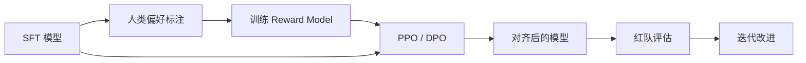
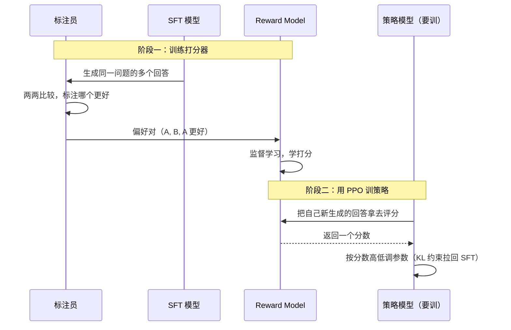
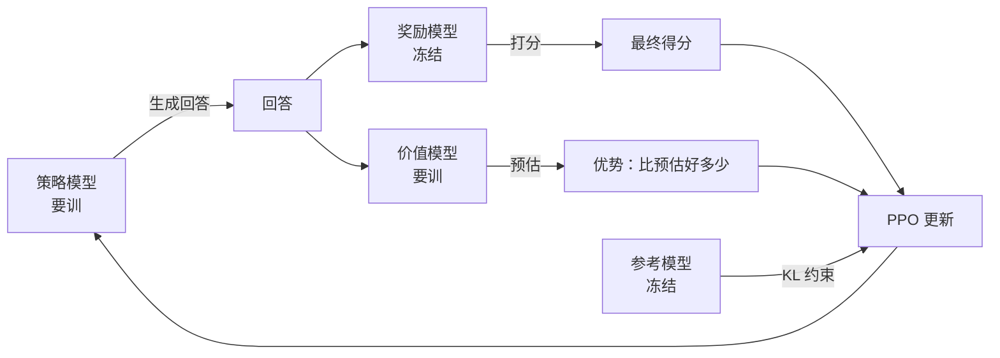
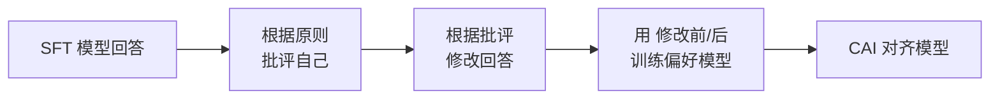
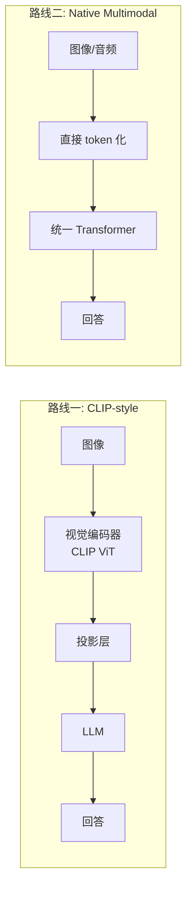

# Ch5 RLHF 与对齐

> 一句话简介：从"会续写"到"听得懂话、答得体面"，看 LLM 是怎么被"调教"成对话助手的。

## 本章目标

读完本章你应当能：
- 解释"对齐"为何必要（不是单纯提升能力）
- 口述 RLHF 三步曲（SFT → RM → PPO）
- 解释奖励模型（Reward Model）如何训练
- 说出 PPO 在 LLM 中的核心思想（策略 / 参考 / 价值 / 奖励 四模型）
- 描述 DPO 的核心思想（直接从偏好学习，无需奖励模型）
- 列出至少 2 种 RLHF 之外的对齐方法
- 解释红队是对齐一部分
- 描述推理模型（o1 / R1）与多模态 LLM 的基本思想

## 本章导览



左半边是训练（SFT → RM → PPO/DPO），右半边是部署后的循环（红队反哺训练）。下面 10 节展开。

## 5.1 为什么要对齐

经过 Ch4 的预训练和 SFT，模型已经"会接话"、大致"听得懂指令"，但还不是合格助手——会**答得出，不一定答得对**：可能答非所问、说胡话、甚至输出有害内容。

这就是 **对齐（alignment）** 要解决的问题：**让模型的行为符合人类意图**。"意图"有三层：
- **有用性（helpful）**：能真正解决用户的问题；
- **诚实性（honest）**：知道自己不知道什么，不编造；
- **无害性（harmless）**：不输出危险、违法、歧视性的内容。

三层合起来常被缩写为 **HHH**（helpful / honest / harmless），Anthropic 早期对齐研究即以此为纲（Constitutional AI 见 5.6）。

**关键认识：能力 ≠ 对齐**：

```text
            对齐高 ↑
               │
★ 能力弱但无害 │      ★ 理想助手
  （SFT 早期） │      （能力强 + 答得体面）
 ──────────────┼──────────────────→ 能力高
               │      ★ "危险天才"
               │        （能力强 + 胡说 / 越狱）
            对齐低 ↓
```

SFT 后的模型在 MMLU（一套多学科选择题测验，满分 100）上能打 80 分，但遇到"教我怎样制造炸弹"的诱导，照样可能"乐于助人"地给出步骤。**能力是"会不会"，对齐是"该不该"。**

## 5.2 RLHF 三步

**先把强化学习的设定补齐。** Ch1 §1.3 只用一句话带过，这里铺开——因为后面所有内容都建立在它上面。

强化学习和监督学习的区别在**"答案从哪来"**：

| | 监督学习（SFT，Ch4 §4.6） | 强化学习（RL） |
|---|---|---|
| 老师给什么 | 一道题 + **标准答案** | 一道题 + **一个分数** |
| 怎么学 | 照着答案背 | 分数高的做法多试，低的少试 |
| 能解决的问题 | 有唯一正确答案的事 | 没有标准答案、只能权衡好坏的事 |

**"写作文"就没有标准答案。** 你不能告诉模型"这篇作文 92 分，那篇 75 分"——判卷标准本身很难写成一条规则。这正是 RL 的用武之地：**你只要能打分，就能用 RL 训练。**

RL 的四个词，只要记住这一句话就够了：**Agent 在某个状态下做一个动作，环境给一个奖励，反复试错，把奖励越拿越高的策略学出来。**

- **状态（state）**：现在的处境是什么
- **动作（action）**：这一步做什么
- **奖励（reward）**：环境给的一个数字（可以是正的也可以是负的）
- **策略（policy）**：从"什么状态"该"做什么动作"的对应关系——**这个策略就是模型本身**

**RLHF（Reinforcement Learning from Human Feedback，人类反馈强化学习）** 自 2022 年 InstructGPT / ChatGPT 后被广泛采纳。核心思想一句话：**人写不出"什么是好回答"的规则，但人分得清两个回答谁更好——那就让"人分"这件事变成机器能用的分数。**

**第一步：SFT（Supervised Fine-Tuning）**——用 `(指令, 回答)` 对继续训练 base 模型（见 Ch4）。这步跟 Ch4 一样，它的作用是给模型一个"起点"，别让 RL 从零开始。

**第二步：奖励模型（RM）训练**——让标注员对同一问题的多个回答两两比较（"这个比那个好"），用这些比较去训练一个**打分器**，输入一段回答、输出一个分数。

**第三步：PPO 强化学习**——把 SFT 模型当作**策略**（就是上面说的"模型本身"），用 RM 的分数当**奖励**，让模型通过反复生成回答、按分数高低调整参数，慢慢学会怎么拿高分。同时用 KL 惩罚把它拉回 SFT 附近，避免刷分胡说（5.4 节展开）。

### 教小孩的类比

SFT = 看教科书；RM = 训练一个"考官"；PPO = 在模拟环境里按"考官"评分反复练习。

### 时序图



**RLHF 的精髓**：把"人难以说清楚的判断"（什么算好回答）变成"机器能直接优化的数字"（打分器的分数）。

## 5.3 奖励模型

奖励模型是 RLHF 的"灵魂"。RM 的架构通常**和 SFT 模型一致**，但**最后一层换成回归头**——最后的隐藏状态过一个线性层，输出标量分数。

### 一个具体例子

```text
指令:  "巴黎是法国首都吗？"
回答 A: "是的。"
回答 B: "不是。巴黎是英国首都。"
偏好:   A 远好于 B  (A 正确，B 错误)
```

RM 学会后会给 A 打高分、B 打低分。它**不需要知道"为什么 A 好"，只要把好回答打得比坏回答更高**。InstructGPT 用约 3.3 万条偏好对，就是 RM 训练的全部数据。

### Bradley-Terry 公式

上面那个例子要变成能算的目标函数。用 **Bradley-Terry 模型**——一个专门用来学"谁更好"的经典统计模型。它说的是：**分数差得越多，"A 比 B 好"的概率就越接近 100%。**

$$P(A \succ B) = \sigma(r_\theta(A) - r_\theta(B))$$

三个符号：**$r_\theta(A)$ 是打分器给 A 的分**，$r_\theta(B)$ 是给 B 的分，$\succ$ 读作"胜过"。**$\sigma$ 是 sigmoid 函数**——一条 S 形曲线，把任意实数压到 0~1 之间，正好当概率用（Ch1 §1.4 表格里提到过的老式激活函数就是它）。

代进那个巴黎的例子看：假设打分器给 A 打 3.0 分、给 B 打 -1.0 分，两者差 4.0，sigmoid(4.0) ≈ 0.982——**训练就朝"让这个差更大"的方向推**。差越大概率越接近 1，训练目标因此变成了"**让好回答减坏回答的分数差尽可能大**"。

### 工程上的两个常见坑

- **位置偏差**：标注员倾向选"上面的"——收集时要随机化 A/B 摆放顺序；
- **长度偏差**：标注员倾向选"更长的"——**打分器也会把"长"当成"好"学进去**，于是模型学会用"写长一点"来骗分。这也是下面 5.4 节 reward hacking 的一种温和版本。

## 5.4 PPO 在 LLM 中的应用

**PPO** 是 OpenAI 2017 年提出的一个强化学习算法，RLHF 把它借来更新 LLM。它的全名 Proximal Policy Optimization 直译是"**保守的**策略优化"——"Proximal（近的）"说的是它的核心脾气：**每次只在参数上小步挪，不让模型一步跨太远。** 这一点在 LLM 上极其重要——参数一步跨太大，模型就垮了；PPO 用一个参数把步长卡死。原理不用推导，记住这句"**小步、别跨太远**"即可。

### 学生考试的类比

PPO 在 LLM 上要同时动用四个模型。用**学生考试**来对应：

| 模型 | 考试里对应谁 | 训不训 |
|---|---|---|
| **策略模型（Policy）** | 上场考试的学生 | **要训**（就是他） |
| **奖励模型（Reward）** | 阅卷老师 | 冻结 |
| **价值模型（Value / Critic）** | 学生自己的**预估分**——"我这次大概能考几分" | **要训** |
| **参考模型（Reference）** | 手里那份"标准答案" | 冻结 |

**价值模型为什么需要？** 因为阅卷老师要等全部答完才给分，**反馈太慢了**。价值模型的活儿是"读到一半就估个分"，让模型能提前知道自己走得好不好，随时调整。**它是"自己估的分"，不是别人给的分**——这个区别是它能被训练的原因（老师的分不能改，自己的预估可以不断校准）。

### 四个模型怎么配合



**「优势」是这里唯一需要多想一秒的概念。** 把价值模型的预估分和奖励模型的真实分**相减**：比预估好 → 正数 → 这条生成思路该多试；比预估差 → 负数 → 该少试。**这个差值就是 PPO 真正用来调参数的方向。**

### 为什么必须有那个"参考模型"

先说清出事的场景。学生（策略模型）会发现一条捷径：**阅卷老师（打分器）只打分，它读不出内容是不是胡说八道。** 那就输出能拿高分但完全没意义的东西——重复一堆无关的敬语、堆一大段正确的废话、甚至输出一串怪字符骗过打分器。

**这就是 reward hacking（奖励黑客）**：考题是"怎么让分数高"，模型答的是这个；可我们真正想要的是"怎么让回答好"。**RL 里的头号敌人。**

**解决办法就是那根安全绳。** 训练时拿一个**冻结的参考模型**（就是 SFT 那个）同时在场，每一步都算一个"你俩现在差多远"的惩罚，加进奖励里。差得越远，扣得越狠。

**这个"差多远"用什么量？** 用 **KL 散度**——衡量两个概率分布差异的标准尺子。**你不需要会算它，只需要记住它的性质**：

> **两个分布一模一样 → KL = 0（不扣分）；差得越离谱 → KL 越大（扣得越狠）。**
> 它只罚"走偏"，不罚"变好"。所以模型可以朝更好的方向走，但走得太远就会被拉住。

（Ch1 §1.2 末尾提过一次"Ch5 RLHF 里的 KL 散度"——就是这里。）

### 现实痛点

PPO 是**显存怪兽**——四个模型（策略、参考、奖励、价值）同时在显存里，一个都不能少。训练 70B 模型要 80~160 张 H100。开源社区因此发展出**省显存变体**——LoRA-PPO、ReMax、GRPO（5.8 节展开 GRPO，它干脆把四个砍到两个）。

## 5.5 DPO

**DPO（Direct Preference Optimization，直接偏好优化，Rafailov et al., 2023）** 是个更省的替代方案：**完全跳过奖励模型**，直接从偏好对学习。

### 先说 PPO 到底有多麻烦

回到 5.4：PPO 要四个模型、两个训练阶段（先训阅卷老师，再训学生），每生成一条回答都得先送进阅卷老师打分。工程上这意味着**你要同时养四份模型，而且训练是"在线"的**——生成一条、评一条、再生成下一条，慢且吃显存。

**DPO 的想法很直接：阅卷老师这个角色，能不能干脆不要？**

### 直觉：只做考卷对照，不请老师

传统 RLHF 像学生做完题还得排队等老师批改。DPO 换了个玩法：**直接把两份答卷摆在一起对照**——"这份老师说好，那份老师说差"——然后让模型自己去琢磨好那份为什么好，照着调参数。

关键在于：**考卷（偏好对）本身就是老师给出的全部信息了。** 老师只会说"A 比 B 好"，那我们需要知道的也就这么多——**再训一个模型去模仿老师怎么打分，等于把老师已经会的东西重学一遍，纯属浪费。**

### 它的巧妙之处

RLHF 的最优策略有一个**闭式解**——就是个现成的公式，数学上能直接写出来：

$$\pi^*(y \mid x) \;\propto\; \pi_{\text{ref}}(y \mid x) \cdot \exp\!\big(r(x,y) / \beta\big)$$

读法是：**"最好的回答" = 参考模型原本会怎么答，再按打分器的分数加权。**（$\propto$ 读作"正比于"——只关心比例，不关心绝对值。$\pi$ 读作"派"，是策略的常用符号。）

**关键的一步**：想办法把式子里的**打分 $r$ 消掉**——消掉之后，就**再也不需要打分器了**。DPO 论文做的正是这件事，剩下的结果是一个只用到"偏好对"和"两个模型"的损失函数。

**记法：DPO 和 RLHF 数学上等价，但工程上简单得多。**「等价」说的是"能训出同样好的模型"，不是"步骤一样"。

### DPO 的损失函数

$$\mathcal{L}_{\text{DPO}} = -\log\sigma\!\left(\beta \log \frac{\pi_\theta(y_w)}{\pi_{\text{ref}}(y_w)} - \beta \log \frac{\pi_\theta(y_l)}{\pi_{\text{ref}}(y_l)}\right)$$

**式子长，但它只在问一个问题：模型对"好回答"的偏爱，比对"坏回答"的偏爱，大了多少？** 拆开看：

| 符号 | 是什么 |
|---|---|
| $y_w$ | 好的那个回答（$w$ = winner，赢家） |
| $y_l$ | 坏的那个回答（$l$ = loser，输家） |
| $\pi_\theta$ | **正在训练的**模型——我们想让它偏向好回答 |
| $\pi_{\text{ref}}$ | **冻结的参考模型**（就是 SFT 那个），当基准线 |
| $\log \dfrac{\pi_\theta(y_w)}{\pi_{\text{ref}}(y_w)}$ | **训练模型比参考模型更偏爱好回答多少** |
| $\beta$ | 一个旋钮，控制"偏得狠一点还是温和一点" |

外层就是 5.3 那个 sigmoid：括号里那个差值越大越好，训大了就说明模型确实更偏爱好回答了。

> **代进 5.3 的巴黎例子看一遍。** 刚做完 SFT 时，模型对"不是。巴黎是英国首都。"（$y_l$）的打分常常还比"是的。"（$y_w$）高——后者太短、信息量少。这时 DPO 算出的差值是**负数**，说明模型偏爱反了；训练就加大力度，直到**模型对"是的"的偏爱超过对"不是"的偏爱**为止。全程没有阅卷老师参与。

### 工程上省了什么

| | RLHF（PPO） | DPO |
|---|---|---|
| 要额外训练的打分器 | 要，先训一整轮 | **不要** |
| 同时在训的模型 | 策略 + 价值模型（2 个） | **只有策略（1 个）** |
| 训练阶段 | 两阶段（先 RM 后 PPO） | **一阶段** |
| 训练方式 | 在线（生成一条、评一条） | **离线**（拿现成的偏好对反复训） |
| 显存 | 高 | **约一半** |

**代价**：DPO 对旋钮 $\beta$ 敏感，分布外的情况泛化不稳——所以 5.6 节那些方法里，不少就是在 DPO 上继续改的。

**2024 年以后大多数开源 LLM 首选 DPO**，理由就是上面这张表。

## 5.6 其他对齐方法

RLHF / DPO 不是唯一答案。下面**只深讲一个**，其余六个一句话定位。

### Constitutional AI：宪法法庭

**类比**：CAI 像"宪法法庭"。模型拿一本"宪法小册子"（一组原则）**自己评判、自行修改回答**；人类只负责写宪法。

**流程四步：**



**优点**：大幅减少人类标注；原则可解释、可审计。Anthropic 在 [Claude 新宪法（2026.01 发布）](https://www.anthropic.com/news/claude-new-constitution/) 中也纳入了对智能体行动场景的约束条款——CAI 正从"对话对齐"扩展到"行动对齐"。

### 其他六种

| 方法 | 一句话定位 | 代表 |
|---|---|---|
| **RLAIF** | 用 AI 反馈代替人类反馈训 RM | Google |
| **Self-Rewarding** | 模型给自己打分继续训 DPO | Meta |
| **PRM** | 给推理的每一步打分 | OpenAI |
| **ORPO** | DPO 变体，结合 SFT，省掉参考模型 | 学术界 |
| **SimPO** | DPO 简化版，对长样本无偏好 | 学术界 |
| **KTO** | 不需要成对偏好，单条好坏即可 | 学术界 |

**简单记法：** **RLHF/DPO 基础款**，CAI / RLAIF **规模化方案**，PRM **过程监督**（5.8 节会再讲），ORPO / SimPO / KTO **工程改进**。

## 5.7 安全与红队

对齐的另一面是**安全**——不仅要"答得好"，还要"不答坏"，这部分主要由**红队（red teaming）**承担。

**类比**：红队像专找漏洞的"白帽黑客"。

**常见攻击类别**（五类）：**越狱**、**提示注入**、**隐私提取**、**偏见触发**、**幻觉诱导**。

**工作流程**：攻击 prompt 库 → 扫模型 → 分析失败 → 补强 → 迭代。**自动化红队**用"攻击者 LLM"自动生成对抗 prompt，比纯人工高效数个量级。

为什么红队算对齐的一部分？**红队找到的失败案例会反哺回训练数据**——这是**对齐数据飞轮**的关键一环。

最后，**过度对齐会损害有用性**（safety-helpfulness tradeoff），只能按部署场景调节。

## 5.8 推理模型与思维链

2024 年下半年起，LLM 出现了"**推理模型**"新赛道——[OpenAI o1](https://openai.com/index/learning-to-reason-with-llms/)（2024.09）、DeepSeek-R1（2025.01）、Claude 3.7 Sonnet Extended Thinking（2025.02）等。核心思想：

> **"思考更久，答得更好"** ——用更多推理时算力，换取更高回答质量。

**直觉**：传统 LLM 像**抢答选手**——立刻回答；推理模型像**草稿选手**——先"长考"再给答案。

**思维链（CoT）** 是基础：给几个"思考 → 答案"示例，模型就能生成中间步骤。推理模型把 CoT 从"prompt 技巧"升级成"训练范式"——**让模型在训练时就学会"先想后答"**：


### GRPO：PPO 的简化版

**DeepSeek-R1** 的核心算法叫 **GRPO**——PPO 的"简化版"：不训价值模型；对同一 prompt 采样一组回答；用组内**相对分数**作优势估计。四模型砍到两模型，显存减半。

### PRM：给每步打分

**Process Reward Model（PRM）**——传统 RM 只给最终答案打分，PRM 给每一步推理打分。

### 推理时计算 vs 训练时计算

| 维度 | 传统 LLM | 推理模型 |
|---|---|---|
| 推理 token 数 | 几十~几百 | 几千~几万 |
| 回答耗时 | 1~3 秒 | 10~60 秒 |
| 适用场景 | 闲聊、简单问答 | 数学、代码、复杂规划 |
| 训练范式 | SFT + RLHF/DPO | SFT + GRPO + PRM |

[OpenAI o1](https://openai.com/index/learning-to-reason-with-llms/) 在 AIME 数学上拿到约 **74%**（GPT-4o 约 **12%**），但**推理更慢、也更贵**。**LLM 范式转折**：从"堆训练算力"到"堆推理算力"。

**简单记法：** CoT 让模型"先想后答"，GRPO 让它可训练，PRM 让它更精准。

### 三种主流 RL 算法对比

| 算法 | RM | 价值模型 | 显存（相对） | 适用 |
|---|---|---|---|---|
| **PPO** | 需要 | 需要 | 1.0× | 通用对齐 |
| **DPO** | 不要 | 不要 | 0.5× | 通用对齐（偏好对） |
| **GRPO** | 不要 | 不要 | 0.5× | 推理（数学 / 代码） |

## 5.9 多模态与延伸

前四章讲的都是文本 LLM，但现实信息远不止文字：图、视频、表格、音频……**多模态 LLM（Multimodal LLM, MLLM）** 把这些模态统一处理。

**类比**：多模态像"翻译不同语言"——文本是普通话、图像是粤语、音频是英语，Transformer 是把它们都译成"通用语"（token）的超级翻译官。

核心思想：**把图像 / 音频 / 视频都变成"token"**。文本是离散 token；图像可以是 patch token（ViT 切出的 14×14 patch 各压成一个向量）、音频是帧 token、视频是时空 patch token。

### 两条主流技术路线



**路线一：CLIP-style（LLaVA 路线）**——单独训视觉编码器 + 语言模型，用投影层把视觉特征映射到 LLM。优：模块化、训练便宜。代表：LLaVA、Qwen-VL、InternVL。

**路线二：Native Multimodal（GPT-4V / Gemini 路线）**——从一开始就混训多模态 token。优：端到端；劣：训练贵。代表：GPT-4V、Gemini、Claude。

**特殊挑战**：跨模态语义对齐、细粒度理解、长视频、多模态幻觉。**简单记法：** CLIP-style 模块化拼接，Native 端到端融合。

## 本章小结

Part 1 的旅程告一段落，回顾走过的路：

- **Ch1**：AI / ML / DL 概览；
- **Ch2**：神经网络基础——MLP、反向传播、激活函数；
- **Ch3**：Transformer 与注意力——self-attention、因果 mask、位置编码；
- **Ch4**：预训练与微调——数据流水线、Tokenizer、Scaling Law、SFT、LoRA；
- **Ch5**：对齐——RLHF、RM、PPO、DPO、其他方法、红队、推理模型、多模态。

**一句话总结 Part 1**：**LLM 是 next-token prediction 的规模化产物——"有用"靠预训练 + SFT；"靠谱"靠 RLHF/DPO；"安全"靠红队；"更强"靠推理时计算和更多模态**

## Part 2 衔接

Part 1 讲"**原理**"，Part 2 讲"**家族演进**"——主流 LLM 各自走了什么变体、什么设计选择。Part 2 会带你走 GPT / LLaMA / DeepSeek / Qwen / Claude / Gemini 等系列，展开 Ch3 的 3.10 节提到的 MoE / RMSNorm / SwiGLU / GQA 等现代组件，以及 5.6 节提到的各种对齐方法的演进。准备好了吗？我们出发。

## 本章参考

### 必读论文

- [InstructGPT: Training Language Models to Follow Instructions with Human Feedback (Ouyang et al., 2022)](https://arxiv.org/abs/2203.02155) — RLHF 三步曲的开山之作，奠定 ChatGPT 时代的对齐范式。
- [Direct Preference Optimization: Your Language Model is Secretly a Reward Model (Rafailov et al., 2023)](https://arxiv.org/abs/2305.18290) — DPO，用一个优雅的闭式解绕过奖励模型，工程上比 PPO 简单一个数量级。
- [DeepSeek-R1: Incentivizing Reasoning Capability in LLMs via Reinforcement Learning (Guo et al., 2025)](https://arxiv.org/abs/2501.12948) — 推理模型路线的代表作，详细讲 GRPO + RL 训练推理能力的全过程。

### 推荐博客 / 教程

- [Hugging Face TRL 库文档](https://huggingface.co/docs/trl) — 工业级 RLHF/DPO/GRPO 训练工具，覆盖 SFT、RM、PPO、DPO 全流程，含可运行代码。
- [Anthropic Constitutional AI 介绍](https://www.anthropic.com/news/claudes-constitution) — 用"宪法原则"代替人类标注，让 AI 评价 AI，是大规模对齐的代表性方案。

### 视频 / 课程

- [Andrej Karpathy "Let's reproduce GPT-2 (124M)"](https://www.youtube.com/watch?v=l8pRSuU81PU) — 从零复现 GPT-2 的 4 小时长视频，覆盖预训练 + instruction tuning 的端到端流程，看完会对"训练一个 LLM"有第一性认识。
