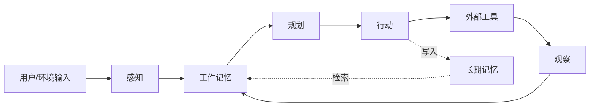
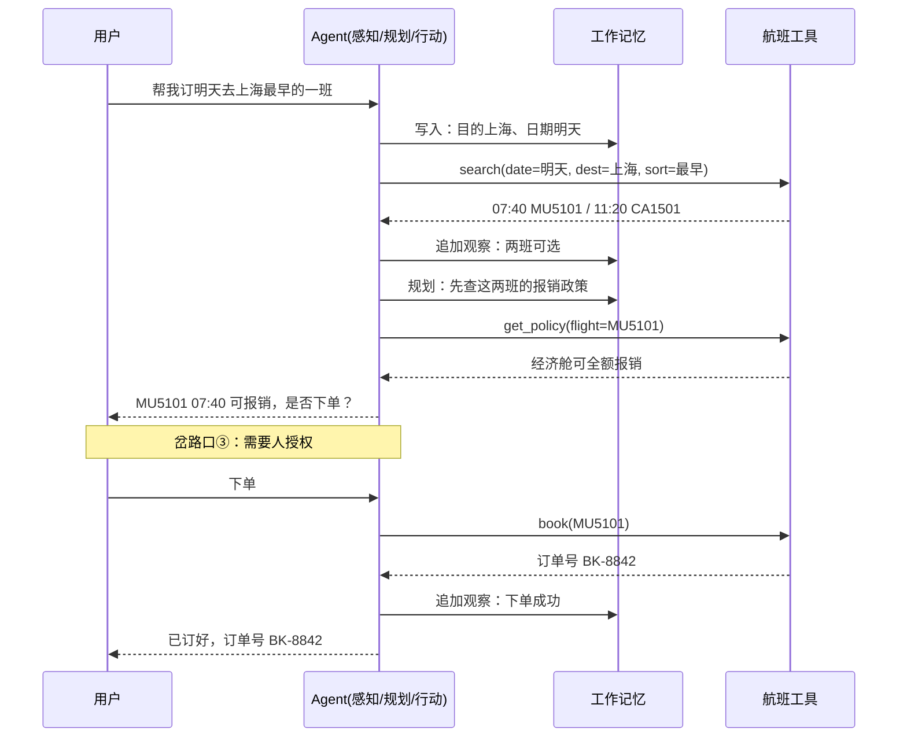

# Ch11 Agent 认知架构：四件套怎么协作

> 一句话简介：Part 2 给了积木清单，本章给装配图。

## 本章目标

读完本章你应当能：
- 说出一个 Agent 内部由哪四件套组成、各自负责什么
- 举出一个"看起来一样、其实不能重试"的行动例子，并解释为什么
- 画出四件套的一次完整协作循环，指出循环上的三个岔路口
- 判断一个任务该不该先做计划

## 本章导览



先说本章是干什么的。Part 2 Ch10 给了你一张"身体积木清单"——上下文、记忆、工具、规划、执行，五块；本章**不重列**那份清单，只在需要时用一句"这块积木在这儿"带过（见 Part 2 Ch10）。本章要做的是把它们**装起来**：数据从哪进来、经过哪几站、每站的产出是什么形状、卡住了往哪拐。

那么，装配起来的东西叫什么？它叫**认知架构（Cognitive Architecture）**——一句话白话说：这是一套决定"谁负责想、谁负责记、谁负责做"的分工方案。生活里的对应物是公司的岗位分工：谁盯前台、谁管档案、谁跑外勤，各有各的职责边界。具体一点看一个客服系统就明白了——听电话收单的是感知，把客户历史单据调出来的是记忆，决定"先解决哪一单"的是规划，拿着改单权限去改数据库的是行动。四件套，就是这个客服系统里的四个岗位。

先把四个岗位摆成一张表，方便你随时回查：

| 岗位 | 一句话职责 | 常见实现（本书范围） | 细节去哪 |
|---|---|---|---|
| 感知 | 把异构输入归一成一种格式 | 宿主程序读文件、调接口、贴"面单" | 11.2 |
| 工作记忆 | 让前两者有地方落脚 | 上下文窗口里的一段固定结构文字 | Part 4 Ch19 |
| 规划 | 决定下一步干什么 | 模型输出结构化的工具调用描述 | Ch12 |
| 行动 | 真的改动世界 | 宿主程序执行函数调用 | Part 5 Ch23 |

术语说明一下出处：这套"把 Agent 内部拆成若干功能模块再讨论它们怎么协作"的思路，学界有一篇综述把它讲得很系统，参考区里那篇 CoALA 就是（Sumers 等，2023）。本章借用它的框架来搭骨架，但不讲论文，只讲你以后每天都会用到的四个岗位。

如果你现在赶时间，全章只读两处也够用：**11.3 的读操作 vs 写操作**（决定一个动作能不能重试），以及 **11.6 的循环图与三个岔路口**（决定循环往哪拐）。其余各节随时回来补。

## 11.1 单步解剖：一个 Agent 收到一句话后的六十秒

先看一个"不够格"的系统长什么样：输入进来，调用一次大模型，把模型的输出原样打印给用户。系统确实有模型，也有代码，但从工程上看它跟一个"复读机 + 翻译器"没有本质区别。用户说"帮我把这周的销售表整理成图表"，它能做的最好表现是什么？给你一段文字——"您可以打开 Excel，用数据透视表按日期聚合，再插入折线图……"。

这句话本身不算错，甚至挺有用。但它**没有对世界产生任何改动**：那张销售表还是那张销售表，那个图表仍然需要你自己去做。它卡住的地方很具体——它有一个会说话的脑子，却没有手。

拆开看，缺的是三样东西：它没有渠道拿到那张表的真实数据（**感知**）、没有一个地方把"表在哪、这周是哪七天"这种中间结论摊着（**工作记忆**）、也没有任何一步能真的去读文件、生成图表（**行动**——白话：把模型的意图变成对世界的真实改动；类比：前台在工单上写"加急"，字条一贴，包裹的优先级就真的变了；例子：模型说"把订单改成明天"，程序真的去改了数据库那一个字段）。少任何一样，它都只能"说"。

"感知"这个术语先落地一下。**白话**：感知就是把五花八门的输入，统一整形成"一种格式"，模型才读得懂。**类比**：快递分拣中心收进来的包裹形状各异——长条形的、方箱的、软塌塌的——但上自动分拣线之前，得先由人给它们统一贴上同一种面单，分拣机才认得。**例子**：工具返回的一串 JSON、用户发来的一张图片、系统在午夜发出的一个定时事件，三者形态天差地别，归一之后都变成"一段文字 + 几个结构化字段"。

"工作记忆"同样先落地。**白话**：这是这一次对话里、模型当前正盯着的那块小桌面。**类比**：开会时摊在面前的那张纸，谁发言谁就往纸上记，散会纸一收就没了。**例子**：一轮对话进行到中途，工作记忆上摊着的就是这么几条——"用户要去上海""出行日期还没定""预算上限 3000 元"。

把两个词都拆开了，现在可以走一遍完整流程。假设用户说："帮我把这周的销售表整理成图表。"

**第 1 拍 · 输入进来。** 一句自然语言，外加一句环境状态（当前系统时间）。这一步的产出形状很简单：**一段文字**。

**第 2 拍 · 感知归一。** 外面的程序负责找到那张表在哪里——是某个路径下的 CSV，还是某个数据库里的一张表。找到之后，把文件读出来、把表头和数据行整理成模型能读的形式。这一步的产出形状：**一段文字（数据内容）+ 几个结构化字段（文件名、列名、行数、日期范围）**。注意归一这件事是外面的程序做的，不是模型自己做的——这一点在 11.2 会展开。

**第 3 拍 · 写进工作记忆。** 把上面两拍的东西摊到那一小块桌面上，此刻桌面上有：用户原始诉求、表的数据、列名清单、当前日期。这一步的产出形状：**一段按固定结构拼装好的文字**（"本轮已知事实"清单）。为什么非要摊开而不是直接问模型？因为模型不记得上一拍发生了什么——它的"记得"完全靠桌面上摆了什么字（见 Part 2 Ch10）。

**第 4 拍 · 规划。** 桌面上摊着的信息已经足够模型判断"先干什么"。这一刻它需要产出一个决定：下一步先调用哪个工具、参数填什么。这一步的产出形状：**一段结构化的工具调用描述**——工具名是 `list_columns`，参数是 `{"file": "sales_2026w41.csv"}`。规划本身不产出文字，它产出**一份待办**。

**第 5 拍 · 行动发出。** 外面那层宿主程序读到这份描述，真的去把那个文件打开、把列名读出来。模型自己连文件都打不开——它只是在说"请你替我打开"。这一步的产出形状：**工具真实的返回值**（列名数组）。

**第 6 拍 · 观察回填。** 把列名数组转成一行行得读的文本，追加回工作记忆的桌面上。桌面内容变了，这就叫**观察（Observation）**——注意这个观察不是模型"看到"的，是程序替它看到、再抄到桌上的（ReAct 范式里这一环的名字，参见 8.7）。

**第 7 拍 · 再规划。** 回到第 4 拍，桌面更厚了，这次可以判断"下一步该按日期聚合了"。如此往复，直到模型判断"手上的事实已经够了，可以给结论"。

**第 8 拍 · 收尾。** 模型产出一段给用户看的文字；程序把它打印出来。同时，如果这一轮里学到的东西值得跨会话保留（比如"这个用户习惯用柱状图"），就额外往长期记忆里写一条。这一步的产出形状：**一段面向人的文字**（可能还附带一张已经生成的图）。

走完这八拍，回看导览图：感知 → 工作记忆 → 规划 → 行动 → 外部工具 → 观察 → 回到工作记忆，一个闭环。你现在能指出每一拍对应图上的哪个方块了。

值得停下来的是第 4 拍到第 7 拍那一圈。第 4 拍决定了"下一步调 `list_columns`"，第 6 拍把列名摊回桌面，第 7 拍的决策就是**建立在第 6 拍的基础上**的——如果列名里有"日期"和"金额"两列，第 7 拍自然转向"按日期聚合金额"；如果返回的是一堆商品编号，第 7 拍就得换思路。这一拍之所以能"转向"，全靠第 3 拍那张桌子还摊着东西。

这一点值得和 Part 2 Ch10 的三步循环对照着看：那边给的是"想 → 做 → 看"三个动作，本节给的是"每一拍的产出具体长什么形状"。形状这件事在写代码时非常具体——第 4 拍的产出必须是一段能被程序解析的结构化文本（工具名 + 参数），不能是一句"我想看看列名"混在自然语言里，否则外面的程序无从下手（工具调用的具体编码方式见 Part 5 Ch23）。**四件套之所以是"件"，而不是四个"想法"，就是因为每个件的边界由产出形状划定。**

这张图里"观察"没有单独占一个方块——它不是一个部件，它是"行动的结果被抄回桌面"这个动作。

同理，"规划"和"行动"在概念上是两件事：**规划想清楚要干什么，行动真去干。** 它们在实现上常常是同一段程序里紧挨着的两行代码；什么时候该分开、什么时候合并成一个循环里的连续动作，是 Part 5 的实现话题，这里先记住有这么一条缝就行。

最后提一个本章后面会反复用到的读法：**看一个陌生系统时，不要问"它用什么模型"，先问"它每一拍的产出是什么形状"**。形状看得见，四个岗位就分得出来；模型看不见，而四个岗位是换模型也照样存在的东西。这正是本章坚持"讲装配不讲模型"的原因。

## 11.2 感知：把杂乱的输入整形成一种格式

现在把第 2 拍那一下单独拿出来放大讲。你可能会觉得这步很平淡——把数据读出来传给模型，有什么好讲的？但真实世界里，Agent 面对的输入远不止"一个 CSV 文件"这么整齐。

铺开看看它日常要接的东西：用户发来的一段话、一张截图；某个工具返回的一整块 JSON；某个工具返回的一句人类可读的报错（比如"connection reset by peer"）；操作系统发来的一条事件（"磁盘剩余空间低于 5%"）；以及从长期记忆里检索出来的几条旧记录。这五样东西的形态完全不同——有的是文字，有的是结构化的，有的半结构半非。

**感知要做的就是：把这五样统一整形成"一种格式"，模型才读得懂。** 回到分拣中心的类比——自动分拣机只会读面单，不认包裹原来的长相。所有包裹进线之前，都得先贴成同一种面单。同理，模型只会读"文字"，你不能把一个 JSON 对象指针直接塞给它看（其实可以，但那就成了编程接口而非语言接口），你得把那个 JSON 摊平成一段人能读、模型也能读的叙述。

看一个具体例子。假设 Agent 有两个工具：`get_sales_table` 和 `query_orders`。用户让它画图表，第一步它选了 `get_sales_table`，返回是这样一段：

```json
{"columns": ["date", "region", "amount"], "rows": 168, "min_date": "2026-10-06", "max_date": "2026-10-12"}
```

第二步它选了 `query_orders`，但这个工具这次报错，返回的是一段纯文本：

```
Error: order service unreachable (retry after 30s)
```

现在看归一之后这两样长什么样——它们最终都会被摊成同一类东西：**一段解释性文字 + 几个可被引用的结构化字段**。下面把两份都归一出来并排放，你感受一下"同一种格式"是什么意思：

```text
【归一后的工具返回 · 成功】
摘要：销售表已读取，共 3 列 168 行，日期范围 2026-10-06 至 2026-10-12
字段：列名 = date, region, amount
      行数 = 168
状态：成功

【归一后的工具返回 · 失败】
摘要：订单服务暂时不可达，30 秒后可重试
字段：失败原因 = 上游连接被重置
      建议等待 = 30 秒
状态：失败（可重试）
```

并排一放就明白了：左边那份的原始形态是结构化 JSON，右边那份的原始形态是一句人话，但归一之后**两者的骨架完全一致**——都有摘要、都有字段、都有状态。模型读这两段用的是同一种理解方式，这就是分拣中心的全部意义：不是为了好看，是为了让下游那台机器只认一种输入。

注意归一的两个层次：**摘要是给模型"读"用的，字段是给模型"引用"用的**。摘要让模型理解发生了什么，字段让模型能在下一句话里精确地提到某个值——比如第 7 拍要决定"按哪一列聚合"，靠的就是"列名 = date, region, amount"这个字段，而不是靠它从摘要里重新猜一遍。**摘要是给人看的，字段是给机器用的**，两者都必要。

顺手做一张表，把归一前后的差别摆清楚：

| 输入来源 | 归一前的原始形态 | 归一后进桌面的形态 |
|---|---|---|
| 用户消息 | 一段自然语言 | 一段自然语言（基本原样） |
| 工具返回成功 | JSON 对象 | 一句概括 + 若干"字段名：值"条目 |
| 工具返回失败 | 纯文本报错串 | 一句概括 + 状态/可重试标记 + 原因 |
| 环境事件 | 一条系统通知 | 一句时间、地点、事件描述 |
| 记忆检索 | 若干条历史片段 | 若干条带来源标注的片段 |

看这张表最后一列，它们收敛到同一个形状去了。这是本节唯一要记住的事。

**归一化有三个经常出问题的坑，值得提前知道。**

第一个坑是**截断**。工具返回了 10 万行数据，归一时你不能全抄上桌面——模型读不完、也读不进窗口。这时的规矩是：头部保留、尾部保留、中间给一行"…共 100000 行，此处省略…"，并把总行数作为一个独立字段放上去。让模型知道"还有 9 万 8 千行没看"，它才知道自己不能假装看全了。

第二个坑是**别把"失败"伪装成"成功"**。上面表里"可重试标记"那一列就是干这个的：如果一段报错文本被归一成了"订单服务暂无数据"，模型就会以为真的没有订单，转而去编一个结论。归一层的职责之一就是**如实标注成功与失败**，别让下游误判。11.3 讲重试时会再用到这个标记。

第三个坑是**别把格式差异吃掉**。两个工具都返回金额，一个用 `"amount": 1200`，另一个用 `"amount": "1200"`（带引号的字符串）——归一时如果随手写成同一句话，模型后面拿去算账就会踩坑。归一是"统一格式"，不是"抹掉差异"，需要抹平的（比如单位：元 vs 分）和必须保留的（类型、精度、是否缺失），要分清楚。

这三个坑有一个共同的根因：归一是一段**跑在模型前面的普通程序代码**，不是模型的一部分。模型看不到原始格式，它只看到归一后的结果——所以归一这一步犯的错，模型完全无法自查、也没机会补救。**模型不可能看出"这句报错其实不是失败"，因为它在桌面上已经被写成一句中性的陈述了。** 这就是为什么本书把归一反复强调成一个独立环节，而不是当成"数据准备"这种不值得一提的杂活。

关于图片和多模态输入，本章只说归一这件事本身：一张截图进来，最终也得变成桌面上的一段文字或几个字段。至于"模型怎么把一张图片变成文字"，那属于多模态模型的内部机制，Part 2 Ch7 已经讲透了（参见 7.7），这里不重复。反过来说，如果你的 Agent 压根不需要看图——只需要读结构化的图表数据——那把图片通道整个砍掉，感知层会简单一大截。这也算归一化带来的一条收益：**只保留你真需要的输入形态**。

## 11.3 行动：读操作和写操作不是一回事

前两拍讲的是"往里送"，这一节讲"往外做"。而往外做这件事，是 Agent 和"会说话的模型"分水岭最明显的地方。同一个系统、同一个模型，加不加这一层，差别可能是这样的：一个出了故障的 Agent 说"我已为您提交退款申请"，其实它只是把请求描述拼进窗口发了出去——而真正动手的那一层会把工具返回的失败状态读回来，把这句话咽回去。

先补两个术语，因为它们是本节全部内容的骨架。

**副作用（side effect）**：白话——一次动作会改变外部世界，而且改变了撤不回来。类比：拧松了水龙头，水就在往外漏，你松手它不会自己回去；文件删掉了就是没了。例子：查天气没有副作用（看完还是那样），重试十次结果一样；扣款有副作用（扣一次少一百，重试两次就少两百）。

**幂等（idempotent）**：白话——同一个动作做两遍，结果和做一遍一样。类比：按电梯按钮，你手欠连按十次，电梯还是只上来一次；不像"点一次退票"，点两下就退了两张。例子："查余额"重复执行结果相同；"转账 100 元"执行两次就扣了 200。

**行动（Action）**的三件套在 11.1 已经给过了，这里直接进判断。两个词凑齐，核心判断也就出来了：**读操作 vs 写操作**。

| | 读操作（读） | 写操作（写） |
|---|---|---|
| 干什么 | 取数据，不改任何东西 | 改数据，改了就是改了 |
| 有副作用吗 | 没有 | 有 |
| 幂等吗 | 是 | 默认不是 |
| 能放心重试吗 | 能，重试 10 次结果一样 | 不能，重试就是重复施加 |
| 例子 | 查余额、列文件、读网页 | 转账、改订单、发消息、删文件 |

这张表是本节的全部价值所在。看第二行和第三行的关联——**没有副作用是幂等的一个常见来源**。不是所有写操作都不幂等：如果"把订单状态设为'已发货'"是用"设为"而不是"累加"，那它重复执行结果还是一样的；而"余额减 100"就不行。所以判断标准不是"读还是写"，而是**这个动作重复做一遍，世界的状态会不会被改两次**。你完全可以在设计工具的时候，主动把某些写操作做成幂等的——但 11.3 末尾会说清楚为什么这件事没那么简单。

前面已经给过"行动"的三件套，这里只补一句它的反面：**行动不等于"说了什么"，行动等于"发生了改变"。** 开头那个说"我已为您提交"的例子就是踩了这个坑——把意图当成了事实。而 11.1 第 6 拍讲的观察环节正是防这个的：**只有拿到了工具的真实返回、并且归一化确认了状态是"成功"，才允许对用户说"做完了"。** 一句话记住：**没观察到结果，就别说做了。**

**幂等键**是解决重试问题的白话办法，一句话解释就是：给每个动作发一个唯一编号（就像工单上的编号），外部系统记住"这个编号我处理过了"，同一个编号再送进来只算一次。转账超时了别急着重发——带上原来的幂等键再送一次，系统一看"这个编号处理过了"，直接返回上次的结果，不扣第二次款。你会发现，这其实就是把"重试"从外部程序的责任，变成了"外部系统的责任"——而外部系统是能可靠记账的地方，Agent 的那一圈循环恰恰是最容易在超时、断网、崩溃时重入的地方。

不过幂等键也不是万能的，有两条边界要说清楚，否则容易用出新的坑。

第一条：**幂等键挡得住"重发"，挡不住"真做了两遍"。** 如果外部系统压根不认这个编号——比如它压根不知道幂等键是什么——那 Agent 把编号带过去也没用，对方照样扣两次款。幂等键是一条**约定**，需要外部系统配合实现，不是 Agent 单方面发个编号就生效的。这也决定了它用在哪里：有自己数据库的自家系统好办，调第三方的支付接口就未必给你这个能力。

第二条：**幂等键必须从一开始就带着，中途才补是补不上的。** 如果第一次转账没带编号、而且也不确定对方到底收没收到，这时候你没法安全重发——你手上没有一个能证明"这两笔是同一件事"的凭证。这也是为什么正确的做法是"每次写操作都带编号"，而不是"只在重试时才补编号"。

**回到本节开头那个销售表例子**，就能看出重试策略为什么必须分类。假设归一化时发现 `get_sales_table` 超时了：这是读操作，重试 10 次都无所谓，大不了多等几秒。假设它已经调完工具、正准备把生成的图表保存到目录时进程崩了，重启后打算从头再跑一遍：这一次要小心——如果保存动作是"追加"而不是"覆盖"，你就有了两份图表；如果发送动作是"发通知给客户"，你就发了两遍。**重试策略必须由动作本身的性质决定，而不是由"这次失败了"这一个事实决定。** 这就是本章想让你带走的一句话。

还有一种介于读和写之间的动作，值得单独认出来：**删除**。它是写操作，而且往往是**不可逆**的写操作——没有"撤销"这一说。同理，"把 A 账户的钱转给 B"如果中途失败，你未必能确定钱到底动没动，这种"状态不明"的写操作最难处理，通常只能去查账而不是盲目重试。识别出"哪些动作失败了之后状态是不确定的"，是本节最实用的一条延伸。

一个更实用的经验：给每个工具调用标上"读"或"写"，是最低成本的一道防线。它不需要改一行架构，只需要在工具清单里多一列；但它能让"失败了就无脑重试"这种常见写法，在第一次评审时被拦下来。

还要给"写"再打一个补丁：**能不能重来。** 有些写操作虽然有副作用，但重做一遍结果和做一遍一样（"把状态设为已发货"）；有些做错了就擦不干净（发出去的邮件、已经扣掉的钱）。同一个"写"字底下其实藏着两小类，前者顶多浪费一次调用，后者一次就伤到底。真要在工具清单上留一列，留的应该是这一列——它比"读/写"更能决定失败之后该怎么办。

危险动作怎么办？这里必须克制：本节只点到为止——**有些写操作不该自动执行，需要先问过人**（改数据库、发邮件、花钱）。至于"谁来问、问什么粒度、授权记录存在哪、代码跑在什么隔离环境里"，那是权限与沙箱的设计题，归 Part 4（见 Part 4 Ch21）。本章的贡献只是让你在设计工具清单时，能认出哪些动作属于"危险动作"这一类。

## 11.4 记忆：五个抽屉，先认认脸

到本节为止，工作记忆已经用得很顺了。但工作记忆只管"这一次对话"。一个干活的 Agent 需要的记忆显然不止一种——上个月这家客户叫什么名字，不该每轮对话重问一遍；去年踩过的坑，也不该今年再踩一次。

Part 2 Ch8 讲过认知科学家的心智模块：BDI 把"相信什么、想要什么、决定做什么"分三样记着，SOAR 会攒经验规则，ACT-R 用"如果…就…"规则串起行为（参见 8.5）。本章要做的是把那些模块**翻译成今天工程里的五种记忆**。

先说清一件事，免得和 Part 2 混淆：Ch10 按**"活多久"**分层（短期 / 工作 / 长期），本章按**"装什么内容"**分类。两把尺子量的是不同维度，同一条信息在两把尺子下各有一个位置——别拿它们互相否定。

五种记忆，一张表认脸。每一种只给一句话直觉加一个生活例子，**机制一律不展开**——什么时候写、什么时候读、什么时候忘、用什么载体存，全部留给 Ch13。

| 类型 | 白话一句话 | 生活例子 |
|---|---|---|
| 工作记忆 | 这一轮正摊在桌上、模型正盯着的那块小桌面 | 开会时面前摊开的那张纸，散会就没了 |
| 情节记忆 | 发生过什么事的流水账，带时间地点 | 你的日程表：上周三下午三点在哪儿见了谁 |
| 语义记忆 | 去掉时间地点的通用事实 | 词典：法国的首都是巴黎，什么时候查的都一样 |
| 程序性记忆 | 怎么做事的做法本身 | 骑自行车的身体记忆：没人能背出步骤，但一上手就会 |
| 长期记忆 | 跨会话、跨任务还留着的那部分存储 | 公司档案柜：换人接手，柜子还在 |

这张表只回答一个问题：**"这条信息属于哪一类"。** 它不回答"存在哪儿"——五类里有的躺在上下文窗口里，有的躺在数据库里，有的躺在向量索引里，同一类信息的载体选择还随规模变化。载体和取舍是 Ch13 的正题，这里一个字都不多讲。

不过有两点直觉可以先给，因为它们直接决定了本书后面几章的分工。

第一，**五类里只有第一类是模型天生就有的**。工作记忆靠"上下文窗口里摆着字"就实现了，其余四类全靠外部存储硬撑出来。这正是"Agent"和"模型"的区别所在：模型负责短暂的当场判断，外部程序负责把该长期留的东西搬进搬出。

第二，**分类的意义在"该不该互相污染"**。语义记忆（通用事实）和情节记忆（某次发生了什么）混在一起，模型就容易把"上次这家客户延期过一次"当成"这家客户总延期"，做出以偏概全的判断。把它们分开存、分开检索，看起来是多几个抽屉的事，实际上是在保护判断质量。这条判断会一路贯穿到 Ch13。

再补一个能帮你"认抽屉"的日常练习。只说最容易混的那两类：你跟 Agent 说"这次的目标是 X"，它得一直记着——这是**工作记忆**（只活在这一次会话里）；而它逐渐知道"你这个团队汇报固定用三段式"，跟你这次问的这件事无关，下次照样用得上——这是**语义记忆**。其余三类（情节、程序性、长期）记不住没关系，回上表对一眼就行：它们分别对应"翻记录找依据""做熟了就成本能""换人接手还在"。**这五种"我记得"在日常体验里是完全不同的五种手感**——有的要你提醒才想得起来，有的它自动就会用。分清这五种手感，是后面所有记忆工程的人门功。

**新概念警示**：上一段一口气引入了五个新分类。读者此刻最容易犯的错，是把它们当成五个并列的"存储桶"来记，然后从此不再想它们的关系。下面这句话帮你收一下——五类之间不是并列的，它们更像**一条信息的五个生命周期阶段**：

```text
一条经历刚发生 ──▶ 工作（"这一轮我摊着这些事实"）
                       │ 记下来
                       ▼
                    情节（"上周三下午发生了什么"）
                       │ 被提炼出通用结论
                       ▼
                    语义（"这类情况通常怎么处理"）
                       │ 被反复执行后变成本能
                       ▼
                    程序性（"下次直接这么做，不用想"）  ← 体现为行为
                       │
                    长期（"以上四类攒下来的、跨会话还在的存储"）← 不是一个阶段，是横跨四格的柜子
```

注意最后那一格不是第五个阶段，而是横跨前四格的柜子——工作、情节、语义、程序性四类都可以被存进长期记忆长期养着。你在 Part 2 Ch10 听过的那把"活多久"的尺子（短期 / 工作 / 长期三层），切口就落在这张图上。

模型本体没有这条流水线上的任何一格；每一格的搬运都是外面的程序干的。这张图先看个大概就够，Ch13 会把每一格怎么实现、什么时候搬、什么时候忘讲透。

顺带把两把尺子的关系再说清楚一次，因为这是初学者最容易绕晕的地方。同一条信息在这两把尺子下坐标不同，两条例子就够：**"这家公司规定报销上限 5000 元"**是语义记忆（按内容）、跨会话仍在（按时长）→ 对应 Ch10 的长期那一层；而**"这次任务已经完成了第 2 步"**是情节记忆（按内容）、只活在这一次任务里（按时长）→ 对应 Ch10 的工作那一层。**两把尺子正交，都需要。** Ch13 会把两套坐标合成一张工程上真能用的表。

## 11.5 规划：先想三步，还是先做一步

工作记忆有了、感知有了，接下来才是那个最容易做过头的动作：**规划**。

**规划**也先落地。**白话**：在动手之前，先把"要做成这件事，得先做哪几步"想出来。**类比**：装修房子有固定工序——水电、瓦工、油漆，顺序反了就要拆了重做；写一封道歉信没有工序，写出来就是写出来了。**例子**："去上海出差"拆成"查航班""订酒店""出报销单"三个能各自独立完成的小任务。

三件套说完，回到这条主线：规划最容易出问题的地方，不是不会拆，而是拆了不该拆的。

规划拆出来的每一个这样的小任务，叫**子目标（subgoal）**：白话——大任务拆出来的一个**能独立完成**的小任务；类比——装修房子拆成"水电、瓦工、油漆"三件事；例子——"去上海出差"拆成"查航班""订酒店""出报销单"。注意"能独立完成"这四个字是重点：它意味着每个子目标做完都有个明确的可交付物（航班号、酒店订单号、一份单据），而不只是"做了一部分"。

现在讲本节的核心问题，也是最容易出错的地方：**什么时候不该规划。**

看一组对照。

| 任务 | 该不该先拆 | 为什么 |
|---|---|---|
| 订一趟出差机票 | 该拆 | 步骤可枚举：查航班 → 比价 → 核对报销政策 → 下单，每步都有明确的完成标志 |
| 把一份销售表做成图表 | 该拆 | 先看列名、再定聚合维度、再选图型、再出图，顺序有讲究 |
| 写一封道歉信 | 不该拆 | 拆了反而僵——先写"开头道歉"再写"解释原因"，两段会各说各话 |
| 回答"这段代码在干什么" | 不该拆 | 拆成"读函数 A""读函数 B"没有增益，不如一次性读完整段 |
| 排查一个偶发崩溃 | 不该先全拆 | 崩在哪都不知道，先拆反而是凭空猜；应该边查边缩小范围 |

先把这张表读透：判据其实只有第一列那四个字——**"步骤可枚举"**。订机票能枚举，是因为你事先就知道要依次回答几个问题：有没有早班机、票价多少、报销标准是什么、要不要审批；道歉信不能枚举，是因为它的"每一步"写出来才知道合不合适。

规律很清楚：**该拆的任务，共同特征是"步骤可枚举"——你事先就能大致说清第一步、第二步是什么。** 而道歉信、代码解释这类任务的步骤，事先根本说不出来；你得先动手，动手之后才知道下一步是什么。对这类任务硬拆，会得到一份"看起来很专业、实际上限制了模型"的计划。

同一把尺子换到非代码的场景也照样管用。看一个**该拆**的："把这半年的体检安排妥当"——要挑机构、要约时间、要挑套餐、要请一天假，这一串你事先就说得出来，而且每做完一步手上都会多出一样能拿住的东西（预约号、套餐单、批条）。再看一个**不该拆**的："想清楚这次跳槽到底该不该去"——你事先列不出步骤，因为答案本身就是边想边冒出来的；硬拆出来的"第一步：评估行业；第二步：评估收入；第三步：评估家庭"，问完第一步还是不知道该不该去，只是把纠结这件事拆成了三个纠结。**凡是做完一步手上就会多出一样东西的，往下拆；凡是做完一步手上什么都不会多出来的，就别拆。**

这里要补一个容易犯的推论：**"该拆"和"拆得细"不是一回事**。把一个五步的计划拆成二十步，往往比拆成三步更糟——步骤越多，中间某一步猜错的机会越大，而一旦错了就全盘错。判据是"步骤可枚举"，不是"步骤越多越好"。

**过度规划的代价，一句话就能说清：每一步都可能出错，而错在第一步就全盘错。** 展开说说：一个五步计划意味着五次"根据上一步的结论猜下一步"。第一步就猜错了——比如它选了某家已停业的酒店网站——后面四步全是在错误的前提下精益求精，做得越细，返工越贵。这就是为什么"计划越详细越好"是一句听起来正确、实际有害的话。

用一个具体的对比来体会"错在第一步"的威力。同一趟出差，两个 Agent 的做法不一样：

```text
【规划细致 · 后果】第 1 步选了"用聚合工具统计" → 第 2 步取到数字
                    → 第 3 步发现工具按订单号而不是按日期分组，数据不对
                    → 第 4、5 步全在这份不对的数据上继续做，图表画完了也白搭

【边做边看 · 后果】第 1 步先看 5 行原始数据 → 立刻发现"这里根本没有日期列"
               → 第 2 步当场改主意：先从另一个字段推算出日期，或者直接问用户
               → 一步之内纠偏，几乎没有浪费
```

左边的浪费不是"多花了几次调用"，而是**把五次调用都押在一个第 1 步就错了的假设上**。这就是"错在第一步就全盘错"的实际含义。

还有第二条代价，读者容易忽略：**计划本身要花钱**。写一份详细的计划要用掉一次模型调用的 token 和时间，而这一整轮可能只是为了让模型想清楚"下一步做什么"——而它本来可以做完这一步再想。所以本章给一条好用的经验：**先用一两句粗计划定方向，走完一步回来看一眼，再决定要不要细化剩下的。** 想细化的时候再细化，这跟 11.6 的循环结构天然合拍（先做一步 → 看结果 → 决定下一步）。

最后给一个可以照着用的判断动作：**把任务写在纸上，看能不能给每一步画出一个"做完这步，我手上会多出什么东西"**。能给得出交付物（航班号、订单号、一份文件），多半该拆；给不出（"想一想该怎么写""理清一下思路"），多半不该拆。这个动作花不了十秒，却能挡掉大部分过度规划。

顺带说一句"计划"这个词的歧义，避免后文混淆：口语里的"我计划一下"其实就是上面这个规划动作；而 Part 5 里讲的"执行代码"这类"计划"是另一回事（预先写好的实现步骤）。本章说的规划专指前者——**模型在运行时想出来的**那一份，不是人事先写死的。

至于 ReAct、Reflexion、Plan-and-Execute 这三条完整路线——先做还是先想、失败后怎么回改——它们是本章循环结构的三个正式变体，Part 3 Ch12 整章展开。

## 11.6 四件套的协作循环：一次完整转圈与三个岔路口

前五节都在分别讲四个岗位。本节把它们合起来转一圈，并回答一个更实用的问题：**循环转起来之后，它凭什么决定往哪拐？**

先看一次完整循环的逐拍交互。下面这张图是本章导览图那条闭环的一个具体实例——把抽象的"感知/规划/行动"换成一个真实场景：用户要查航班。



对照这张图回看 11.1 的八拍：拍 1、2 对应开头那两行（用户输入、写入工作记忆）；拍 3、4 是第一次工具调用和回填；拍 5、6 是第二次工具调用和回填；拍 7、8 是最后那句结论。区别在于——**这次没有停在"再规划"，而是在中途岔去了人类那里**。这正是下面要讲的三个岔路口之一。

先把整张图按拍读一遍，确认四个岗位各自露过面：用户那一行是**感知**的入口；Agent 往 M（工作记忆）写的每一行是**工作记忆**；Agent 往 T 发出的每一行是**行动**（由规划决定调哪个工具）；而"Agent"这个框之所以能同时扮演三个角色，是因为模型一次调用同时产出"想调什么"和"说什么"两样东西——**这正是 11.1 结尾说过的"规划和行动常常是同一段程序里紧挨着的两行"的由来**。先把这句话钉在这里，11.3 和 11.5 会反复回来用。

图上还有一个容易被跳过的细节：用户说完"下单"之后，Agent **重新从头走了一遍循环**——写入工作记忆、调用工具、回填观察、给结论。也就是说，"求助人类"不是循环的中断，而是**循环的一次暂停**；人类回答完，循环从暂停处继续往下转。这一点在实现上很要紧：暂停/恢复需要有人替它记着"当时问到哪儿了"，否则人回一句"好"，Agent 已经完全忘了自己在问什么。这个"记住问到哪儿了"存哪儿，是记忆工程的事（见 Ch13）。

顺带看一眼工作记忆在这张图里的变化，这是四件套里最容易被忽略的一环：

```text
初始    目的=上海，日期=明天，"要最早的一班"
  ↓ 查航班后追加
第 1 圈  …… + 观察：07:40 MU5101 / 11:20 CA1501（两班可选）
  ↓ 查政策后追加
第 2 圈  …… + 观察：MU5101 经济舱可全额报销
  ↓ 下单后追加
第 3 圈  …… + 观察：下单成功，订单号 BK-8842
```

桌面只增不减，每一圈都厚一点。到最后给结论时，模型引用的每一个数字都来自这张桌子，没有一个数字是它"记得"的——**它不可能记得，因为它压根没有记忆**。这就是工作记忆为什么是四件套里最基础的一件：其他三件都靠它中转。

### 三个岔路口

循环转起来以后，每一轮末尾它都得回答同一个问题："接下来怎么办？"答案不止一种。

**岔路口一：继续。** 最常见的一种。观察回来之后，下一步的打算已经很清楚了，直接走下一步。在上面那张图里，"查完航班 → 去查报销政策"就是继续。

**岔路口二：换招。** 选定的这条路走不通，但目标还值得追：换工具、换措辞、换个数据来源再试一次。判据是"这次失败，换个办法可能成"。比如航班工具报"上游超时"——这是**暂时性失败**，换个时间重试或者改查另一个航班网站，大概率能成。再比如：你让 Agent 找一份文档，检索工具报"索引不存在"——这是**手段失效**，那就该换一个检索入口，甚至换一种"直接把候选文件名列出来、让 Agent 自己挑"的查法。11.3 说过写操作不能无脑重试——换招和重试最大的区别就在这：**换招是换了手段，重试是换了时间**。

**岔路口三：求助人类。** 有两种情形会走到这个路口：一是**缺信息**（上图的"是否下单"——用户的偏好不在系统里，任何 Agent 都猜不准）；二是**缺授权**（要花钱、要删数据、要发对外消息）。走这个岔路口意味着**这一轮循环中止，等人回来**。很多人低估了它的份量：一个不敢求助的 Agent，在缺信息时只有两条路——要么瞎猜一个（危险），要么无限重试（卡死）。而"知道自己该问人"本身，是工程上很难造出来的一种品质。

要问，也得问得像样。同一个岔路口，问法好坏差出十倍：

```text
【差的问法】"我需要更多信息才能继续，请提供更多信息。"
  → 人看完不知道该给什么，很可能回一句"你看着办"，Agent 拿到的还是空白

【好的问法】"两班可选：MU5101 07:40（可全额报销）/ CA1501 11:20（仅经济舱）。
              我建议 MU5101。要按这个订吗？"
  → 人扫一眼就能答一个字
```

差别只在于**把已经查到的事实替人摆好、把要人做的决定缩到一个**。这恰恰是靠工作记忆里那堆事实支撑的——它知道自己手里已经有什么、缺什么，才问得出上面那句。这也让"求助人类"这个路口和 11.1 的第 4 拍连了起来：**规划阶段就该决定"这一步该不该问人"，而不是先傻干一轮再问。**

顺手做一张表，把三个路口摆在一起，方便你以后对着一个 Agent 问"它这一步为什么停下来了"：

| 岔路口 | 触发信号 | 该做什么 |
|---|---|---|
| 继续 | 下一步打算清楚，且无风险 | 直接执行下一步 |
| 换招 | 工具报错 / 返回空 / 结果不合理，但目标还有价值 | 换一个手段再试，换工具或换查法 |
| 求助人类 | 关键信息缺失，或动作需要授权与承担后果 | 中止本轮，把待决问题交回给人 |

这张表也顺手回答了本章目标里的第二问：判断一个系统是在哪一步失灵的，比看它最终答得好不好更有用。

三个路口不是并列的三选一——**"求助人类"是最后那个兜底**：先判断能不能继续，再判断能不能换招，两个都不行才停下来问人。顺序反了就会得到一个什么都问人的 Agent，那不叫智能，叫推卸责任。

最后补一句关于**为什么要转成循环**这件事。上面这些看起来都可以写成一条直线——按顺序做 1、2、3、4 就完事了。转成循环的理由是：第 2 步的结果可能让第 3、4 步变得没必要（查完发现没票，就不用查报销政策了）；也可能让原本不存在的第 5 步变得必要（原来以为能直接下单，结果发现要先填出差申请）。**只有循环才能让"发现什么就临时改什么"成为可能**，而这正是 Part 2 Ch8 讲的 BDI 循环——按新情况重新掂量原定意图——在今天 LLM Agent 上的样子（参见 8.5）。

## 11.7 三代语言 Agent 的代差

前面六节讲的是"今天这一代长什么样"。这一节往回看一眼，一页篇幅，不展开成历史课：这一代和它的前辈，差在哪个零件上。

学界有一份梳理把语言 Agent 归成三代（CoALA，Sumers 等，2023）。代差不是按年份切的，是按**内部有没有某几个零件**切的——你一眼就能认出自己在看哪一代。

| | 第一代：链式 | 第二代：工具调用式 | 第三代：有记忆与反思 |
|---|---|---|---|
| 一句话概括 | 一次问，一次答 | 问 → 用工具 → 答 | 循环多轮，且记得住 |
| 有工具吗 | 没有 | 有 | 有 |
| 感知这一环 | 无（只吃文字） | 工具返回即用 | 归一 + 按需检索 |
| 有循环吗 | 无（一次就结束） | 无（拿到结果就结束） | 有（结果回填工作记忆再规划） |
| 会写记忆吗 | 无 | 无 | 有（情节/语义/程序性 + 长期存储） |
| 会从失败里改吗 | 无 | 无 | 有（把失败写进下一轮的开场） |
| 典型毛病 | 只会说不会做 | 做一步就收，不会根据结果调整 | 成本高、易绕圈 |
| 一句话例子 | 聊天问答 | "查一下余额" | "对不上账，帮我查清楚" |

这张表读下来，差别的落点其实只有一个：**内部状态存不存得住、存不存得下。** 第一代和第二代之间，工具是分水岭（有了手）；第二代和第三代之间，循环与记忆是分水岭（有了一个能带着东西往前走的内部状态）。而第一列"感知这一环"到第三列的变化，归一化本身就是第三代才需要认真对待的活——只做一次问答的系统不需要想格式统一这件事。

换个更好认的说法：三代的差别就像"一次问答"和"一个会记事的人"的差别。第一代和第二代的本事全在当场——问一句答一句，答完手里就空了，不留痕；第三代之所以像"人"，不在于它答得更好，而在于它**答完还记得自己答过什么**，下一次能接着上次往下走。也正因为它能往下走，才谈得上"改主意"：一件事做错了，下一轮能看见；看不见就无从改。

打个可能有争议的比方。假设你要查"上季度华东区退货率为什么涨了"：第一代给你一段搜索结果摘要（也许你还得自己去点开）；第二代给你查好的表格并附一句总结，完事；第三代会一路查到某一批次的质检记录没上传、发现数据缺口、回头去问你要不要换个时间口径——**而这条路径不是你事先给的，是它自己走出来并在中途改的。** 差别不在回答的质量，在于"谁决定了调查的方向"。

值得展开看的是"有循环吗"那一行——它看起来最不起眼，其实是三代里最贵的一项。第三代为了拿到那个循环，每一轮都要重新把工作记忆读一遍、重新做一次决策；轮次越多，模型调用次数越多，token 花销与出错概率同步往上走。第二代"拿到结果就结束"看起来寒酸，但它是**一次调用就能结束**的系统——快、便宜、好调试。**代差不总是"越往后越强"，很多时候是"越往后越贵"。** 这也是为什么本书接下来不会一路只讲第三代的高配形态，Ch12 Ch13 里那些"什么时候退回简单做法"的讨论才是真的工程。

**本书 Part 3 讲的正是第三代**：11.2 的归一、11.4 的五种记忆、11.6 的循环与岔路口，全是第三代的零件。Ch12 讲的三种范式是第三代循环的三种驱动方式，Ch13 讲记忆怎么真正落地，Ch14 讲多个这种 Agent 怎么互相说话，Ch15 讲为什么真实系统往往不是"一个大模型"而是几个部件拼的。

也要说一句第三代自己的账：这一代把"想"和"做"放进同一个循环，成本和不确定性都上去了——token 随轮次线性上涨，长链条容易漂移，偶尔还会绕圈打转。11.5 讲的过度规划、11.3 讲的重试分类，都是这些账的具体形态。下一代会怎么解决它，现在还没有定论。

## 11.8 思维跃迁：从"调用一次 LLM"到"运行一个 Agent"

最后收一下这两者的差别，一段话。

一个只调用一次 LLM 的系统，是**一次性函数**：输入进去，输出出来，世界没有因此改变什么。它的全部状态就是它生成的那些字，结束即归零。

一个 Agent 是**持续运转的过程**：它有一个跨轮次存着的内部状态（工作记忆），有一个能改到世界的手（工具），有一套"看完结果再决定下一步"的循环，还有一个"不行就换招、换招还不行就问人"的判断。它不是一次调用，是一台被调用的机器反复转起来。

把两者的差别落到一句你以后能反复用的话上：**"调用一次模型"处理的是文本，"运行一个 Agent"处理的是过程。** 文本是一次性的、可以被写下来传给别人的；过程是有状态的、会改到外部世界的、可能中途要人插一脚的。这条区分比"模型强不强"重要得多——一个再强的模型，装在一次性函数里，也只是一个更贵的复读机。

所以你会看到这些"只在 Agent 里出现"的工程负担：一个工具清单要维护、一个循环要有终止条件（转到什么时候算完，见 11.6）、失败要分类（可重试的、该换招的、该问人的）、记忆要决定写什么和忘什么。这些东西单看都很琐碎，但它们正是"会干活"这件事本身的成本。Part 2 Ch10 给的那张五块积木清单（见 Part 2 Ch10）就是这份成本的一部分；本章讲的是它们怎么接在一起。

顺带给你一个自检问题，下次看到任何一个号称是 Agent 的系统，问自己三句：**它的工作记忆里现在摊着什么？它下一步打算干什么？它凭什么决定是继续、换招、还是问人？** 三句都答得上来，那就是本章说的这套装配；有一句答不上来，那多半是外面套了个壳的问答系统。这三句话也正好是 Ch12 Ch13 Ch14 要逐个展开的部分。

本章从"一个只调用一次 LLM 的系统为什么不算 Agent"走到"Agent 是四件套转成的循环"，中间所有的例子都围绕同一个销售表任务展开，正是为了让读者反复看到同一件事的不同侧面。如果读完只留下一句话，就留这句：**一个 Agent 之所以是 Agent，不是因为它模型更强，而是因为它在四件套之间跑着一个能改主意、能求助人的循环。**

下一章开始拆其中最核心的那块：**那个循环到底该用什么方式转**。同样的循环骨架，有的系统边想边做（ReAct），有的系统做错了能在下一轮改（Reflexion），有的系统坚持先把计划列全再动手（Plan-and-Execute）——为什么分这三路、各自什么时候更好用，是 Ch12 的正题。

## 本章小结

- 一个 Agent 内部是**四件套**：感知负责把杂乱的输入归一成一种格式，规划负责决定下一步，行动负责真的改动世界，工作记忆负责让前两者有地方落脚。
- **归一化**（感知）的产出形状永远是"一段文字 + 几个结构化字段"；三个常见坑是截断、把失败伪装成成功、抹掉真实格式差异。
- **区分读操作与写操作**是本章最实用的一条：读操作无副作用、天然幂等、可放心重试；写操作默认有副作用、默认不幂等，重试等于重复施加，所以需要幂等键或人工授权。
- **规划只在"步骤可枚举"时划算**；过度规划的代价是每一步都可能出错，且错在第一步就全盘错。经验法则是先列粗计划，做一步看一步。
- 记忆按内容分**五类**：工作、情节、语义、程序性、长期；本章只给直觉与例子，载体与取舍见 Ch13。
- 循环上只有**三个岔路口**：继续、换招、求助人类；判断一个 Agent 在哪一步失灵，比看它最终答得好不好更有用。
- 代差看的是**内部状态存不存得住**：工具是二代与一代的分水岭，循环与记忆是三代与二代的分水岭——本书 Part 3 讲的正是第三代。

## 本章参考

### 必读论文
- [Cognitive Architectures for Language Agents（CoALA，Sumers 等，2023）](https://arxiv.org/abs/2309.02427)——本章"四件套"框架的来源，11.7 的三代划分也出自这篇；它把记忆分成工作 / 情节 / 语义 / 程序性 / 长期五类，本章 11.4 直接沿用这套分法。
- [ReAct: Synergizing Reasoning and Acting in Language Models（Yao 等，2022）](https://arxiv.org/abs/2210.03629)——11.6 那张交互图里"行动 → 观察 → 回填工作记忆"的循环骨架；Part 3 Ch12 会完整展开。

### 推荐博客 / 教程
- 想看循环跑起来的样子，直接读代码：[react-lm.github.io（ReAct 项目页）](https://react-lm.github.io)——一个几十行的参考实现，对照 11.6 的图看，比读文字描述快。

### 视频 / 课程
- [I-X Seminar: Formulating and Evaluating Language Agents（Shunyu Yao 学术讲座，ReAct 第一作者亲讲）](https://www.youtube.com/watch?v=qmGu9okiICU)——从 ReAct 讲到语言智能体的定义与评测，适合在想动手实现之前先把"什么算 Agent"这件事想清楚。