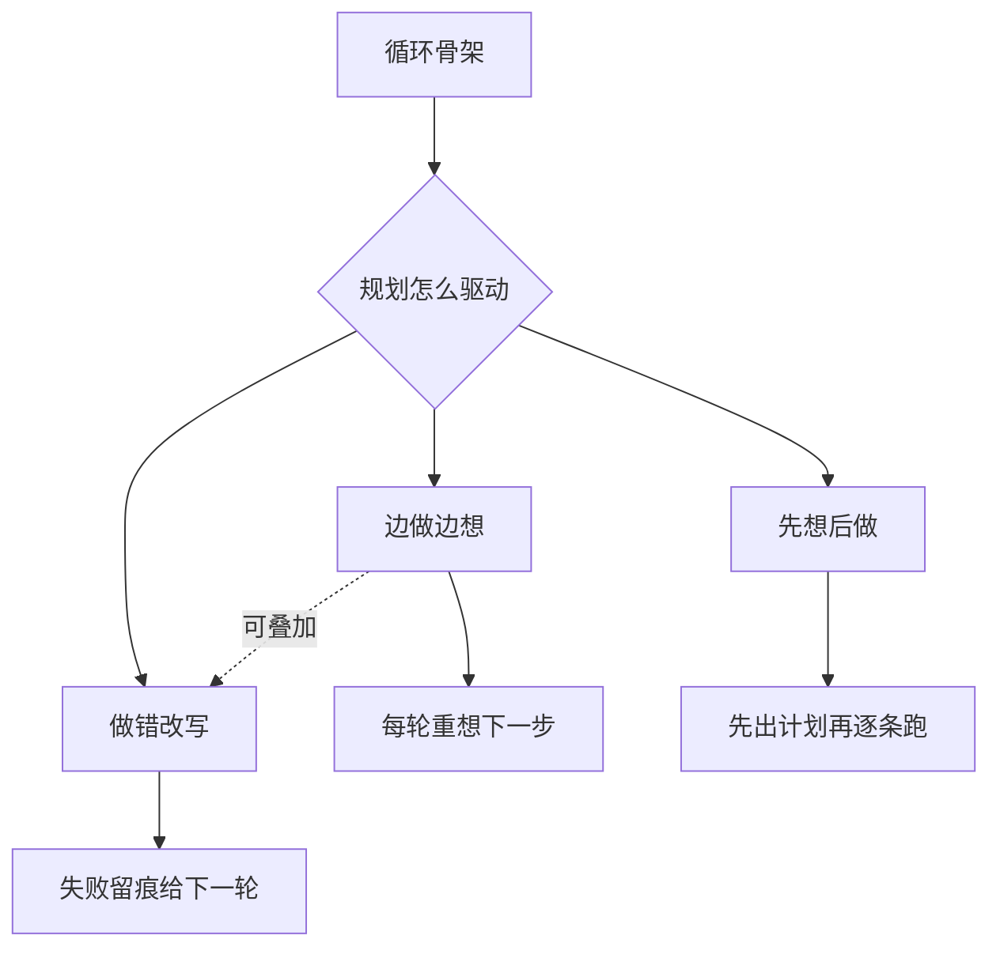
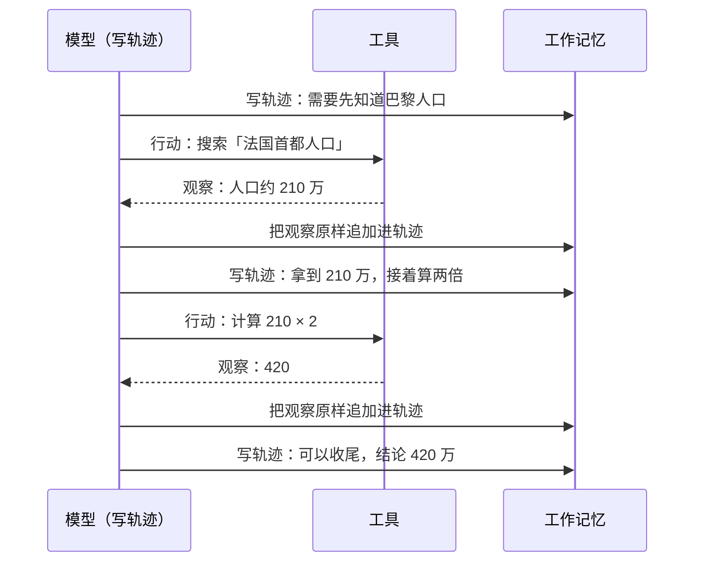
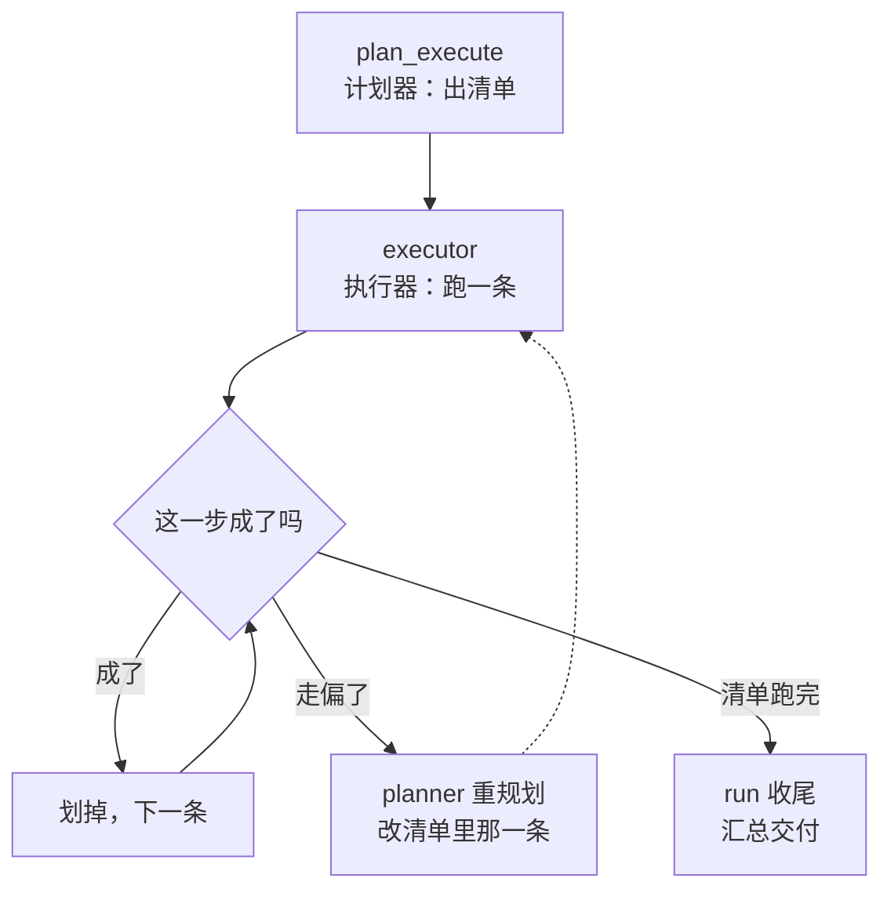
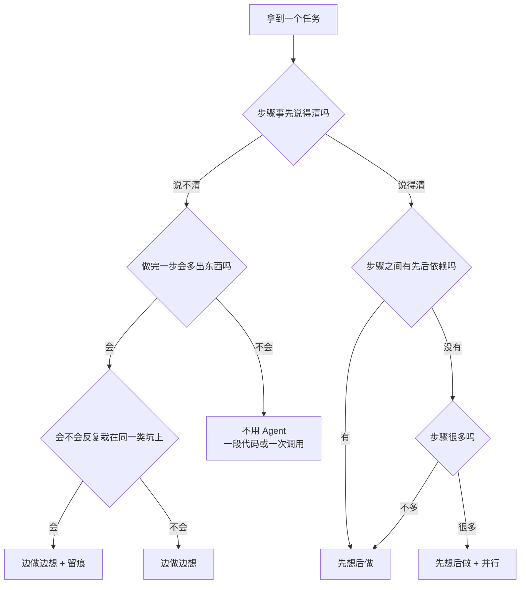

# Ch12 三大范式：ReAct / Reflexion / Plan-and-Execute

> 同一个循环骨架，凭什么分出三种跑法，又该在什么时候选哪一种。

## 本章目标

读完本章你应当能：
- 说清 ReAct 的"想"与"做"为什么必须互相喂，而不是各干各的
- 举出一个 ReAct 会绕圈打转的具体场景，并说出它的三个失效条件
- 解释"反思是留痕，不是重新训练"，并说明口头反馈到底改了什么
- 复述 Plan-and-Execute 的三个角色，以及"解耦"省下的到底是什么
- 拿到一个任务，能照着 12.5 的决策树选出一条路，并说出为什么

## 本章导览



**先划清本章的边界。** Part 2 Ch10 的 10.8 已经给过一个能转起来的最小循环——想一轮、做一轮、看一轮（见 Part 2 Ch10）。本章一个字都不重复那个循环长什么样，只回答三个新问题：

1. **为什么它有效**——"想"和"做"交替这件事，凭什么能提高正确率；
2. **什么时候它失效**——这个骨架在什么条件下会变慢、变贵、原地打转；
3. **怎么选**——同一个循环有三种驱动方式，凭什么选这个不选那个。

三种范式的出处与出现顺序，Part 2 Ch8 8.7 已经编过年表（参见 8.7）。本章把它们并排摆开，比的是**驱动方式**，不是历史。

## 12.0 引子：同一个循环，三种跑法

先把最容易误会的一句话说清楚：**ReAct、Reflexion、Plan-and-Execute 不是三个不同的系统，是同一台机器的三种开法。**

上一章拆出来的四件套——感知、工作记忆、规划、行动（见 Part 3 Ch11）——三种范式一样都不少。感知照样归一输入，工作记忆照样摊着面前那张纸，行动照样是对世界的真实改动（改不动就是没生效，见 Part 3 Ch11 的 11.3）。三者之间唯一的差别，落在**"规划"这一格怎么接线**上：

- 有一种接法是**规划这一步只负责"想下一步"，不负责"提前想好后面几步"**——想到哪做到哪。这条路叫 ReAct。
- 有一种接法是**规划这一步除了想，还负责"把上次为什么失败写下来"**——留痕给下一轮当开场白。这条路叫 Reflexion。
- 还有一种接法是**规划这一步一次性把后面几步都想完，执行器照单跑，跑到中途发现不对再回头改**。这条路叫 Plan-and-Execute。

把"规划那一格"当成一台机器里可以换的零件，其余部分不动——这是本章最想给你的视角。真实的工程系统往往三种混着用，而不是三选一；本章把它们分开讲，是为了让你看清各自的脾气，最后再合成一个选择（见 12.5）。

不过在往下走之前，得先把 11.5 那个判据捡回来，因为它是本章所有选择的根。上一章说过：**该拆任务的条件是"步骤可枚举"**——你事先能大致说清第一步、第二步是什么（参见 Part 3 Ch11 的 11.5）。这句话翻译成范式语言就是：

- 步骤事先说得清 → **先想后做**划算（Plan-and-Execute）；
- 步骤事先说不清 → **只能边做边想**（ReAct）。

三种范式的分野，源头就在这里。往下每讲一种，你都可以回来问一句：**它假设我事先知道几步？** 这个假设就是它的全部优点，也是它的全部代价。

## 12.1 ReAct 为什么有效

### 12.1.1 机制：想与做互相喂

先把这一节最核心的一句话说出来：**ReAct 的全部机制，就是让"想"和"做"互相喂对方缺的东西。**

模型单靠在脑子里想，缺的是**真实世界的最新事实**；模型单靠调用工具，缺的是**把事实串成下一步的判断**。把两者放进同一个循环里、并且强制它们写在同一份文本上，就各自补上了对方的短板。

这里要落地两个术语。它们是本章后面所有内容的零件，先铺白话。

**推理轨迹（reasoning trace）**。白话一句话——模型把"我为什么这么做"一句句写在纸上的过程。类比：医生边看片子边口述判断依据，而不是只甩给你一句"肺部有阴影"。例子：模型写下"需要知道巴黎人口 → 先搜索，不要凭记忆猜"，这就是一条推理轨迹；它比"我要搜索一下"多了一层——**说出了为什么**。

**观察（observation）**。白话一句话——工具或环境返回回来的**真实结果**，不是模型的猜测值。类比：医生查完化验单，看到的是单子上印的那个数字，不是"我估计大概是这个数"。例子：搜索返回"法国首都人口约 210 万"，模型读到的是这句；它不是模型记忆里那个可能早已过时的数字。上一章 11.1 第 6 拍讲过观察回填，这里只补一条纪律：**观察必须原样抄回，不许模型转述**——一改写就带上了模型的偏见，真实性就没了。

两个术语凑齐，先用最小的一个例子把"互相喂"过一遍，读者再去看图会省力得多。同样一个问题，问"法国首都人口的两倍是多少"，注意它其实考了两件事：先查、再算，所以循环注定要转三轮。

```text
【不写轨迹 · 只记结果】
  问：法国首都人口的两倍是多少？
  查 → 人口约 210 万
  再查？→ 它不知道刚才查到的是什么，只能重新想一遍该问什么
  ……结果：要么重复搜索，要么卡在原地

【写轨迹 + 记观察】
  想：先要知道巴黎人口，不能凭记忆猜
  查 → 观察：人口约 210 万
  想：210 万在手了，两倍就是 420，接着调计算器
  算 → 观察：420
  想：结论可以给了
```

上面那一栏在查完之后没有一条记下来的"想"——只有一句"再查？"，因为**模型想的东西没有落在纸上，它自己也就无从复用**；下面那一栏的第三行之所以能直接去调计算器，靠的是前两行纸面上的东西。紧跟着这张图就是下面那一栏的展开，请只抓两条回边——全部机制都在回边上。



**回边一：观察喂给轨迹。** 每一条观察都原样追加进工作记忆，于是下一轮模型读到的文本里，既有"我上一步打算干什么"，也有"世界实际回了什么"。这两样摆在一起，模型才有条件更新自己的打算——**如果只写轨迹不记观察，模型会拿旧计划去套新世界；如果只记观察不写轨迹，模型面对一堆数字会不知道该拿它们怎么办。** 回想上一章 11.1 的第 7 拍，说的就是这件事。

**回边二：轨迹喂给行动。** 行动不是"盲点一个工具"——正因为轨迹里写了"要算两倍"，模型才知道第二次该调的是计算器而不是继续搜索。**行动的参数来自推理，不是来自上一轮行动。** 这一条是 ReAct 与"多调几个工具"的分水岭：前者每一步都带理由，后者只是一串互相无关的请求。

把两条回边翻译成一句话，你就能记住 ReAct 的全部收益：**它把"猜"换成了"查"，而且换的过程是可读的。**

"可读"这件事值得多说两句，因为它经常被当成附赠品，其实不是。轨迹是一份白纸黑字的文本，你可以逐行读：它在哪一步判断错了、哪个工具调用参数填错了、哪一步开始跑偏，全都能定位到。上一章讲过 Agent 调试的价值（判断它在哪一步失灵比看它答得好不好更有用，参见 Part 3 Ch11 的 11.6）；轨迹就是那份能让判断成立的材料。**没有轨迹，一个答错的 Agent 就是一个黑箱，你连追问的入口都没有。**

> 本节没有公式，也不需要。ReAct 讲的是一条循环怎么接线，公式在这里帮不上忙——你把上面那张图翻译成代码，就是全部内容（10.8 已给过一个 50 行版本，见 Part 2 Ch10）。

### 12.1.2 可核实的效果

上面这套机制不是纸上谈兵。ReAct 的论文在几个标准任务上做过对照实验，下面三个结论是论文摘要里可以直接核到的，数字逐字照引：

| 结论 | 出处 |
|---|---|
| 在 ALFWorld 与 WebShop 两个任务上，绝对成功率分别高出对照方法 **34%** 与 **10%** | ReAct 论文（Yao 等，2022）摘要 |
| 而且这个成绩是在**只给一到两个示例**的条件下取得的——不是靠堆例子堆出来的 | 同上 |
| 仅通过接入一个简单的维基百科接口，就克服了纯推理链存在的幻觉与误差传播问题 | 同上 |

这三条里，最该记住的不是百分比，是**最后一条的因果结构**：论文的结论是"一接入外部知识源，幻觉和误差传播这两个问题就被克服了"。注意它说的是**被克服**，机制是"接入了一个能返回真值的简单接口"——**幻觉和误差传播不是被模型自己想明白的，是被外部真值顶掉的。**

这一点必须讲透，因为它直接决定了 12.6 的第一个误用。ReAct 之所以抗幻觉，靠的是"每一步都有一次外部核对"；**一旦你把工具拿掉、让模型凭记忆一条链推到底，你就把那个核对环节删了，ReAct 的两个优点会同时消失。** 所以"ReAct 能抗幻觉"这句话有个隐含前提——**它手上真的有可查的外部接口**。工具返回一个空值、一个报错、或一段过时的数据，核对照样发生，但核对的结果是"错的"，那时候 ReAct 只会更自信地把错话讲下去。

补充一句读数字的姿势：ALFWorld 和 WebShop 都是**交互式**任务——模型要在一个可以操作的模拟环境里一连串动作，最后看环境认不认它的完成状态。这类任务天然适合 ReAct，因为每一步动作之后环境必然回一个明确的结果。反过来，**如果一个任务做完一步之后没有可观察的结果**（比如"帮我想想这份方案该怎么改"），观察这一环就是空的，循环退化成"只有想没有看"，ReAct 的优势随之蒸发。12.5 的决策树里会再碰到这个条件。

还有一句必须说，因为初学者最容易在这里把结论用过头：**这些数字证明的是"在有外部真值可查的交互任务上，ReAct 比纯推理链更强"，不是"ReAct 在任何任务上都更强"。** 论文的实验范围划得很清楚——工具返回什么、任务有没有明确的完成判定，都在论文的设定之内。**离开这个设定，这三个数字就不作数了。** 你在自己项目里能拿到的唯一有效证据，永远是你自己任务上的那组对照，而不是别人的百分数。这一点也是本书后面几章反复要摆正的态度：范式的收益要在你的任务上量，不是在论文里领。

### 12.1.3 代价

前面两节讲的都是优点。但这一节是本章里最重要的一节——因为**一个只知道优点的范式，读者会用错**。ReAct 的代价有三条，一条比一条隐蔽。

**第一条：token 随轮次快速上涨，加总起来是平方级。** 这是最容易理解的。循环转 N 圈，第 N 轮要读的文本就包含前 N-1 圈的全部轨迹加全部观察——所以第 N 轮读进去的文本量大约是第 1 轮的 N 倍（单轮是线性），一轮一轮加起来，账单就是平方级（总额是平方）。更麻烦的是，那些早就用完的信息（早就查完的那条新闻、上一轮已经确认过的参数）并不能扔掉，因为模型可能后面又要回头引用。于是**转得越久，每一轮越贵，而每一轮又只是往同一个窗口里加东西**。真实系统里你会在某处看到一条硬约束——"上下文超过某个长度就压缩"（怎么压缩见 Part 4 Ch20）——那条约束存在的原因之一就在这里。

**第二条：长链路漂移。** 白话：**前面某一步的小错，会顺着链路一路传下去，越传越离谱。** 想象一条十步的链路：第 2 步取错了单位（把"万元"当成了"元"），后面八步全都在这个错数上继续算，第 8 步算出来的漂亮结论，其实在第 2 步就已经死了。而因为每一步都"看起来有观察支撑"，错得很有底气，你很难在中途发现。

这里有个细节值得点破：**ReAct 的观察只能挡住"凭空编"，挡不住"理解错"。** 工具返回"2026 年第二季度营收 1200 万元"，模型把它读成 1200 元——观察本身是真的，但归一和解读这一步出了错，后面的循环照样顺畅地跑下去。所以上一章讲归一化时那条"别把格式差异吃掉"的坑（参见 Part 3 Ch11 的 11.2），在 ReAct 里会以"漂移"的形式加倍还给你。

漂移和"第二步错了"看着像，其实不是——**"第二步错了"是错在一个点上，漂移是错在"没有人再回头看第一步"。** 区别在于有没有一个环节强制回看。有三种做法能压住漂移，代价依次增大：最便宜的是**在轨迹里定期重申约束**（把"金额单位是万元"这类原始要求隔几轮重述一次，让它始终留在模型的注意力里）；再贵一点是**让关键事实以结构化字段的形式单独存一份**，别只藏在自然语言轨迹里（回顾 Part 3 Ch11 的 11.2"摘要是给人读的，字段是给机器用的"）；最贵的是**在长任务里分段落盘，每到一个检查点就把已经确认的事实固化成一份小结**，下一段从这份小结开始而不是从原始轨迹开始。前两种是提示词和存储格式的事，第三种已经是 Part 4 Ch20 的正题。

**第三条：绕圈打转。** 这是最贵的一条，因为它既烧钱又烧时间，而且不会自己停。看一段真实得不能再真实的对话片段：

```text
第 1 轮  想：应该有个按状态查订单的接口，先试一下
        做：查订单（状态＝待发货）
        看：Error：权限不足

第 2 轮  想：权限不够，是不是少了参数？换个不带参数的调用试试
        做：查订单()
        看：Error：权限不足

第 3 轮  想：再试一次，可能是偶发的
        做：查订单()
        看：Error：权限不足

第 4 轮  想：再试一次
        做：查订单()
        看：Error：权限不足
        ……第 20 轮：还是同一句话
```

每一步单独看都"合理"：工具报错了，试一下很正常；报了同样的错，再试一次也正常。**问题在于循环的终止条件（见 Part 2 Ch10）通常只认"模型说完了"，而模型在这条路上永远说不出"我完了"。** 于是这个 Agent 会一直转下去，转到烧完预算。

回头看，这段片段其实每一轮都踩了 11.6 讲过的同一个岔路口（参见 Part 3 Ch11 的 11.6）。"权限不足"既不是"继续"也不是"换招"，它是**换招也换不动的那种——手段和目标之间的墙是硬的**。这时候正确动作是第三个岔路口：停下，把"这个账号缺订单读取权限"这句话交回去求人。绕圈的根因不是模型笨，是**它没有"这条路是死的"这个概念，只能靠反复试探来逼近它**。

所以防绕圈靠的不是"劝模型别试了"（提示词里写十遍也没用），而是三样工程手段：

| 手段 | 做什么 | 挡的是哪条代价 |
|---|---|---|
| 最大步数保险丝 | 转够 N 圈就强制收尾并承认失败 | 绕圈 |
| 循环去重检测 | 新一轮的"想 + 做"和前一轮几乎一模一样就中断 | 绕圈 |
| 工具失败分类 | 报错归一时就标上"可重试 / 别再试了"（回顾 Part 3 Ch11 的 11.2） | 绕圈 + 漂移 |

三条里最有用的是第三条，因为它把判断放在了**模型看不到的地方**——归一层在把报错抄给模型之前，就已经在给它贴标签了。这也解释了为什么 11.2 说归一层的错误模型无法自查：**模型看到的是"Error：权限不足"这句话本身，它无从知道系统是否已经试过三次。**

把这三条代价并起来，ReAct 的适用边界就很清楚了：**它适合步数不多、每一步都能拿到真观察、每一步失败都有明确信号的任务。** 三个条件缺一个，它就从优势变成负担。12.5 的决策树会用这三条做分叉。

在此之前给一条可以照着用的粗算术，它能让你在上线之前就估出这笔账有多离谱：**第 N 轮要读进去的文本，大约是第 1 轮的 N 倍。** 五步的任务，读进去的文本量大致是第一步的五倍；二十步的任务，是二十倍；一百步的任务是一百倍。**单轮看是线性，但把一轮轮的账加在一起，就是平方级的总开销**——这是两笔不同的账，别混。（上一章 11.7 顺口把这笔账说成"线性上涨"，指的是单轮那一笔。）所以"多跑几轮看看"这种想法在五步时无所谓，在五十步时是一笔足以让人重新考虑架构的钱。你会在 12.6.1 看到一个被这笔账压垮的具体场景。

## 12.2 Reflexion：把失败写进下一轮

ReAct 的账里，有一条 12.1.3 反复提到但没能解决：**同一类错误会在后续轮次里重犯**。第 4 轮试出来的失败，到第 5 轮已经不在任何地方了——因为轨迹会被压缩、会滚出窗口、会为了省钱被裁掉。ReAct 只在**当轮**用得上自己的教训，它不跨轮。

Reflexion 就是冲着这件事去的。

先把最容易误解的那句话钉在最前面：**反思是留痕，不是重新训练。**

### 12.2.1 三个术语

**反思（reflection）**。白话一句话——**把这次的失败写成一句话，留给下一轮当开场白**。类比：考完试在错题本上写"我不是不会，是看错了题号"。例子：Agent 发现自己上轮直接拿两个币种的数字换算，换出来的结果离谱；它写下一句"我上轮试图直接换算汇率，但汇率需要先取当日中间价"，把这句话**贴在下一轮的开头**。下一轮模型读到它，就等于开局先拿到一条前人的忠告。

请特别注意这句"贴在下一轮的开头"——它是整个机制的**全部**，也是最容易丢掉的部分。它不是存在数据库里等着被检索，它是被**直接摆到模型眼前的那段文字里**。下一轮的输入因此变了，模型的输出随之改变。

**口头反馈（verbal feedback）**。白话一句话——用自然语言写下来的反馈，**不改模型的参数**。类比：员工收到老板的一段评语，而不是被送去重新培训。例子：一段 30 字的自我批评（"上轮我假设接口支持分页，其实不支持"），而不是重新训练一次模型。

这两个术语是一对，必须连着理解。**"口头反馈"里的"口头"两个字是技术定义的一部分，不是修辞。** 它之所以能叫"强化"，靠的不是梯度更新，而是"下一轮的输入里多了几句话"这件事本身——所以它被叫作语言层面的强化。

再补一句它**没有**做的事，一句顶三句：**反思不动模型的权重。** 你可以把整个反思机制想象成一个记事本：模型本身一个字节都没变，变的是每轮开场递上去的那张纸。任何时候你把这个记事本抽掉，系统立刻退回原样。这条会在 12.6 第二次用到。

"不动权重"这四个字最好用对照看。假设你想让模型**真的**改掉一个毛病，有两条路：

| | 做法 | 成本 | 什么时候用 |
|---|---|---|---|
| **重新训练** | 把这批失败样本喂进去跑一轮训练，权重变了 | 要数据、要算力、要一整轮训练周期 | 你确信这是模型的通病，换一百个任务也一样 |
| **口头反馈** | 把结论写成一段话，贴进下一轮输入开头 | 一次模型调用的钱 | 毛病只在这类任务上出现，或你想先便宜地试 |

**这两条路的适用面几乎不重叠，所以"该反思还是该训练"其实不难判断。** 判据只有一条：**这个毛病换到别的任务上还在不在。** 还在，说明是模型的通病，该走训练；换了任务就犯，说明是这个任务上的执行问题，写句话比跑一轮训练划算得多。Reflexion 之所以能被一个几十行的原型实现出来，就是因为它选的是右边那条几乎免费的路——**代价是它只能改"下一轮"，改不了"下一千个任务的通用能力"。**

顺便回答一个初学者常问的问题：那多写几句话，效果能好到哪儿去？给一个可以想象的量级——**一段三十到五十字的判据，通常比一段三百字的流水账更有用**，因为模型要的是"下次该怎么想"的指向，不是"上次发生了什么"的完整档案。下一小节给正反两个例子。

### 12.2.2 错题本怎么工作

还是错题本的类比，但它比"写一句总结"更具体，所以值得展开三步：

**第一步：做完，写下失败的证据。** 不是"我这次没做好"这种空话，是**具体的、能对照的事实**。拿 ReAct 那个绕圈的例子说：Agent 转了 20 圈，每圈都收到"权限不足"，它该写下的是——

```text
【好的反思 · 短、指向未来】
现象：连续 20 轮调「查订单」都返回「权限不足」。
教训：报错文案不含"重试/稍后"字样时，不要当成暂时故障反复重试；应换手段或上报。

【坏的反思 · 长、只复述】
本轮我调用了「查订单」接口，参数包括 status=待发货，接口返回权限不足……
然后我又调用了一次，不带参数，还是权限不足，之后又调用了好多次……
最后我没能完成查询订单的任务。我觉得这次主要是权限方面的限制，
如果以后遇到类似情况，应该注意权限的配置问题。
```

两份摆在一起，差别一目了然：**下面那份写得更长，却没有一句是下一轮能直接拿来判断的东西。** 它复述了一遍已经发生的事，模型下一轮读到的还是"发生了什么"，而不是"下次该怎么办"。上面那份只有两行，第二行是一句可以被直接执行的判据。

这就是本节最实用的一条经验：**写反思的判据是"这句话能不能直接改变下一轮的选择"，不是"这件事交代得清不清楚"。** 交代清楚是流水账的职责，改选择才是反思的职责。

**第二步：把这段小结放进下一轮的输入开头。** 注意是"开头"不是"结尾"。放结尾的话，它会被后面新写的轨迹稀释；放开头，它是模型读到的第一句事实，权重最高。

**第三步：下一轮重来一次，看行为有没有变。** 变了，说明反思起作用；没变，说明那句话写得不够具体——**下次改进的方法是把小结写得更细，而不是写得更用力。**

这三步拼起来就是 Reflexion 的完整机制，一句话总结：**它给循环加了一条跨轮的旁路——上一轮的经验可以不经过参数、直接进入下一轮的输入。**

### 12.2.3 三个部件

Reflexion 在工程上把整件事拆成三块，装在一个盒子里。一张表认脸：

| 部件 | 是什么 | 活多久 | 例子 |
|---|---|---|---|
| **短期轨迹** | 这一轮任务从头到尾的动作和观察流水 | 只活这一轮任务，任务结束就丢 | "第 1 轮调搜索返回超时；第 2 轮换了个关键词才查到" |
| **长期反思** | 从流水里提炼出的那几句判据 | 跨轮保留，一直摆在下轮开头 | "该关键词库对中文查询召回差，先翻成英文再搜" |
| **任务反馈** | 来自外部的信号：这个任务到底成没成 | 任务结束才有 | 环境的成功/失败判定，或人给的一句"这次做对了" |

三块的分工一句话各说一遍：**短期轨迹是素材，长期反思是从素材里提炼出的判据，任务反馈是判断"该提炼还是不提炼"的依据。**

任务反馈这一块值得单独说两句，因为它是三者里唯一**不由 Agent 自己产生**的。短任务可以不要它——比如"查一下明天的天气"根本不需要回头评价自己。但长任务必须有：一个跑了几十步的 Agent，如果最后没人告诉它"成了"还是"没成"，它的反思就只是流水账的复述。**能不能拿到"成没成"这个信号，决定了反思是有方向的反馈还是无方向的唠叨。**

这个信号的来源往往不是"模型自己给自己打分"（那是循环论证），而是外部世界给的三种之一：**环境的判定**（编译过了没有？测试跑通没有？目标文件生成没有？）、**硬指标的校验**（把答案和标准答案比一比）、**人的一句话**（"这次做对了"/"格式不对"）。第一、二种最可靠，因为它们和任务本身绑死；第三种最灵活，但也最容易被忽略——很多人给 Agent 装了反思机制，却忘了把人的纠正接进来，结果 Agent 一直在反思自己一个人的错误版本。

上一章讲循环的三个岔路口时说过"求助人类是兜底"，这里可以补一个同源的事实：**人类的反馈同时也是任务反馈的来源之一**——人回一句"这次做对了"，就等于给了 Agent 一个评估信号。这也再次说明为什么求助人类不是可耻的兜底（参见 Part 3 Ch11 的 11.6）。

### 12.2.4 和 ReAct 差在哪

现在可以回答本章标题里最容易混的一对了。一张表：

| | ReAct | Reflexion |
|---|---|---|
| 核心动作 | 想 → 做 → 看，循环往回转 | 在 ReAct 之上，多加一条"写判据"的动作 |
| 留痕的作用范围 | **当轮**——轨迹是为了让下一轮用得上 | **跨轮**——反思是为了让以后几轮用得上 |
| 记忆放哪 | 工作记忆（这一轮） | 工作记忆 + 一份跨轮保留的反思 |
| 解决的问题 | 别凭空编，按事实走 | 别重复犯同一类错 |
| 不解决什么 | 同类错误反复出现 | 一切需要外部真值才能解决的问题 |

最后一行是两者共同的短板，值得点出来：如果你手上根本没有可信的外部信息源（工具返回的全是空的、全是错的），**反思写得再勤快也只是在错误的事实上打转**——反思能纠正"方法错"，纠正不了"信息就是假的"。

**那为什么把它们分作两种范式，而不是一种？** 因为它俩确实是不同的：**ReAct 的改进方向是"这一轮更准"，Reflexion 的改进方向是"以后的轮次不再重复今天的错"。** 前者改的是当场，后者改的是习惯。

不过最后必须说一句防止你把书读窄的话：**两者不是二选一，而是叠着用的。** 典型的 Reflexion 系统底下跑的就是一个 ReAct 循环，只是在每轮结束时多插了一句"你这轮哪里错了"。把两个循环画在一起，多的那一条旁路一眼就看得出来：

```text
【ReAct】             想 → 做 → 看 → 想 → 做 → 看 → … → 收尾   （中间不留任何东西）

【ReAct + 反思】      想 → 做 → 看 → … → 收尾
                    │                    ↑
                    └─ 写一句判据 ───────┘   ← 这一条旁路就是 Reflexion 全部的新增部分
```

所以 12.6 那个"三选一"的问法本身就是错的——真实的做法是 12.1 打底、12.2 补一层、12.3 在任务性质合适时整体换驱动方式。**这也是为什么本章把三种范式并排放，而不是按"第 1 代 / 第 2 代 / 第 3 代"排**：它们不是互相取代的关系，是可以长在同一台机器上的三根轴。

## 12.3 Plan-and-Execute 谱系：先想后做

前面两节的共同前提是：**每一步都重新想下一步**。这一节换一条路——**先想完，再执行**。

这条路的家族史不用展开讲，两句话定位就够。2023 年前后，社区里出现了几个把 Agent 做成"任务列表循环"的原型：BabyAGI 和 AutoGPT 都属于这一类，形态是**维护一个待办清单，做完一条就从清单上划掉，再从清单里挑下一条**。这批原型把"规划该独立成一个角色"这个想法推到了台面上，虽然它们本身在工程上相当粗糙。**本章关心的是从这个想法长出来的现代形态，不是评价这些原型。**

### 12.3.1 三个角色

现代形态把规划从"每轮顺手做一下"，升级成了三个有名有姓的角色。术语先落地：

| 角色 | 白话一句话 | 生活中谁是 | 例子 |
|---|---|---|---|
| **计划器** | 出主意的那个，一次把要做的事排成一张单子 | 项目经理 | 计划器排出三步：取 A 家价格、取 B 家价格、比较两家 |
| **执行器** | 照单动手的那个，只管把某一条真的做出来 | 工人 | 执行器跑第 1 步 `fetch_price(A)`，返回"A: ￥120/月" |
| **重规划器** | 盯着现场看，发现走偏了负责改主意的那个 | 监理 | 执行器取 B 家价格取回来是空值，归一成一条「取价失败」信号；重规划器判定取价这条路走不通，把清单里 `fetch_price(B)` 那一条换成 `fetch_price(B, 备用源)` |

生活里的对应物不是"项目经理—工人—监理"这么工整的三级关系，更像一支小队伍里真实存在的三个角色。**关键不在于三个人的名字，而在于"想"和"做"被拆成了两次独立的事**——这才是这一节全部内容的立足点。

把三个角色放回一次真实执行里，长这样。**看图时只盯一条线**：全图唯一的虚线，`planner` 回到 `executor` 那个回边——它是整张图和 ReAct 的全部区别：



三条线怎么读：**实线是"照着做"，唯一的虚线是"改主意"。** 这条虚线回边在 ReAct 里是不存在的——ReAct 每一轮都重新决策，看起来更像"随时能改"，实际上它改的是下一步，而不是已经写死的清单；Plan-and-Execute 把清单先定下来，于是**"改主意"从每轮一次变成了一次显式的、要付出代价的动作**（要再调一次 `planner`）。代价换来的是中间那几条执行不再调模型，这笔账在 12.4 会算清楚。

这张表里的"步骤"，就是上一章说的**子目标（subgoal）**（参见 Part 3 Ch11 的 11.5）——同一件事的两个叫法：11.5 从"怎么拆"的角度叫它子目标，本节从"谁去跑"的角度叫它步骤。往下读的时候看到哪一个都别以为是新东西。

为什么这个拆分重要？回到 11.5 讲过的过度规划（参见 Part 3 Ch11 的 11.5）：一份详细计划要花一次模型调用，而这一整轮可能只是为了让模型想清楚下一步做什么。**先想后做把"想"的成本一次性付掉，然后"做"的每一步都是廉价的执行。** 代价是那份计划是在**还没看到任何观察**的时候写的，所以它一定会有一批步骤是不合用的——重规划器就是为收拾这些不合用的步骤而存在的。

**"重规划器"和 11.6 那个"换招"岔路口是一回事，只是发生在不同的粒度上**，这一点值得点破，否则两个词会让人以为是两套机制。11.6 的换招发生在**一步之内**：工具报错了，换个工具再试这一件事。重规划器发生在**整份清单之上**：工具报错了，我判定"取价这条路走不通"，于是把清单里那一条从 `fetch_price(B)` 改写成 `fetch_price(B, 备用源)`——本节的示意代码里就是这一个字段的一次改写。前者修一颗螺丝，后者换一份图纸。**如果你的系统只有前者没有后者，清单一旦偏了就会一路偏到底**——因为照着一份已经被证伪的计划往下跑，跑得再稳也是错的。

这三步走下来，你已经能看出 ReAct 与 Plan-and-Execute 在**花钱方式**上的根本不同了：ReAct 每一步都要重新决策一次，所以每一步都要调一次模型；先想后做只在开头（和每次改主意时）调模型，中间那几条执行是纯机械的。**这就是同样的任务，两种跑法账单能差一个数量级的原因。**

三个角色的分工，在代码里长这样（`code/part-3/plan_execute.py`，示意代码，不执行）。先提醒一句取名的事：**计划器和重规划器在代码里是同一个函数 `planner`**，这不是偷懒——改主意的动作小到不需要第二个角色，判据一响、把清单改一行，就完了：

```python
# illustrative only
# Ch12 示意代码：Plan-and-Execute 三段式状态机
# 纯标准库；三个角色都用假实现，目的是让"先规划、再执行、边执行边重规划"
# 这条骨架一眼看得见——真实系统里，planner / executor 里跑的是大模型。
# 跑一遍你会看到：B 家第一次取价返回空值 → 升级信号触发 → planner 改写了清单。

PLAN = {
    "目标": "比较两家云厂商的按月价格，选出更便宜的一家",
    "步骤": ["fetch_price(A)", "fetch_price(B)", "compare(A, B)"],
    "已完成": [],
    "结果": {},
    "重规划次数": 0,
}


def planner(state, observation):
    """重规划器：拿到上一步的观察后决定下一步；没有待办步骤就返回 None。

    三份工按顺序：① 归档观察 → ② 判升级信号、必要时改写清单 → ③ 挑下一个待办。
    第 ② 步就是"重规划"的全部——它只改 state["步骤"] 这一个字段。
    """
    # ① 归档：观察挂在"刚做完的那一步"上，所以最后一步的结果也查得到
    if observation is not None and state["已完成"]:
        state["结果"][state["已完成"][-1]] = observation

    # ② 重规划：升级信号触发时，把清单里那一条换掉（换数据源再取）
    if observation == "取价失败" and "fetch_price(B)" in state["步骤"]:
        i = state["步骤"].index("fetch_price(B)")
        state["步骤"][i] = "fetch_price(B, 备用源)"
        state["重规划次数"] += 1

    # ③ 挑下一个待办；没有待办 → 规划结束
    pending = [s for s in state["步骤"] if s not in state["已完成"]]
    return pending[0] if pending else None


def executor(step):
    """执行器：真实系统里这里调工具；示意版直接回一个假结果。

    B 家第一次取价返回空值，模拟数据源故障——这正是重规划器的触发场景。
    """
    fake = {
        "fetch_price(A)": "A: ￥120/月",
        "fetch_price(B)": None,                      # 第一次取 B 家：数据源故障
        "fetch_price(B, 备用源)": "B: ￥98/月",        # 换源再取：成功
        "compare(A, B)": "结论：选 B",
    }
    if step not in fake:
        raise ValueError(f"未知步骤：{step}")
    if fake[step] is None:
        return "取价失败"                            # 归一层把空值归一成一条信号
    return fake[step]


def run(initial_state, max_steps=10):
    """主循环：规划 → 执行 → 把结果喂回规划器，最多 max_steps 步。"""
    state = initial_state
    step = planner(state, None)
    while step is not None and max_steps > 0:
        observation = executor(step)
        state["已完成"].append(step)
        step = planner(state, observation)
        max_steps -= 1
    return state
```

请只盯三件事，其余全是细节：

**第一，`PLAN` 是一张看得见的清单。** 三步写在 `步骤` 里，做完的划进 `已完成`，`结果` 里存着每一步跑出来的东西。**计划不是藏在模型脑子里的东西，是一份可以打印出来贴在墙上的纸**——这一点在工程上价值极高：你能检查它、能在它错的时候手改、能让 Agent 告诉你"我打算做这三件事"然后等人点头（这正好落在 11.6 求助人类那个岔路口上，参见 Part 3 Ch11 的 11.6）。纸上还写着 `目标` 那一行，这份示意代码里没有人读它——它是给**人**看的（真实系统里，重规划器判断"目标达成了没有"要读的就是它）。

**第二，`planner` 一个函数兼了三份工。** 归档观察、判升级信号并改写清单、挑下一个待办，全在里面。看这个函数时请把三份工分开看，因为它们的成本差着几个数量级：**归档和挑待办是宿主程序干的机械活，不该烧模型调用；只有中间那一份——改写清单——是真·规划动作，真实系统里由计划器（也就是模型）来做。** 注意 `结果` 的键是**刚做完的那一步**（代码里那行 `state["结果"][state["已完成"][-1]]`），不是刚挑中的下一步——写错了你就会永远查不到最后一步的结果。

**第三，`max_steps` 是最后那道保险丝。** 就算待办清单没走完，转够 10 步也强制停。本例全程 4 步，保险丝一次都用不上；它在几十步的真实任务里才登场。这和 12.1.3 讲的是同一个工程约束：**任何会自己往前走的循环，都必须配一根外加的刹车**——因为"什么时候停"这件事不能只问模型。

主循环 `run` 的骨架，用文字走一遍就是四句：**先问一次计划（拿到第一步）→ 执行一步 → 把结果喂回计划器 → 再问下一次。** 这四句在 ReAct 里是同一个角色分身的活，在这里是两个角色之间的对话。

跑一遍 `run(PLAN)`，你能对着这四句核对结果：`重规划次数` 是 **1**（B 家第一次取价取回来是空值，归一成「取价失败」触发了改写），`结果` 里有 **4** 条，最后一条是 `"结论：选 B"`。**注意最后一步的结果查得到**——因为归档挂的是"刚做完的那一步"，这正是上面第二点要你留心的地方。顺带提醒一句：`run` 是**就地**改清单的，所以每跑一次都得从一份全新的 `PLAN` 起步，否则第二遍就看不到重规划了。

### 12.3.2 解耦：ReWOO 怎么把"想"和"看"拆开

先想后做还有一种更激进的走法：**连"看到结果之后再想"这一步都省掉。** 计划器一口气把整个计划和每一步该去查什么，全都写出来；执行器顺着单子一路跑下去，跑完了再一次性把所有结果摆给模型。中间**不再有"看一眼、改主意"这个环节**。

这个走法叫**解耦（decoupling）**：白话一句话——**把"想"和"看"拆开，先全想完再一次性去看。** 类比：先写完整购物清单再去超市，而不是站在货架前才想起来要买什么。例子：这个任务里，计划器一次生成全部三步；工具结果回来之后不再重新规划，直接汇总。

ReWOO 是这条路线的代表作，论文摘要里可以核到的结论有三条：

| 结论 | 出处 |
|---|---|
| **token 效率提升 5 倍** | ReWOO 论文摘要 |
| HotpotQA 上的准确率**提升 4%** | 同上 |
| 演示了把 **175B GPT3.5 的推理能力卸载进 7B LLaMA** | 同上 |

先说第一条**为什么**能省下五倍，而不是笼统地说"更省"。ReAct 每一轮都要重新把"全部历史轨迹 + 全部观察"读一遍，第 N 轮读的量约为第 1 轮的 N 倍；解耦之后，那个"想"的阶段**只发生一次**，第 1 轮读进去的上下文和第 10 轮读进去的上下文几乎一样长。**省的是重复读历史，不是省了工具调用次数**——这一点要分清楚，否则会推出错误的优化方向。

第二条那个"4%"和第一条的"5 倍"放在一起，是一组很有意思的对照：**省下五倍的代价是多花了 4% 的准确率。** 为什么会多花？因为有些步骤本来是要看到结果才能决定要不要做的——解耦把这部分机会扔掉了。这条对照正好呼应 11.5 过度规划的代价（参见 Part 3 Ch11 的 11.5）：**先想后做省的是钱和延迟，付的是"看不见新情况"的风险。** 任务越是"步骤事先说得清"，这笔买卖越划算。

第三条**是通向 Part 3 Ch15 的伏笔，这里只点一句**：论文展示的是把大模型的推理能力"卸载"进一个小模型——**让小模型去做推理，让它在需要时才去调用大模型**。这与本节的解耦是同一个思路的延伸（既然推理和观察可以拆开，推理和模型规模也可以拆开）。混合系统怎么把大模型省着用、什么时候才升级到它，见 Part 3 Ch15 的 15.3。

解耦也有明确的失效条件，**说清楚比说优点更重要**：如果任务里存在"必须看到 A 的结果才能决定要不要做 B"这种强依赖，解耦生成的清单就必然有一半是废的——B 的存在理由根本没被检验过。**判断标准还是 11.5 那句话：步骤事先说得清，解耦划算；说不清，别解耦。**

这一节的**三件套里还差最后一个动词：并行。** 解耦把手从模型上解下来了，但脚还绑着——单子上写了三条，这三条还是得一条一条跑。于是下一个问题自然冒出来：**既然清单已经是一次性生成的了，能不能在它落地之前先看看，这几条之间谁等谁？** 这就是 12.3.3 要讲的。

顺带把这一节三个动词的关系捋成一句：**解耦省的是"想"的重复，并行省的是"做"的等待，重规划补的是"想错之后怎么办"。** 三件事都发生在同一份清单上，各修各的漏，所以它们经常被叠着用。

### 12.3.3 并行：LLMCompiler 把清单变成并发

解耦解决了"想"重复读历史的问题，但还有一处浪费：清单上明明有三步互不依赖的工具调用，却只能老老实实一条一条跑——每跑一条都要等模型做一次决策。

**LLMCompiler 的切入点就在这里。** 它把系统拆成三个组件，逐字是：**Planner（计划器）、Task Fetching Unit（取任务单元）、Executor（执行器）**。多出来的中间那个"取任务单元"，就是专门负责**在计划落地之前先看看哪些调用彼此独立，然后决定它们能不能同时开跑**。

论文摘要里可核到的数字，与 ReAct 逐项对比：

| 指标 | 相对 ReAct 的变化 | 出处 |
|---|---|---|
| 延迟 | 最高提速 **3.7 倍** | LLMCompiler 论文摘要 |
| 成本 | 最高省下 **6.7 倍** | 同上 |
| 准确率 | 最高提升 **约 9%** | 同上 |

三个数字要连着读，因为它们讲的是同一件事的三个面：**省下来的钱和时间，被拿去多试了几条路，所以准确率还上去了。** 并行不是纯粹的优化——**它把原本串行时根本跑不完的预算，变成了能跑完的预算。** 这是全书都会反复出现的一个模式：省下来的成本如果只是省下来，那只是效率；省下来之后拿去做更多尝试，那才是能力。

"取任务单元"这个组件的思路值得展开一句，因为它是一个可以脱离这篇论文去用的通法：**在任何有多个待办事项的系统里，先花一次判断把"哪些互不依赖"标出来，再并发跑，是一条通用优化。** 它的风险也通用——**标错了就会出事**：如果两个调用其实有依赖却标成独立，B 用到的 A 的结果还没到位就被执行了。工程上的常见做法是**只敢标那些"纯读、参数完全确定、无副作用"的调用**，宁可少并行一点也不并行错（参数确定这一点值得对照 11.3 的读/写与幂等讨论，参见 Part 3 Ch11 的 11.3）。

### 12.3.4 升级信号

三条路线走到这里，需要补上最后一个零件：**重规划器靠什么判断"该改主意了"？**

答案是**升级信号**。白话一句话——**一条事先定好的判据，用来判定"这个活不该按原计划继续了"。** 类比：监理手里那张对照表——图纸写着承重 200 公斤，现场却摆了一台 300 公斤的机器，一对上号就喊停。例子：在"比较两家云厂商月价"这个任务里，若取 B 家价格时返回空值，升级信号就触发了，计划器据此判定"取价这条路走不通"，改走"换数据源再取"或者"求助人类"。

**"事先定好"这四个字是这个术语的全部要点。** 如果升级信号是临场想出来的，那它就不是信号，是模型的又一次猜测；只有把它写成一条明确的判据——"工具返回空值 → 换数据源"、"报错文案不含重试字样 → 上报"——它才具备工程价值。

这一点把 12.1.3 的账结清了。那一节说 ReAct 会绕圈，根因是**模型没有"这条路是死的"这个概念，只能靠反复试探逼近它**。升级信号就是把这个概念**从模型手里拿过来，交给宿主程序**——在模型看到那句"Error：权限不足"之前，归一层就已经替它判过"这条路是死的，别再试了"。**三个范式的差别，说到底是这个判据放在谁手里、放不放得进代码。**

## 12.4 三种范式对比

### 12.4.1 一张总表

前面三节讲完，现在把三条路线并排摆进一张表。**这张表的用法是查，不是读**——你不用背，忘了回来查就行。

| | ReAct | Reflexion | Plan-and-Execute |
|---|---|---|---|
| **核心假设** | 事先不知道要做几步 | 事先不知道要做几步，但同类错别重犯 | 步骤事先可枚举（11.5 的判据） |
| **一步长什么样** | 想一句 → 调一次工具 → 看结果 | 同 ReAct，外加一句"你这轮哪里错了" | 先出整份清单；执行器照单跑一条 |
| **"想"发生在哪** | 每轮一次 | 每轮一次（外加一次反思） | 开头一次（重规划时再来一次） |
| **主要优势** | 步骤事先说不清时也能走；轨迹可读、易定位错误 | 跨轮不重复犯同一类错；省下重复读历史的成本 | 步数多时省 token、省延迟；计划可见可审可改 |
| **主要局限** | token 随轮次涨、长链路漂移、会绕圈 | 需要外部的"成没成"信号；信息本身错时无效 | 计划在没看到任何观察时写就，偏了就整段偏 |
| **典型场景** | 步骤事先说不清；每一步都能拿到真观察 | 会反复栽在同一类坑上的长任务；探索类问题 | 步骤可枚举：迁移、批处理、巡检、数据核对 |
| **一句话心法** | 想到哪做到哪 | 想到哪做到哪，但别再踩同一个坑 | 先把单子列全，再照单跑 |

**这张表里最值得横着读的一行是"主要优势"。** 三者的优势**不是同一个维度的三种表述，而是三种不同的省钱方式**：ReAct 省的是"你不必事先想对"（想错不要紧，当场改就行）；Reflexion 省的是"你不必每轮重新想一遍为什么"（教训留一次、用很多次）；Plan-and-Execute 省的是"你不必每轮重新读一遍历史"（想一次，用到底）。**搞清楚你要省的是哪一种，选型就不难了。**

### 12.4.2 一张账单对照

这张抽象的表可能还需要一个具体的对照才不至于滑过去。同样一件"把 20 个网页的标题抓下来"的任务，两种跑法的账是这样的：

```text
【边做边想】每抓一个网页：读一遍「已抓 0 个 + 轨迹」→ 决策 → 抓 → 读一遍「已抓 1 个 + 轨迹」→ ……
  模型调用：约 21 次（每抓一个决策一次，最后一次收尾）
  token 账单：第 1 轮很小，第 20 轮要把前 19 轮全读一遍 → 总额按平方累加

【先想后做】开头：读一遍「任务描述」→ 输出 21 行清单（抓 A / 抓 B / … / 汇总）
  之后：20 次抓取全是机械执行，不调模型
  模型调用：2 次（1 次列清单 + 1 次汇总）
  token 账单：两次都很短

【先想后做 + 并行】同上，但 20 次抓取在判定"彼此无依赖"后同时开跑
  模型调用：还是 2 次
  额外收益：总耗时从"20 次串行的往返"压到"1 次往返 + 20 次并发往返"
```

看这张对照就知道为什么 12.5 的第一个问题问的是"步骤事先说得清吗"：**这三种跑法的账单差距，取决于任务能不能被拆成"互不相干、机械可执行"的一串活。** 抓 20 个网页可以，"帮我想想这份方案怎么改"不行——后者根本没有 20 个可以并发调用的动作。

反过来说，**"主要局限"那一行才是你上生产前必须逐条对过的**——三条局限对应三种不同的翻车现场，没有一条是"顶多慢一点"。

最后补一个查表时容易搞混的点：**表里"典型场景"那一行的"迁移、批处理、巡检、数据核对"，共同点是"步骤事先可枚举"，而不是"这些行业比较简单"。** 判断依据永远是任务结构，不是行业标签。同一个"客服"场景，处理"查一下我的订单号"该走边做边想，处理"把上季度所有退款单按规则批量归档"该走先想后做——**同一个业务，两种范式。**

## 12.5 选择指南：拿到一个任务怎么选

### 12.5.1 五问决策树

决策树放在下面。**每个分叉后面都跟一句人话，因为分叉本身不解释任何事。**



逐个分叉解释过去——**这几句才是决策树的价值所在，图本身只是索引**。

**Q1「步骤事先说得清吗」**，这是全树最重要的一个分叉，它就是 11.5 那条判据的原话（参见 Part 3 Ch11 的 11.5）。"说得清"的操作性定义是：**你能不能在动手之前，把第一步、第二步的名字写出来。** 能写出来 → 往右走先想后做；写不出来 → 往左走边做边想。往左走不是"低人一等"，是因为这类任务里"事先写清单"这个动作本身就会写错。

**Q2「做完一步会多出东西吗」**，这一问只在"说不清"的分支上用。它区分的是**探索型任务**和**一问一答型任务**：查一个航班号、翻一个历史订单——做完一步手上真的多出一个航班号、一个订单，那它其实接近"说得清"，走边做边想就够；写一封道歉信、想一想方案该怎么改——做完一步手上什么都不会多出来，那就别硬循环了，**直接一次调用出答案更省**。这一问的价值是提醒你：**很多"任务"根本不需要 Agent，一段普通代码或一次模型调用就够**——图上那条边会直接走出整棵树，落到最后一个方框。

**Q3「会不会反复栽在同一类坑上」**，这是 ReAct 分支里唯一需要 Reflexion 的信号。判断方法很朴素：**这个任务以前做砸过吗？或者它有二十步以上、中途一定会踩坑吗？** 是 → 上留痕；否 → 老实跑 ReAct，别为一个三步任务加一层反思机制。反思不是免费的，它要多烧至少一次模型调用。

**Q4「步骤之间有先后依赖吗」**，这是先想后做分支里的第一刀。**有依赖**（B 必须等 A 的结果才能确定参数）→ 老老实实串行，走标准 Plan-and-Execute。**没有依赖**（查 A 家的价格和查 B 家的价格互不相干）→ 值得往下再问一次。

**Q5「步骤很多吗」**，只在无依赖的前提下问。**多**（比如要巡检几十个目标）→ 加上并行调度，也就是 12.3.3 那条路线。**不多** → 别加，并行的调度复杂度不划算。

### 12.5.2 三个任务走一遍

走完这五问，你手里大概会有一条路。但树是抽象的，抽象的树最怕的就是读者对着它愣住——所以拿三个真实任务走一遍，答案自己就出来了。

**任务一：「帮我查一下我上周三的订单发出去没有？」**

先问 Q1：事先说得清吗？说得清——第一步查订单、第二步看状态、第三步告诉你。就三步。往右走。Q4：步骤之间有先后依赖吗？有，第二步必须等第一步的结果。**→ 先想后做（标准形态）。** 但你会发现，为这三步搭一整套计划器 / 执行器 / 重规划器是杀鸡用牛刀——**Q1 的答案虽然是"说得清"，还得再问一句"几步"**。三步的任务，边做边想的开销和先想后做差不多，架构上反而更简单。

**任务二：「把这批文件按内容分到对应文件夹里，分错了要重来。」**

Q1：说得清吗？**大致**说得清——先读内容、判断类别、移到目标文件夹、验证移对了没。第四步那句"验证"说明步骤是可枚举的。往右走。Q4：有强依赖吗？**同类文件之间没有**——文件 A 和文件 B 互不相干，判 A 类别不需要先判 B。往 Q5：步骤很多吗？200 个文件，多。**→ 先想后做 + 并行。** 这正是 12.6.1 要详细讲的那个被 ReAct 压垮的场景。

**任务三：「上季度华东区退货率为什么突然涨了？」**

Q1：说得清吗？**说不清。** 你事先不知道要去翻退货记录、质检记录还是物流记录，也不知道翻到哪一步会发现缺口。往左走。Q2：做完一步会多出东西吗？会——每查一张表手上就多一批数据。Q3：会不会反复栽在同一类坑上？会——这是典型的"翻数据翻到一半发现某个上游表根本没导出"的任务，上一次翻车过一次。**→ 边做边想 + 留痕。** 而且 12.3.4 那个"升级信号"在这里有明确的落点：**某个上游表返回空 → 停下来上报，而不是继续往下翻。**

三个任务、三条路，都能用同一棵树上问出来。**注意任务一和任务二都走了先想后做，但走向不同分支**——任务一在 Q4 就答完停下了，任务二还要再问一次 Q5——这正是"先问依赖关系、再问步骤多不多"这两问分两道问、而不是合成一问的理由。

最后必须补两句实在话，因为决策树给不了它们：

**其一，三种不是三选一。** 最常见的真实形态是**叠着用的**：ReAct 打底，任务长了就往上加一层反思，步骤本身可枚举的部分抽出来走先想后做。选型选的是"底座是哪一种"，不是"只用哪一种"。任务三那个例子就很典型——它的前三步（查退货记录、查质检记录）本来是可枚举的，完全可以先想后做；但第四步往后就不行了，于是一个很务实的做法是**把可枚举的那段抽出来跑先想后做，剩下的交回边做边想**。

**其二，这棵树只在任务开始时用一次。** 真实的系统会在循环运行中改主意——**12.3.4 讲的那个升级信号，正是运行中改主意的合法途径**。所以别把决策树的结论当成合同，它是开工前的起点估计。

## 12.6 两个常见误用

最后两节点破两个本书读者极易混淆的地方。它们的共同点是：**看起来都是把某个好东西用过头了。**

### 12.6.1 误用一：把 ReAct 当银弹

ReAct 效果好、原理好懂、还有论文背书，于是它成了"Agent 应该长这样"的默认答案。**但 12.1.3 已经把它的三个失效条件摆清楚了：步数一多 token 就平方级上涨；链路一长就漂移；步数一多还可能绕圈打转。** 三条都在同一条尾巴上——**"步数一多"**。

举一个具体的翻车现场。你让一个 ReAct Agent 处理"把这 200 个文件按内容分类并归档"：它得跑大约 400 轮（每轮认一个文件）。第 200 轮时，模型要为这 200 轮的全部轨迹和观察付费；第 300 轮时它已经读不进最开头那份"这 200 个文件应该分成哪几类"的原始分类标准了，于是开始按自己临时想的标准归类——**这就是漂移**，而且漂得毫无痕迹，因为每一步都还有观察支撑。更别提中途遇到一个读不出来的文件，它很可能就在那儿重试到天荒地明。

**这类任务的正确答案不是"换个更聪明的模型"，而是"换驱动方式"**：200 个文件里绝大多数是互不依赖的读操作，先扫一遍列成清单（想一次），再并发读（12.3.3 那条路），最后统一分类（想一次）。ReAct 在这里从优势变成了纯粹的账单。

把三个症状并成一张表，方便你对着自己的系统自查——**左栏是现象，中栏是真相，右栏是动哪根扳手**：

| 你看到的现象 | 真相 | 该动哪根扳手 |
|---|---|---|
| 一次任务跑了几十轮，单次调用越来越慢越来越贵 | 第 N 轮要重读前 N-1 轮全部内容（12.1.3 的平方账） | 换驱动方式：可枚举的部分走先想后做；给上下文加压缩策略（见 Part 4 Ch20） |
| 中途跑着跑着，结论和任务最开始的要求对不上了 | 长链路漂移：原始约束被挤出了模型的注意力范围 | 定期重申关键约束；把关键事实以结构化字段单独存；分段落盘（12.1.3） |
| 它卡在同一个报错上转了二十圈 | 绕圈：模型手上没有"这条路是死的"这个概念 | 加升级信号与最大步数刹车；给工具失败分类（12.1.3 / 12.3.4） |
| 它给出的方案很完整，但就是不敢动手 | 缺信息或缺授权，不该它自己拍板 | 走 11.6 的"求助人类"岔路口：把已查到的事实摆好、把问题缩到一个（参见 Part 3 Ch11 的 11.6） |

**这四行里没有一行是"换个更强的模型"。** 这是这一节最想让你记住的东西：**大部分 ReAct 的翻车现场，症结在驱动方式而不在模型能力**，所以"升级模型"往往既贵又治标。

所以正确的心态是：**ReAct 是默认起点，不是终点。** 它是三种范式里最容易上手、对任务结构要求最低的那一个，**所以它是合理的默认值**——但当任务的结构明显是"一串可枚举、机械、互不相关的活"时，继续在默认值上走就变成了惯性。**换一个驱动方式往往不需要换模型，只是要换一层几十行的骨架。**

### 12.6.2 误用二：把"反思"当成"训练"

第二个误用更隐蔽，因为它听上去像是把 12.2 的能力**高估**了，而不是用过头了。

**幻觉一：以为反思会改掉模型的判断力。** 不会。**反思一动权重都没动**——12.2.1 已经讲过：它改的是"下一轮输入里多了几句话"。同一段反思贴在 A 任务的开头有用，贴到一个前提完全不同的 B 任务开头可能有害，因为那句话在 B 的语境里根本不成立。

**幻觉二：以为反思能替代模型能力。** 它不能。一个模型推理能力不足时，你给它再好的反思也只能让它**稳定地重复犯同一个错**——12.2.4 那张表最后一行说过的就是这个：反思纠正得了"方法错"，纠正不了"信息就是假的"。

**幻觉三（工程上最容易踩）：把反思当成一个会自动生效的开关。** 12.2.2 的三步里，第二步是**把反思真的放进下一轮的输入开头**。忘了放——或者放在末尾被稀释了——那么反思就只是一个躺在数据库里、从没被读过的记录。**反思不生效，通常不是它写得不好，是它根本没被贴到该贴的地方。** 这是写代码时最该自查的一条：反思的存储和反思的注入是两件事，后者更容易漏。

**幻觉四：以为反思会一直有效。** 一条判据在同一个任务里管用几次是有上限的——第三次遇到同样的岔路口，它就该升级成一条规则，甚至该触发"这条路走不通、上报"这个更重的动作。**永远停在"写句话提醒一下"这个档位，是很多反思机制用着用着就失灵的原因。**

这四个幻觉背后是同一件事：**把"喂了模型几句话"高估成了"改造了模型"。** 一句话记住边界——**反思是留痕，不是重新训练；它改的是下一轮的输入，不是模型本身。** 相应地，它的上限也是明摆着的：你能指望它省下重复犯错的成本，指望不上它替你的模型补上推理能力的短板。**这两件事该分开买，不要指望反思顺手把第二个也办了。**

## 本章小结

- 三种范式不是三个系统，是**同一台机器（感知 / 工作记忆 / 规划 / 行动）三种开法**，差别只在"规划"这一格怎么接线；真实系统常常叠着用，不是三选一。
- **ReAct 的全部机制是让"想"和"做"互相喂**：推理轨迹让模型能更新打算，行动让它拿到外部真值把猜测换成查询。它可核实的效果是在 ALFWorld 与 WebShop 上绝对成功率高出 34% 与 10%（且只需一到两个示例），以及仅接入一个简单的维基百科接口就克服了纯推理链的幻觉与误差传播。
- **ReAct 的代价必须一起记**：token 随轮次平方级上涨、长链路会漂移、工具持续返回无信息量的结果时会绕圈打转。三条都指向同一个条件——**步数一多**。防绕圈靠外加的刹车与升级信号，不是靠劝模型。
- **Reflexion 的核心是"反思是留痕，不是重新训练"**：它用自然语言写下的口头反馈改下一轮的输入，不动模型权重。三个部件是短期轨迹（素材）、长期反思（判据）、任务反馈（该不该提炼的依据）。
- **Plan-and-Execute 把规划拆成三个角色**：计划器出主意、执行器照单做、重规划器发现走偏时改主意；计划是一张看得见的清单，可以检查、可以手改、可以拿来求人点头。
- 两个子范式省的是**不同的东西**：解耦（ReWOO）省重复读历史，token 效率 5 倍、HotpotQA 准确率提升 4%，代价是"看不见新情况"；并行（LLMCompiler）省串行等待，延迟最高提速 3.7 倍、成本最高省下 6.7 倍、准确率最高提升约 9%。**省下来的成本拿去多试几条路，才是能力。**
- **三个范式的差别，说到底是升级信号放在谁手里**——放进宿主程序（12.3.4），模型才有了"这条路是死的"这个概念；留在模型脑子里，它只能靠反复试探逼近。

## 本章参考

### 必读论文

- [ReAct: Synergizing Reasoning and Acting in Language Models（Yao 等，2022）](https://arxiv.org/abs/2210.03629)——12.1 全节出自此文。摘要里的三组结论（ALFWorld / WebShop 相对提升 34% 与 10%、仅需一到两个示例、接入简单维基接口即可克服幻觉与误差传播）均出自其摘要；12.1.3 的三条代价是本章据其机制推演出的工程判断，不是论文结论。
- [Reflexion: Language Agents with Verbal Reinforcement Learning（Shinn 等，2023）](https://arxiv.org/abs/2303.11366)——12.2 全节出自此文，"口头反馈"这个提法对应标题里的 Verbal Reinforcement Learning（语言层面的强化）：它用自然语言而非参数更新来做强化。
- [ReWOO: Decoupling Reasoning from Observations for Efficient Augmented Language Models（Xu 等，2023）](https://arxiv.org/abs/2305.18323)——12.3.2 出自此文。5 倍 token 效率、HotpotQA 准确率提升 4%、把 175B GPT3.5 的推理能力卸载进 7B LLaMA 三条均出自其摘要；最后一条通向 Part 3 Ch15 的混合系统（详见 Part 3 Ch15 的 15.3）。
- [An LLM Compiler for Parallel Function Calling（Kim 等，2023）](https://arxiv.org/abs/2312.04511)——12.3.3 出自此文。Planner / Task Fetching Unit / Executor 三组件命名，以及相对 ReAct 的延迟最高 3.7 倍、成本最高省下 6.7 倍、准确率最高提升约 9% 三条数字，均出自其摘要。

### 推荐博客 / 教程

- 想看 ReAct 的循环跑起来是什么样子，读它的官方项目页即可——一个几十行的参考实现：[react-lm.github.io](https://react-lm.github.io)。对着 12.1.1 那张交互图看，比读文字描述快；Part 2 Ch10 的 10.8 也给过一个纯标准库的最小版本，两者可以对照着读。
- LLMCompiler 的参考实现见其官方代码库：[github.com/SqueezeAILab/LLMCompiler](https://github.com/SqueezeAILab/LLMCompiler)。想理解"取任务单元"如何在计划阶段判断哪些调用可并行，看它的调度代码比读论文正文快。

### 视频 / 课程

- 想先建立"什么算 Agent、范式之间差在哪"的整体直觉，再动手选型，建议先看 [ReAct 第一作者的学术讲座](https://ix.imperial.ac.uk/event/i-x-seminar-series-formulating-and-evaluating-language-agents-with-shunyu-yao)（I-X Seminar: Formulating and Evaluating Language Agents，Shunyu Yao）。它从语言智能体是什么、怎么评测讲起，一路讲到 CoALA 认知架构框架与三个评测基准（WebShop / InterCode / SWE-Bench），对应本章 12.0 的那三种开法。