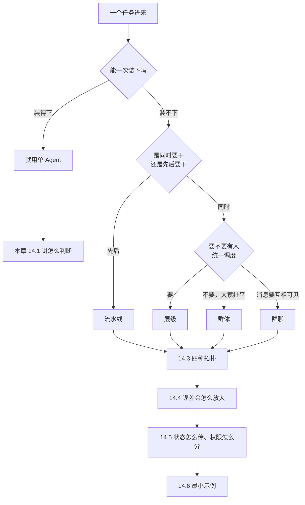
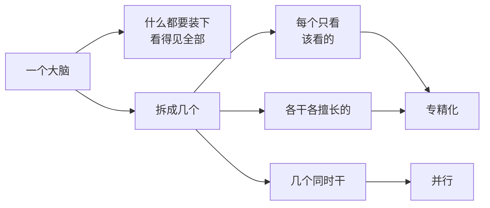
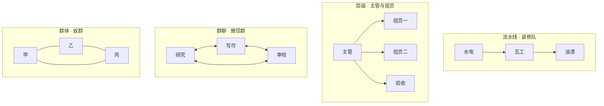
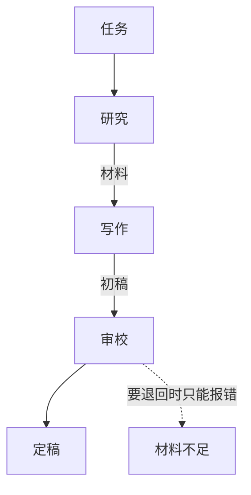
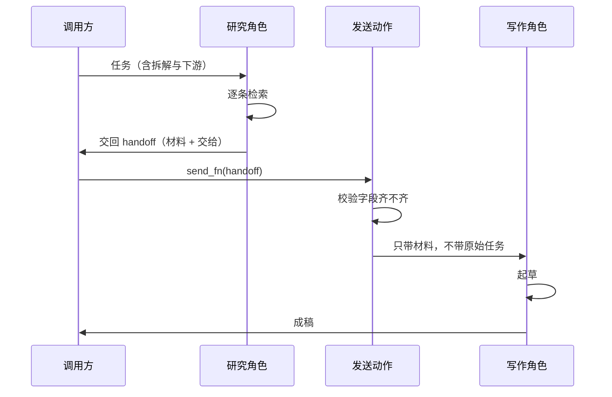

# Ch14 多 Agent 协作：什么时候该拆，拆了又怎么不塌

> 一句话简介：多 Agent 是要付代价的选择，不是默认更强的选择。

## 本章目标

读完本章你应当能：
- 说出四种"这事一个人干就够、别拆"的判据
- 画出流水线、层级、群聊、群体四种协作形状（拓扑），并各配一个生活类比
- 用一条具体例子说清楚误差是怎么沿着交接链条被放大的
- 拿到一个失败的多 Agent 系统，能按失败类型对症下药，而不是笼统地说"模型不行"
- 说清共享状态、上下文传递、身份权限这三处工程取舍各自在防什么

## 本章导览

先把这章的立场摆在最前面，因为不摆清楚，后面的内容读者会当成"多 Agent 教程"来读，而它不是。

**本章默认的答案是：先别拆。** 单个 Agent 是默认选项，多 Agent 是要付代价才换来的选择。这句话听起来消极，但它省掉的钱和调试时间是实在的。多 Agent 系统最常见的失败方式不是"某个 Agent 太笨"，而是"三个都不笨，合起来把事做坏了"——链条一长，前面一个小错就有机会被后面放大，而放大之后的产物看上去还挺像样，比一个笨 Agent 出的错更难被发现。

Part 2 Ch10 讲过为什么要把活分给不同的"工位"：一个人干不完所有类型的活，分工之后每个人只看自己该看的东西（见 Part 2 Ch10）。本章往后再推一层——那个例子只说明了"分工为什么合理"，没回答三个更要命的问题：**什么时候该拆？拆成几个？拆完它坏了，是谁的锅？** 这三个问题就是本章的骨架。

Part 2 Ch9 提过，业界后来专门立了一套"Agent 之间互相说话"的协议（见 Part 2 Ch9）。协议层的东西本章一个字都不展开——本章只讲"分工与交接"这件事本身的逻辑，协议留到 Part 4 Ch19。



顺着上面这张图走一遍，你就知道全章的顺序了。任务进来先问一句"能不能一次装下"——装得下就没后面的事了（14.1 讲怎么判断这一问）；装不下，才轮到第二个问题：这些活是**先后**要干还是**同时**要干。先后要干就是流水线，同时要干才问第三个问题：要不要有人统一调度——要，是层级；不要，但消息要互相可见，是群聊；既不调度也不排队，大家地位平等、靠商量收敛，是群体。四种形状定下来之后，本章用两节讲它们各自的代价：14.4 讲误差怎么沿着交接链条被放大，14.5 讲拆完之后真正要动手做的三件工程事。收尾的 14.6 用二十来行代码把最短的一条流水线缩到最小。

如果你现在赶时间，全章只读两处也够用：**14.1 的四种单 Agent 情形**（决定要不要拆），以及 **14.4 的失败分类法表**（拆完了怎么定位问题）。这两处占了本章八成的实用价值。

## 14.1 先反着讲：默认应该是单 Agent

大部分关于 Agent 协作的讨论，是从"怎么把活分出去"开始的。本节反过来，从"什么时候不该分"开始。理由很实际：拆的成本你在一开始看不见，只在出了问题之后才结账。

先演一遍"没有单 Agent 这个默认选项会怎样"。假设我们规定所有任务都必须拆成至少三个角色，每个角色只拿一部分材料。读者试着写一封道歉信——没有"查证"角色可查，没有"起草"与"润色"之分，写信是一个连续的动作，硬拆成三段只会让每一段都不知道上一段在干什么。你立刻会觉得别扭。**这个别扭感，就是单 Agent 默认优先的全部理由。**

下面四种情形，我认为是"别拆"的可靠信号。它们有个共同点：**每一条都在描述一件"本来就该由一个人干"的活长什么样。** 所以别把这一节当成一张禁令清单，它是四个描述——你可以在自己的任务上逐条对，看它像不像。

### 14.1.1 任务可以线性拆完

**白话**：一件事能顺次做完，中间没有"必须同时进行"的部分，也没有"必须回头改前面"的弯。

**类比**：泡茶。烧水、洗杯子、放茶叶、冲水——四步，每一步都知道上一步产出了什么，按顺序做就行，拆给三个人反而要互相等。

**例子**：把一个季度的销售数据汇总成一张表。取数、算汇总、画图，三步顺序明确，第 2 步要的就是第 1 步的输出。你可以让一个 Agent 顺着做完；拆给三个 Agent，第 2、3 步就得等第 1 步的结果传过来——传的过程会丢信息（14.5 讲这件事）。

为什么这是"别拆"的信号？因为线性任务里，多 Agent 唯一多出来的东西是**交接**，而交接必然有损耗。收益是零的时候，损耗就是纯亏。

顺手把这句话补完整一点。线性任务里，多 Agent 能带来的收益只有"分工带来的专注"——但你回想 14.2.1 讲的，专精化的价值来自"两段上下文截然不同"。线性任务的两段恰恰是同一段上下文：取数和算汇总都需要看到同一批数据。那种情况下所谓的"专注"是假的，因为两个角色看到的东西一样、担心的东西也一样。**收益是零，损耗是实打实的一份材料转述。**

还有一种情形值得一并想到：**顺序不确定的任务也不该拆成流水线。** 比如"根据客户反馈决定先修哪个 bug"——反馈和要修哪个 bug 是互为因果的，谁先谁后没法预设。这种任务不适合流水线拓扑（14.3.1），但它并不适合随便拆几个角色，更适合老老实实交给一个 Agent 连着做。这是 14.1 的四条判据最容易被绕过去的一个口子，值得单独记一笔。

### 14.1.2 中间产物装得下

**白话**：从任务开始到结束，需要一直摆在桌上的东西不多，一次对话的容量够用。

**类比**：小学生的书包。文具盒、水杯、课本，全塞得下，就不用为了"分类"专门买个大书包。

**例子**：把一段会议录音整理成纪要。整个过程摊在工作记忆上的东西大概是"原始转写文本 + 一份待填的纪要模板"，几十万字以内。

这一条要小心区分"装得下"和"看起来装得下"。真正决定的是**中间产物的累计体积**，不是任务描述有多长。查十个网页、读三个文件、跑一次代码——每一步都"还好"，加起来可能已经撑爆了窗口。判据不是单步大小，是"所有中间产物加起来"。

有个便宜的估法：**把中间产物列出来，数一数行。** 研究阶段的原始材料、筛选后的候选清单、最终结论这三样加起来有多大？如果摊开写满好几页纸，你就已经在单 Agent 的临界点上了；如果只是几十行，完全不用担心。这一步不需要精确估数，量级对了就行。

而"装得下"还有另一层意思：装得下，模型就看得见全部事实，做判断时不用"猜"。装不下，模型只能靠推测补全——推测就是误差的入口，14.4 会看到误差从这里溜进去。

顺着这个逻辑还有一句要说：单 Agent 也有"装不下"的问题，但它的表现是多轮循环去消化（见 Part 3 Ch11 11.1）。多 Agent 在这里**不是解决方案**——它只是把"一个窗口装不下"换成"多个窗口各自装一点"，代价是 14.4 要讲的那些。真正解决装不下的问题，靠的是压缩、筛选和外部存储，那属于 Part 4 Ch20 的正题。所以下次遇到"上下文装不下"，第一反应不应该是"拆成几个 Agent"。

### 14.1.3 调试要求很高

**白话**：出错了，你必须能一句话说清"是哪一步、因为什么错"。

**类比**：体检。医生要看片子，但体温计读数是好的——你就敢只信体温计。要是连体温计都不准，你不会只买一个便宜的。

**例子**：一个改了生产数据库字段的 Agent。出了错，你得能指出"是它调 `update_order` 那一步参数填错了，还是它压根调错了工具"。单 Agent 时日志是一条链，顺着读就能定位；三个 Agent 时你要跨三份日志对时间线，而三份日志的时间戳来自三个时钟。

这条判据的分量常被低估。很多团队拆 Agent 是为了"显得工程化"，结果同时把可调试性扔了。**代价清单里，可调试性通常是最先被牺牲、最后才被怀念的那一项。**

调试这件事在单 Agent 里也不是白送的，但它便宜——一份日志、一条时间线，看完就知道。单 Agent 里出问题的两种典型形态是"某一步工具参数填错了"和"整个方向跑偏了"，两者都能从日志里读出来。多 Agent 把这两种问题都变复杂了：工具参数填错，可能是上游给的指令本身就含糊（那责任在上游），也可能是下游误解了（责任在下游），日志不再自带答案。

### 14.1.4 预算紧

**白话**：你按调用次数或按 token 付费，而每个 Agent 都要先被塞一遍自己的说明书。

**类比**：带三个实习生开一个会。三个人都得先花十分钟听同一个背景介绍，然后才能开始干——人越多，开会越慢。

**例子**：一个每天要处理十万条工单的系统。每条工单发给一个 Agent 处理是合理的；发三个 Agent 串行处理，光是"让它们互相知道对方在做什么"这件事就要烧掉三倍以上的调用量。

注意这里的账要算全。一个 Agent 的成本不只是它自己的推理，还包括：

- 让它理解自己职责的那段固定说明（每个角色都有，哪怕一模一样）
- 上游交给它的材料（下游要重读一遍上游读过的东西）
- 编排本身的判断（谁先做、做完给谁）——说白了就是一张排班表

这三项在单 Agent 里都为零。**多 Agent 系统的成本是"角色数 × 角色数"级别地涨，而收益是线性的**——这个账不划算的时候，就别拆。

延迟也要算在同一本账上。单 Agent 跑十步就是十步；五个角色并排跑，听起来是快了一倍，但每个角色启动时都要先读自己的说明书、读上游给的材料，这些"启动开销"是并行的五个角色各付一次，不是只付一次。真到了线上，并行的收益通常比直觉里小不少。

最后加一条实务上的提醒：**预算紧的时候，多 Agent 系统特别难做回归测试。** 因为每个角色的输出都有随机性，串起来之后你很难判断"这次结果和上次不一样"是正常波动还是真的坏了。单 Agent 的失败至少还能靠固定输入复现，多 Agent 的失败经常复现不出来——复现不出来的问题，就没法定位，也就没法修。

### 14.1.5 什么时候反而该拆

把上面四条反过来读，就是拆的信号。反过来只有一条是真信号：**同一件活里，有两种截然不同、且各自都吃大量上下文的判断**。

比如"先从一堆资料里找出相关的那几条，再把找出来的东西写成一篇文章"。前半段要面对几千行原始材料，后半段要面对一篇要讲究结构与文风的成稿。这两段的上下文几乎不重叠——找的时候不需要关心文风，写的时候不需要再翻原始材料。这正是 14.2 的第一个动机。

除这一条之外，"看起来该拆"的其他理由通常都不成立：**"任务很大"不是理由**（大可以拆成子任务给同一个 Agent 依次做），**"模型不够聪明"也不是理由**（那是换模型的事，模型路由另见 Part 6 Ch32）。

## 14.2 多 Agent 的三个真实动机

上一节的结论很窄：只有一种信号支持拆。这一节讲那一种信号具体长什么样，以及另外两个常被提起的动机为什么站得住。

三个动机，按"是否真的省事"排序：**专精化**（最实）、**上下文隔离**（次之）、**并行**（最容易被滥用）。



### 14.2.1 专精化：每个角色只干自己擅长的一件事

**白话**：不同角色只负责一类活，不负责别的。

**类比**：装修队里的水电工和油漆工。水电工只管走线开槽，油漆工只管刷漆。你不会让油漆工顺便去接电线——不是他不会，是他接了也没人验收。

**例子**：研究 Agent 只负责查资料，不负责写文风；写作 Agent 只负责把材料变成成稿，不负责判断资料对不对。

这一条最容易讲成"给 Agent 起不同的名字、塞不同的提示词"。那样理解就浅了。专精化的实质是**让每个角色面对的输入分布变窄**。

一个人做"查资料 + 写文章"，他每一轮都要同时照顾两件事：既要想"这条信息可不可信"，又要想"这段话通顺吗"。写得好的时候两件事互相帮忙；但两者对输入的要求是相反的——查资料要广，宁可多看几条；写作要窄，只要最相关的那几条。**同一个窗口里同时满足这两种相反的偏好，结果通常是两边都不够好。**

拆开之后，研究 Agent 的输入可以是"几千行原始材料 + 一个宽泛的问题"，写作 Agent 的输入是"五条精选结论 + 一个成稿要求"。前者不必担心文风，后者不必担心信息遗漏。这就是专精化真正买到的东西：**每个角色只需要在一个方向上做对。**

"输入分布变窄"这句话值得再展开半句，因为它决定了一个常被忽略的推论：**角色越窄，可测量的东西越多。** 宽泛的"帮我处理一下"没法判断做得好不好；"从这 200 条反馈里挑出 3 条最像投诉的"就有明确的判据——拿 30 条人工标好的样本对一下就知道准不准。窄任务可测量，于是你能发现它坏了；宽任务不可测量，于是它慢慢坏掉你也不知道。

这也解释了专精化常被误读的地方：**写角色说明时不该写"你是一个资深研究员"，该写"你只从给定的材料里挑，不要补充材料以外的说法"。** 前者几乎没有约束力，后者是可检查的。角色越窄，说明就该越像一份验收标准——因为窄任务的产出形状是可以提前定死的。

### 14.2.2 上下文隔离：不同角色之间不共享全部对话

**白话**：角色之间不共享全部对话内容，各自只看自己该看的那部分。

**类比**：两个部门各看各的档案。研究部不翻财务部的账本，财务部也不去翻用户访谈记录。互相知道有这么回事，但不共享底稿。

**例子**：研究 Agent 不需要看到用户的写作要求全文——"写给谁看""多长""什么语气"这些对它没有帮助，看到了反而是干扰：它可能开始琢磨"这个说法够不够有说服力"，然后在挑资料的时候就被带偏了。

这一条经常被误解成"省 token"。省 token 只是副作用，**主要价值是防止干扰**。一个角色看到的材料越多，它越容易去做"不属于它的判断"——这是 14.4 失败分类法里"角色越界"那一类的直接来源。

隔离的代价也是真的：被隔离掉的信息，那个角色就永远不知道了。如果写作 Agent 看不到"用户特别讨厌夸张的措辞"，它写出来的稿子就会踩雷，而**没有任何一个人会为这件事负责**——因为每个人都只看到了自己那一份。14.4 讲的就是这种"每个人都对、合起来错"的经典局面。

所以隔离要配一个问题回答：**下游缺了什么会猜错？** 猜不出来的那些信息，不能隔离，必须显式传过去。哪些该传，是 14.5 的内容。

这里有一个可以直接照着做的判断法。列出下游**必须知道才能不猜**的信息，然后逐条问：这条信息如果不告诉下游，下游会怎么做？会做错、还是会停下来问人？会做错的，必须传过去；会停下来问人的，可以不传——因为停下来问人本身就是一个安全的失败。多 Agent 里最糟的不是"做错了"，是"做错了还一副胸有成竹的样子"。

顺带说一个反直觉的现象：**隔离有时候会让系统表现变好，哪怕它丢了信息。** 因为下游拿到的材料更窄，它就更容易把全部注意力放在这一件事上，不容易分心。这不是好事——它只是说明"变好"和"做对"是两回事。窄输入很容易带来漂亮的产出，但你得确认那份漂亮不是因为它漏掉了什么。这一点在评测时特别容易骗人：拿一个本来就窄的子集测，指标很好看，上线才发现真实场景是宽的。

### 14.2.3 并行：几件互不依赖的活同时干

**白话**：几件谁也不需要谁的事，同时开始做。

**类比**：洗衣服的时候你去扫地、擦桌子——各干各的，快的是"同时"这件事，不是"分给了两个人"。

**例子**：同时查五个互不相关的事实——这家公司的注册地、它今年的营收规模、它的主要产品线、它现在的 CEO、它去年有没有被处罚。五个查询谁也不依赖谁，一个 Agent 循环五轮做完，或者五个 Agent 同时做完，答案一样。

看清楚了吗？并行的收益是**时间**，不是质量，也不是上下文。五个查询拆给五个 Agent，五个 Agent 看到的东西和一个 Agent 看到的一模一样，得到的答案也一模一样——只是快了。

这就是为什么并行最容易被滥用：它带来的加速是真实的，所以很容易被当成"多 Agent 的主要好处"。但它有个前置条件——**真的互不依赖**。只要有一件事必须先做完另一件才能开始，并行就退化成了流水线加一堆等待。

而且并行的代价在 14.4 会变得刺眼：五个 Agent 各查各的，最后谁来判断这五条结论彼此矛盾？没有第五个 Agent 来做这件事，矛盾就原样进了最终答案。**并行把"串行时本来就有的检查"给拆没了。**

这句话值得再掰开一点，因为它是并行最常见的坑。串行做的时候，前面那条查询的结果就摆在桌面上，模型做下一次查询时天然能看到它，于是"这条和刚才那条对不上"这种念头是有机会冒出来的。并行之后，每个角色都在自己的窗口里干活，**谁都没有"刚才那条"这个概念**——冲突判断需要一个同时看得见双方的角色，并行的结构里恰恰没有。

所以并行几乎总要多配一个环节，而这个环节要么是一个专职的对账角色（那就已经是层级了），要么就是调用方自己做的事（那意味着"并行"省下的时间被对账吃掉了一部分）。这不是说并行不该用，而是说：**用并行的时候要一并回答"谁来对账"**，别以为拆出去就完事了。

还要补一句并行和分工的区别，这两个词很容易混：**并行说的是时间维度，分工说的是职责维度。** 五个角色各查一个事实，这是并行也是分工（虽然分工得并不彻底）；两个角色一个查一个写，这是分工但不是并行（要等）。同一套系统里两种维度常常同时存在，看的时候分开数，会清楚很多。

## 14.3 四种协作拓扑

动机讲完了，接下来是形状。所谓**协作拓扑**，说白了就是"谁和谁连线"的形状——名字唬人，意思很直白。**你要是不知道有几种形状，看别人的架构图就只看得见一堆方框和箭头，分不清"研究 Agent 直接写报告"和"研究 Agent → 审校 Agent → 写报告"是不是一回事。** 工程上"多个 Agent 怎么连"只有四种基本连法。记住这四种，够你在任何一张架构图上读出这个系统的骨架。



四选一的经验判断是这样的：**任务有明确先后** → 流水线；**有质量风险、需要有人把关** → 层级；**情况多变、路径不确定** → 群聊；**没有唯一正确答案** → 群体。现实系统常常是混的——比如总体是层级，某个下属任务内部是流水线。

### 14.3.1 流水线：一条直线上前后接力

**白话**：Agent 排成一队，前一个做完交给后一个，每个只干自己那一段。

**类比**：装修流水线。走完水电，才轮到瓦工；瓦工走了，油漆工才能进场。每个工种只看自己那一段的现场。

**例子**：研究 Agent 产出材料 → 写作 Agent 产出初稿 → 审校 Agent 挑错。14.6 的最小示例就是这条流水线最短的样子。

流水线的特点：**顺序固定、每个环节职责单一、状态只在相邻两个环节之间流动**。它的好处是可预测——你知道现在东西在谁手上，出问题也只需要看两个环节的接口。坏处是僵硬——如果审校发现材料本身有问题，它没法让研究 Agent 回去补，只能报错。

流水线的这个"报不了错"值得展开：它不是 bug，是流水线的定义决定的。前面环节已经交付的东西不回收，后面的环节只有"接着做"和"停下来"两个选项。工程上的解法通常是加一条**回退边**——审校认为材料不足时，把请求原路退回研究环节。注意这条边是流水线结构上本来没有的，加它就多出一个环节在跑（增加成本），也多一个状态要处理（增加复杂度）。要不要加这条边，是"这个任务里质量风险有多大"的具体化。



### 14.3.2 层级：上面有人管，下面有人干

**白话**：有一个角色专门负责分工和验收，其他角色只管执行。

**类比**：项目组。主管接下总任务、拆成三块分给三个组员、每块交回来时主管验收、哪块不合格打回去重做。组员之间不直接对话。

**例子**：一个"总监"角色负责理解用户到底要什么、决定派给谁；下面挂一个查资料的、一个写代码的、一个做检查的。总监还要判断"这一块做得对不对"，不合格就让它重做。

层级的价值在于**验收点**。流水线上没有人生成最终判断，全流程任一环节出错，错误就直接流到用户面前；层级里多了一个专职的角色来拦。代价是**延迟与成本**：每一次退回都是从头跑一遍，而且主管角色的上下文要装下所有下游的状态。

层级还有一处容易忽略的设计：主管到底看不看得到下游的工作过程？看得到，才能提前发现问题；看不到，就只能在交付时才发现。这两者对上下文的要求差很多，14.5 会展开。

### 14.3.3 群聊：所有人都在同一个频道里说话

**白话**：每个角色都能听到其他所有人说的话，也能直接对任何人说话，没有固定顺序。

**类比**：一个工作群。人人都在群里，谁发现缺东西就喊一嗓子，谁有空谁接。热闹，但容易吵，也容易有人刷屏把关键信息淹掉。

**例子**：研究、写作、审校三个角色同处一个会话。研究发现材料有矛盾，喊一声；写作正好缺一个数据，随口问；审校看到有人跑题，插一句纠正。

群聊的好处是**灵活**：遇到流水线处理不了的情况（中间发现上游错了），当场就能说，不用设计一条回退路径。坏处是**注意力被稀释**——上下文窗口里塞满了所有对话，其中大部分与当前角色无关；而且"谁该现在说话"这个决定本身需要判断，判断错了就会出现两个人同时动手改同一份东西。

群聊还有一个隐蔽问题：**谁做最终决定？** 群聊天然没有主持人，容易变成几个人各说各话，最后谁嗓门大听谁的，或者干脆没人拍板。这个坑在 14.4 的"过早宣布完成"那一类里。

### 14.3.4 群体：大家扯平，靠共识推进

**白话**：没有主管，角色之间地位平等，事情靠大家协商或投票定下来。

**类比**：蚁群。没有蚁后下命令，每只蚂蚁只根据眼前的信息和几条简单规则行动，整体却表现出像有组织的样子。或者说：几个同事围着一张桌子讨论，没人拍板，靠讨论收敛出结论。

**例子**：三个角色各写一版方案，然后互相点评，最后投票选一版。这类结构适合"没有唯一正确答案"的活——写三个不同风格的标题然后投票，比让一个 Agent 写五遍再自己挑更靠谱。

群体的关键在于**收敛机制**。蚁群能收敛是因为规则极其简单且明确；LLM 角色之间的"规则"是自然语言，往往含糊，于是群体很容易陷入无休止的互相点评——每个人都觉得自己该改一下，改完又触发新一轮。

这类无休止的互动在工程上有很轻的解法：**给评审设一个硬性的轮次上限。** 不管有没有达成一致，第 N 轮之后就按预设规则定稿——比如取票数、或者取最早产生的那版。听起来像是在糊弄，但"有限时间内给出一个确定的答案"通常比"等到完美"更有用。这也是 Ch11 讲的循环终止条件在多 Agent 上的对应物：单个 Agent 的循环要问"什么时候算完"（见 Part 3 Ch11 11.6），多个 Agent 协商同样要问，而且要问得更早。

需要说清楚的是：市面上有一些开源框架把这四种形状做成了现成的写法，能省掉自己画图和写状态管理的工夫。但它们属于**实现选择**而不是本章的主题——本章讲的是形状本身的逻辑，换一套框架，这四条判据照样成立。真要用的时候，先按上面四条把形状定下来，再**按形状去找东西**：想找流水线就搜"工作流编排"，想找群聊就搜"多角色会话"，想找群体就搜"投票 / 评审"。别按框架名字找，按形状找——工具的名字每两年换一轮，形状不会。

## 14.4 误差放大：加更多 Agent 不等于更强

这是本章最承重的一节。前面三节都在讲多 Agent 能换来什么，这一节讲它要付什么账，以及为什么这张账单经常比想象中大。

一句话结论先给出：**多 Agent 系统不一定比单 Agent 强。** 这不是修辞。有研究专门分析了多 Agent 系统为什么失败，结论相当直接——在这些系统受测的主流基准上，它们相对单 Agent 的提升常常微乎其微（[Why Do Multi-Agent LLM Systems Fail?](https://arxiv.org/abs/2503.13657)）。

研究者把这些失败归成三大类。三个名字都自带"这是毛病"的色彩，你只要记住它们各管一件事：

| 大类 | 白话 | 说白了是 |
|---|---|---|
| **系统设计问题** | 这套分工方式本身选错了 | 不是你代码写错，是"角色该怎么分"这件事从根上就分错了 |
| **Agent 之间的误解** | 几个角色对不上话 | 上游说的是 A，下游听成了 B，而谁都不知道自己听岔了 |
| **验收缺位** | 没人核对就宣布做完了 | 三个角色都觉得"差不多了"，没有一个去对账 |

本章下面的失败分类法就是照着这三类的思路给的——它把三大类摊成了**七种**具体表现。其中「过早宣布完成」属于**验收缺位**，「级联放大」属于**系统设计问题**。这份研究一共看了多少条运行轨迹、总结出多少种失败模式，见本章参考区。

### 14.4.1 一场传话游戏

先不看系统，看人。

六个人排一排。第一个人被耳语一句：**"通知大家，今天下午三点开会。"** 他复述给第二个人时成了"今天下午三点开会"。第二个人复述给第三个人时，第三个人记成了"明天"。传完六个人，群里发出来的是：**"明天开会"**。

传话游戏的每一个条件，在这里都有对应物：

| 传话游戏 | 多 Agent 系统 |
|---|---|
| 六个环节 | 六个 Agent 依次接力 |
| 每个人只听到上一句 | 每个 Agent 只看到上游的产出 |
| 每复述一次都有一次改写 | 每交接一次都有一次摘要与重述 |
| 没人能回头问原话 | 没有 Agent 能回头看上游的原始材料 |
| 错的照样传下去，因为"看起来很合理" | 错的照样传下去，因为下游分不出真假 |

最后一行是最要命的。**下游判断不了，就一定会信。** 传话游戏里"明天开会"听起来完全合理，没有任何地方写着"可疑"；同理，一个 Agent 把"2024 年的数据"写成"去年的数据"，下游读到的就是一个语气笃定、时间合理的句子。错的不是格式，格式永远是对的；错的是内容，而内容没有校验点。

这就是**误差放大（error amplification）**：链条越长，前面一个小错越容易被后面放大。放大有两种机制，都值得单独说。

**第一种是转述式放大。** 上游产出是一大段材料，下游的窗口装不下，只能压缩成一小段再往下传——每压缩一次，就有机会丢一个限定词、换一种说法。传话游戏里第二个人把"今天"记成"明天"，就是这个动作。限定词（"大约""仅限华北区""截至上季度"）是最容易被压缩掉的东西，而它们恰恰是判断对错的关键。

**第二种是确认式放大。** 下游不只接收，还会在接收的基础上继续推理。上游说"营收 1200 万"，下游写报告时推了一句"考虑到增长趋势，全年有望达到 1500 万"。这一句**上游从没说过**，它是下游加的——但它读起来比原始数字更有分析味道，更像人写的，于是更容易被下一棒当成事实继续加工。

**链条越长，两种放大叠加得越狠。** 而这里有一个很残酷的不对称：多 Agent 换来的是线性收益（多几种能力），放大带来的是复合损失（误差按链条长度增长）。

### 14.4.2 失败分类法：先分科，再对症下药

上面这段分析有个直接的工程结论：**"多 Agent 没做好"是一句废话，因为它不可执行。** 要能开药方，就得先把失败分成若干类。

做法和医院分诊一样——先分科，再治。同一个"没做好"，可能是**七种**完全不同的病，每一种要用完全不同的药。下面这张表是本章最实用的一张表，建议存下来。

| 失败类型 | 典型表现 | 为什么会发生 | 缓解手段 |
|---|---|---|---|
| **听错指令** | 角色做的是相邻但不同的事——要"总结"给了"翻译"，要"查证"给了"推测" | 上游给的是压缩过的一句摘要，下游只看到这一句，缺少原始要求 | 交接时带上原始任务的关键约束，不只带结果 |
| **角色越界** | 研究角色开始评价文风，写作角色开始自己补事实 | 角色看到了不属于它的材料，忍不住顺手判断 | 收紧角色输入；把"只做什么"写成可检查的产出格式 |
| **消息丢失/格式不匹配** | 下游拿到的材料缺字段、字段名对不上，只能猜 | 传递方式是自由文本，上下游对"一份材料长什么样"没有共识 | 约定结构化的交接格式；字段缺失时**报错而不是猜** |
| **过早宣布完成** | 三个角色都觉得"差不多了"，没有一个去核对 | 群聊/群体结构里没有专职验收人；每个角色只看得到自己那部分 | 设一个验收角色，或一条硬性核对清单 |
| **级联放大** | 上游的错被下游加工得更像样，一路传到底 | 没人回头核；下游无法判断真假（见 14.4.1） | 关键结论带来源；下游对可疑事实做一次回查 |
| **协调开销耗尽预算** | 活还没干完，钱花完了/轮次用光了 | 每个角色都要被塞一遍说明书，上游产出下游要重读 | 角色数宁少勿多；能合的合 |
| **收敛失败** | 群体结构里无休止地互相点评，永远定不下来 | 收敛机制没定，或者规则含糊 | 给评审设轮次上限；平票时按预设规则决策 |

分类的意义在于**它把"重新设计一遍"的成本降下来了**。听到级联放大，加的是回查机制（改动小）；听到收敛失败，加的是轮次上限（改动更小）；听到消息丢失，改的是交接格式（改一个地方，全链受益）。反过来说，如果只知道"效果不好"，你能做的只有加模型、加角色——那恰恰是最贵的两个动作。

### 14.4.3 关于那句反直觉的结论

把这一节的话说明白：**多 Agent 不一定比单 Agent 强。**

这不是"多 Agent 没用"。上面那张表里的每一类失败都是可修的，修好了之后，多 Agent 的并行和专精化收益是真的（14.2 讲的那些）。这句话要挡的是另一种误用——**因为"看起来更高级"就拆**。

拆之前请老实回答一个问题：**我这个任务里，有没有两段上下文截然不同、且各自都很吃上下文？** 有，那拆（14.2.1、14.2.2）。没有，那拆了就是在为"误差放大"创造机会，换不来任何能力上的好处，14.1 那四条判据该拦就拦。

还有一层更深的账。多 Agent 系统出问题时，**最贵的往往不是修它，是看出来它坏了**。单 Agent 的产出你扫一眼就知道对不对；多 Agent 的产出经过了若干次压缩与再加工，往往读起来比真实情况更流畅、更有条理——流畅正是压缩出来的副产品，它掩盖问题，不揭示问题。

这引出一条很实用的工程建议：**在多 Agent 系统里，第一件该建的不是"让它更聪明"，而是"让它能被检查"。** 具体就是：每一步的中间产物留痕；关键结论带来源；交接用结构化格式而不是一段话；有一个角色专门负责最后核对。这些东西在 14.5 展开。

## 14.5 工程取舍：状态怎么传、权限怎么分

前面四节讲的是"要不要拆、怎么连、错了怎么办"。这一节讲拆完之后真正要动手做的三件事。三件事各防一类问题，而且**每一件都有"不做会怎样"的明确后果**。

### 14.5.1 共享状态：共享什么，会不会互相污染

**白话**：几个 Agent 之间共用一块数据区，谁都能往里写。

**类比**：一本公用的工作日志本。所有参与的同事都能往上写东西。好处是信息一处可见；坏处是有人把潦草的草稿写进正式页，也有人把结论写到便签区，两种记录混在一起没人分得清。

**例子**：一份任务材料。三个角色都要读它。研究角色往上追加"检索记录"，写作角色往上追加"草稿"，审校角色往上追加"修改意见"。

共享状态的核心矛盾是**可见性与污染的取舍**：

- 全共享——好处是每个角色都知道别人干了什么，不会重复劳动；坏处是上下文里塞满与本角色无关的内容，还会互相覆盖。
- 完全隔离——好处是每个角色干净；坏处是没人知道全局，卡在两个角色之间的问题永远出不来。
- 折中——共享一个只读的"事实区"（任务原始要求、已确认的结论、已发现的矛盾），加几个各自私有的"工作区"（草稿、检索记录、候选方案）。

折中方案里那句"已发现的矛盾"值得单独说：**它是最值钱的一格。** 因为矛盾是跨角色才能发现的——研究角色发现两条资料打架，只有把这件事写进共享区，写作角色才有机会看见它。如果矛盾只留在研究角色的私有区里，那么这个系统就会一边知道有矛盾、一边照样把稿子写完，这是最坏的一种失败。

规矩只一条：**共享区只放确定的东西，不放草稿。** 一旦草稿进了共享区，它就会被别的角色当成事实引用——这正是 14.4.1 里"确认式放大"最常见的起点。

### 14.5.2 上下文传递：给结果，还是给原始材料

**白话**：上游往下游传的，到底是"结论"，还是"结论加上得出结论的依据"。

**类比**：同事之间转述一个消息。"三点开会"是结论；"三点开会，因为临时改了地点"是结论加依据。下游拿到后者，才能判断这个时间可不可靠。

**例子**：研究 Agent 返回 `{"结论": "去年营收 1200 万", "来源": [...], "口径": "含内部交易"}` 对比 `{"结论": "去年营收 1200 万"}`。

只传结论，下游就只能选择"信"或"不信"，两个都很糟：信了就是把误差放大，不信就是白拆。传依据，下游才有第三个选项——"口径含内部交易，我按对外口径再核一下"。

所以传递的规矩是：**能传依据就传依据；传不了依据时，至少标一个"这条我不确定"或"这条来自二手来源"。** 这个标记不产生收益，它产生的是让下游有机会怀疑——而下游只有在你给了标记之后才可能怀疑。

还有一件容易忽略的事：**要不要传上游的完整过程？** 传了，下游能在发现问题时往回追；不传，系统更省、更快，但也彻底断掉了追溯路径。经验做法是：**中间过程只留在日志里，不进下游的上下文；依据和来源进下游的上下文。** 日志是给人查的，上下文是给模型用的，两者混在一起就是 14.1.3 说的那种"调试要求高"时最怕的状态。

至于 Agent 之间的消息该按什么协议来传、消息信封长什么样——那是协议层的正题，本章一个字不展开。业界已经有一套专门的标准在管这件事（见 Part 4 Ch19）。本章只守住一件事：**不管你用哪套协议，"带不带依据"这件事是你自己要在内容里写清楚的，协议不会替你做这个决定。**

### 14.5.3 身份与权限：谁能动真格

**白话**：每个角色能碰哪些东西，是要分开的。

**类比**：装修队里，水电工的钥匙开得了配电箱，油漆工的钥匙只开得了房间门。不是不信任谁，是**让误操作的影响范围可控**。

**例子**：一个 Agent 只能查资料、另一个 Agent 能写文件并执行命令。如果两者权限相同，第一个 Agent 的一次幻觉就可能删掉用户的数据；如果分开了，那次幻觉最坏的结果只是"查回来的东西不对"。

这一条接的是 Ch11 讲过的老话题：动作分读操作和写操作，读操作无副作用、可以放心重试，写操作默认有副作用、重试等于重复施加（见 Part 3 Ch11 11.3）。多 Agent 把这件事放大了——**你重试的不再是一个 Agent，而是整条链**，而链上可能有好几个写操作。

按这个逻辑，最省心的分配方式是：**只让一个角色有写权限。** 需要读的任务全都可以随便并行重试；需要写的任务排队走一个出口，出问题时也只有一处要查。

与之配套的是**授权边界**：什么程度的动作能自己干，什么程度必须先问人。Ch11 讲过循环末尾只有三个岔路口——继续、换招、求助人类，并且强调求助人类是兜底而非首选（见 Part 3 Ch11 11.6）。多 Agent 里这条口径要保持一致，而且要多一层意思：**谁是那个"求助人类"的角色？** 如果三个角色都可以直接问人，用户会被问三次；如果只有一个角色能问人，它就得替另外两个兜底——那它实际上已经是个主管了，你其实做的是层级结构（14.3.2）。

权限怎么挂到操作系统层面、沙箱怎么圈边界，属于 harness 工程的问题（见 Part 4 Ch21）。本章只给一条原则：**权限是防线，不是开关。** 它挡的是"模型判断错了"这类你无法靠提示词消除的情况。

### 14.5.4 三处取舍的速查

| 取舍点 | 不做会怎样 | 最小可行做法 |
|---|---|---|
| 共享状态 | 两角色卡在中间的问题永远出不来 | 一个只读事实区 + 各自私有工作区 |
| 上下文传递 | 误差放大无从察觉 | 结论必带来源或"不确定"标记 |
| 身份与权限 | 一次幻觉就能改到真实世界 | 只让一个角色有写权限 |

## 14.6 最小两 Agent 示例

讲了一整章，最后用二十来行代码把整件事缩到最小。这是本书 Part 3 的示意代码，对应 [`code/part-3/multi_agent_min.py`](../code/part-3/multi_agent_min.py)。

```python
# illustrative only
# Ch14 示意代码：researcher + writer 两个 Agent 的最小消息传递
# 重点不是代码，是"交接"——上游的产出怎样成为下游的输入。


def researcher(task, search_fn):
    """研究 Agent：把任务拆成若干检索动作，把结果并成一份材料。"""
    findings = [search_fn(sub) for sub in task["拆解"]]
    return {"材料": findings, "交给": task["下游"]}


def writer(handoff, draft_fn):
    """写作 Agent：只做一件事——把上游材料变成一段成稿。"""
    return draft_fn(handoff["材料"])


def run(task, search_fn, draft_fn, send_fn):
    """主编排：上游产出交给下游，下游产出再回到调用方手里。"""
    handoff = researcher(task, search_fn)
    assert handoff["交给"] == "writer"     # 上游必须说清交给谁
    send_fn(handoff)                        # 这就是"发消息"这一步
    return writer(handoff, draft_fn)
```

这二十来行里没有模型、没有框架、没有循环。它是 14.3.1 流水线最短的样子，三个部分各对应一件事：

**`researcher` 是上游。** 它拿到任务，拆成若干检索动作，逐个执行，把结果并成一份材料。它的产出形状是**一个结构**——`材料` 装结果，`交给` 装这份材料要去哪。注意这两个字段的性质完全不同：`材料` 是内容，`交给` 是路由信息。

**那个 `交给` 字段是本章最想让你看见的一行。** 它存在的原因很朴素：**多 Agent 系统必须有一个地方显式地说明"东西交给谁"，而不是靠默契。** `assert` 那行把它变成了硬约束——上游没说清楚，程序当场停。

看 14.4.2 那张表的第一行：**听错指令**，缓解手段是"交接时带上原始任务的关键约束，不只带结果"。这个 `交给` 字段就是那条约束在最小规模上的样子：它让"交接给谁"变成一件**可以被检查的事**。真实系统里会有更多这样的字段——交回给谁、失败了找谁、这份东西的来源是谁——但它们全都是同一个想法：**把口头约定变成结构化的、能被检查的东西。**

**`writer` 是下游。** 注意它拿到的**上下文只有 `handoff` 这一份**（另一个参数 `draft_fn` 只递工具、不递内容），**它看不到原始任务**。这就是 14.2.2 的上下文隔离在代码里的样子：研究角色和写作角色看到的世界不一样。代价也在这里——如果 `handoff` 里没带"写给谁看"，writer 就无从知道；代码不会报错，只会写出一篇语气不对的稿子。

**`run` 是编排（orchestration）**——决定"谁先做、做完交给谁"的那套规则。**白话**：这就是排班表。**类比**：工厂流水线上，工件流向哪道工序由它决定。**例子**：A 做完交给 B，B 做完交给 C。

`run` 就四行代码，正好把编排的四件事摆出来了：先调上游、断言交接对象、调用发送动作、再调下游。

`send_fn(handoff)` 这一行值得停一下。**它在这里只是"传一下"的动作，但它代表的是整条链路上风险最大的一步。** 14.4.1 说的传话游戏，坏就坏在这一步上。真实系统里这一步要做的事包括：序列化、校验字段齐不齐、记录日志、以及最重要的一项——**判断这份材料是不是值得往下游传**（比如研究角色只查到两条弱相关资料时，是该老实报"材料不足"，还是硬着头皮递下去）。这个判断决定了下游是在补全，还是在误解。



这张时序图把"交接"这件事拆成了能看到的两半：`R→C` 是上游交回产出，`S→W` 是把产出送到下游。中间那个 `S` 是本章提醒你**不要省掉**的一步——它可以只是传个参，但在真实系统里，它是唯一能拦住"材料字段缺失"和"交接对象写错"的地方。

这二十来行代码里没有出现的东西，恰好是本章花力气讲的那些：材料质量怎么保证、冲突谁来发现、下游缺信息怎么办、失败怎么归因。它们全部在 `search_fn` 和 `draft_fn` 这两个被传进来的函数背后。**多 Agent 系统的难度从来不在线路图上，在那些被压缩成一行调用的地方。**

## 本章小结

- 本章的默认立场是**先别拆**。四种"单 Agent 更好"的信号：任务可线性分解、中间产物装得下、调试要求高、预算紧。
- 拆的可靠信号只有一条：**同一件活里有两段上下文截然不同、且各自都吃大量上下文**。"任务大"和"模型不够聪明"都不是理由。
- 三个真实动机是**专精化**（输入分布变窄）、**上下文隔离**（防止干扰）、**并行**（只换来时间，且要求真的互不依赖）。三者收益的量级差别很大。
- 四种拓扑：**流水线**（顺序固定，最可预测）、**层级**（多一个验收点）、**群聊**（灵活但注意力被稀释）、**群体**（适合没有唯一正确答案的活，难在收敛）。
- **误差放大**是本章的承重结论：链条越长，压缩式转述与下游自行补全这两种放大机制叠加得越狠。多 Agent 的成本按角色数复合增长，收益却是线性的。
- 结论要记住：**多 Agent 不一定比单 Agent 强**。先把系统变得**可被检查**（留痕、带来源、结构化交接、有验收角色），再谈让它更强。
- 三处工程取舍：共享状态分成只读事实区与私有工作区；上下文传递要带依据或"不确定"标记；权限上只让一个角色能写。
- 协议层的东西本章不展开（见 Part 4 Ch19）；本章守住的判断——"带不带依据"——是内容层的决定，协议替你做不了。

## 本章参考

### 必读论文
- [Why Do Multi-Agent LLM Systems Fail?（Cemri 等，2025）](https://arxiv.org/abs/2503.13657)——本章 14.4 的直接依据。论文用 1600 多条标注轨迹建了一套多 Agent 失败分类法，识别出 14 种失败模式、归为三大类，并指出这些系统在主流基准上相对单 Agent 的提升常常很有限。本章 14.4 的三大类用的是论文原意，只是换成了更适合初学者的中文说法：**系统设计问题**指"角色该怎么分"这件事本身选错了，**Agent 之间的误解**指论文里的 inter-agent misalignment（几个角色对不上话），**验收缺位**指 task verification 这一类（没人核对就宣布完成）。本章 14.4.2 的表是照着这个思路写的简化版。

### 推荐博客 / 教程
- 想看多 Agent 系统实际跑起来的中间产物长什么样，最快的办法是自己搭一个最小的两角色流水线，把每一步的交接内容打印出来。本章 14.6 那二十来行就是最小的种子——把它改成能真跑的版本（补上两个函数），比读十篇文章有用。

### 视频 / 课程
- 本章不需要视频。建议的替代路径是：读完本章后直接读 Part 5 Ch25——那是把这四种拓扑真正实现成代码的地方，本章的取舍在那里会变成具体的接口设计。