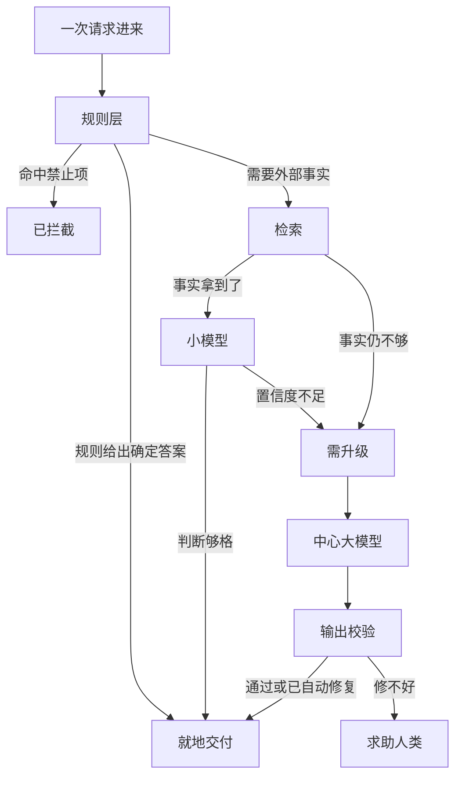
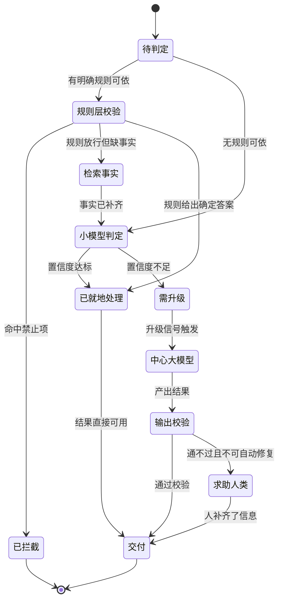

# Ch15 混合系统：规则、检索、小模型与中心大模型

> 一句话简介：真实的 Agent 系统往往不是"一个大模型"。

## 本章目标

读完本章你应当能：
- 说出一个混合系统里四类部件各自负责什么、各自会在哪里失效
- 举出三种"该升级了"的升级信号，并解释它们为什么必须是可自动检测的
- 画出一个级联路由的状态迁移图，说清"就地处理"在哪一步收尾、"升级"在哪一步触发，以及这两条路分别通向哪一个交付出口
- 判断一个系统该上混合，还是老老实实一路调用大模型

## 本章导览

先看一眼本章的骨架。这是**一次请求进来之后会经过哪些部件、在哪里换人**的完整走法——现在不用记住细节，能对着图把话说一遍就行：



图最上面是"一次请求进来"，进来先撞上**规则层**。这一步有三种走法：命中禁止项，走**已拦截**那条线，系统到此结束；规则直接给出了确定答案（比如 320 有没有超过上限），就地**交付**；剩下的情况一律放行，问题变成"事实齐了吗"。

事实没齐就去**检索**补齐，补齐之后交给**小模型**做判断。这一步是全图的分岔点：小模型说有把握，结果直接就地交付；说没把握，走**需升级**那条线，把这活交给**中心大模型**。检索自己也有一个升级口——事实查回来还是不够，同样走**需升级**，不必硬着头皮往下猜。

中心大模型做完也不是直接交付——它的结果要先过一遍**输出校验**：缺个默认字段之类能自动修的，补完就交；修不好的，走**求助人类**。

这张图现在你只需要记住一件事：**通往中心大模型的路只有一条，它前面只设了两道闸——检索没查到、小模型没把握——每一道都必须有人明确说"我不行"才放行。** 左边那大半截全是便宜部件在接力，真正花钱的只有中间那一条窄路。这就是 15.3 要讲的级联结构在图上的样子。

现在回到这张图背后的问题。先把本章要回答的问题摆出来。前面四章我们讲的东西——四件套怎么协作、循环有哪几种转法、记忆分哪几类、多个 Agent 怎么协作——都默认了一个前提：**Agent 的判断，主要由模型来做。** 这个前提在教学里好用，因为把复杂问题归到一个地方才好讲。但真实的工程系统很少是这么长的：它更像一家医院，既有门卫的规定，也有翻档案室的护士，也有分诊台，还有专科医生。

**白话**一句话说清本章说的"混合系统"：不是一个大模型包打天下，而是几类便宜又可靠的部件各管一段，最贵的那个只在最后兜底。真正要搞明白的是**它们怎么被组织起来**——什么时候该走便宜的通道，什么时候该升级。

先把本章的核心结论用一句大白话说出来，你读完全章之后再回来对一遍，看是不是能一字不差地复述：

> **不是所有活都该由最贵的大脑干。能用便宜部件判掉的判断就便宜地判掉，只有便宜部件明确表示"我不行"的时候，才升级到中心大模型。**

这句话里有两个词要落地，本章会反复用。第一个是**级联（cascade）**——**白话**：便宜的处理排在前面，前一个处理不了才轮到贵的。**类比**：先挂普通门诊，普通门诊看不了再转专家门诊，你不会一进医院就直奔最贵的那个专家。**例子**：一个小模型先给工单分类，它对分类结果的把握够高就直接派单，把握不够才把工单原文交给中心大模型去读。

第二个是**升级信号（escalation signal）**——**白话**：判定"该换更贵的部件了"的那个触发条件。**类比**：分诊台的转诊标准——"体温超过 39℃ 就转急诊"，这条线是事先写死的，不是每个病人现商量。**例子**：小模型分类时报上来的把握程度低于门槛线（这个数有个名字叫**置信度**，15.3.3 会细讲）；或者从文字里抽出来的类别不在已知清单里；或者输出没通过格式校验。这三条都是**程序能自己测出来**的，不需要人再来看一眼。

如果这两句话你都记住了，本章剩下的内容都是在给它们添细节。赶时间的话，全章只读两处也够用：**15.3.2 的状态图**（决定"什么时候升级"），和 **15.4 的失败模式表**（决定"哪里会出错"）。

---

## 15.1 问题现场：一次报销请求里藏着四种判断

我们从一个具体场景开始。别急着看图，先自己动手拆一次。

用户打进一句话：**"上周三买了个 320 元的键盘，走报销。"**

现在假装你就是那个要写代码的人。你的第一个念头很可能是"那就调一次大模型，让它把这句话拆成结构化的字段，填进报销单"。这个念头不算错——它确实行得通，本书的绝大部分示例都是这么干的。但你有没有想过，这句话里其实藏着好几个判断，而它们的难度差得很远？我们一句一句拆开看。

**第一句判断：这句话是什么意思？** 要理解"上周三买的键盘"是在申报一件已经发生的采购。这需要理解意图——**贵**，得让中心大模型来。

**第二句判断：这句话里有金额吗？有多少？** 要在"买了个 320 元的键盘"里认出 320 是个金额。这需要一个动作：从一大段文字里把结构化的字段挑出来。这种动作叫**抽取（extraction）**——**白话**：从一大段文字里把结构化字段填进表格。**类比**：财务把一堆报销单摞在一起，逐张把金额、日期、事由填进同一张表。**例子**：从"上周三买了个 320 元的键盘"里抽出 `{金额: 320, 物品: 键盘, 时间: 上周三}`。

**第三句判断：320 元超过报销上限了吗？** 这是一个比较——320 和一个固定数字 500 比大小。**便宜**，甚至便宜到不需要任何模型，一行 `if` 就够。

**第四句判断：公司的报销标准里，键盘算可报销品类吗？** 麻烦来了。这条标准不在模型的参数里——公司上个月才改的，而且每家公司都不一样。模型硬答就等于**编**。要答对必须先去把标准查回来。**便宜**，但贵在"查"而不在"想"——查事实比比较一个常量贵一点，可还是比"想清楚这句话要干什么"便宜得多。

现在把四个判断排个队，你会得到这样一张表：

| 判断 | 难度 | 谁做最合适 | 要是做错了会怎样 |
|---|---|---|---|
| 金额是多少 | 便宜 | 抽取 / 小模型 | 填错数字，人要手工改 |
| 超过上限了吗 | 极便宜 | 规则层 | 本该拒的批了，钱花出去收不回 |
| 键盘能报销吗 | 便宜（查） | 检索 | 答一个公司根本没写过的品类 |
| 这句话到底要干嘛 | 贵 | 中心大模型 | 理解错意图，后面全错 |

注意这张表里**只有最后一行需要"理解意图"**。前三行分别是查表、比较、找文件——它们需要的是"知道答案在哪"，不是"想清楚这句话的意思"。

这就是问题现场。**一次看起来需要"智能"的请求，实际只有一小部分真的需要智能。** 请注意，本章不给"80% 的活很便宜"这类统计数字——我们不知道你手上的活到底是什么比例。正确的读法是你自己拿一批真实请求，像刚才那样一句一句拆开看，数一数有几行落在上面那张表的前三行。**你数出来的比例，才是适合你系统的比例。**

顺手把刚才那个请求画成一条链，你会看得更清楚——注意每个环节的产出形状不一样，这是 11.1 讲过的判别法在新场景里的复用：

```text
"上周三买了个 320 元的键盘，走报销。"

  → [规则层]   320 < 500 ？        → 是，继续            （确定性判断）
  → [检索]     键盘 ∈ 可报销品类？ → 是，附"办公设备"    （事实供给）
  → [小模型]   抽字段              → {金额:320, 物品:键盘,
                                     日期:2026-10-07}    （结构化产出）
  → 交付：填单，等人提交                                 （0 次大模型调用）
```

再假设用户补一句 **"顺便，我上次那个发票找不到了怎么办"**。链子会在中途拐一次：

```text
  → [规则层]   通过
  → [检索]     查上次报账记录   → 找到单号 BK-8842
  → [小模型]   抽字段           → 置信度 0.55，低于门槛线
  → [升级]     这句追问         → 交给中心大模型（"找不到了怎么办"要读懂意图和上文）
```

同样是报销，第二句让中心大模型出动了。**变的不是系统，是请求。** 级联要解决的就是：让系统在这种"大部分时候不用、大概时候要用"的状态下自动完成切换，而不是由人每次手动决定。

那既然便宜活这么多，为什么还要把中心大模型留着？因为它确实干着一件别的部件干不了的事。前面那行判断（这到底是报销、投诉还是闲聊？）需要读懂人的真实意图，而"找不到了怎么办"这种话，连意图本身都不完整——它依赖上文。这是本章无法省掉的一层。问题不是"要不要中心大模型"，而是**"什么时候才轮到它"**。

现在再往前追问一步：既然要分工，怎么保证"该便宜的时候真的走便宜了"？这就引出了本章剩下要解决的两件事。第一件是**分工本身**——这四类部件各自能干什么、干不好会怎样（15.2）。第二件是**分工之后的调度**——一次请求来了，谁先上、什么条件下换人（15.3）。

---

## 15.2 四类部件各管什么

先看看如果**没有**部件分工会怎样。假设我们只有一个中心大模型，所有判断都交给它。这套做法在教科书里完全成立，它也能跑。问题出在三个地方，而且三个都是**结构性**的，靠"换个更聪明的模型"解决不了：

- **不是每次都需要理解意图**，但每次都被收了理解意图的钱和等待的时间。
- **有些判断必须每次都一模一样**（"禁止访问系统账户文件"这类边界），而模型的输出天生带随机性——同样的问题，上一次放行，这一次拦下。
- **有些答案压根不在模型里**（你们公司的报销标准），模型越强，编得越像真的。

这三件事分别对应下面四类部件中的三类。带着这个"没有它会怎样"的动机，我们一个个看。

### 15.2.1 规则层：把不该商量的写成死的

**规则层**这个词听起来平淡，但它撑起了系统里最硬的那部分边界。**白话**：写死的、不由模型决定的判断。**类比**：门卫的规定——没工牌不能进楼，这条不随你今天心情如何而变。**例子**：禁止访问系统的账户文件；单次扣款超过限额直接拦截。

先说它的**独特地位**：四类部件里，只有规则层**不需要模型**。检索要检索引擎，小模型和中心大模型要推理资源，只有规则层是一段确定性的代码。这带来一个别的部件给不了的好处——**可预测**。同样输入永远同样输出，不需要重试，不会漂移，出了问题可以直接复现。凡是"错一次的代价很大、而且必须为零"的判断，都应该落到这一层。

那么它具体管什么？三类活：

1. **边界拦截**。不许读某些路径、不许调某些工具、不许写某些字段。11.3 讲过"读操作和写操作要分开对待"（见 11.3），规则层就是这条原则的执行者。
2. **额度与限额**。单次最多扣多少钱、每天最多调多少次模型。
3. **输出校验**。最后交出去的东西是不是符合格式——是不是 JSON、字段齐不齐。这条会在 15.3 再次出现，它是升级信号之一。

再说**它的失效模式**——这是本章最需要你记住的一段。规则层的失败不是"漏了几条"，而是三种更麻烦的形态：

- **过窄**：只写了三条禁止规则，结果绕过去第四条就干了坏事。攻击者专挑规则没写的地方。
- **过宽**：把正常请求也拦了。用户体验上这是"这个系统动不动就发火"。
- **写在错的地方**：规则逻辑散落在业务代码里，改一处要翻五个文件。这条不是运行错误，是维护错误，但杀伤力最大。

规则层的具体工程实现——权限、沙箱、拦截钩子——属于 harness（Agent 外层的运行装置）的正题，展开在（见 Part 4 Ch21）。本章只抓住一条：**它是四类部件里唯一不依赖模型随机性的一类，因此它是系统行为的下限保障。**

### 15.2.2 检索：把参数里没有的事实找回来

第二类是**检索**。**白话**：把模型参数里没有的事实查回来。**类比**：答题的时候翻书——书上有答案，但答案不在你脑子里，你得去查。**例子**：产品的最新价格、你们公司的报销标准、某条工单上周的状态。

检索存在的理由可以用一句话讲完：**模型参数里没有的东西，它只会编。** 这一点在 Ch12 讲幻觉时已经反复出现过。但检索比"让模型别编"要主动得多——它不是抑制编造，是**真的把答案送到模型面前**。

它在混合系统里承担的是"事实供给"这一角色。注意一个常被搞混的地方：**检索解决的是"事实"，不是"理解"。** 查回来一堆文本之后，还得有人读懂它们。所以检索和中心大模型不是替代关系，是**供给关系**：检索负责把答案从外面搬进上下文，判断"这个答案够不够用"仍然要靠后面的部件：详见 Ch13 对检索式记忆的讨论，以及更完整的检索增强生成流程（见 Part 5 Ch23）。

检索的**失效模式**有三个，从轻到重：

- **查到了但没用上**。最常见的一种。检索回来十段文档，模型没在里面找到答案——因为它压根没往那段看。这类问题不在检索器里，在"检索结果怎么摆进工作记忆"上，属于上下文工程（见 Part 4 Ch20）。
- **查到了错的**。索引本身是旧的。你的报销标准上个月改了，索引没更新，检索器忠实地返回了上个月的版本。
- **压根不知道该查什么**。这是最难的一种——查询词本身需要理解意图才能生成，而理解意图正是中心大模型的活。所以检索不是独立的，它**嵌在**别的部件里面。这一点在 15.3 会体现得更清楚。

### 15.2.3 小模型：干粗活的那个

第三类是**小模型**。**白话**：比中心大模型小一号、便宜一号、快一号的模型，用来干不需要深度理解但需要一点灵活性的活。**类比**：分诊台上的护士——她不是专科医生，但她会看脸色、听主诉、按经验分诊。**例子**：给工单分类、从自然语言里抽字段、把用户的话改写得更规范一点。

小模型干得最好的是四件事，恰好对应 Agent 里最高频的四种操作：**分类**（这属于哪一类）、**抽取**（这段文字里的字段是什么）、**改写**（把口语变成规范表述）、**去重**（这两句是不是同一件事）。

它最大的价值在于**便宜**，而且便宜的幅度往往超乎直觉——同样一件事，小模型的单位成本可能是大模型的百分之一，也就是**便宜一百倍**。便宜这么多，是本章整个"级联"想法能成立的经济前提：如果两者成本相当，把简单活交给小模型就毫无意义，直接全部上中心大模型完事。后面 15.4 会用一张表把这笔账摊开。

那"小模型也能扛推理"这件事有没有可能？这里要回指一下 Ch12 的一个实验：ReWOO 的工作把一个 175B 模型的推理能力卸载进了一个 7B 的小模型里。这件事的意义不在于"7B 也能推理"，而在于它证明了**推理的负担可以被重新分配**——你不必把全部推理都压在一个最大的模型上。这个观察是本章"级联"思路的一个缩影，也是它从"分工"升级为"可调度"的关键。

小模型的**失效模式**要分两类看，因为它们的处方完全相反：

- **能力不足**。它分不清、抽不准、看不懂长文本。这类只能靠换模型或者靠升级信号把它摘出去。
- **过度自信**。它明明分不清，却给出 0.95 的把握。这类更隐蔽，因为升级信号本身失效了——15.3.3 讲置信度信号时会专门回到这里。

### 15.2.4 中心大模型：兜底的那个

第四类是**中心大模型**，它前面已经讲过很多了，这里只补上它在混合系统里的**位置**。它是四类里唯一一个**以理解为唯一职责**的部件。

它的职责边界很清晰：**处理那些前面三类都处理不了的活**。具体说就是两类——需要理解意图的判断（这句话到底想干什么），以及需要权衡的判断（这两条要求冲突了，该满足哪一条）。

它也有它自己的**失效模式**，而在混合系统里，它的失效模式跟前三类都不一样：前三类坏在"做不好"，中心大模型坏在"**做得慢、做得贵、而且做得不稳定**"。更麻烦的是第四种——**它不知道自己做得不好**。一个幻觉的答案从它嘴里出来的时候，语气和正确的答案一模一样。这就是为什么混合系统不能只靠中心大模型自己判断"我要不要升级"：判断这件事必须由外面那个更笨但更刻板的部件来做。

现在把四个部件摆成一张表。这张表建议先记住前两列，用到的时候再回来查后面：

| 部件 | 擅长什么 | 典型活 | 主要失效模式 |
|---|---|---|---|
| 规则层 | 确定性的边界判断 | 拦截禁止项、卡额度、校验输出格式 | 规则过窄被绕、规则过宽误伤、逻辑散落难维护 |
| 检索 | 提供模型没有的事实 | 查最新价格、查公司标准、查历史记录 | 查到了没用上、查到旧版本、不知道该查什么 |
| 小模型 | 高频的粗活 | 分类、抽取、改写、去重 | 能力不足、过度自信（置信度假高） |
| 中心大模型 | 理解意图与权衡取舍 | 拆解复杂诉求、在冲突要求间取舍 | 慢、贵、输出不稳定、不知道自己错了 |

这张表还有个读法你可能没注意：**四行里没有一行是"多余的"。** 少任何一行，系统都还能跑，但会在某个具体的场景上塌掉——少规则层就塌在边界上，少检索就塌在事实新鲜度上，少小模型就塌在成本上，少中心大模型就塌在复杂请求上。这是混合系统的基本盘：**不是四选一，是四道分工。**

不过"四道分工"这四个字容易读成"各管各的、互不相干"，那就错了。这四类部件其实共享着**同一份工作记忆**——Ch11 讲的那个"开会时摊在面前的那张纸"（见 11.1）。规则层放进去的拦截结论，检索放进去的事实，小模型放进去的抽取结果，全都在同一张纸上。中心大模型之所以能"用上"前面三层的产出，不是因为它记得前面发生了什么，而是因为**那三层的产出都写在了它能读到的那张纸上**。

这一点值得多说一句，因为它是整个混合系统里最容易被忽略的工程约束：**部件之间的传递介质是上下文，不是内存。** 每多一层，就多一次"把上一层的产出翻译成下一层能读的形状"。翻译得干净，接缝就看不见；翻译得糙，你得到的就是 15.4 里那条"接口不一致"。

顺着这个读法，这张表其实回答了一个更根本的问题：**这四类部件的分工，是按"能力"分的，不是按"组织"分的。** 换句话说，划分它们的标准是"这件事需要什么样的能力"——确定性、事实性、表层模式、意图理解——而不是"这个能力由谁提供"。这个视角在 Ch14 讲多 Agent 的时候已经出现过一次，那边分的是"谁去干哪一段活"，这边分的是"这件事的性质决定它归谁"。两者的区别在本章 15.3 会讲清楚。

但这张表还留着两个问题没答。第一，它只说了"谁擅长什么"，没说服人"顺序怎么排"——为什么不是让中心大模型先上、简单活也走它？第二，它完全没提**什么时候从便宜的换到贵的**。这两个问题是 15.3 的全部内容。

---

## 15.3 路由与升级信号：什么时候该换更贵的部件

上一节结尾那两个问题，现在一并解决。这一节分六小步走：先定顺序，再画出链子，然后讲"什么时候换人"的那几个具体条件、两个容易滑过去的变体，最后落到代码和适用判据。

### 15.3.1 顺序：按代价排，不按准确率排

先说第一个问题的答案，它可能有点反直觉：**顺序不是按"准确率"排的，是按"代价"排的。** 让中心大模型先上，然后试图在它答错时退回便宜部件——这条路也有，但它要求你**先花了最贵的钱**。而让便宜部件先上、答不了再升级，你只在真正需要时才付那笔钱。这两条路的最终结果可以一样，账单能差一百倍。

第二条路就是本章开头说的**级联（cascade）**：便宜的处理排在前面，前一个处理不了才轮到贵的。请注意级联和 Ch14 讲的"多 Agent 协作"**不是同一件事**。Ch14 是把一件事拆给几个**能力相当**的 Agent 分头做；级联是把事**按难度排队**，能力小的那一环天然是能力大那一环的前置。两者的区别在拓扑上就能看出来——多 Agent 是网状的，级联是链状的。

### 15.3.2 级联的状态机：链子长什么样

把它画成状态机，是本章第一次用状态图，也是本章最值得你记住的一张图：



读这张图，从最上面那个 `待判定` 出发。你会注意到它前后有好几处分岔，但**真正决定这次请求花多少钱的分岔只有一个：`小模型判定` 那一步**。`待判定` 和 `规则层校验` 也各有分岔，不过那些分岔只是在便宜部件之间选路，账单基本不变——那之前是便宜部件之间的接力（规则层 → 检索 → 小模型），那之后是贵部件的独角戏。整条链子上花钱与否，就看小模型那一拍拍不拍板。

最后说一处初看会愣一下的地方：图上 `待判定` 除了往右走，还有一条边**直接指向 `小模型判定`**，中间跳过了规则层和检索。这不是画漏了，标签写着「无规则可依」：像"把这条工单归到哪一类"这种请求，本来就没有一条写死的规则可对，检索也没有外部事实可查，那就没必要绕那一圈，直接让小模型分类。**规则层和检索不是每次请求都必须经过的关卡，而是"有活可干时才上场"的部件。** 这也解释了本章开头那张总览图为什么把检索画成规则层的一条分支——总览图画的是最常见的走法，这里这张图把例外也补上了。

### 15.3.3 三种升级信号：什么时候该换人

现在说升级信号——就是 `小模型判定 → 需升级` 这条边上那个括号里的条件。前面说了，它必须满足一个硬性要求：**程序自己能测出来，不需要人来判断。** 理由你回顾一下 15.2.4 结尾那句——中心大模型不知道自己做得不好，所以"要不要升级"这件事绝不能交给模型自己决定，必须由一个更笨但更刻板的东西来决定。

常用的升级信号有三种，我们一个个看。

**信号一：置信度不足。** 最直觉的一种。小模型分类的时候不只给标签，还给一个"我有几成把握"。这个数低于阈值就升级。

这里有个坑值得停一下：**置信度是模型自己报的数字，它可能高得离谱。** 一个没见过的表述，一个模型照样能报 0.98。所以真做的时候要用一批标注好的样本来**标定**这个阈值——找那个"召回率还能接受"的点，而不是拍脑袋定 0.7。你可以把阈值想成**分数线**：过了线才算这门科目会，而及格线划在哪，直接决定有多少人被送去补考。而且阈值是个要持续调的旋钮：定高了省钱但漏升级，定低了升级太频繁，等于白设了级联。

**信号二：抽出的类别不在清单内。** 不看置信度，看内容。小模型抽出来一个"其他/未知"，或者抽出一个系统里根本没有的类别——这说明请求超出了这一级能处理的范围，不管它报多少把握，都该升级。这个信号的好处是**完全不需要标定**，它就是一个集合成员判断，因此特别适合当兜底信号。

**信号二的一个延伸：查回来的东西为空。** 15.2.2 说过检索的第三种失效是"压根不知道该查什么"，但有一种情况更简单也更常见：**你确实知道自己该查什么，检索器也确实去查了，索引里就是没有这条。** 这时候不该在原地重试（重试一百次索引还是空的），也不该直接升级到中心大模型（它只会编一个更圆的答案）。正确的动作是**扩大检索范围或者直接求助人类**。把"检索为空"当成升级信号是一件很自然的事——它同时踩中了信号二（不在清单内）和 11.6 的求助人类岔路口（缺了它猜不出来的信息）。

**信号三：输出通不过校验。** 最晚的一道闸。小模型（或者中心大模型）把结果交出来，规则层拿 15.2.1 说过的那套校验逻辑跑一遍——格式不对、字段缺失、数值超出范围，都算没过。没过怎么办？两种处置：

- **可自动修复的**——比如只是缺了个默认字段，补上再交。注意这**不算升级**：升级信号说的是"换一类更贵的部件顶上"，而这里还是原来那个部件自己返工。
- **不可自动修复的**——15.3.2 那张图上就是从 `输出校验` 直接走 `求助人类`。工程上也有人让它先回中心大模型重试一次再找人，那多出来的一次调用就是这条路径的价钱。

**求助人类**这个终点你可能觉得眼熟。是的，它就是 11.6 讲的三个岔路口里的第三个（见 11.6）。级联链的末尾和 Agent 循环的末尾，遇到的是同一类问题：系统走到自己能走的尽头了。这里再提醒一次那条纪律——**求助人类是兜底不是首选**，一条把大部分请求都甩给人的级联链，设计是错的。

**信号三的一个细节：谁来当校验员？** 15.2.1 说过校验逻辑属于规则层，所以这里有个容易绕晕的地方——**校验员本身也是这条链上的一个部件，它跑在最末端，检的是前面所有部件的产出。** 换句话说，规则层在这条链上出现两次：开头拦边界，末尾验产出。开头那次管"不许做"，末尾这次管"做得对不对"。两个位置的逻辑不同但同源，所以共享同一份规则定义——这正是把规则集中管理的好处，改一处两边都生效。

### 15.3.4 两个容易忽略的变体：环境性信号与回退

三种信号讲完了，还有两个容易滑过去的变体。它们都不是"小模型不行"，但都真实发生在链子上。

一个是**环境性信号**——它不属于"小模型不行"而属于"环境不行"：**工具报错或超时**。这和 Ch11 讲的"换招"岔路口是同一件事（见 11.6）——级联链上遇到工具失败，不是重试，而是先换个手段再继续；重试和换招的区别，11.6 已经划清楚了。

另一个是**反向问题：升级是单向的吗？** 在 15.3.2 那张状态图里是单向的——一旦升上去就不下来了。但这未必总对。如果中心大模型给出的答案通不过输出校验，而它给出的理由其实是"这事我需要一个我自己能查的事实"，那么正确的动作可能不是继续往上砸资源，而是**退回检索那一环**把事实补齐再试一次。工程上确实会做这种"回退"路径，但每加一条回退，链子的状态图就复杂一分——这正是 15.4 说的维护复杂度的一部分。

### 15.3.5 落到代码：级联路由的骨架

现在把上面说的落成代码。级联路由的骨架其实非常短，短到有点反直觉：

```python
# illustrative only
# Ch15 示意代码：级联路由——便宜的判断先做，做不了才升级到中心大模型


def cheap_check(text):
    """小模型干粗活：判断这段话能不能用规则直接处理掉。
    返回 (handled, result)，handled 为 True 表示不用升级。"""
    if "?" in text or "？" in text:
        return False, None              # 问句要理解意图 → 升级
    if len(text) < 30:
        return True, f"已记录：{text}"    # 短指令照做，不用大模型
    return False, None


def central_llm(text):
    """中心大模型：兜底处理真正需要理解意图的活。"""
    return f"（大模型处理）{text}"


def route(text):
    """级联主函数：先便宜后昂贵，升级信号 = 小模型处理不了。"""
    handled, result = cheap_check(text)
    if handled:
        return "小模型", result
    return "中心LLM", central_llm(text)
```

完整文件在 `code/part-3/cascade_router.py`。这段代码值得逐行读一遍——它是级联骨架的**最小切片**：为了把"升级信号"这一件事讲透，这里只留了 15.3.2 那张状态图中间最关键的两步——判定（`cheap_check`）和兜底（`central_llm`）。图上的 `规则层校验` 和 `检索事实` 要排在判定之前，`输出校验` 和 `求助人类` 要排在兜底之后，**这些文件里都还没有写**。你打开代码找不到它们，不是漏了——这是一个刻意留下的骨架，不是完整实现。

- `cheap_check` 返回的不是一个标签，是**一个二元组** `(handled, result)`。这个形状就是"能不能就地处理"的判定本身——`handled` 是升级信号的载体，`result` 是它顺手给出的产出。
- `route` 里那四行就是状态图上 `小模型判定 → 已就地处理` 和 `小模型判定 → 需升级 → 中心大模型` 这两条边的全部实现。**级联的全部复杂度，落在了一个 `if` 上。**
- 返回值里的 `"小模型"` / `"中心LLM"`（后者是代码里的简写，正文一律叫"中心大模型"）不是装饰，是**记账用的**——15.4 讲成本的时候会看到，它是你统计升级率的唯一数据来源。没有这个标签，你事后永远不知道自己的路由准不准。

刻意留在代码里的两处粗糙，是为了让概念清楚：这里的"置信度"是拿文本长度当的代理，"问句"是拿标点当的信号。真实系统里换成 15.3.3 说的那三种信号，**结构一个字都不用改**——变的只是 `handled` 那个布尔值是怎么算出来的。这是级联路由最值得学的一点：**升级信号的算法可以迭代，级联的结构是稳定的。**

### 15.3.6 什么时候不要上混合

那么本章目标里的最后一个问题：什么样的系统**不该**上混合？答案比想象中简单——**当四类判断里只有一类存在的时候。** 如果这个系统处理的所有请求都是需要深度理解意图的对话，那它老老实实一路调中心大模型，不要加规则层也不要加小模型，多加的每一层都是纯成本。反过来，如果你的请求有九成都是能查表判定的，加混合的收益就大得多。**判据还是 15.1 那句话：拿一批真实请求拆开数一数。**

还有一条经验：**别一上来就做全套。** 四类部件同时上，等于你一次装了四个可能出问题的新东西，而你还不知道哪个真的有用。更稳的做法是从最小的开始——先加规则层（因为它单独就有安全价值），跑一段时间看看升级率；再决定要不要加小模型。**每加一类，观察一轮，再加下一类。** 这也是本章想让你带走的工程态度：混合系统的复杂度是可以增量获得的，不必一次性买单。

---

## 15.4 收益账与失败模式

这一节要做一件前面一直欠着的事：**把好处和代价都摆出来。** 只讲好处的架构文章很多，本节不会那样。

先看收益。它们不是同一件事，容易被混着说，所以分开讲。

**第一是钱。** 这是最直观的。15.2.3 说过，小模型和中心大模型的单位成本可能差一百倍。级联把绝大部分请求挡在中心大模型之前，账单就直接跟着下来了。这类研究里已经有人系统地量过这件事：有一项工作专门研究怎么把不同规模的模型串成级联，报告的实验结果是**用级联可以在匹配最强单个模型表现的同时把成本降低最多 98%**，或者在同样成本下把准确率提到比最强单个模型高 4%（FrugalGPT，参考区有链接）。这两个数字是那项工作的实验设定下的结果，换到你自己的数据上不会照抄——但**便宜一百倍这个方向是稳的**。

**第二是等待。** 同一件事，便宜部件的响应通常快十倍以上。对交互式产品来说，这直接是体感差别；而对批量任务来说，延迟降低还能让整条链子转得更快。

**第三是稳定性。** 这条最容易被忽略，也最重要。规则层不依赖模型随机性，所以它保证了系统的**行为下限**：无论模型今天发挥得好不好，那些必须拦住的请求一定被拦住了。没有这一层，你的系统就有概率——哪怕是千分之一——放行一次本该禁止的操作。**千分之一乘以每天几万次请求，就不是一个可以接受的数字。**

这条还有个反直觉的好处：**规则层的存在让中心大模型可以放松一点。** 一个知道边界有规则层兜底的模型，推理时不必把"我会不会越权"这件事挂在心上，可以把注意力全放在任务本身。反过来，如果模型独自承担全部安全责任，你就得在每次提示词里反复叮嘱它——而这种叮嘱**必然会漏**，漏一次就是一次事故。

**第四是可调试性。** 这条的价值要过一段时间才显现。级联把"这次请求最终由谁处理了"记了下来，于是你事后能回答一个以前答不了的问题：*"上周那批答错的请求，是小模型干的还是中心大模型干的？"* 答案是小模型干的，那该修的是阈值或者小模型；答案是中心大模型干的，那该修的是提示词或者换模型。没有这个标签，你只能猜。

再看代价。三条，按咬人的顺序排。

**代价一：路由本身会出错，而且错法有四种。** 这是混合系统自带的、和中心大模型的失效完全无关的一类新故障。加了一层路由，就多了一处会出错的地方——这是所有"加一层"都要付的账。四条错法：

- **该升级没升级**（漏升级）：阈值定得太保守，便宜部件硬着头皮答了不该答的。后果最严重，因为它是**静默**的——系统看起来在正常工作。
- **不该升级却升级了**（过度升级）：阈值太激进，钱白花了，但至少结果通常是对的，**不容易被发现**。这条的隐蔽性和上一条刚好反过来。
- **升级信号本身测不准**：置信度不可信（15.3.3 说过的过度自信），这条会让整个信号机制形同虚设。
- **升级了但接不住**：中心大模型也答不了。链子走完了，只能走求助人类或者直接失败。

四条里，前两条有一个共同点值得单独拎出来：**它们不会报错。** 系统不会崩、不会抛异常、日志里干干净净——只是结果慢慢变差，或者账单慢慢变高。这就是混合系统最需要监控的两项指标：**升级率**和**分部件的正确率**。升级率突然从 5% 跳到 40%，几乎一定是阈值或小模型出了变化；某个部件的正确率下滑，先查它自己的版本。两项都做不进监控面板，这套系统就等于在裸奔——观测怎么做（见 Part 6 Ch29）。

把这四条列成表，配上"错在哪一步"，因为你以后排查问题基本都落在这张表上：

| 失败模式 | 症状 | 根因 | 修哪儿 |
|---|---|---|---|
| 漏升级 | 便宜部件给了个错答案，没人拦 | 阈值太保守 | 调阈值 / 补规则 |
| 过度升级 | 账单涨了，结果没变差 | 阈值太激进 | 调阈值 / 补清单 |
| 信号失灵 | 升级率忽高忽低，没规律 | 置信度不可信 | 用集合类信号兜底 |
| 接不住 | 链子走完了，还是没答案 | 中心大模型也答不了 | 转求助人类 / 换更强的模型 |

**代价二：部件之间接口不一致。** 这条不在上面那张表里，因为它不是路由自己出错，是部件之间的接缝对不上——最容易被忽略、也最难查。四类部件要互相传东西，而每一级都有自己习惯的格式。小模型抽出来的字段名和中心大模型期待的字段名对不上、检索回来的事实没有标注来源、规则层的校验逻辑和上游产出的结构不匹配——**这类问题不报错，只是让结果莫名其妙地差一截。** 它的成因是缺少一份明确的**数据契约**：谁产出什么形状、字段叫什么、缺失时怎么办。打个比方，**数据契约就是画在墙上的插座标准**——针数、电压、缺口位置是写死在墙上的，插头照着画就行，电器型号随便换；墙上没画标准，每个电工凭自己的习惯接一根线，当场能通电，换个房间就废了。本章不展开数据契约的工程做法（那是 harness 的正题），但你要有这个概念：混合系统的组件之间需要约定，组件越多，约定越重要。

举个具体的：15.1 那个报销链里，小模型抽出来的是 `{金额, 物品, 日期}`，而输出校验那一环约定要的是 `{amount, item, date}`。字段名对不上，校验规则会判定"字段缺失"，然后每一次都被判为不可自动修复、直接送去求助人类。**结果完全错，但每一层单看都没错**——这就是接缝型 bug 的典型面貌。对策不神秘：约定一份契约，然后让每一级的输入输出都过一遍契约测试。契约本身怎么定、工具之间怎么传结构化数据，是 Part 5 的正题（见 Part 5 Ch23）。

**代价三：维护复杂度。** 四类部件 = 四套东西要维护、四个地方会坏、还要有一份映射表告诉你"哪类问题该找哪类部件"。**这套映射表是整套设计里最容易被省掉、也最不该省掉的东西。** 没有它，一个出了 bug 的请求会在四类部件里被挨个怀疑一遍，而没有人知道该先怀疑谁。

把这三条代价和四条收益并排放一次，你会发现它们有一个共同的结构：**收益随请求量增长，代价随部件数增长。** 一天十万次请求、一共三类部件，那么"省下的钱"和"多出来的接缝"的比值是划算的；一天十次请求、一共五类部件，那多半不划算。这就是一个可以直接套用的估算方式：

```text
划算  ⟺  （请求量 × 单次省下的成本）  >  （部件数 × 每次改动的人力）
```

右边那一项提醒了一件事：**部件数不是一个技术指标，它是一个组织指标。** 每多一类部件，就多一个要有人懂、有人改、有人半夜被叫起来的人。所以"能不能再加一类部件"这个问题，工程答案往往不是"技术上能不能"，而是"团队里谁接"。

现在把这笔账用一个类比收住。多加一层路由，就像在办事大厅多加一个柜台：好处是能分流，坏处是多了一处会出错、而且出错时办事的人只会说"你们系统有问题"，不会说是哪个柜台接错了单。

最后给一个诚实的总结。混合系统**不是一个默认更好的架构**，它是一个**有前提的架构**——前提是"你的请求里有相当比例是便宜的判断"，而且这个比例**必须你自己去数**。如果前提不成立，加混合纯亏。用一句话把它说完整：

> **混合系统的收益来自"便宜的活足够多"，它的代价来自"部件之间多出来的接缝"。前者你能通过拆请求估算出来，后者只能靠克制——每加一类部件，接缝就多一道。**

---

## 15.5 通往 Part 6

本章讲的是一个 Agent 系统**内部**的分工。往后的 Part 会往外走一层。

第一个往外走的方向是**模型路由（model routing）**——本章讲的级联只是路由的一种形态，"挑够用就行"；更彻底的做法是根据请求的实时难度在多个模型之间动态选，甚至同时问几个模型投票。本章只给这个直觉，展开在（见 Part 6 Ch32）。

第二个方向是**成本控制（cost control）**——15.4 那张失败模式表里，"过度升级"这一行本质上就是一个成本问题。真实系统里还会有一整套监控升级率、平均成本、收益质量的做法。观测与评测属于（见 Part 6 Ch29）与（见 Part 6 Ch30），成本与路由属于（见 Part 6 Ch32）。

第三个方向是**投机解码（speculative decoding）**——一句话点名，不展开：让一个小模型先猜，大模型一次性验证，用小模型的便宜换大模型的准。它和级联的共同点是都靠"大小模型搭配"，不同点是投机解码加速的是**同一个模型的推理**，级联分的是**不同性质的判断**。展开同样在（见 Part 6 Ch32）。

三个方向摆在一起，你会发现它们问的是三个不同的问题。**模型路由**问"这次该找谁"——选择问题；**成本控制**问"这么找完之后账单还合不合理"——经济问题；**投机解码**问"同一次推理能不能快点"——速度问题。本章只处理了选择问题的一半（哪一类部件），另一半（哪一档模型）留到 Part 6。把三个问题分清楚，后面读 Ch32 时会省不少力气。

回到 Part 3 本身。这一章是 Part 3 的收尾，把前面几章的东西摆在一起看：Ch11 给了四件套怎么协作，Ch12 给了循环有哪几种转法，Ch13 给了记忆怎么存取和遗忘，Ch14 给了多个 Agent 怎么分工协作，而本章给出的是**一个更基础的问题**——在所有这些机制之下，系统的"判断力"到底由谁提供、怎么分配。

这个问题的答案可以串成一条线。Ch11 告诉你，判断发生在循环里，每轮末尾有继续、换招、求助人类三个岔路口（见 11.6）。Ch12 告诉你，循环可以用三种范式转，每种范式对推理的需求不一样。Ch14 告诉你，判断还可以拆给多个能力相当的 Agent 分头做。而本章告诉你第四种切法：**不按角色切，按代价切。** 一部分是规则，一部分查事实，一部分是小模型，剩下最后一点才轮到中心大模型。这四种切法没有优劣之分，只有适不适合你的请求分布。

答案就是本章开头那句话，你现在应该能一字不差地复述了：便宜部件先判，判不了才升级。

下一章 Ch16 会把 Part 3 全部内容收成一张装配图，然后交给 Part 4。到那时你会发现一个新的问题：部件本身都清楚了，**部件之间怎么组网**还没解决——上下文怎么组织才能既装得下又不丢关键、工具怎么协议化才能被多个 Agent 共用、权限和沙箱怎么落地才能让规则层说到做到。这三件事恰好就是 Part 4 的全部内容，所以下一章的结尾会专门做一次交接。

---

## 本章小结

- **混合系统**指的是：不由一个部件包办，而是规则、检索、小模型、中心大模型四类部件各管一段——白话，一句话就是"不是一个大模型"。
- **四类部件各有不可替代的位置**：规则层守行为下限（唯一不依赖模型随机性）、检索供模型没有的事实、小模型干分类抽取这些高频粗活、中心大模型做意图理解与权衡。
- **级联（cascade）** 把它们串成链：便宜的先做、明确做不了才升级。关键是顺序按**代价**排，而不是按准确率排。
- **升级信号**必须由程序自动检测、不依赖模型自觉。三种常用的：置信度不足、抽出的类别不在清单内、输出通不过校验；另加一类环境性信号（工具失败，走"换招"）。
- **回退路径要克制**。每多一条回退，状态图就复杂一分——15.3.4 讲的那个"退回检索再试"是可选的，不是必需的。
- **收益与代价都要算**：收益是钱、延迟、行为下限、可调试性；代价是路由自身会出错（四种失败模式）、部件间数据契约不一致、维护复杂度上升。
- **混合不是默认更好的架构**。前提是"便宜的活足够多"，这个比例必须拿真实请求自己拆开数。

## 本章参考

### 必读论文
- [FrugalGPT: How to Use Large Language Models While Reducing Cost and Improving Performance（Chen、Zaharia、Zou，2023）](https://arxiv.org/abs/2305.05176)——本章 15.4 引用的成本与准确率数字出自这篇；它把降推理成本的路子归成三类（提示适配、小模型近似、模型级联），本章的级联是其中第三类。摘要已核实。
- [RouterBench: A Benchmark for Multi-LLM Routing System（Hu 等，2024）](https://arxiv.org/abs/2403.12031)——当级联从"链"走向"在多个模型间动态选"，就需要一个衡量路由质量的公共尺子；这篇是那个尺子。想深入模型路由时读它。
- [ReWOO: Decoupling Reasoning from Observations for Efficient Augmented Language Models（2023）](https://arxiv.org/abs/2305.18323)——15.2.3 提到的"把 175B 的推理能力卸载进 7B"出自这里；Ch12 已完整展开，它和本章"推理负担可以重新分配"这个观察是同一件事的两个切面。

### 推荐博客 / 教程
- 本章的代码只有二十来行，建议直接读 `code/part-3/cascade_router.py` 而不是找外部示例——它把"升级信号"和"级联结构"这两件事的接缝暴露得清清楚楚：结构在 `route` 的几行里，信号在 `cheap_check` 的两个判断里。看完再去看 FrugalGPT 那篇论文的实验设定，你会发现论文里那些复杂的多模型组合，骨架就是这么几行。

### 视频 / 课程
- 本章不需要视频。建议的替代路径是：读完本章后直接读 Part 6 Ch32——那是把本章的"级联"放大成"在多个模型之间动态选"的正题，本章的四类部件在那边会变成一张路由策略表。