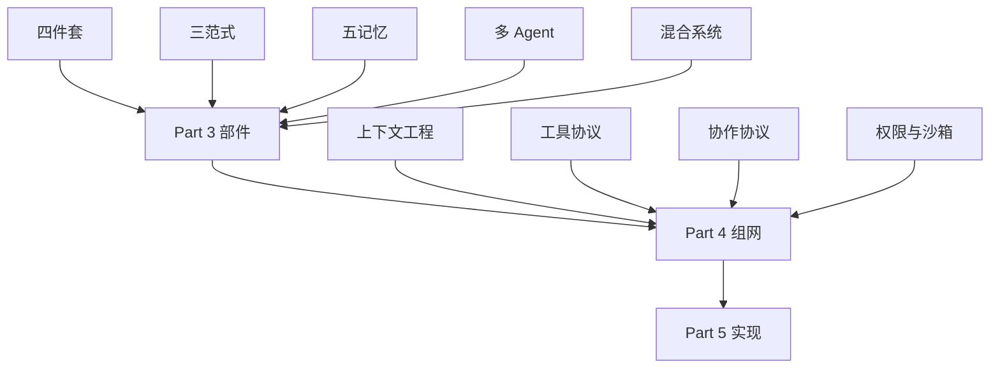
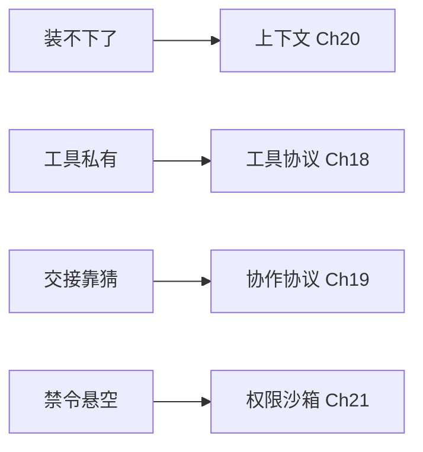

# Ch16 小结与衔接：把 Part 3 装回一张图

> 一句话简介：五章的内容都讲完了，现在把它们装回一张能背下来的图。

## 本章目标

读完本章你应当能：
- 用一张表说清 Part 3 讲过的全部机制，并指出每一块的正文位置
- 面对一个新任务，用三句话判断出「脑多大 / 记多少 / 拆不拆」
- 认出三个最常见的误用，并说出每个误用的替代做法
- 说清楚 Part 4 接手的到底是**哪一类**问题（而不是具体内容）

## 本章导览

先说本章的处境，免得你抱错期待：这是 Part 3 的最后一章，而它**不教任何新东西**。前面五章每章都在往零件清单上加东西，这一章一件都不加——它只做三件事：把五章收拢成一张可以随时回忆的图，给你一组开工前就能用的判断，点破三个你多半已经踩过或即将踩的坑，然后把接力棒交给 Part 4。

赶时间的话全章只读两处：**16.1 那张回顾表**和 **16.2 的三个问题**。

下面这张图是全书的骨架位置图。三个 Part 分工很清楚：**Part 3 讲部件，Part 4 讲组网，Part 5 讲实现**。



读这张图只需记住一件事：**前面 Part 的判断，要靠后面 Part 才变成能跑的东西。** 你在这五章学到的"该先想后做""该拆成多个 Agent"，在 Part 4 之前都只是一句判断。

## 16.1 装配图回顾：一页纸装下 Part 3

先演一个"没有这张表会怎样"。假设你三个月后要改一个 Agent 的记忆策略，翻遍 Part 3 也想不起来"记忆该什么时候写"讲在哪一节——大概率你会重读一遍 Ch13 的十几段，然后发现答案在 13.3 的一张小表里。这不是记性问题，是**结构问题**：五章本来就有内在结构，缺的是一张把它摊平的索引。

下面就是这张索引。**用法是查，不是背**：每行一句话，后面跟它真正的正文位置。

| 组 | 概念 | 一句话 | 详见 |
|---|---|---|---|
| **四件套** | 感知 | 把图片、网页、命令行结果统一整成"一段文字 + 几个结构化字段" | 11.2 |
| | 工作记忆 | 这一轮摊在桌面上的那张纸——只有它，其余三样才有地方落脚 | 11.1 |
| | 行动 | 真的改动世界。读操作能重试，写操作不能，这就是幂等键的理由 | 11.3 |
| | 规划 | 决定下一步干什么。**拆得对不对，决定后面所有的账单** | 11.5 |
| | 循环与岔路口 | 每轮末尾只能在继续 / 换招 / 求助人类里选一个；求助是暂停不是中断 | 11.6 |
| **三范式** | ReAct | 想到哪做到哪，靠每一轮拿到的真观察更新打算 | 12.1 |
| | Reflexion | 同上，外加一句"你这轮哪儿错了"写进下一轮开头——**不动模型** | 12.2 |
| | Plan-and-Execute | 开头先出一份清单，执行器照单跑，走偏了由重规划器改 | 12.3 |
| | 选型 | 一棵五问决策树，问的是任务结构，不是行业 | 12.5 |
| **五记忆** | 两把尺子 | 按"装什么"分五类，按"活多久"分三层，正交不冲突 | 13.2 |
| | 写 | 下次任务还会用到吗 | 13.3 |
| | 读 | 桌面上现在有没有这个事实 | 13.3 |
| | 忘 | 是不是**又老又不重要**；三样工具是衰减、容量上限、定期合并 | 13.3 |
| | 攻击面 | 写进记忆的内容，下一轮会被**当指令读**，不是当资料读 | 13.5 |
| **系统形态** | 默认单 Agent | 四条"别拆"的信号：线性可拆、装得下、调试要求高、预算紧 | 14.1 |
| | 该拆的唯一信号 | 同一件活里有两段上下文截然不同，且各自都很吃上下文 | 14.1.5 |
| | 四种拓扑 | 流水线、层级、群聊、群体；可预测性依次下降 | 14.3 |
| | 拆的代价 | 误差放大。收益线性、成本复合，多 Agent 不一定更强 | 14.4 |
| | 混合四部件 | 规则层、检索、小模型、中心大模型，各管一段 | 15.2 |
| | 顺序 | 按**代价**排不是按准确率排：便宜部件先判，判不了才升级 | 15.3 |

这张表最值得横着读的不是任何一行，而是**第一列的分组顺序**——它同时是 Part 3 的搭建顺序：

```text
先把四件套装起来             → 一个能转的最小循环
再决定这个循环怎么转         → ReAct / Reflexion / 先想后做
然后给它装上记忆             → 写 / 读 / 忘
再考虑要不要拆成多个         → 默认不拆，拆之前先过 14.1 那四条
最后把判断力分给不同部件     → 便宜的先判，判不了才升级
```

这条链上每一步都是**可跳过的**——跳过任何一步系统都能跑，只是会在某个具体场景上塌掉。塌法分散在五章各自的失效模式里，其中"少了判断力分层"这一种写得最集中：15.2 那张表一行写一种，少规则层就塌在边界上，少检索就塌在事实新鲜度上。

**一句话**：Part 3 讲的不是五章各管一摊零散方法，是**一个循环的五个层次**，从"怎么转"一路叠到"判断力归谁"。

## 16.2 三个问题：开工前的三句判断

先演一个"没有这三问会怎样"。设想你要给一个新场景做方案，会议上有人说"上多 Agent 吧，显得先进"，有人说"记忆存越多越聪明"，有人说"ReAct 最成熟"。听完你什么也没定——因为这些都是**立场**，不是**判断依据**。可操作的判断只有一类形态：**问一个能当场答上来的事实，用答案决定往哪边走。** 下面三问都属于这一类。

### 要多大的脑？

**问题**：这个场景里，"便宜活"和"难活"的比例是多少？

**判断依据**：拿真实请求拆开数一次——把最近一周的请求粗分成两类：**分类 / 抽取 / 查事实 / 改格式**这类不需要理解意图的粗活，和**需要理解意图或在冲突要求间取舍**的难活。前者占比高，就该上混合系统（15.2）；占比低，**老老实实全上中心大模型，别折腾级联**——级联自身的路由会出错（15.4 列了四种），简单活本来不多的话，省下的钱还不够付路由的麻烦。

真要上，依据是 15.3 那句：**顺序按代价排，不按准确率排**。便宜部件先判、判不了才升级——这意味着你**默认相信便宜部件会说出"我不行"**。所以配套的另一半是升级信号必须由程序自动检测（置信度不足、抽出的类别不在清单内、输出通不过校验），不能指望模型自觉。

### 要记多少东西？

**问题**：这条信息，下次任务还会用到吗？这次任务的桌面上，现在有没有它？

**判断依据**：这两个问题分别管写和读，答"不会"和"没有"就不写、不捞。至于"能记多少"，依据不在"能存多少"，而在**三条硬线的顺序**（13.3）：

```text
先有容量上限（"最多两千条"）           ← 没有上限的记忆库不是资产，是负债
再谈衰减（又老又不重要才沉底）         ← 光有上限，系统会退化成"只留最近的事"
最后定期合并（先合并，再删除）         ← 光有衰减，系统会退化成一个越来越臃肿的百科
```

顺序不能换。**先删后合会丢信息**——你把三条记录删了两条，就永远拼不回那条完整的经验。

还有一个反直觉但实用的判据：如果 Agent **记了东西却用不上**，先别急着加容量，去对 13.2 那张双向表——是**装错了格子**（该写进程序性记忆的写进了情节记忆），还是**活错了时长**（该跨会话的一次会话就丢了）？两种病的症状一模一样，修法完全相反。

### 要不要拆给别人？

**问题**：这个任务里，有没有两段上下文截然不同、且各自都很吃上下文？

**判断依据**：这题只答一个是或否。答"有"就拆，答"没有"就别拆——**"没有"比"有"更常见**（14.1 的默认立场就是先别拆）。守住三条否定项，因为这三个最常被拿来当借口：

- **"任务很大"不是理由**——大可以拆成子任务交给同一个 Agent 依次做。
- **"模型不够聪明"不是理由**——那是换模型的事，属于模型路由（见 Part 6 Ch32）。
- **"上下文装不下"不是理由**——真正的解法是压缩、筛选和外部存储（见 Part 4 Ch20）。多 Agent 只是把"一个窗口装不下"换成"多个窗口各自装一点"，代价是 14.4 那些放大。

**一句话**：Part 3 这五章教的东西，压成开工前的三问——**便宜的活多不多、要记的东西下次用不用得上、任务里有没有两段截然不同的上下文**。

## 16.3 三条常见误解

先演一个"没有它们会怎样"。上面那三问之所以要做，是因为有三个默认答案会让它们白问——它们平时不出声，等你真做方案时才跳出来替你做决定。

### 误解一：拆得越细越先进

戳破这一条，靠的不是"多 Agent 不是万能的"这种谁都知道的话，而是一个具体的现场：

> 你有三个角色——查资料的、写稿的、审校的。任务跑完了，三个角色都觉得"差不多了"，于是系统宣布完成，交付了一份稿子。三个月后有人发现稿子里引用的那个数字是错的，而且**审校那一关从来没真正核过任何一条**。

这是 14.4 里的**验收缺位**，不是笔误。它之所以会发生，是因为没有任何一个角色被赋予过"我要去核对这件事"的职责——每个角色只看得到自己那一段。修法很便宜：**设一个验收角色，或一条硬性核对清单**。

还有一个更隐蔽的版本：一个 Agent 把"2024 年的数据"写成了"去年的数据"，下游读到的就是一个语气笃定、时间合理的句子。**下游分不出真假，就一定会信**（14.4.1）。

所以正确的顺序是反过来的：**在多 Agent 系统里，第一件该建的不是"让它更聪明"，而是"让它能被检查"**——中间产物留痕、关键结论带来源、交接用结构化格式、有一个角色专责最后核对（14.4.3）。这些都做完，多 Agent 换来的并行和专精化收益才是真的。

### 误解二：ReAct 是银弹

戳破这一条，也要给一个现场：

> 你让一个 Agent 处理"把这 200 个文件按内容分类并归档"，它跑了大约 400 轮。第 300 轮的时候，它已经读不进最开头那份"这 200 个文件应该分成哪几类"的原始分类标准了，于是开始按自己临时想出来的标准归类。**而且漂得毫无痕迹，因为每一步都还有观察支撑。**

这就是漂移（12.1.3）。它危险的地方在于**你从输出里看不出来**——每一轮看上去都合理，只有回头对照最初那份标准才知道全歪了。

这个任务的正确答案不是"换个更聪明的模型"，而是**换驱动方式**：200 个文件里绝大多数是互不依赖的读操作，先扫一遍列成清单（想一次），并发读（12.3.3），最后统一分类（想一次）。

这条误解有个便宜的解药：**把四个症状对着自查一遍**（12.6.1 那张表）——越跑越贵是平方账、跑着跑着跑偏了是漂移、卡在同一个报错上是绕圈、方案完整但不敢动手是缺授权。**这四行里没有一行是"换个更强的模型"。** 症结在驱动方式，不在模型能力。

### 误解三：记得越多越聪明

戳破这一条，也给一个现场：

> 你把 Agent 说过的话、查过的结果、修过的报错统统记下来，让它"越用越懂你"。三个月后记忆库十万条。你问它一个具体问题，它捞回二十条相似的旧记录，其中十九条是噪声，剩下那条也不含答案——**答案藏在没被捞上来的那一条里**。更糟的是，你的衰减规则可能已经悄悄把"这家酒店要提前三天订"沉底了，因为这条规矩一年只用一次。

这两件事是同一枚硬币的两面。**没有上限的记忆库不是资产，是负债**，而衰减单独用会**误杀低频但关键的记忆**（13.3）。修法也是一整套：容量上限、命中计数加权、"用户明确要求"标记、先合并再删除。

顺带一句更要紧的：这类系统的防线不在"更聪明"，在"更谨慎"——写入记来源、读出划边界、敏感动作重新确认（13.5）。红队视角另见 Part 6 Ch31。

**一句话**：这三条误解有个共同的形状——**它们都高估了"加东西"的力量，而低估了"分对地方"的力量**。

## 16.4 交接：部件清楚了，组网还没解决

先演一个"没有下一 Part 会怎样"。假设你照着 16.1 那张表把零件全造齐了：四件套能转、范式选了先想后做、记忆会写会读会忘、多 Agent 拓扑也定了。接下来你会发现一件很扫兴的事——**零件全齐，系统跑不起来。** 具体会遇到：

- 上下文塞不下了，可你不知道该裁哪一段；检索回来的十条里有七条是噪声，可你不知道该按什么顺序摆给模型看。
- 你写了五个工具，每个都是一段私有代码，换一个 Agent 要用就得把代码复制过去改一遍。
- 两个 Agent 之间那段交接只能靠一段自由文本传，字段名对不上，只能互相猜（14.5 说过这件事）。
- 你在 15.2 写了规则层说"不许读系统账户文件"——可这句话到底**在哪里**被拦住了，你答不上来。

这四件事有一个共同点：**它们都不是"机制"问题，而是"接缝"问题。** 机制告诉你有哪些选项、各自什么代价（Part 3 干的就是这个）；接缝告诉你面对一个具体产品该怎么选、怎么连、怎么维护。**Part 3 把零件画好了，Part 4 画的是电路板。**

下面这张图，把上一节那四个撞墙点各自甩下去的问题，接住它们的正题在哪——四条边和那四条一一对应：



四个正题各自接手的那一段，是这样对上的：

| Part 4 的正题 | 接住 Part 3 留下的哪个洞 |
|---|---|
| **上下文工程与记忆**（见 Part 4 Ch20） | 装不下了裁哪段、捞回来的十条按什么顺序摆、边界怎么划。Ch13 讲"取舍"，这里讲"取舍变成一段每天要维护的代码" |
| **工具协议**（见 Part 4 Ch18） | 五个私有函数怎么变成任何 Agent 都能按同一套规矩调用的外部工具，以及为什么要有一份全行业协议 |
| **协作协议**（见 Part 4 Ch19） | 交接怎么带上下文、带来源、带"我不确定"标记——14.5 说"协议替你做不了内容层的决定"，前提是得先有协议 |
| **权限与沙箱**（见 Part 4 Ch21） | 15.2 规则层说出的禁令，在工程上由哪一层真正执行；为什么"写死的规则"必须配一个"关起来的执行环境"才靠得住 |

四件事里，**只有第四件是 Part 3 完全没碰过的**——前面三件 Part 3 都留了钩子：检索结果怎么摆进上下文、工具协议为什么必要、交接为什么必须带依据。

再往前看一格，交代一句 Part 5 的位置：**Part 4 的接缝画好之后，Part 5 才把它们写成能跑的代码**——工具调用与检索增强、记忆与规划、多 Agent 协作、代码执行（见 Part 5 Ch23 至 Ch26），以及把三套协议接进系统的做法（见 Part 5 Ch27）。Part 3 提供的是**判断"该不该这么写"的能力**，Part 5 要教的是"这么写"的每一行。

所以进 Part 4 之前，最后留两个问题。它们现在没有答案，但读 Part 4 时你会一直用它们对照：

1. **如果让你维护一个每天服务十万次对话的记忆模块，你会先给它定哪三个指标？** 指标定不下来，你就没法知道它什么时候变坏。
2. **13.5 的三条防线里，哪一条最容易被绕过？** 提示层和流程层的补丁没有一条能根治——根治的层次不在 Part 3 的范围里。

**一句话**：Part 3 让你知道**零件有哪些、什么时候换**；Part 4 要解决的是**零件之间怎么连、连坏了怎么查**。

## 本章小结

- **Part 3 是一个循环的五个层次**：四件套怎么转（Ch11）→ 循环有哪几种跑法（Ch12）→ 记忆怎么存取与遗忘（Ch13）→ 什么时候拆成多个（Ch14）→ 判断力怎么按代价分配（Ch15）。每层都可跳过，跳过的代价写在各章自己的失效模式里，15.2 那张表最集中。
- **每层的默认立场都是"先别加东西"**：先用单 Agent，先用最简范式，先不加记忆（13.3 的三问），先用便宜部件。
- **16.2 的三问最该带走**：便宜的活多不多、要记的东西下次用不用得上、任务里有没有两段截然不同的上下文。
- **三条误解指向同一个偏差**：高估了"加东西"的力量，低估了"分对地方"的力量。多 Agent 要先能被检查，ReAct 步数一多要换驱动方式，记忆要有上限也要能合并。
- **Part 3 到部件为止，Part 4 接的是接缝**：上下文工程（见 Part 4 Ch20）、工具协议（见 Part 4 Ch18）、协作协议（见 Part 4 Ch19）、权限与沙箱（见 Part 4 Ch21）。

## 本章参考

本章不引入任何新论文，下面每一条都出自前五章已引用并核实过的材料；列出是为了让你按主题连着读，不必翻回原章。

### 必读论文

- [Cognitive Architectures for Language Agents（CoALA，Sumers 等，2023）](https://arxiv.org/abs/2309.02427)——四件套框架的出处；记忆部分原文拆成工作 / 情节 / 语义 / 程序性四个模块，本书的五类分法是单列长期记忆后的说法（11.4 / 13.2）。
- [ReAct: Synergizing Reasoning and Acting in Language Models（Yao 等，2022）](https://arxiv.org/abs/2210.03629)——三范式里最基础的一种（12.1），协作循环骨架（11.6）。
- [Reflexion: Language Agents with Verbal Reinforcement Learning（Shinn 等，2023）](https://arxiv.org/abs/2303.11366)——"反思是留痕不是重新训练"的出处（12.2）。
- [MemGPT: Towards LLMs as Operating Systems（Packer 等，2023）](https://arxiv.org/abs/2310.08560)——上下文分页管理的出处（13.4），进 Part 4 前最该先读的一篇。
- [Why Do Multi-Agent LLM Systems Fail?（Cemri 等，2025）](https://arxiv.org/abs/2503.13657)——七种失败模式的原始分类（14.4）。
- [FrugalGPT（Chen、Zaharia、Zou，2023）](https://arxiv.org/abs/2305.05176)——16.2"要多大的脑"背后的降本思路（15.4）。

### 推荐博客 / 教程

- 想看 ReAct 的循环跑起来是什么样子，读它的官方项目页即可——一个几十行的参考实现：[react-lm.github.io](https://react-lm.github.io)。
- 想理解"模型自己管自己的记忆"为什么可行，从 [MemGPT 项目页（research.memgpt.ai）](https://research.memgpt.ai) 读比啃论文正文快。
- 想看并行调度在代码里长什么样，参考 [LLMCompiler 官方代码库](https://github.com/SqueezeAILab/LLMCompiler) 的调度部分。
- Part 3 的两段示意代码都只有三十行上下，建议直接读：`code/part-3/memory_store.py` 对应 13.3 的"写 / 读 / 忘"，`code/part-3/cascade_router.py` 对应 15.3 的级联。

### 视频 / 课程

- [I-X Seminar：语言智能体的定义与评测（Shunyu Yao 学术讲座）](https://ix.imperial.ac.uk/event/i-x-seminar-series-formulating-and-evaluating-language-agents-with-shunyu-yao)——动手设计 harness 前先用它建立整体直觉；本章是收束章，正好回头把 Part 3 串起来看。