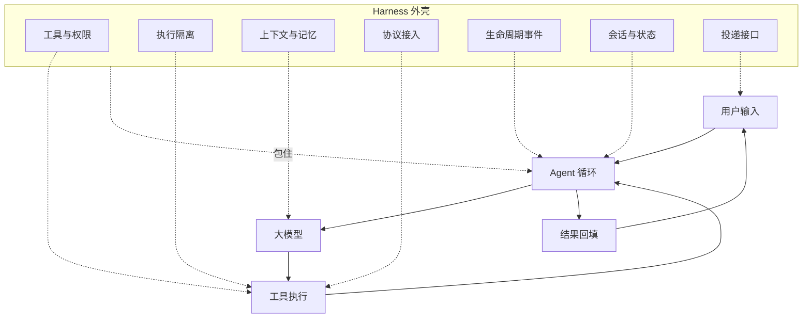
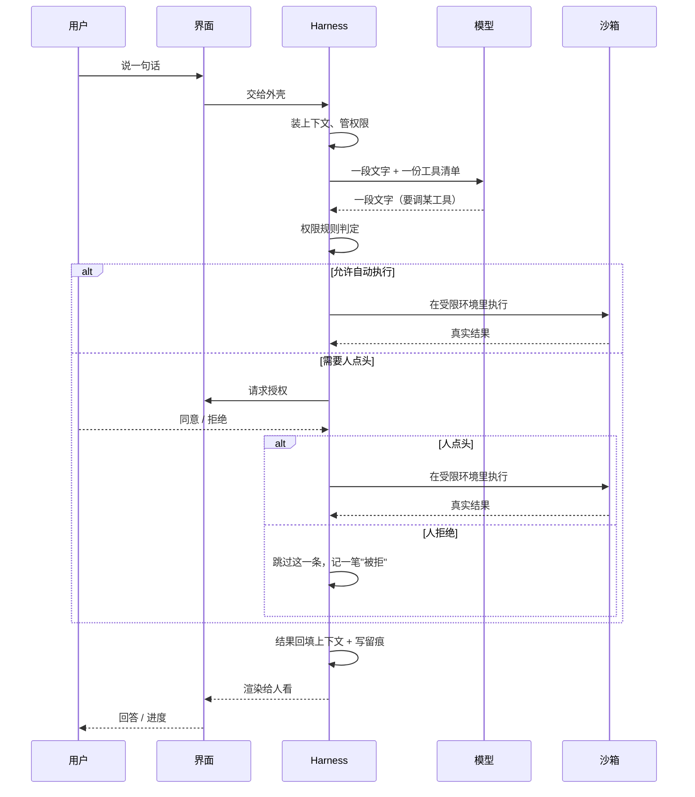

# Ch17 Harness 导览

> 一句话简介：模型只负责想，剩下的活全靠外面那层壳。

## 本章目标

读完本章你应当能：

- 说清楚一个裸模型为什么不能直接当 Agent 用，并指出它缺的是哪几样
- 用一句话解释 harness 是什么，并能举出一个生活里的对应物
- 复述主流 coding agent CLI 反复出现的几个共同决定，并说出每一个是被什么逼出来的
- 背出 harness 的七大职责，并说出每一项解决哪一类问题
- 分清"工具与权限""执行隔离""生命周期事件"这三项职责各自的边界

## 本章导览

Part 3 拆开了一个 Agent 的内部零件（见 Part 3 Ch11），本章不重复那份清单，只问一个新问题：**这些零件装到生产环境里，为什么外面还要再包一层？**

图心那个转圈的方块就是 Agent 循环——感知、规划、行动、观察，一圈一圈地转。转圈外面那圈虚线框住的，就是本章要讲的 **harness（外壳 / 外层工程）**——现在只知道它是虚线圈住的那一圈，17.2 展开。



读法：模型只出现在图心那一格，工作是"读进来一堆文字，吐出去一段文字"。其余六格——怎么把话变成动作、动作在哪儿执行、上下文放什么、怎么接外面的世界、什么时候该做点额外的事、断线了怎么接上、人从哪儿进来——一件都不是模型干的。

赶时间的话，全章只读三处：**17.1 的三个演示**、**17.4 的七项职责**、**17.5 那段总结**。

## 17.1 一个朴素的问题：裸 LLM 为什么不能当 Agent 用

### 17.1.1 先动手试一次

不先讲定义，先做一件事：把一个真实仓库"交给"模型。你的仓库里有些函数留着 `TODO`，于是对一个刚接上 API 的大模型说"帮我把这个仓库里所有还留着 TODO 的函数列出来"。裸模型的回复大概长这样：

```text
你可以在项目根目录运行：

    grep -rn "TODO" --include="*.py" .
```

这句话是对的，而且有用。但请先回答：**仓库现在变了吗？** 没变。那张清单没有生成，你还得自己开终端、复制粘贴、重新整理一遍——一件事也没省下。

问题出在哪？白话说：**模型没有手**。类比上，它像一个博览群书、记性极好的面试官，坐在一间没有窗也没有门的房间里——你请他"去隔壁会议室把合同拿来"，他站起来也走不出去。具体到这里：模型**看不见你的磁盘**，不知道 `src/` 下有哪些文件，也无从知道哪一行代码里有 `TODO`。它读到的只有你打进 API 的那几个字。

**没有手**是第一道墙。推倒它，再试。

### 17.1.2 给了手，但不设边界

假设我们心软，干脆写一个万能工具丢给模型：任意 shell 命令，任意参数。仓库真的变成了 Agent——它跑出了那份 TODO 清单，前两轮一切正常。第三轮，模型贴心地补了一句"顺便把构建产物清理一下"，然后输出 `rm -rf build/`。再往后，它想清理"看起来像临时目录"的东西，判断错了，删掉的是 `src/`。

第二道墙。白话说：**模型会犯错，而它犯的错直接落在你的文件系统上。** 类比上，等于你雇了个博览群书但**判断力偶尔失准**的人，把机房钥匙直接塞给他，旁边还放了一把电锯，并约定"他说什么你就照做，不许拦"。问题不是他可不可靠，而是**这套安排里没有任何一处能挡住他失手**。

这里有一条很重要的直觉，先记下、17.4 还会回来说：**提示词是软约束**。你在系统提示（每次请求都带在最前面的那段说明）里写"请谨慎，不要删除重要文件"，模型读到的只是一句话；它的约束力取决于那一刻模型有多注意。一句话替代不了一道门。

### 17.1.3 手脚都齐了，但记不住

第三次把墙再推倒：既给了手，又加了"危险操作要先问我"。这个 Agent 真的会干活了——跑了一小时，改对了七个文件，跑通了测试。然后你重启了一次进程，问它："我们刚才改到哪儿了？"

它不知道。它答得很客气、很有条理、也很没用——因为它压根没有"刚才"。**模型的"记得"完全靠这一次对话里传进去的那些字**（见 Part 2 Ch10），它自己身上一个字都没存。

第三道墙：**上下文窗口是模型唯一的记忆，而这块窗口有限额、要花钱、还有上限。** 主流模型的窗口通常是几十万 token 量级，一个中等规模代码仓库全量读进来很容易就吃掉这么多。于是两个坏结果同时成立：要么**读不全**（漏掉三分之一的文件，然后自信地说"全部通过"），要么**加钱换更大的窗口**（更贵、更慢，而且再大也有上限）。

三道墙并排看，长这样：

```text
┌─ 墙一：没有手 ────┬─ 墙二：没有边界 ───┬─ 墙三：没有记性 ───┐
│ 够不着            │ 砸得着             │ 留不下             │
│ 你的磁盘          │ 你的真实文件       │ 上一轮说过的话     │
│ 看不见也改不动    │ 一次误判就不可撤销 │ 窗口再大也有上限   │
└───────────────────┴────────────────────┴────────────────────┘
```

| 缺什么 | 白话 | 撞墙时的现象 |
|---|---|---|
| 手 | 模型看不见也改不动外部世界 | 只能给建议，不能干活 |
| 边界 | 它的错误直接落在真实资源上 | 一次误判就可能删掉代码 |
| 记性 | 记忆只在这一次对话的窗口里 | 一重启就失忆；窗口再大也有上限 |

**光有模型不够，还得在外面补上"手、边界、记性"，以及它们各自要挂靠的一整套工程。** 那个"一整套工程"，就是下一节要讲的东西。

## 17.2 什么是 harness：套在 Agent 循环外面的工程外壳

先给白话定义，再给类比，最后给例子——顺序不能倒。

**白话。** harness 就是**大模型之外、围着 Agent 循环转的那一整套程序**。壳负责把模型说的话变成真的动作，把真实世界的反应整理成模型读得懂的文字，并在中间管住风险、上下文和流程。

**类比。** 接着 17.1 的面试官往下编：要让他能干活，得给他装上耳朵眼睛手和一张门禁卡（不然够不着够不着的都乱够）、一块能随手擦的白板（不然手上留不住东西）、一间墙厚的隔间（不然他失手能烧掉整层楼）、一台能查资料的对讲机、一本值班手册（不然没人告诉他何时该停机）、一个黑匣子（不然出事查不出原因），还有一扇门。这七样合起来就是 harness——**模型本人不在这个清单里**，它是被改造的人，不是改造本身。

**一个具体的例子。** 同样是调用一个模型，套不套这一层，差别全在这个 `while` 循环周围（示意；完整骨架见 `code/part-4/`）。代码右边方括号里的〔职责几〕是**路标**，指向 17.4 那七项职责的编号——现在先别管它们各自是什么，扫一眼看个大概就够了：

```python
while not done:
    resp = call_model(memory.pack(budget), registry.list_tools())
    for call in parse(resp):                          # 把模型说的话翻译成一个动作
        if not policy.allow(call):                    # 这一步得先问人吗？      〔职责一〕
            if not ask_human(call): continue          # 人不点头就跳过，绝不执行   〔职责七〕
        result = sandbox.run(call)                    # 在受限环境里跑          〔职责二〕
        hooks.fire("post_tool", call)                 # 跑完做收尾              〔职责五〕
        memory.append(result)                         # 把结果记进上下文        〔职责三〕
```

还有两样东西也在这几行里，只是没法单独占一行：工具清单是从协议登记来的（职责四），而 `hooks.fire` 顺手留下的那段执行记录，是黑匣子（职责六）。至于人点完头之后"同意/拒绝"从哪个口子递回来——终端按键、网页按钮、批处理里的预授权——那是投递接口的事（职责七，见 17.4.7）。

⚠️ 那行 `continue` 别当成可有可无的细节。**它是"人点拒绝"这件事唯一的出口**：少了它，`ask_human` 的返回值没人接，外壳会径直执行下一行——模型要删掉整个构建目录，人点了拒绝，命令照样跑起来了。记住这条：**"这个函数被调用了"和"它的每一种结果都有地方去"是两件事。**

**harness 不是模型的一部分，而是模型之外的那部分。** 换模型，这一圈代码一行都不用改；换外壳，模型权重也不用动。

**术语出处。** harness 从软件测试领域借来——test harness（测试台架）是"把被测件架起来、给它输入、接住它输出、并自动判定成败的那套装置"。到 2026 年，"harness engineering（外壳工程）"已是业内通称。

## 17.3 主流 coding agent CLI 的横切：它们有什么共同点

拿 2026 年最有代表性的那几个 coding agent CLI 当观察对象——也就是你在终端里敲一句话、它替你看代码改代码的那类工具，**不比较谁好谁坏，只找反复出现的设计决定**。下面每一条都不是某一个产品的偏好。

| 共同点 | 它是被什么逼出来的 |
|---|---|
| **界面和循环是分开的** | 循环写死在界面里，就没法进流水线，也没法同时跑五个任务 |
| **默认偏保守** | 默认松的代价不对称：占便宜时省几秒，出事时丢的是仓库 |
| **执行环境不由模型决定** | 命令在哪儿跑、能碰哪些目录、能不能连外网，都不在模型的参数里 |
| **上下文按"预算"来管** | 没有一个把整个仓库原样塞进窗口（各家叫法不同，但"必须取舍"一致） |
| **外部能力走协议、会话有留痕** | 各自发明接法的代价是 N 份维护成本；出事还得查得出 |
| **只读动作与改动世界的动作分开** | 前者可以放心重试，后者每次都要过一道闸（见 Part 3 Ch11 11.3） |

规律就出来了：**没有一条是"因为某家这么做所以我们也这么做"。** 它们共同源自**同一组约束**——模型看不见世界、模型会犯错、模型的记性等于它的窗口、真实世界有副作用。横切下来的东西，本来就不属于任何一家。

下面这张时序图画的是这些共同点跑起来的样子，请注意**模型只出现在其中两行**：



对照这张图再看导览图，一个此前不明显的事实就浮出来了：**中间所有"要不要执行、在哪儿执行、结果怎么记下来"的环节全是壳在做。** 模型是个**顾问**，壳才是**执行方**。

## 17.4 Harness 的七大职责

本节是全章的锚点，每件都按同样顺序讲：**先看没有它会怎样，再给白话定义、类比和小例子**。下面是七项职责的正式措辞，以后全书不再改名。

| 编号 | 职责 | 一句话白话 | 展开在 |
|---|---|---|---|
| 1 | 工具与权限 | 告诉模型能干什么，并管住哪些要问人 | Ch21 |
| 2 | 执行隔离 | 命令在受限环境里跑，出事炸不到外面 | Ch21 |
| 3 | 上下文与记忆 | 决定每一轮递给模型哪些字 | Ch20 |
| 4 | 协议接入 | 用公开协议把外部工具接进来 | Ch18、Ch19 |
| 5 | 生命周期事件 | 在固定时刻跑一段确定性的程序 | Ch21 |
| 6 | 会话与状态 | 留下可回放、可恢复的记录 | Ch20 |
| 7 | 投递接口 | 决定人从哪儿进来、结果从哪儿出去 | 本 Part 各章 |

### 17.4.1 职责一：工具与权限

**没有它会怎样。** 回到 17.1.1：不给工具，模型只能给建议。反过来还有另一面墙——工具设计得随意，清一色"执行任意命令"这种万能入口，模型每步都要现挑，很容易挑出又慢又错的那种。这一项同时解决两个方向：**让够得着的够得着，别让够不着的乱够。**

**白话。** 工具（Tool）是模型能叫得动的那几项具体动作——读一个文件、改一行、跑一条命令、查一次网络。权限（Permission）是一份规则，回答"哪些可以自己就做，哪些必须先问人一次"。

**类比。** 前台服务台配门禁卡。工种不同，能刷开的门也不同：实习生进得了资料室，进不了档案室。容易混的点在于：**工具决定"有哪些门"，权限决定"这张卡能开哪几扇"**。工具少不是问题，权限乱才是。

**小例子。** 一条典型的权限规则读起来大概是这个意思：

```yaml
allow: [ "read(src/**)", "run(git status)" ]
ask:   [ "write(**)"    , "run(git commit)"  ]   # 改文件、提交都要先问
deny:  [ "read(**/.env)", "run(curl|*:*)"     ]   # 密钥文件与联网一律不走
```

三类之外还有一个默认值：**默认怎么办**。主流做法是默认拦住而不是放行——漏判一条规则的代价，远大于多问一次人。

最容易踩的坑是：**工具给模型的是"意图"，不是"命令"**——模型说的是"改一下解析器"，不是一条逐字精确的 diff。规则匹配的是意图，判定与执行之间的差距留给 Ch21 补。

### 17.4.2 职责二：执行隔离

**没有它会怎样。** 这是 17.1.2 那道墙。哪怕规则写得很细、每处都有人点头，规则总有没写到的地方；一旦执行发生在真实环境里，"判断错"的代价就**不可撤销**。这一项存在的理由恰恰不是"信任模型"，而是**"哪天模型判断错了，这道兜底得接得住"**。

**白话。** 隔离（Isolation，也叫沙箱 Sandbox）是把要执行的代码关进一个**受限制的运行环境**：只能碰指定的目录，默认连不上网络，跑完就销毁。

**类比。** 拆弹间。技术再好的拆弹手也要先在独立的屋子里操作——屋外站满人，但墙是厚的；就算他判断错了、手一抖，损失也被关在屋里。**重点不是"更安全"，而是"损失有上限"。**

**小例子。** 一个最小隔离配置读起来是这样：

```text
可读 / 可写：  仅工作区目录；之外任何路径不可写
网络：        默认关闭，需要时按单次操作临时开
执行时长：    单条命令 120 秒硬超时，到点强制收尾
执行完：      环境销毁，不留后门
```

"只读 / 可写工作区 / 完全放开"这样的三档划分，几个主流工具是各自独立收敛到同一个形状的：**档位太少不够用，太多用户选不动**——三档刚好覆盖"只看代码""改代码跑测试""完全信任"。

两者必须配套读，它们不是一回事：

| | 权限 | 隔离 |
|---|---|---|
| 是什么 | 一份**规则** | 一个**运行环境** |
| 什么时候起作用 | 执行**之前**判定 | 执行**之中**约束 |
| 回答什么问题 | 允不允许做 | 允许之后，在什么条件下做 |

两道闸是**串联**的：权限全放行时隔离还在，隔离关到最严时权限也还在。

### 17.4.3 职责三：上下文与记忆

**没有它会怎样。** 这是 17.1.3 那道墙，也是最容易被低估的一项。把整仓塞进窗口、不做取舍，窗口小了读不全，窗口大了烧钱。而它最贵的失败模式不是报错，是**漏了东西却说自己看全了**。

**白话。** 上下文（Context）是**这一轮真正递进模型的那段文字**；记忆（Memory）是**这段文字之外、会跨轮次甚至跨会话留存的那些东西**。这一项只干一件事：**决定每一轮到底递哪些字进去。**

**类比。** 导航仪的地图卡。地图卡装不下整座城市，只能装你眼下这段路线，每开一段就要重新裁一张。它不是"记性差"，是**容量本来就设计成这样**。

**小例子。** 一轮里真正递给模型的东西是这样：

```text
[系统提示]   角色、边界、输出格式      ← 固定占用，通常最长的一段
[任务说明]   用户最初那句话            ← 必须原样保留
[当前状态]   仓库名、当前分支、已改文件  ← 每次刷新
[工具清单]   名称 + 一句话用途          ← 随可用工具变化
[最近若干轮 + 本轮观察]  对话与工具结果  ← 滚动窗口
```

每一块都有取舍——N 取多少、观察太长怎么裁、二十个工具要不要只挑相关的——加起来就是这一项的全部工作量（策略见 Ch20）。

**必须划清的一条线**（这是全书的分工）：**上下文工程管"这一轮递什么给模型"，记忆系统管"什么东西存到轮次之外去"。** 前者像开卷考试考哪几页，后者像考完把哪几页抄进笔记本。Ch20 讲前者，后者见 Part 5 Ch24。

### 17.4.4 职责四：协议接入

**没有它会怎样。** 设想没有协议的日子：想让 Agent 用上公司内部的工单系统，就得在代码里手写调用、认它的返回格式、处理它的鉴权头；下一个 Agent 想用同一个系统，再写一遍；第三个再写一遍。**同一个外部能力，接一次是一遍代码，维护它的是 N 份。**

**白话。** 协议接入（Protocol Adapter）就是**让 harness 用一套公开的约定、而不是各家自定的方式，去连接外部的工具和 Agent**。到 2026 年，这个位置上有两套成熟的标准：**MCP** 管"Agent 接工具"，**A2A** 管"Agent 接 Agent"。

**类比。** 通用对讲机频率。无线电规范统一了频率、呼叫格式、谁先说话——任何按规范做的电台都能和另一台对上话。私人约定的手势也行，但出了那栋楼就不好使：协议的作用不是让熟人之间更方便，而是**让互不相识的两端也能对上**。

**小例子。** 接一个外部工具，有协议之前的写法是这样：

```text
【写死】   harness 里硬编码：POST /api/tickets {title, body} → 自己解析响应
【走协议】 harness 里注册一句："工具：创建工单，用途：给某人建一张待办"
           字段说明（schema）从协议拿，调用与返回也都按协议收发
```

差别不只省了代码，更省了**心智**：用户不用知道每个工具背后是哪套接口。协议的具体形状见 Ch18 与 Ch19。

顺带说清一件容易误会的事：**"接工具"和"接另一个 Agent"不是同一种接法**——前者对方暴露的是一个函数，后者是一个会自己规划、自己循环、中途可能要问人的独立程序。Ch19 开头专门讲。

### 17.4.5 职责五：生命周期事件

**没有它会怎样。** Agent 改完一个文件之后，你想自动跑一遍格式化。这事简单到不值得设计一个功能——在工具执行之后顺手调一下脚本不就行了？但问题在于，**"工具执行完之后"这个时刻，是模型说了才算的**。模型可能这一轮就结束对话了，那一步就永远没被触发。需要每次都发生的动作，绝不能依赖模型每次都记得。

**白话。** 钩子（Hook，本书也叫生命周期事件）是**挂在流程固定时刻上的一个回调**：时刻到了，壳就自动执行一段你写好的程序，不问模型。

**类比。** 飞机起飞前的机务喊话。机务不会问飞行员"你打算什么时候检查起落架"——那是固定流程，走到那一步他就喊。**关键在"固定"两个字**：触发权在流程手里，不在被服务的人手里。

**小例子。** 常见的时刻清单是这样：

```text
会话开始前   加载项目说明、准备初始上下文
工具执行前   判断这一步要不要先问人、要不要先备份
工具执行后   跑格式化 / 跑测试 / 把结果摘要写进上下文
会话结束时   归档会话、跑收尾脚本
```

念一遍就会发现它们的共同点：**触发权在流程手里，不在模型手里。** 这就是钩子的全部理由——把一批"靠模型自觉"的动作改造成"到点必跑"。

### 17.4.6 职责六：会话与状态

**没有它会怎样。** 两个很具体的坏场面。第一，Agent 干了四十分钟的活然后崩了——你看着屏幕上那一屏输出，不知道它改了什么、能不能从某个点接着干。第二，任务做偏了，想退回到"它开始改代码之前"重来——做不到。**出事之后你手里什么证据都没有。**

**白话。** 会话与状态（Session）管的是两件事：**记下每一步**（一份能回放的流水账），**打断后能把状态接回来**（需要时再从某个历史点分出一条新岔路）。它和职责三不是一回事——职责三决定"递给模型什么"，这一项决定"存下来什么"。

**类比。** 黑匣子加里程表。黑匣子让事故能复盘；里程表让车能接着开。里程表上还有一道可以打点的横杠：发现走错了，可以从那个点重新拐出去。

**小例子。** 一次会话结束，留下这么一串：

```text
<会话记录，每一步一行>
  step 14 | 权限：命中 write 规则 → 已获用户同意（用时 8 秒）
  step 15 | 沙箱：执行 → 退出码 0，改了 1 处
  [检查点] step 20 打点，附一句话摘要："解析器已改宽松，单测全过"
<状态文件>  当前分支 / 已改文件清单 / 已跑过的测试
```

### 17.4.7 职责七：投递接口

**没有它会怎样。** 这是最容易被当成"不重要的边角"、实际却卡住很多产品的一项。设想前六项都做齐了，现在想让同一个 Agent 支持三种用法：终端里对话、流水线里跑批处理、网页里嵌聊天窗。你会发现前六项**一行都不用改**，要改的全是同一堆代码——因为"循环"和"人怎么跟它说话"被写死在一起了。改到第三个场景时你会有点想推倒重写。

**白话。** 投递接口（Delivery Surface）指的是**人和这个 Agent 之间的所有进出口**：请求怎么进来、过程怎么呈现、结果怎么出去、人工确认怎么回。

**类比。** 舱门。飞机怎么飞是机身的事，但人怎么进、行李怎么装、座位上能按哪几个按钮——这是舱门这一层的事。**机身可以不变，舱门可以有好几种。**

**小例子。** 常见的几种投递面：终端交互（多管流式输出和随时中断）、一次性批处理（没有人在线，"要不要问人"得先定义好）、服务化接口（长任务怎么轮询、并发怎么限）、可嵌入的库（调用方自己的界面怎么渲染）。四种排下来你会发现，**变的都是"人和过程之间怎么打交道"，都不是"Agent 怎么干活"**——这正是它单独成为一条职责的原因：把"内核"和"入口"切开，同一个内核才能被四种场景复用。

## 17.5 一段话总结：Agent = 模型 × harness

把前面四节压成一段：

> **一个 Agent = 一个会读文字写文字的大模型，外面套一层工程外壳。**
> 模型负责"想下一步干什么"，它既看不见你的文件，也记不住上一轮说什么；外壳负责把它想出来的事**变成真的动作**，并且**管住这些动作**——哪些要问人、哪些在受限环境里跑、上下文里放什么、外部工具怎么接、哪些时刻要强制做点什么、过程怎么留痕、人从哪儿进来。这七件事合起来就是 harness。**模型是零件，外壳是产品。**

这里特意用了**乘号**而不是加号。乘法说的是：两部分必须同时在场才成立，缺任何一个结果都是零——这正是 17.1 三道墙的意思。它还多带一层：**两个因子的权重不一样时结果变化很大**，更强的模型常常不如配得更好的外壳。

## 17.6 全章导览

回到 17.4 那张表换一种读法——从"工程麻烦"倒过来看：

| 工程麻烦 | 治它的那项职责 |
|---|---|
| 够不着 | 工具与权限 |
| 误判不可撤销 | 执行隔离 |
| 装不下，且不能说谎 | 上下文与记忆 |
| 重复造轮子 | 协议接入 |
| 该做而没做 | 生命周期事件 |
| 出事查不出 | 会话与状态 |
| 换场景要重写 | 投递接口 |

**Ch18 / Ch19** 做深协议接入，**Ch20** 做深第三、六项，**Ch21** 做深第一、二、五项。

## 17.7 Part 4 阅读路线

**完整顺序读（本路线默认）。** Ch17 → Ch18（MCP）→ Ch19（A2A）→ Ch20（上下文与记忆）→ Ch21（钩子 / 权限 / 沙箱）→ Ch22（小结）。先把七项职责的名词认全，再把里面唯一有公开标准的两项做深，然后处理最难量化的两项。Ch21 是全 Part 的承重结论——**提示词是软约束，外壳才是硬约束**——放在 Ch20 之后读效果最好。

**你要动手写一个的话**，按这个顺序跳更省时间：**17.4.1**（工具清单和权限规则）→ **Ch21**（三层防御，能不能放心让它跑起来的分水岭）→ **17.4.6 + Ch20**（留痕和上下文，决定它能不能跑长任务）→ **Ch18**、**Ch19**（要接外部东西时才读）。

## 本章小结

- 裸模型不能当 Agent 用，卡在三道墙上：**没有手**（看不见也改不动世界）、**没有边界**（错误直接落在真实资源上）、**没有记性**（记忆只有这一轮对话的窗口）。
- **harness（外壳 / 外层工程）**是模型之外、围着 Agent 循环转的那一整套程序，从软件测试的 test harness 借来：被测件不等于台架。
- 模型在系统里是**顾问**，外壳才是**执行方**：模型只参与"读文字"和"写文字"两步。
- **harness 的七大职责**：工具与权限、执行隔离、上下文与记忆、协议接入、生命周期事件、会话与状态、投递接口。这七个措辞是 Part 4 全书的共同约定，后续章节不再改名。
- **权限是一份规则、沙箱是一个环境、钩子是一个时刻**：前两个串联成两道闸，第三个把"靠模型自觉"的动作改造成"到点必跑"。提示词是软约束，外壳才是硬约束。

## 本章参考

### 必读论文

- [Cognitive Architectures for Language Agents（CoALA，Sumers 等，2023）](https://arxiv.org/abs/2309.02427)——"把 Agent 拆成若干功能模块再讨论它们怎么协作"这套讲法的来源。
- [MemGPT: Towards LLMs as Operating Systems（Packer 等，2023）](https://arxiv.org/abs/2310.08560)——把"上下文窗口不够用"当成**内存管理问题**来看的代表作。

### 推荐博客 / 教程

- [The Anatomy of an Agent Harness](https://www.langchain.com/blog/the-anatomy-of-an-agent-harness)（2026 年 3 月）——`Agent = 模型 + Harness` 这句概括的出处。
- [Effective context engineering for AI agents](https://www.anthropic.com/engineering/effective-context-engineering-for-ai-agents)（2025 年 9 月）——17.4.3 的展开材料，Ch20 正式引用。
- 协议以官方文档为准：[MCP 规范](https://modelcontextprotocol.io/specification/2026-07-28/)（Ch18）、[A2A 协议官网](https://a2a-protocol.org)（Ch19）。

### 视频 / 课程

- [Agentic AI 短课（Andrew Ng 主讲，约 10 小时）](https://learn.deeplearning.ai/courses/agentic-ai/information)——设计模式那一层，与 Part 3 重叠处快过。
