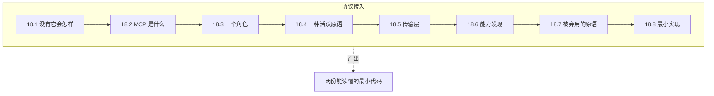
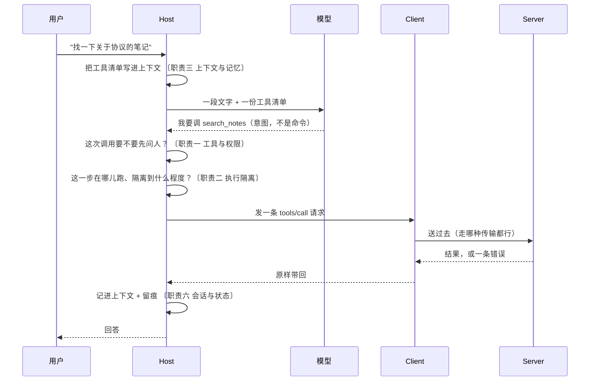
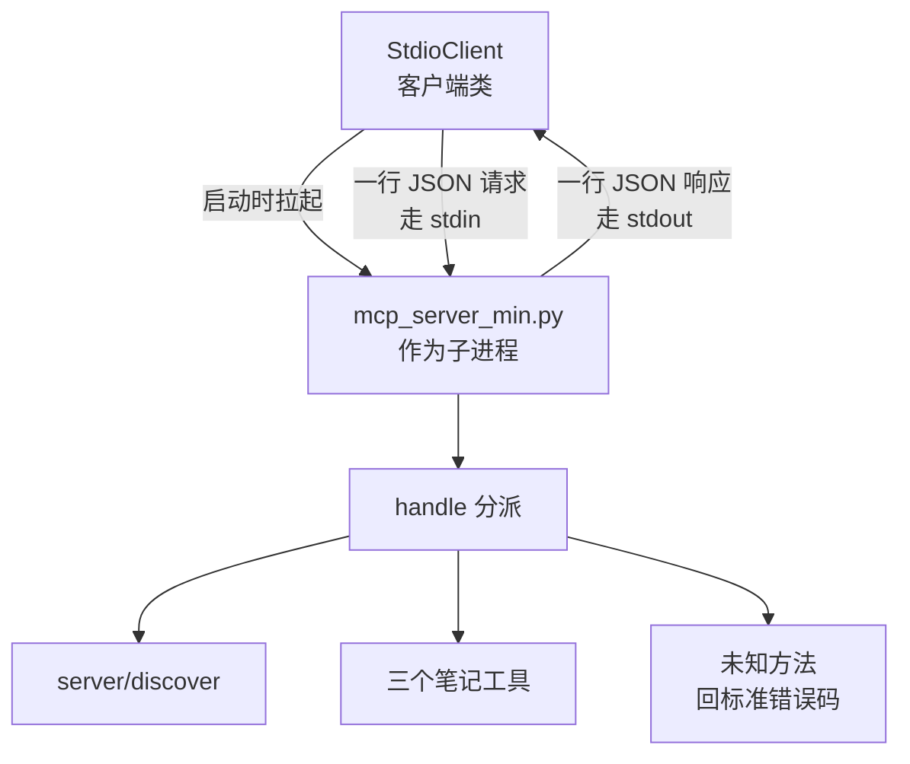

# Ch18 MCP 协议

> 一句话简介：让互不相识的两端也能对上话的一台标准对讲机。

## 本章目标

读完本章你应当能：

- 说清楚"每个工具各写一套对接"这件事，代价到底落在哪里
- 用一句话解释 MCP（模型上下文协议）是什么，并指出它在外壳七项职责里的位置
- 分清 Tools / Resources / Prompts 三种原语，**按"谁决定何时用它"而不是按"能不能改"来分**
- 讲出一次完整的工具调用经过哪几个角色、哪几个步骤
- 解释能力发现是什么意思，以及为什么新版规范把"握手"拿掉了
- 看到"某功能被弃用"时，知道它和"被删除"是两回事，并知道该去哪里查

## 本章导览

本章只回答 Ch17 留下的那一个问题：**职责四（协议接入）是怎么被标准化的。** 别的六项职责在后续章节展开。



读法：18.1 到 18.4 是主菜——先演痛点，再给定义、三角色、三原语。18.5 到 18.7 是三件"细但必须知道"的事：消息怎么送、能力怎么报、以及**已经消失的东西去了哪**。18.8 是代码，18.9 收尾。

⚠️ **全章有一个前置提醒**：MCP 是一个仍在快速修订的规范，本章讲的是 **2026-07-28 版**。这是本书引入的一条阅读纪律——

> **看任何协议文档，先确认它说的是哪个日期的版本。** 同一份文档的半年后版本可能已经把本章讲的东西删掉了。

## 18.1 先演一次"没有协议会怎样"

Ch17 17.4.4 已经点过一句：**同一个外部能力，接一次是一遍代码，维护它的是 N 份。** 现在把这句话算成具体的活。

设想一个团队要做 coding Agent，第一版只接一个东西：公司内部的工单系统。按最直接的想法写，就是四件事——发一个 HTTP 请求、把返回的 JSON 翻译成一句话、失败了给个能看懂的报错、超时了重试两次。假设这四件事加起来 200 行。这 200 行不算多。

然后需求来了：接数据库、接监控、接内部 wiki、接 CI、接一个向量库、接邮件、接日历、接另一个团队的服务、接一个命令行工具。到第 10 个工具时，账是这样的（以下是构造出来的账，不是统计数字，但结构是真的；比上面那四件事切得更细，还多算了两项一次性的活）：

| 每个新工具都要重做一遍的事 | 大约多少 |
|---|---|
| 鉴权（token 从哪来、怎么续期） | 30 行 |
| 参数校验与转换 | 40 行 |
| 返回值翻译成模型读得懂的话 | 40 行 |
| 错误分类与重试策略 | 30 行 |
| 给模型看的那句用途说明 | 手写一段文字 |
| 测试用例 | 一个文件 |

**关键不在于 200 行，而在于"重复了 10 遍"。** 更贵的还不是代码，是下面三件事：

1. **同一个错误，十个工具十种说法。** 有的抛异常、有的返回空字符串、有的悄悄吞掉。宿主没法写一个统一的"这条路走不通"的提示，只能一个一个去认。
2. **换一个工具，等于改一遍上下文装配。** 每接一个工具都得改那段"把工具清单整理好塞进模型"的代码（Ch17 17.2 的 `registry.list_tools()`），改十次，十次都可能改错。
3. **工具一换版本，十处同时要改。** 工单系统把 `title` 改名成 `subject`，十个对接点、十个 Agent 实例同时变红。

于是问题浮出水面了：**昂贵的不是"接一个工具"，是"接 N 个互不相干的工具，而且它们还在各自演化"。**

顺着这个账往下想，会发现真正被省掉的不只是 200 行，还有**心智**——用户和模型都不需要知道每个工具背后是哪套接口，接口的差异全被挡在了一个地方。这也正是 Ch17 说的那句"更省了心智"。

## 18.2 MCP 是什么

**白话。** MCP（Model Context Protocol，模型上下文协议）是一套**公开的报文约定**：规定"我要用一个工具"这句话该怎么写、对方该怎么回、字段叫什么名字。任何一方按这套约定写出来的程序，都能和另一方对上话——不管双方是谁写的、用什么语言。

**类比。** 沿用 Ch17 17.4.4 的**通用对讲机频率**：无线电规范统一了频率、呼叫格式、谁先说话，所以按规范做的电台都能和另一台对上话；私人手势出了那栋楼就不管用。

不过这个类比要往前推一步，因为对讲机只统一了"怎么喊"，**没统一"能喊什么"**。MCP 同样分两层：

```
┌─────────────────────────────────────────────┐
│  上层：约定"能有什么、怎么描述"               │  ← 三个原语 + JSON Schema（结构化的参数说明书）
├─────────────────────────────────────────────┤
│  下层：约定"消息怎么送"                       │  ← 传输层（stdio / HTTP）
└─────────────────────────────────────────────┘
```

**一个具体的例子。** 前面那个工单系统，接了 MCP 之后，外壳里要写的东西从 200 行变成**一句注册 + 一段描述**：

```json
{
  "name": "create_ticket",
  "description": "在工单系统里建一张待办工单，返回工单号和链接。",
  "inputSchema": {
    "type": "object",
    "properties": {
      "title": { "type": "string", "description": "一句话说清要修什么" },
      "assignee": { "type": "string", "description": "负责人邮箱" }
    },
    "required": ["title"]
  }
}
```

剩下的四件事——鉴权、校验、翻译、重试——**由 server 自己在协议里声明要怎么做**，宿主不写。原来那 200 行并没有消失，它搬到了"提供这个能力的那一方"那边去了。这是一次搬家，不是消灭：但搬完之后，**每个 Agent 都不再重复它一遍**。

顺带说清一件容易误会的事。MCP 解决的是"**多个工具**"，不是"多台电脑"。同一台机器、同一个进程里，外壳直接 import 一个 Python 函数当然更省事。MCP 真正的用武之地是跨进程、跨语言、跨组织——而一旦跨了组织，就没法假设"对方也是 Python"。

## 18.3 三个角色，和一次完整的调用

MCP 里只有三个角色，不多不少：

| 角色 | 它是什么 | 在外壳里对应什么 |
|---|---|---|
| **Host（宿主）** | 装模型、装上下文、管权限的那个进程 | **外壳本体** |
| **Client（客户端）** | Host 内部的一个连接实例，1:1 对应一个 server | 工具注册表里的一个连接 |
| **Server（服务端）** | 独立进程或独立服务，暴露某一项具体能力 | 你接的那个工单系统适配层 |

白话：**Host 是调度员，Client 是他手里的每一根对讲机，Server 是对讲机那头的人。** 一个 Host 可以握着很多根对讲机同时和好几个 Server 说话，但**每一根只对一个 Server**。

这里有两层隔离是规范特意强调的，写外壳时值得照抄：**Server 看不到整段对话，也看不到别的 Server。** 它每次只收到这一条请求里该给的东西。你在设计自己的协议时，这一点同样值得保留——它让"换一个后端"变成一件不影响安全面的事。

下面是一次完整的"搜一个笔记"的调用。**注意看，模型只出现在其中两行**，其余全是外壳在转（这是 Ch17 17.3 那张图的重演）：



把这次调用拆成"谁做了什么"，是本章最值得记住的一段：

| 步骤 | 谁做的 | 落在哪项职责 |
|---|---|---|
| 把工具清单写进上下文 | 外壳 | 职责三 |
| 决定"这一步要不要问人" | 外壳 | 职责一 |
| 决定"这一步在哪儿跑" | 外壳 | 职责二 执行隔离 |
| 把消息按协议送出去 | **协议** | **职责四 协议接入** |
| 把结果翻译成一句话 | Server | 职责四 协议接入 |
| 记进上下文、留痕 | 外壳 | 职责三 / 职责六 |

**模型在整个过程里只干了"读文字、说一个意图"这一件事。** 协议把模型和真实世界之间的那一段距离，填得满满当当——而这一段距离，正是职责四的辖区。

## 18.4 三种活跃的原语

**原语（Primitive）**是协议开放给 server 的三类东西。一个 server 不必全都实现，实现哪几类就在能力发现里声明哪几类。

判断它们不要用"能不能改数据"，要用**这一个标准：谁决定什么时候用它。** 三种原语在这一点上分得干干净净：

| 原语 | 白话 | 谁决定何时用 | 一个具体例子 |
|---|---|---|---|
| **Tools 工具** | 模型叫得动的那几项动作 | **模型** | 搜索笔记、跑一条命令、建一张工单 |
| **Resources 资源** | 应用能读的一段带地址的数据 | **应用**（宿主） | `file:///project/README.md`、一段配置 |
| **Prompts 提示** | 服务端准备的一段可复用文本 | **用户** | 一个"生成代码评审要点"的模板 |

### 18.4.1 Tools：模型决定

**白话。** 工具是**模型能叫得动、会真的改变点什么的那几项具体动作**。每个工具必须带一句人类能读的用途说明和一份参数说明，模型就是靠这两样决定"要不要调它、参数填什么"。

**类比。** 员工手册里的"可申请事项"清单：订会议室、报销一张打车票。每一条都写着"什么情况下可以办、需要填什么、找谁办"。**决定权在办事的人手里。**

**小例子。** 上一节那个 `search_notes`，模型看到的就是那段 JSON：一句用途 + 一份参数说明。宿主不用写任何"参数怎么解析"的代码——说明本身是数据，不是代码。

这里有一条规范写得很直白的规矩，值得原样记住：**工具的清单可以随时间变，但不允许因为"连的是哪个连接"而变。** 原因见 18.6——新版协议里连接不代表会话，同一个 client 可以在一条连接上交错地处理好几件不相干的事。

### 18.4.2 Resources：应用决定

**白话。** 资源是**一段有地址（URI）的内容，由应用主动读进来**。协议规定了两件事：怎么列出有哪些资源（`resources/list`）、怎么按地址读一个（`resources/read`）。**什么时候读、读哪几个，宿主说了算。**

**类比。** 图书馆的书架。馆员（应用）决定这一趟给读者端哪几本书上来，读者自己不能伸手去够最里面的那本。**同一个书架，端什么上来是馆员的工作。**

**小例子。** 一个文件服务暴露的资源可能是这样几个地址：

```text
file:///project/README.md
file:///project/CHANGELOG.md
file:///{path}          ← 模板：任意路径，由宿主决定填什么
```

### 18.4.3 工具和资源，差在哪

**这是初学者最容易糊的一处，单独讲。**

最容易犯的错是按"能不能改"来分：**以为资源是只读的、工具是可写的。** 这个分法不对——`create_note` 是工具，它只往内存里写；一个指向线上数据库的资源，照样可写。

真正的分法是**前面那个标准：谁决定何时用。**

| | Tools | Resources |
|---|---|---|
| 模型能不能主动点名要它 | **能** | **不能**（由应用递进来） |
| 地址 | 没有，用 `name` 调 | 有，用 URI 标识 |
| 谁决定什么时候用 | 模型 | 应用 |
| 典型参数 | 一份参数说明 | 只有 URI |

**为什么协议要把这两件事分开？** 因为它们的**信任来源不一样**。工具是模型点名要跑的，所以宿主必须在它跑之前过一道权限判定（职责一）；资源是应用自己递进去的，模型没有选择权，**风险天然低一档**。把这条线在协议层就画清楚，宿主写权限规则时就不用纠结"这个该按工具管还是按资源管"。

### 18.4.4 Prompts：用户决定

**白话。** 提示是**服务端备好的一段可复用文本，用户点一下才用**。它可以带参数（比如"针对第 14 行开始的那段"）。

**类比。** 便利贴模板。打印了一批放在抽屉里，用哪一张、填什么内容，是使用者决定的。**模板本身由提供方写好，选不选用、用在哪，由使用者决定。**

**小例子。** 一个叫"代码评审要点"的提示，用户填一个参数（代码语言）就得到一段排好的清单。

三种原语讲完，可以记一句总纲：**模型的意图靠 Tools 传上去，应用的上下文靠 Resources 递下去，用户的快捷方式靠 Prompts 挂出来。** 三条通路，三个方向。

## 18.5 传输层：消息怎么送出去

先看一个具体的场景：你要连的工单系统不在本机，而在公司另一台服务器上。MCP 统一了"我要建一张工单"这句话**该怎么写**，可这句话**怎么真的送到对面去**，每项能力都不一样——同机的可以直接 import 一个函数，远处的得走网络。反过来，对方回给你的那段 JSON **怎么变成一行行字节塞进管道**，也没有谁替你统一。

传输层就是为这两摊活而设的。它在协议里叫 **binding**，只回答一个问题：**消息怎么切成字节送过去。** 它**不回答消息是什么意思**——同样的 `tools/call`，走哪种传输都是同一句话，变的只是怎么把它送过去。

### 18.5.1 两种传递方式

规范给的标准传输有两条：

| | stdio | Streamable HTTP |
|---|---|---|
| 怎么送 | 客户端拉起一个子进程，**一行一条 JSON**，stdin 进、stdout 出 | 每条消息一个 POST，打到**同一个地址** |
| 回话怎么收 | 还是那一行，进程内的反向管道 | 一个 JSON 对象，或一条跟这次请求绑定的流 |
| 典型场景 | 工具就在本机，和 Agent 同一个用户下 | 工具是远程服务、多用户共用 |
| 身份从哪来 | 进程本身就是身份（用户起的就是自己的权限） | HTTP 头 + 凭据 |
| 主要麻烦 | 服务端的日志必须走 stderr，**写 stdout 就污染了协议流** | 要自己处理鉴权，还要防 DNS 重绑定攻击 |

同一版本规范里还有一条**弃用**记录：早期的 HTTP+SSE 传输（一条长连接专门推消息）已弃用，迁往 Streamable HTTP。细节见 18.7。

### 18.5.2 两个必踩的坑

⚠️ 先是 HTTP 这边：规范明确要求服务端**必须校验 Origin 头**，否则一个恶意网页就能借你的浏览器去调你本机跑的 server。这是"本地进程"的信任模型在 HTTP 上的漏洞——**"只有我能访问"这句话在浏览器面前从来不成立**，凡是跑在 localhost 上的服务都要当心这一类攻击。

stdio 这边也有个容易被忽略的坑：**stderr 是给人看的，stdout 是给协议用的。** 服务端随手 `print()` 一行调试信息，客户端就会把它当成一条消息去解析，然后报一个莫名其妙的错。这一条在下面的代码里直接体现成了 `stderr=sys.stderr`。

## 18.6 能力发现：怎么知道对面会什么

这一节讲的是全文最容易被过时资料坑掉的地方。

### 18.6.1 旧办法：握手

早期版本里，client 和 server 一连上先要做一次**握手（initialize）**：

```text
client → server : initialize（我支持 2025-11-25，我的能力是 {tools, sampling}）
server → client : （我也支持 2025-11-25，我的能力是 {tools, resources}）
client → server : notifications/initialized（好了，开始干活）
```

握手有个致命的假设：**这条连接 = 这次会话。** 版本、能力、身份全绑在连接上，后面所有请求默认沿用。

### 18.6.2 新办法：每条请求都自报家门

2026-07-28 版把 `initialize` 和 `notifications/initialized` **整个移除了**（SEP-2575——规范每次改动都带一个提案编号，这是这一条的编号），改成两件事：

1. **每一条请求的 `_meta` 里都带齐三样**：协议版本、客户端身份、客户端能力。
2. **新增一个 `server/discover` 方法**，让 server 一次性把自己的版本、能力、身份报出来。规范写明 **server 必须实现它**，但**客户端可以不调**——直接调别的也行，对不上会收到 `UnsupportedProtocolVersion`。

一条真实的 `server/discover` 请求长这样。先花一句话给这个信封起个名字：**MCP 的每一条消息都是一个 JSON-RPC 2.0 信封**——`jsonrpc` 是格式版本、`id` 是这次提问的编号（答复要靠它对回问题）、`method` 是"你要干什么"、`params` 是"干这件事要的参数"。答复只有两种形状：`result`（成了）或 `error`（出错了）。三种原语、两种传输，换的只是信封里装的东西，**信封本身永远是这一种**。

```json
{
  "jsonrpc": "2.0",
  "id": "discover-1",
  "method": "server/discover",
  "params": {
    "_meta": {
      "io.modelcontextprotocol/protocolVersion": "2026-07-28",
      "io.modelcontextprotocol/clientInfo": { "name": "DemoHost", "version": "0.1.0" },
      "io.modelcontextprotocol/clientCapabilities": {}
    }
  }
}
```

### 18.6.3 为什么要改

先说清楚一个常被说错的结论：**这不是"改成无状态"，准确说法是"协议不再隐式维护会话，状态改由显式 handle 承载"。** 无状态的是**传输层会话**，"什么东西需要记着"这件事并没有消失。这里的 **handle** 是服务端发来的一串编号，像餐厅的取餐号——你拿着号回来，服务端才知道你问的是哪一单。

那为什么还要改？想象一个跑了两小时的 Agent，它手上的连接断了。旧协议下所有版本与能力信息都随连接一起没了，接回来得重做一次握手；新版下每个请求自带家底，**断线不丢东西**，重连后第一条请求就能干活。

所以关键在这句话：

> **一个打开的连接不是一次对话。** 客户端可以在同一条传输上交错地处理好几件不相干的事，server 不得把"连的是谁"当成"我们在聊哪件事"的替身。

真需要跨请求记着的东西——一个长任务、一个上传会话——**由 server 自己发一个 handle，当普通参数传进来**。同一批改动里，HTTP 上的 `Mcp-Session-Id` 头也一并移除了（SEP-2567）。

| | 早期版本 | 2026-07-28 版 |
|---|---|---|
| 版本与能力怎么传 | 一次握手，之后沿用 | 每条请求的 `_meta` |
| 断了会怎样 | 丢版本与能力 | 不丢，下一条请求自带 |
| 想一次看全对方能力 | 挨个探 `tools/list` / `resources/list` | 一次 `server/discover` |
| 跨请求的状态 | 藏在连接里 | **显式 handle**，当普通参数传 |

这一节还顺带解释了 18.4 那个"清单不许因连接而变"的规矩：**既然连接不再代表会话，清单也就没有理由按连接分叉。** 唯一合理的变量是**凭据**——同一个 client 拿两套不同权限的令牌，本来就该看到不同的工具集。

## 18.7 原语被弃用之后

MCP 的原语从最早的六项一路减到三项。这个过程本身是个很好的教材。

### 18.7.1 三项被标记弃用

**先纠正一个最常见的说法。** 网上（包括不少二手资料）会写"Roots / Sampling / Logging 已被移除"——**这是错的。** 规范把它们登记为**弃用（Deprecated）**，而不是移除（Removed）。2026-07-28 版的弃用登记页里，"已被移除"那一栏明明白白写着**在这套生命周期规矩之下，目前还没有任何功能走到这一步**。

（补一句免得读反：这句话只管 SEP-2596 这套**新规矩管过的功能**。同一版的 SEP-2575 是**另一次决定**，它确实当场移除了 `initialize`、`ping` 这样的老方法——那叫"按提案直接下掉"，不叫"走完弃用流程再下掉"。见 18.7.3。）

弃用和移除的区别，用一句话讲清：

| | 弃用 | 移除 |
|---|---|---|
| 类型还在不在规范里 | **在** | 不在 |
| 老实现还能不能用 | **能**，行为不变 | 不能 |
| 新实现该不该用 | 不该 | 不能 |
| 什么时候真的消失 | 过了迁移窗口，由维护者决定 | 已经消失了 |

弃用这条状态本身是 2026-07-28 版**新立的规矩**（SEP-2596）：它定义了三个状态（Active / Deprecated / Removed），并规定**最短十二个月的弃用窗口**。于是 Roots / Sampling / Logging 三项的**最早移除日期是 2027-07-28 及以后的第一个修订版**——注意，是"最早"，实际移除时刻还要维护者在发版时决定，可能更晚。

### 18.7.2 那它们去哪了

弃用登记页直接给了迁移建议，照抄成一张表：

| 被弃用的东西 | 它原本管什么 | 官方给的替代 |
|---|---|---|
| **Roots** | 客户端告诉 server"你可以看哪些目录" | 用**工具参数、资源地址，或服务端自己的配置**传进去 |
| **Sampling** | server 反过来让 client 去调大模型 | **直连模型厂商的 API** |
| **Logging** | server 往客户端推日志 | stdio 下写 **stderr**；要做可观测性就用 **OpenTelemetry** |

这张表本身就是一份设计教材。三条替代路径有同一个共同点：**每一条都把"谁负责"往外挪了一格。** Roots 的信息不用协议来问，配置里直接写；Sampling 不用绕一圈借宿主的手，自己调 API；日志不用协议来送，走它该在的那条管道。**一个功能被删掉，往往不是因为它没用，而是因为它强加了一个本不该有的中转。**

### 18.7.3 但也别写成"彻底没了"

这里有一处需要格外精确，因为两句话说在一起才对。

第一句：**这三项的"请求类型"在新版连接上确实没有可用通道了。** 因为握手被移除，服务端再也不能主动向客户端发请求，`roots/list`、`sampling/createMessage` 这类方法在 2026-07-28 版里已经发不出去。

第二句：**但它们的"载荷类型"活着。** 同一批改动引入了一种新的往返模式：server 需要更多信息时，不再另开一次请求，而是在**当前这条请求的回复里**放一个"我还需要这些信息"的特殊结果，客户端把答案**附在下一次重发同一个请求时**带回来。弃用的三项载荷，以及"向用户问一句"的表单，都被折进了这个机制。所以"被弃用"和"没法用"不是同一句话，得看问的是哪一层。

这两层可以这样分：**"请求类型"是一扇门的名字**（`roots/list` 这扇门），**"载荷类型"是门里面那张表格**。门拆了，名字就没人喊了；表格本身印得好好地放在别处，还有人拿着用。把上面的机制画出来就是：

```text
旧：client ──"roots/list？"──▶ server       （要问 client，得 server 主动开口）
                             ✗ 旧版没有这条反向通道
新：client ──"我要建一张新工单"──▶ server
                                   └── "我还需要：这张单归谁管"（特殊结果）
再：client ──"这张工单归张三管"──▶ server   （重发同一个请求，把答案带上）
                                   └── "工单 #4821 已创建"
```

另外几项的处理要更干脆——它们是**被直接移除**（Removed），不是弃用：`ping`（心跳）、`logging/setLevel`（设日志级别）和 `notifications/roots/list_changed`（通知客户端目录变了）。这几句看着和上面"移除那一栏还是空的"打架，其实不冲突：**它们压根没进弃用流程，是当年被提案直接下掉的**（18.7.1 末尾括号里那句话指的就是它们）。日志级别改为每条请求在 `_meta` 里带一个字段来声明；目录变更通知则没有替代品，Roots 整个弃用之后它也就没有存在意义了。

最后一条也不一样：**HTTP+SSE 传输的最早移除日期不是 2027-07-28**，而是"相关规范正式生效后三个月"。同一张弃用表里，每一行的时钟都是单独算的——这本身就是"看文档先看日期"的最好例证。

### 18.7.4 一条要带走的判断习惯

看完上面这些，读者应该能自己回答一个以后还会遇到很多次的问题：**看到"某某功能被弃用了"，第一反应该是什么？**

不是"那我不该用了"，而是这三个问题：

```text
1. 这条信息的日期是哪一天？（规范换版号了没）
2. 弃用还是移除？（看规范里 Deprecated 和 Removed 两个分区分别在列谁）
3. 官方给的替代路径是什么？
```

第 3 个问题的价值最大——**弃用公告附带的迁移路径，比弃用本身有用得多。** 一份只说"我们要下掉 X"而不说"那你改用 Y"的公告，是不合格的；SEP-2577 附了三条，这三条现在已经被无数实现当作路线图用。

## 18.8 一个最小 server 和一个最小 client

光看协议名字没用，下面两份代码把 18.3 到 18.6 串起来跑一遍。完整文件在 `code/part-4/mcp_server_min.py` 与 `code/part-4/mcp_client_min.py`，下面只节选最能说明问题的部分。

两份文件读之前先摆结构，一眼看清楚"谁主动找谁"——**MCP 里 client 是拉起 server 的那一方，这个方向很多人在看协议图时会看反**：



**看图上那个不对称的形状**：箭头是双向的，但**控制权在客户端**——是它 `subprocess` 起 server，server 起来之后只是被动应答。18.6 讲的"能力发现"就是第一条 `server/discover`；18.4 讲的那三类原语，在这份最小实现里只落了 Tools 一类，具体就是那三个笔记方法。**server 端所有的活都发生在 `handle` 这一个函数里**，它做的事只有一件：看 `method` 是什么，转给对应的 `call_*`。

**server 端——分派逻辑。** 摘自 `code/part-4/mcp_server_min.py`，原样照抄。注意每次返回都带 `resultType`（它的另一种取值见 18.7.3），每次未知方法都回标准错误码：

```python
def handle(req):
    """把一条请求变成一条响应。返回值永远是 dict，直接序列化即可。"""
    method = req.get("method", "")
    params = req.get("params", {})
    rid = req.get("id")

    if method == "server/discover":
        return {
            "jsonrpc": "2.0",
            "id": rid,
            "result": {
                "resultType": "complete",
                "supportedVersions": [PROTOCOL_VERSION],
                "capabilities": {"tools": {}, "resources": {}, "prompts": {}},
                "_meta": {"io.modelcontextprotocol/serverInfo": SERVER_INFO},
                "instructions": "一个演示用的笔记库。改动写操作前请先问人。",
            },
        }

    if method == "tools/list":
        return {
            "jsonrpc": "2.0",
            "id": rid,
            "result": {"resultType": "complete", "tools": TOOLS},
        }

    if method == "tools/call":
        name = params.get("name", "")
        handler = HANDLERS.get(name)
        if handler is None:
            # 工具不存在：用 JSON-RPC 的标准错误码，别自己编一个
            return {
                "jsonrpc": "2.0",
                "id": rid,
                "error": {"code": -32601, "message": f"没有这个工具：{name}"},
            }
        return {"jsonrpc": "2.0", "id": rid, "result": handler(params)}

    return {
        "jsonrpc": "2.0",
        "id": rid,
        "error": {"code": -32601, "message": f"未实现的方法：{method}"},
    }
```

**client 端——发一条请求。** 摘自 `code/part-4/mcp_client_min.py` 的 `StdioClient` 类，同样原样照抄。每一行请求都自带版本、身份、能力，这是 18.6.2 那条规则在代码里的样子：

```python
    def request(self, method, params=None):
        # 每一行请求都自带这几样，这是 2026-07-28 版的核心变化：
        # 协议版本、客户端身份、客户端能力，都随请求走，而不是靠一次握手定下来。
        meta = {
            "io.modelcontextprotocol/protocolVersion": PROTOCOL_VERSION,
            "io.modelcontextprotocol/clientInfo": {"name": "demo-host", "version": "0.1.0"},
            "io.modelcontextprotocol/clientCapabilities": {},
        }
        payload = dict(params or {})
        payload["_meta"] = meta

        msg = {"jsonrpc": "2.0", "id": self._new_id(), "method": method, "params": payload}
        self.proc.stdin.write(json.dumps(msg, ensure_ascii=False) + "\n")
        self.proc.stdin.flush()

        line = self.proc.stdout.readline()
        if not line:
            raise RuntimeError("服务端没有回答就退出了")
        return json.loads(line)
```

三件从代码里能读出来、而正文里不好讲的事：

1. **server 的全部知识就是一张 `HANDLERS` 字典。** 它不知道宿主是谁、不知道对话长什么样，也不需要知道——这正是 18.3 那条"server 看不到整段对话"的设计。
2. **请求和响应靠一个 `id` 配对。** 换掉 SDK 也得自己处理这件事，因为它不是 MCP 的发明，是 JSON-RPC 的地基。
3. **权限判定不在这里。** 代码里没有任何一行拦 `create_note`。**"这次调用要不要先问人"是宿主在收到模型意图之后、发请求之前做的事**（见 Ch21）——server 只管执行，管不了也不该管。

## 18.9 本章小结

- 昂贵的不是"接一个工具"，是"接 N 个互不相干的工具，而且它们各自还在演化"。MCP 把每个工具的对接成本从**每家 Agent 各写一遍**降到**每项能力只写一遍**。
- MCP 是一套公开报文约定，分两层：上层约定"能有什么、怎么描述"，下层约定"消息怎么送"。
- 三个角色：**Host 就是外壳本体**，Client 是它 1:1 对应一个 server 的连接实例，Server 是独立的能力提供者。**Server 看不到整段对话，也看不到别的 server。**
- 一次调用里模型只出现在两行；协议负责的那一段（消息怎么送、结果怎么翻译）正是**职责四（协议接入）** 的辖区。
- 2026-07-28 版的活跃原语是**三项**，按"谁决定何时用"分：**Tools 由模型决定、Resources 由应用决定、Prompts 由用户决定**。工具与资源的真正差别不是可不可写，而是**模型能不能主动点名要它**——这决定了宿主要不要在它跑之前过权限判定。
- 握手被移除，`server/discover` 取而代之；每条请求在 `_meta` 里自报版本、身份与能力。准确的说法是"**协议不再隐式维护会话，状态改由显式 handle 承载**"，不是"什么都不要记"。
- **弃用 ≠ 移除。** Roots / Sampling / Logging 目前仍在规范内，最早移除日期是 2027-07-28 及以后的第一个修订版。而 `ping`、`logging/setLevel` 这些是**当场就被移除**的——它们走的是另一条路，不受那套弃用流程约束。看任何协议文档，先确认日期和状态分区。

**与 Ch19 的衔接。** MCP 解决的是"Agent 怎么接**工具**"。但 Agent 之间要互相调用时，对方不是一个函数，而是 Ch17 17.4.4 末尾说的那种**会自己规划、自己循环、中途可能要问人的独立程序**——本章讲的三角色与三原语的模型在它身上都不适用，需要另一套约定。下一章讲那一套：一句话分工是 **MCP 管 Agent 对工具，A2A 管 Agent 对 Agent**。

## 本章参考

> 下面全部是 `modelcontextprotocol.io` 上的官方规范页面，**均为 2026-07-28 版**。换版本时这些链接要跟着改——这正是 18.7.4 那条纪律的用处。

### 必读

- [MCP 规范首页（2026-07-28 版）](https://modelcontextprotocol.io/specification/2026-07-28/)——全章的版本锚点。
- [Architecture（架构）](https://modelcontextprotocol.io/specification/2026-07-28/architecture)——Host / Client / Server 三角色、无状态设计原则、能力协商。18.3 与 18.6 的主要出处。
- [Key Changes（本版改了什么）](https://modelcontextprotocol.io/specification/2026-07-28/changelog)——18.6 与 18.7 的事实依据，逐条列出了移除 `initialize`、`notifications/initialized`、`Mcp-Session-Id`、`ping`、`logging/setLevel`、`notifications/roots/list_changed`，以及弃用三项原语。
- [Deprecated Features（弃用与移除登记）](https://modelcontextprotocol.io/specification/2026-07-28/deprecated)——18.7.1 与 18.7.2 的直接出处，含每一项的最早移除日期与迁移路径。

### 推荐教程 / 参考页

- [Base Protocol（基础协议）](https://modelcontextprotocol.io/specification/2026-07-28/basic)——JSON-RPC 报文结构、`resultType`、错误码、无状态条款。
- [Transports（传输）](https://modelcontextprotocol.io/specification/2026-07-28/basic/transports/)——stdio 与 Streamable HTTP 两种 binding 的完整规定。
- [Discovery（能力发现）](https://modelcontextprotocol.io/specification/2026-07-28/server/discover)——`server/discover` 的请求、响应与调用时机。
- [Tools](https://modelcontextprotocol.io/specification/2026-07-28/server/tools) / [Resources](https://modelcontextprotocol.io/specification/2026-07-28/server/resources) / [Prompts](https://modelcontextprotocol.io/specification/2026-07-28/server/prompts)——三种原语的规范页。
- [Elicitation（向用户提问）](https://modelcontextprotocol.io/specification/2026-07-28/client/elicitation)——18.7.3 提到的"折叠进同一回复"的机制，原文在 InputRequiredResult 一节。
- [Roots](https://modelcontextprotocol.io/specification/2026-07-28/client/roots) / [Sampling](https://modelcontextprotocol.io/specification/2026-07-28/client/sampling)——已弃用，保留在此是为了让读者看到弃用公告长什么样。

### 视频 / 课程

- 本章没有推荐的视频课程。**这个协议的更新速度快过大多数课程的制作周期**，与其找课不如直接读上面的 Key Changes——它一页就说清了这一版改了什么。
