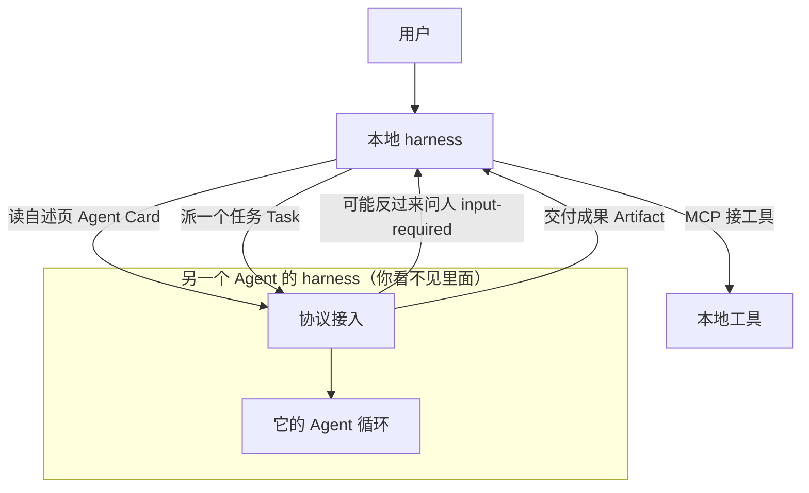
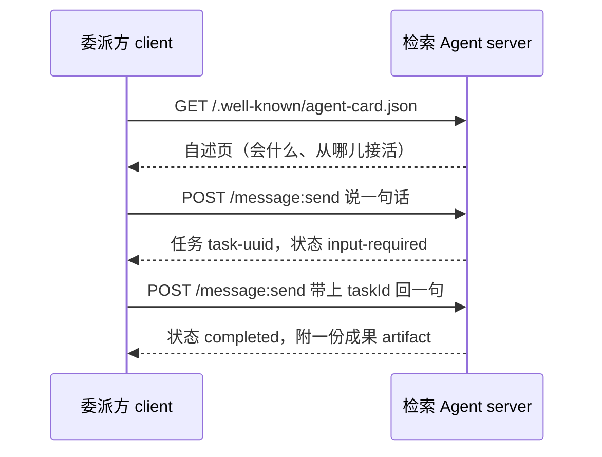

# Ch19 A2A：让 Agent 之间也能对上话

> 一句话简介：工具是一次调用，委派是一件事——A2A 讲的就是后者。

上一章讲完 MCP，harness 第 4 项职责「**协议接入**」只做了一半。那一半叫"把工具接进来"，这一半叫"**把另一个 Agent 接进来**"。很多人读完两章还是糊的，症结不在术语难，而在**根本没意识到这是两种不同的接法**。

本章以 **A2A 协议 v1.0** 为准（v1.0.0 于 2026 年 3 月发布，v1.0.1 为当前修订；协议版本号一律写作 `1.0`，补丁号不参与协商）。

## 本章目标

读完本章你应当能：

- 用一句话说清「接一个工具」和「接一个 Agent」差在哪
- 解释 Agent Card 是什么、为什么它必须待在固定地址上
- 复述任务的八个状态，并指出哪一个是 A2A 区别于工具调用的根本原因
- 判断一个外部能力该做成工具，还是该做成一个 Agent

## 本章导览

左边是本地 harness，虚线框里是通过 A2A 招来的远端 Agent——**框里那台自己还带着一整套 harness。A2A 连的是两个壳，不是一个壳和一个模型。**



图里已经藏着全章要点：**箭头是双向的、有状态的、可能会折回来。** 上一章的 MCP 箭头只有一根，从 Agent 指向工具，问完就结束。

赶时间只读四处：19.1 的场景、19.3 的一张卡片、19.4 的状态图、19.6 的对比表。

---

## 19.1 先演一遍「没有它会怎样」

### 19.1.1 一个具体场景

你要一份"某项目过去三年验收情况"的报告。你手上有一个**写报告的 Agent**：文笔好、排版好，但它看不见档案库。档案库里有几千份扫描件，需要一个**专精检索的 Agent** 去翻——它知道哪些文件在哪、哪些是正文哪些是附件。

活儿分给了两个专才。问题来了：**报告 Agent 怎么把活儿派给检索 Agent？**

### 19.1.2 没有协议的日子

按最直觉的办法干：在报告 Agent 里直接写调用。

```text
response = http_post("https://archive.internal/api/v2/search",
                     {"query": "...", "year_from": 2021, "year_to": 2024})
```

第一天能跑通。**第三天开始出事，而且出的是四类完全不同的事：**

| 出了什么事 | 表面现象 | 真正的病根 |
|---|---|---|
| 检索 Agent 改了接口 | 返回 422，错误信息是一段英文 JSON，模型读不懂也不会重试 | 你把它的**实现**焊死了 |
| 检索 Agent 要反问："A 项目还是 B 项目？" | 请求直接超时——**问-答模型里没有"停下来等"的位** | 两个模型不是一回事 |
| 检索 Agent 翻档案要 6 分钟 | 你的连接 30 秒就断了，只剩半截结果 | 你假设了它是**瞬时**的 |
| 检索 Agent 换了底层引擎 | 返回结构全变，报告 Agent 直接崩 | 你没有"能力描述"，只能靠猜 |

请特别注意第二、三行：**它们不是接口没调通，是模型不匹配**——你用"调一个函数"的假设，去对付一个"会自己规划、自己循环、中途可能需要人、需要一段时间"的程序。

于是本章的立论就在这儿：

> **当「工具」需要一个决策、需要一段时间、甚至需要反过来问人时，它就不再是工具了，它是一个 Agent。**

A2A 就是为这句话而生的。它不发明 Agent，只规定**两个都不透明的 Agent 之间怎么说话**。

### 19.1.3 加上协议之后

```text
① 读自述页（一个固定地址的 JSON）
   → 知道：它叫"档案检索助手"，会"复杂档案检索"，协议版本 1.0
② 派一句话过去 → 对方回一个任务号，状态"处理中"
③ 对方停下来说："要限定年份范围吗？"
   → 报告 Agent 答："限定 2023 年 1 月到 6 月"，带上任务号送回去
④ 对方回"已完成"，附一份成果
```

**报告 Agent 全程不知道对方用什么模型、什么框架、连着什么数据库。** 它只遵守了一套约定——正是 17.4.4 那句"协议的作用不是让熟人之间更方便，而是让互不相识的两端也能对上"。

## 19.2 A2A 是什么

### 19.2.1 白话、类比、小例子

**白话。** A2A 是一种**公开的对话约定**，让两个各自独立、谁也看不见谁的 Agent，能发现彼此、派活给它、看着它干完、必要时中途搭把手，最后取走成果。

**类比。** 接着 17.4.4 的**通用对讲机频率**往下推一步：MCP 解决的是**两端对上频率**；对上频道只够"滴"两下确认在不在。要谈成一件事，还得有三样东西：**对方开机时自报家门**、**每件事一个工单号**（有进度、有状态、能停下来等你回话）、以及**最后交回来的成果单**。A2A 就是规定这三样东西长什么样。

**小例子。** 一句话派活加上一句话回话，就是完整的 A2A 交互：

```text
客户端 → 服务端：  { "message": { "role": "ROLE_USER",
                              "parts": [ {"text": "帮我查一份 2023 年的验收档案"} ] } }
服务端 → 客户端：  { "task": { "id": "task-uuid",
                              "status": { "state": "TASK_STATE_INPUT_REQUIRED",
                                          "message": { "role": "ROLE_AGENT",
                                                       "parts": [ {"text":
                                                       "要限定年份范围吗？"} ] } } } }
```

读法：客户端发出**一句话**，服务端回给它的**不是结果，是一个任务**；任务现在停在"等你回话"，并附了一句反问。**注意"任务"这两个字**——它有编号、有状态、能暂停、稍后接着走。这是本章接下来要展开的唯一一个新概念。

### 19.2.2 它到底规定了哪几件事

一个协议只做四件事：**怎么找到对方**（一张固定地址的自述页，19.3）、**怎么派活**（一条消息换回一个任务，19.4）、**怎么知道进度**（任务有状态，19.4）、**干完了拿什么**（成果单独装，19.5）。至于"你怎么想"、"你调什么工具"、"你的模型多大"——**协议一概不问。不问，才有互操作。**

### 19.2.3 一句官方说法，和它的治理

A2A 项目在 v1.0 发布公告里，把它和 MCP 的关系写成一句话：

> **MCP inside agents, A2A between agents.**（MCP 在 Agent 内部，A2A 在 Agent 之间。）

和 19.1 的立论是同一件事的两种说法：一句讲分工，一句讲为什么。

治理方面：A2A 于 2025 年 6 月由 Linux Foundation 托管，2026 年 8 月并入该基金会旗下的 Agentic AI 基金会（AAIF），成为 Growth Stage 项目，技术指导委员会由 8 家公司的代表组成；到 2026 年 4 月官方宣布有 150 多家组织参与。**这些数字都在变，要引用就以官网当日页面为准。**

## 19.3 Agent Card：一个 Agent 怎么介绍自己

### 19.3.1 白话、类比、小例子

**白话。** Agent Card 是一张**自述页**：一个 Agent 在固定地址上公开的一份 JSON 说明书，写着我是谁、我会干什么、从哪儿能派活给我。**别人在派活之前先读它。**

**类比。** 还是对讲机那场戏。无线电有**呼号**——每个电台报出自己是谁，别人一听就知道在跟谁说话。Agent Card 就是 Agent 的呼号，只不过它还附带一张**业务范围表**：我专修发动机，不修机翼，你派错活我当场就能拒。

**小例子。** 一张真实的自述页（字段名与 v1.0 规范一致，值为便于理解而编造）：

```json
{
  "name": "档案检索助手",
  "description": "只做一件事：把一份复杂档案查清楚并交回结论，不写报告。",
  "version": "1.0.0",
  "supportedInterfaces": [
    { "url": "https://archive.example.com", "protocolBinding": "HTTP+JSON",
      "protocolVersion": "1.0" }
  ],
  "capabilities": { "streaming": true, "pushNotifications": false },
  "skills": [
    { "id": "archive_lookup", "name": "复杂档案检索",
      "description": "给定档案主题与年份范围，检索并汇总成结构化结论。",
      "tags": ["retrieval", "research"] }
  ]
}
```

只有三处要紧：

- **`skills` 是这张卡的正文。** 每条技能有一句 `description` 和一串 `tags`——**这是写给模型读的**，模型靠它决定派不派。所以 description 要写"能做什么"，别写"我很好用"。
- **`supportedInterfaces` 告诉你从哪儿接活。** v1.0 把原先分散在顶层的地址和首选传输方式合并成了这个有序数组，**第一个最推荐**。
- **`capabilities` 是它的诚实声明。** 这里写着不支持推送通知，客户端就不该指望它半夜来敲门。

### 19.3.2 为什么非要放在固定地址上

这一步很反直觉：**规定一个大家都能猜到的地址，比提供一个搜索功能有用得多。** 地址固定之后，客户端拿到的就只有一个域名：

```text
GET https://{对方域名}/.well-known/agent-card.json
```

于是接入方**一句配置都不用加**。19.1 那四类故障里的第一类和第四类靠的就是这张卡：对方换了引擎不要紧，`skills` 那几行会变；对方不支持哪种接法不要紧，`capabilities` 那几行会变。**变更通过一个公开地址自动传播，不需要挨个通知。**

`/.well-known/` 前缀来自互联网通用约定（同一套前缀也放 `security.txt` 这类安全声明）。选它的理由是：**它让"读说明书"不需要任何鉴权、不需要任何协商**。规范进一步要求这张卡**免鉴权**提供——因为客户端还不知道该拿什么凭证来读它，顺序不能倒过来。真正的凭证要求写在卡里的 `securitySchemes` 字段，读完卡才知道。

> ⚠️ **一个必须澄清的路径说法。** 网路上流传着两个地址：`/.well-known/agent.json` 和 `/.well-known/agent-card.json`。**v1.0 规范用的是后者**；本项目早期设计稿里写的 `agent.json` 是更早版本的遗留写法，**已不是当前规范**。本章与配套代码一律用 `agent-card.json`。

卡片另外还支持**数字签名**与**扩展声明**：前者让对方在做任何事之前先验明这张卡确实出自这家公司，后者让生态长出新东西不必回头改协议。本章不展开。

## 19.4 Task：为什么必须有"停下来问人"

### 19.4.1 白话、类比、小例子

**白话。** 任务（Task）是**一件被编号了的活儿**。它不是一次函数调用，它有进度、有历史、会中途停下来向你要信息、最后可能成功也可能失败。A2A 里"派活"的返回值不是结果，是这个任务。

**类比。** 派工单。你把一件活儿填成工单递给另一个班组，对方**不会当场干完递回来**——流程上可能有五个环节，卡在任何一环都可能回头找人："这个编号到底是 A 还是 B？"你补一句，它继续往下走；走到最后一环，工单盖上"完结"章，附上产出物。

**小例子。** 一张停在"等你回话"的工单：

```text
任务号：task-uuid
状态：  等你补信息
对方问：这份档案要限定年份范围吗？给我一个起止年份，我按范围查。
```

**"工单会停在半路"，是 A2A 与上一章那套工具调用最本质的差别。** 工具调用没有半路——你调一个函数，它要么返回一个值，要么抛一个异常，没有"我先歇一会儿，等你回句话"的第三种状态。而现实中的活儿有。

### 19.4.2 八个状态，一张图看完

v1.0 定义了八个状态。按"任务还能不能动"分三组更好记：

| 分组 | 状态 | 白话 |
|---|---|---|
| **在途** | `submitted` 已接单 | 我收到了，还没开工 |
| | `working` 处理中 | 正在干 |
| **中断** | `input-required` 等你补信息 | **停下来，要你回一句才能继续** |
| | `auth-required` 等你授权 | 停下来，缺凭证 |
| **终结** | `completed` 完成 | 干成了，成果在后面 |
| | `failed` 失败 | 干了，干砸了 |
| | `canceled` 已取消 | 还没干完就停了 |
| | `rejected` 已拒绝 | 我不接这个活（当场就能拒） |

`rejected` 和 `failed` 不是一回事：**`failed` 是我试了但没成，`rejected` 是我压根不接。** 一个专精档案检索的 Agent 收到"帮我写一封辞职信"，正确反应是当场拒绝，而不是硬着头皮去试、试完报个错。

```mermaid
stateDiagram-v2
    [*] --> submitted: 派活
    submitted --> working: 开工
    working --> input-required: 缺信息
    input-required --> working: 补齐了
    working --> auth-required: 缺凭证
    auth-required --> working: 凭证到位
    working --> completed: 干完
    working --> failed: 干砸了
    working --> canceled: 被叫停
    submitted --> rejected: 当场不接

    completed --> [*]
    failed --> [*]
    canceled --> [*]
    rejected --> [*]
```

四个终结状态都是**终点**：任务进了这些状态就不能再往里递消息了，规范规定这时要报 `UnsupportedOperationError`。这和职责六「会话与状态」是一回事——**能回放的事才叫会话，能被后续消息改写的状态才叫活的。**

### 19.4.3 重点：把 `input-required` 单独拿出来看

回到 Ch17 17.3 那张时序图。它当时画了一条分支，只在旁边标了四个字：

```text
    else 需要人点头
        H->>I: 请求授权
        U-->>H: 同意 / 拒绝
    end
```

**那一条分支就是 `input-required`。** 在工具调用的世界里，人点头发生在**壳内部**——本地 harness 拦下模型的一个危险动作，问的是"我这次用户"。而在 A2A 里，人点头可以发生在**另一台机器上的另一个 Agent 内部**：它说"我需要一个起止年份"，这句话要**穿过网络、回到委派方**。

这个差别看着像技术细节，其实是能力上的分水岭：**停下来问人的是对方而不是你**（你甚至可以把自己的 Agent 关掉，等对方那边的人类答完再回来接着收）；**人可以在网络的另一端**（你连对方问的是什么问题，都是通过一段 JSON 才知道的）；**长任务因此变得可能**（19.1 那类"跑六分钟"的活儿，不再是一次超长的 HTTP 请求，而是一串可以跨越任意长时间的对话）。

因此本章给你一条实用判据：

> **如果你要接的那个外部能力，说不出"它会中途停下来问什么"，那它多半是个工具，用 MCP 就行，不用上 A2A。**

## 19.5 一次完整的任务流转

19.1 我们用文字演过一遍，现在画出来。



五个来回，没有一次是"我调你一下你返回结果"。**第 3、4 步之间可以隔三小时**——如果对方是在等一个真人回答的话。

协议里有两个容器要分清：**消息（Message）**装双方说的话，一次性、读完就过去；**成果（Artifact）**装干完的产出，挂在任务上、可反复取。分开的理由和 Ch17 的会话留痕是同一个——**过程中的对话和最终交付物不是一回事**，混在一处你就说不出"这轮到底交付了什么"。每份成果还有独立编号，这样流式返回时可以一段一段追加。

消息正文又切成一小块一小块（协议里叫 Part），可以是文字、文件或结构化数据。**一行 `parts: [{"text": "..."}]` 里的那个 `{"text": ...}` 就是一个 Part。** 这是本章最后一个新概念。

至于等结果，规范给了三种办法：**轮询**（过一会儿问一次，最简单，示例代码就用它）、**流式订阅**（挂长连接，边干边推）、**回调**（留个地址，干完它来敲门）。选哪个跟 harness 第 7 项「投递接口」是同一类决策——**取决于人是怎么看进度的**，跟 Agent 怎么干活无关，详见 17.4.7。

## 19.6 A2A 与 MCP 怎么分工

上一章已经讲过 MCP 的原语和传输，这里不重复，只回答"什么时候用哪个"。

| 维度 | MCP（Ch18） | A2A（本章） |
|---|---|---|
| 连的是 | **工具**——给一个 Agent 加工具 | **Agent**——让两个 Agent 协作 |
| 谁去找谁 | 通常是 Agent 去找工具 | 一方把**任务**交给另一方 |
| 产物 | 工具的调用与返回 | 一个**有生命周期的任务** |
| 能否中途问人 | 不能（问人发生在本地壳里） | **能**，`input-required` |
| 耗时 | 通常毫秒级 | 可能几秒到几小时 |
| 对方是否不透明 | 工具的说明书是公开的 schema | **对方内部一律不透明**，这是设计目标 |
| 典型场景 | 读文件、查数据库、跑测试 | 专精检索、法务审阅、跨部门协作 |

按顺序问三个问题，答到"是"就停：**它需要自己做判断吗？** 只是执行一条明确指令 → 工具。**它中途可能需要反问我吗？** 会停、会要参数、会要授权 → Agent。**它是另一个团队写的、我改不动也不该改吗？** → Agent，因为不透明正是它的卖点。

**最后补一句最容易忽略的：两者不是二选一，几乎总是一起用。**

```text
用户 → 编排 Agent 的 harness
        │  A2A：派一个任务
        ▼
     检索 Agent 的 harness
        │  MCP：接工具
        ├─→ 向量库   ├─→ OCR   └─→ 文件系统
```

**A2A 管的是编排 Agent 和检索 Agent 之间那一层；检索 Agent 内部怎么接工具，是它自己的事。** 官方那句"MCP 在 Agent 内部，A2A 在 Agent 之间"说的就是这个结构。

## 19.7 最小服务端与客户端

### 19.7.1 一个能被人委派的 Agent（服务端）

```python
# illustrative only
"""
最小 A2A 服务端：放自述页、接单、停下来反问、交付成果。
Python 3.9+ 标准库。运行：python3 a2a_server_min.py
协议依据：A2A v1.0。教学示意，未做鉴权与重试，不要搬去生产。
"""

import json
import re
import uuid
from datetime import datetime, timezone
from http.server import BaseHTTPRequestHandler, HTTPServer

BASE, VERSION = "http://127.0.0.1:9000", "1.0"
MEDIA = "application/a2a+json"

# 任务表。真实系统该落库——进度要能被后来的人查回来，这正是第六项职责要的留痕。
# LOG 是教学用流水账，它不是协议字段：协议只管状态怎么变，不管你怎么记。
TASKS, LOG = {}, []


def now():
    """协议要求 ISO 8601、UTC、毫秒精度。"""
    return datetime.now(timezone.utc).isoformat(timespec="milliseconds").replace("+00:00", "Z")


def agent_card():
    """对外的自述页。发现地址被规范定死，拿到域名就能找到你。"""
    return {
        "name": "档案检索助手",
        "description": "只做一件事：把一份复杂档案查清楚并交回结论，不写报告。",
        "version": "1.0.0",
        "supportedInterfaces": [
            {"url": BASE, "protocolBinding": "HTTP+JSON", "protocolVersion": VERSION}],
        "capabilities": {"streaming": False, "pushNotifications": False},
        "defaultInputModes": ["text/plain"],
        "skills": [{
            "id": "archive_lookup", "name": "复杂档案检索",
            "description": "给定档案主题与年份范围，检索并汇总成结构化结论。",
            "tags": ["retrieval", "research"]}],
    }


def start_task():
    """接单：先返回"处理中"，干到一半才可能回头问人。"""
    task = {"id": str(uuid.uuid4()), "contextId": str(uuid.uuid4()),
            "status": {"state": "TASK_STATE_WORKING", "timestamp": now()}}
    TASKS[task["id"]] = task
    return task


def ask_back(task, question):
    """停在"等你回话"上——这正是 A2A 与工具调用的分水岭。"""
    task["status"] = {"state": "TASK_STATE_INPUT_REQUIRED", "timestamp": now(),
                      "message": {"role": "ROLE_AGENT", "parts": [{"text": question}]}}
    LOG.append({"task": task["id"], "event": "input-required"})


def deliver(task, answer):
    """交付。产出物用 artifact 装，和过程中的对话分开存放。"""
    task["status"] = {"state": "TASK_STATE_COMPLETED", "timestamp": now()}
    task["artifacts"] = [{"artifactId": str(uuid.uuid4()), "name": "检索结论",
                          "parts": [{"text": answer}]}]
    LOG.append({"task": task["id"], "event": "completed"})


class Handler(BaseHTTPRequestHandler):
    def reply(self, code, body):
        raw = json.dumps(body, ensure_ascii=False).encode("utf-8")
        self.send_response(code)
        self.send_header("Content-Type", MEDIA)
        self.send_header("Content-Length", str(len(raw)))
        self.end_headers()
        self.wfile.write(raw)

    def not_found(self):
        # 协议规定错误响应用 problem+json
        self.reply(404, {"title": "Not Found", "status": 404})

    def do_GET(self):
        path = self.path.split("?")[0]
        if path == "/.well-known/agent-card.json":
            self.reply(200, agent_card())
            return
        matched = re.fullmatch(r"/tasks/([0-9a-fA-F-]+)", path)
        if matched:
            task = TASKS.get(matched.group(1))
            self.reply(200, {"task": task}) if task else self.not_found()
            return
        self.not_found()

    def do_POST(self):
        if self.path.split("?")[0] != "/message:send":
            self.not_found()
            return
        # 真实实现必须在这里校验 A2A-Version 请求头，版本对不上要退回错误
        n = int(self.headers.get("Content-Length", "0"))
        msg = json.loads(self.rfile.read(n) or b"{}").get("message", {})
        text = "".join(p.get("text", "") for p in msg.get("parts", []))
        task_id = msg.get("taskId")

        # 整个 A2A 的会话逻辑，就是下面这一个字段
        if task_id is None:
            task = start_task()
            ask_back(task, "这份档案要限定年份范围吗？给我一个起止年份。")
        else:
            task = TASKS.get(task_id)
            if task is None:
                self.not_found()
                return
            deliver(task, "已按「{}」检索完毕，命中 3 份相关文件。".format(text))
        self.reply(200, {"task": task})


if __name__ == "__main__":
    print("示例服务端：{}  自述页：{}/.well-known/agent-card.json".format(BASE, BASE))
    HTTPServer(("127.0.0.1", 9000), Handler).serve_forever()
```
```

三处值得停下来看：**`do_GET` 的第一个分支就是 19.3 那张自述页**，无参数、无鉴权，拿到域名就能读；**`do_POST` 的分岔点只有一个——这次消息带没带 `taskId`**，带了就接着原来那件事说，没带就是新开一件事，整个 A2A 的会话逻辑就是这一个字段；**`LOG` 不在协议里**，它是第 6 项「会话与状态」要的留痕——**协议只规定状态怎么变，不规定你怎么记。**

### 19.7.2 委派的那一方（客户端）

```python
# illustrative only
"""
最小 A2A 客户端：读自述页 → 派一个任务 → 顺着状态走到终态。
Python 3.9+ 标准库。先启动 a2a_server_min.py，再 python3 a2a_client_min.py
协议依据：A2A v1.0。教学示意，未做鉴权与证书校验。
"""

import json
import uuid
import urllib.request

BASE, VERSION = "http://127.0.0.1:9000", "1.0"
MEDIA = "application/a2a+json"

# 本章的核心：任务要么停在"还要你补一句"，要么已经落地了。
INTERRUPTED = {"TASK_STATE_INPUT_REQUIRED", "TASK_STATE_AUTH_REQUIRED"}
TERMINAL = {"TASK_STATE_COMPLETED", "TASK_STATE_FAILED",
            "TASK_STATE_CANCELED", "TASK_STATE_REJECTED"}


def request(method, path, body=None):
    """一次协议请求。真实实现还要加超时、重试与鉴权头。"""
    data = json.dumps(body, ensure_ascii=False).encode("utf-8") if body else None
    req = urllib.request.Request(BASE + path, data=data, method=method)
    req.add_header("Content-Type", MEDIA)
    # A2A-Version 从 v1.0 起必填：对方升级之后，两端才知道在讲哪一版
    req.add_header("A2A-Version", VERSION)
    with urllib.request.urlopen(req, timeout=10) as resp:
        return json.loads(resp.read().decode("utf-8"))


def discover():
    """第 1 步：先读自述页，看它会什么、从哪儿接活，别急着派。"""
    card = request("GET", "/.well-known/agent-card.json")
    print("找到 Agent：{}（{}）".format(card["name"], card["version"]))
    for skill in card["skills"]:
        print("  技能：{} — {}".format(skill["name"], skill["description"]))
    for i in card["supportedInterfaces"]:
        print("  接口：{} {}（协议 {}）".format(
            i["protocolBinding"], i["url"], i["protocolVersion"]))


def send(text, task_id=None):
    """带 task_id 就是"接着那件事说"，不带就是"新开一件事"。"""
    msg = {"role": "ROLE_USER", "parts": [{"text": text}], "messageId": str(uuid.uuid4())}
    if task_id:
        msg["taskId"] = task_id
    return request("POST", "/message:send", {"message": msg})["task"]


def main():
    discover()
    print("\n派活：查一份 2023 年的项目验收档案")
    task = send("帮我查一份 2023 年的项目验收档案")
    task_id = task["id"]

    # 整个客户端的主循环就是这个 while：追着任务状态走，
    # 遇到"停下来问人"就补一句再送回去，遇到终态就收工。
    while True:
        state = task["status"]["state"]
        print("  状态：{}".format(state))
        if state in TERMINAL:
            break
        if state in INTERRUPTED:
            print("  它反问：{}".format(task["status"]["message"]["parts"][0]["text"]))
            task = send("限定 2023 年 1 月到 6 月", task_id)
            continue
        # 协议给了三种等结果的办法，这里用最简单的轮询。
        task = request("GET", "/tasks/{}".format(task_id))["task"]

    for art in task.get("artifacts", []):
        print("交付物[{}]：{}".format(art["name"], art["parts"][0]["text"]))


if __name__ == "__main__":
    main()
```
```

**整个客户端的主循环就是那个 `while`，一共三种分支**：到终态就收工；对方在问你就答了再送回去；还在干活就等一会儿再看。**A2A 的客户端逻辑，本质上就是一个状态机。**

### 19.7.3 跑起来会看到什么

```text
找到 Agent：档案检索助手（1.0.0）
  技能：复杂档案检索 — 给定档案主题与年份范围，检索并汇总成结构化结论。
  接口：HTTP+JSON http://127.0.0.1:9000（协议 1.0）

派活：查一份 2023 年的项目验收档案
  状态：TASK_STATE_INPUT_REQUIRED
  它反问：这份档案要限定年份范围吗？给我一个起止年份。
  状态：TASK_STATE_COMPLETED
交付物[检索结论]：已按「限定 2023 年 1 月到 6 月」检索完毕，命中 3 份相关文件。
```

**这一屏输出里，`input-required` 那一行是全章最值钱的一行。** 19.1 那四类故障里的第二类——"对方要反过来问"——在这一屏里被彻底解决了，而解决它的东西，是对方状态上的两个词加一段 JSON。

## 19.8 A2A 在 harness 里的位置

harness 第 4 项职责「**协议接入**」的白话是"用公开协议把外部工具接进来"，Ch18 和 Ch19 正好各占一半：

```text
职责四 协议接入
├── 接工具    ← Ch18：暴露一个函数，毫秒级返回，不需要中途问你
└── 接 Agent  ← Ch19（本）：暴露一个独立程序，能派活、能中途问你、能跑很久
```

**为什么这两件事放在同一项职责下？** 因为它们受同一组约束：都需要一份公开约定让互不相识的两端对上，都需要把外部能力的接口从内部实现里剥开，都需要能力声明与鉴权信息。**换了协议，不换那套工程。**

也正因如此，A2A 引入了几个上一章没有的问题，而它们**每一个都对应着七大职责里的某一项**：派出去的活儿在对方机器上跑，出事怎么办（2 执行隔离，见 Part 4 Ch21）；中途冒出"要授权"的状态，谁来点这个头（1 工具与权限，见 Part 4 Ch21）；对方反问时我这边该递哪些上下文过去（3 上下文与记忆，见 Part 4 Ch20）；任务状态是给对方看的，界面怎么呈现（7 投递接口，见 17.4.7）。**本章到此只做一件事：讲清楚第 4 项职责的另一半。**

## 本章小结

- 工具是一次调用，委派是一件事。当一个外部能力**需要自己做判断、需要一段时间、甚至需要反过来问人**，它就不再是工具，它是一个 Agent——这就是 A2A 存在的全部理由。
- A2A 只规定四个动作：怎么找到对方、怎么派活、怎么知道进度、怎么取成果。**它一概不问对方用什么模型、什么框架、什么工具。不问，才有互操作。**
- **Agent Card** 是固定地址 `/.well-known/agent-card.json` 上的一张自述页，`skills` 是它的正文。定死地址的价值是：调用方拿到域名就能接入，零配置，且对方的变更会通过这个地址自动传播。
- **任务（Task）**有八个状态：`submitted` / `working` / `input-required` / `auth-required` / `completed` / `failed` / `canceled` / `rejected`。其中 `input-required` 是 A2A 与工具调用最本质的差别——**它能让对方停下来问人，隔任意长时间再接着做。**
- **消息装过程，成果装交付**，两者分开，成果才有独立编号才能反复取。
- 分工一句话：**MCP 在 Agent 内部，A2A 在 Agent 之间。** 判据三条：它要自己做判断吗？它中途会反问我吗？它是别人写的、我改不动吗？

## 与 Ch20 的衔接

把活儿派出去之后，一个新问题立刻冒出来：**派过去的那句话里，我该带多少自己的上下文过去？** 带少了对方接不住，带多了既烧钱又稀释注意力。这就是下一章的主题——上下文工程（见 Part 4 Ch20）。

## 本章参考

### 必读

本章全部协议事实以官方规范为准。以下页面是本章实际访问并逐条核对的：

- [A2A 协议官方站点](https://a2a-protocol.org)——规范与教程总入口。
- [A2A v1.0.0 规范全文](https://a2a-protocol.org/v1.0.0/specification/)——Agent Card 路径（§8.2）、任务状态（§4.1.3）、AgentCard 字段（§4.4.1）、AgentSkill 字段（§4.4.5）、HTTP 绑定路径（§5.3）、多轮交互示例（§6.3）均引自此页。
- [What's New in A2A Protocol v1.0](https://github.com/a2aproject/A2A/blob/v1.0.1/docs/whats-new-v1.md)——v0.3 到 v1.0 的逐项变更，含 `supportedInterfaces` 的合并与 `protocolVersion` 的下沉。
- [A2A v1.0 发布公告](https://github.com/a2aproject/A2A/blob/v1.0.1/docs/announcing-1.0.md)——"MCP inside agents, A2A between agents" 一句的出处。

### 推荐博客 / 教程

- [Agent Discovery 专题](https://github.com/a2aproject/A2A/blob/v1.0.1/docs/topics/agent-discovery.md)——三种发现方式与自述页的缓存、安全注意事项。
- [a2a-python SDK](https://github.com/a2aproject/a2a-python)——官方 Python SDK。本章示例为了不引入手册依赖，只用标准库手写。

### 视频 / 课程

本章无推荐视频。官方站点另附 [SDK 快速上手教程](https://github.com/a2aproject/A2A/tree/v1.0.1/docs/tutorials)，适合动手时对照。
