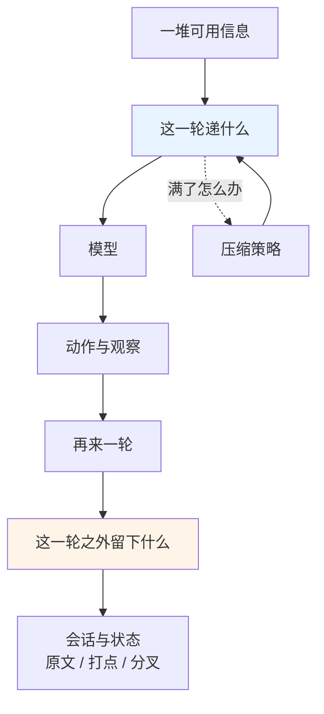
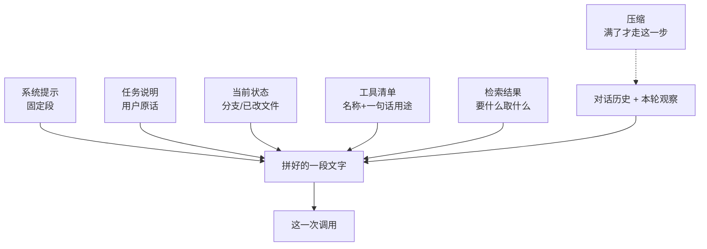
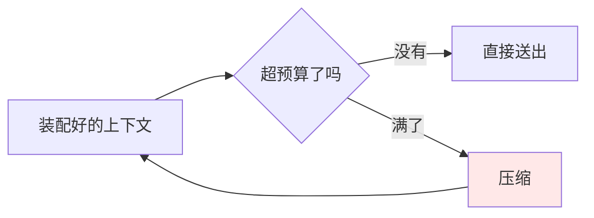

# Ch20 上下文工程与记忆

> 一句话简介：模型每一步只能看见有限的一格字，这一格该装什么、满了怎么办。

## 本章目标

读完本章你应当能：

- 说清楚"上下文窗口变大"为什么不是问题的解法，并能用"注意力预算"解释原因
- 拆开一轮请求的上下文，说出它由哪几块拼成、每块由谁提供、满了先动哪块
- 说出窗口满了时的四种压缩策略，并解释它们各自在"丢掉什么"这一步上的差别
- 举出一个"摘要把限定条件抹掉"的例子，说清为什么摘要不能无脑用
- 说出「会话与状态」这一项职责的两半——留原文、能恢复、能分叉——以及它和「上下文与记忆」为什么不是同一件事

## 本章导览

本章做深 Ch17 里的两项职责：**第 3 项上下文与记忆**和**第 6 项会话与状态**。先用一章回答一句话——**模型每一步只能看见有限的一格字，这一格该装什么、满了怎么办**——再回答第二句——**跑完这一格之后，我们自己手里留下了什么**。

先记住一条红线，它划在 Part 4 和 Part 5 之间：**本章管"这一轮递什么给模型"；"什么东西存到轮次之外去"归 Part 5 Ch24**（见 17.4.3）。沿用 Ch17 的说法——开卷考试"考哪几页"是本章，"考完把哪几页抄进笔记本"是 Ch24。



图上只有两个方块上了色，记住这两个就够。**蓝色的 `这一轮递什么`** 是 20.3–20.5 的地盘：**装配 → 满了 → 压缩**——它本身是装配的产物，那条虚线「满了怎么办」就是 20.4 的压缩策略，压完再送回同一个方块。**橙色的 `这一轮之外留下什么`** 是 20.6 的地盘。两支连在一起才是一个完整的长任务能力——只做蓝色那一支，Agent 跑得短没问题；跑得长，就一定会撞到橙色那一支。（20.1 讲为什么会撞墙、20.2 讲为什么买更大的窗口没用，这两节是整张图的前提，图上不占格子。）

## 20.1 先演一遍「没有它会怎样」：第 15 步发生了什么

Ch17 17.4.3 已经把这件事说成一句话了——"决定每一轮到底递哪些字进去"。这一次我们不停在定义上，**跟着一个具体的任务走二十几步，看它怎么撞墙**。

任务是这么一句话：

> 把这个仓库里所有没被真正用到的依赖列出来，确认之后删掉。

Agent 拿到手，开始干活：

```text
step 1   读依赖清单文件（package.json / requirements.txt）
step 2   读构建配置，确认打包方式
step 3   全仓库扫一遍 import 语句
step 4   ★ 扫到 legacy-imports.py：有两个包只出现在"被注释掉的那段旧代码"里
step 5   判断：注释掉的代码也算引用吗？—— 先记下来，回头问用户
step 6..13  逐个查包是否被真正调用，逐个跑测试验证
step 14  跑完整测试套件，绿
step 15  ← 窗口用量 87%
```

到了第 15 步，窗口里已经装满了：系统提示、用户那句话、14 轮对话、工具清单、十几个包的查询结果、成片的测试输出。**其中最占地方的往往不是对话，是工具返回的长文本**——一次测试跑动的输出，动辄几千个字。

现在看第 25 步。Agent 要回答最初那个问题："所有没用到的依赖，都列全了吗？"它需要回看第 4 步的那条发现。可那条发现已经在窗口的边缘，眼看要被挤出去。

如果不管它，会发生两件事，第二件要命得多：

1. **Agent 重新去扫一遍**，浪费十几步和一大截预算；
2. **Agent 直接答了**："没有其他未使用的依赖了。"——**它漏了东西，却说自己看全了。**

第二种正是 Ch17 17.4.3 点名的、最贵的失败模式：报错你看得见，**说谎你看不见**。

### 为什么会这样：不是模型笨

这是本章最该先钉死的一点：**这不是模型的记性问题，是容量问题。** 三条原因，从最表层往里挖：

**第一，窗口是一个连续的空间，不是一排抽屉。** 我们直觉上以为上下文像书架——把不用的抽出来，用的放回去。但实际上它是一块整的画布：新内容进来，不会自动把旧内容挤到"归档区"，它只能**直接把旧的挤出去**。塞得越满，越靠边的东西越先掉。

**第二，窗口越满，模型能"均匀用上"的部分就越少。** 一半是因为每样东西分到的注意力变少，一半是因为位置也有讲究——这两条 20.2 展开。注意力是要**分摊**的，不是无限的。

**第三——也是最关键的一条——模型身上没有任何一处可以翻。** 它不是"忘了"第 4 步，它**根本不存在一个"我之前想过什么"的地方**。第 4 步那条发现只在窗口里，而窗口就是它全部的记忆。窗口一满，那条发现对它来说就等于**从来没发生过**。

请把这三条读成一个结论：

> **模型没有记忆，只有上下文。上下文一满，等于记忆被清空。**

```text
step 1    [系统提示][用户那句话]                                       用 12%
step 6    [系统提示][用户那句话][6 轮对话][工具清单][观察…]            用 48%
step 15   [系统提示][用户那句话][14 轮对话][工具清单][观察…]           用 87%
step 25   [系统提示][用户那句话][25 轮对话][工具清单][观察…]           用 120%
                                                                             ✗ 塞不下了
                     ↑
          第 4 步那条"注释块里也有引用"，就掉在这条路上
```

## 20.2 注意力预算：为什么"买张更大的地图卡"不是答案

### 先摆一个常见的想法，再说它为什么不够

看完上面的失败，最自然的反应是：**窗口不够大，那就换个窗口更大的模型。**

这个反应不算错，但只解决了一半。到 2026 年，百万量级 token 的窗口在主流模型上已经是常见配置——**这类数字变得极快，本书不列具体型号和数值**，但大方向是稳定的：窗口确实越来越大。**那为什么任务还是会撞墙？**

### 白话

因为窗口里的每一个字，都要从**同一份总量**里分一点注意力。字越多，每个字分到的那一点就越少。

### 类比

一间坐了两百人的大教室，讲台上只有一位教授。他一个人要同时照顾两百个人——**他照顾得过来，但每个人都只能分到一点点。**

坐在第一排和最后一排的学生，教授常常能叫出名字；坐在中间那一大片区域的，教授扫过去只记得"那里坐了一堆人"。**这两百个人确实都在教室里，可他们并不被同等看见。**

这个类比不是随口编的——它对应的是记忆心理学里早就有的一个现象，叫**首因与近因效应**：人对一件事的开头和结尾记得最牢，中间记得最糊。而模型在这件事上的表现，恰好长这个样子。

### 小例子

一句话，二十个字。

```text
情况 A：这 20 个字单独递进去           → 模型几乎一字不差地用上
情况 B：这 20 个字塞在 4000 个字正中间 → 模型只用上了其中 3 个
```

同一个模型，同一句话，只是**位置**不一样。差别就这么大。

到这里，这个已经摸得着的东西可以有个正式名字了：**注意力预算（attention budget）= 这一次调用里，全部输入的字共同分享的那份注意力总量。** 它是有限的，会被瓜分；装得越满，每样东西被"注意到"的份额越低。Ch17 17.3 那张表里写的"上下文按**预算**来管"，说的就是它——当时只用了这个词。

这不是比喻，是测出来的。2023 年有一篇论文专门做这件事：在多文档问答和关键信息检索两个任务上，把同一段关键信息分别放在长上下文的开头、中间和结尾。结果是一条 **U 形曲线**——开头好、结尾好、**中间明显差**。更扎心的是其中一个数：某个模型在关键信息处于中间时的表现，**比它压根不看这些文档还低**。也就是说，多塞进去反而不如不塞。

2025 年 7 月又有一份规模更大的复核报告：横向测了 18 个前沿模型，**结论是全都退化**，而且退化的是"能不能均匀地用上"，跟"装不装得下"是两回事。

### 所以，"买更大的窗口"为什么不够

三条理由，凑齐了就明白了：

| | 为什么不够 |
|---|---|
| **贵** | 输入的字是要按量计费的。窗口从二十万加到一百万，单次请求的成本不是翻倍而是**显著放大**，而且每一次调用都要付 |
| **慢** | 字越多，送进去和读出来的计算量越大，每一轮都等得更久。Agent 是几十轮起步的任务，**每轮慢 2 秒就是好几分钟** |
| **最要紧的** | **退化的是"能均匀用上"，不是"装得下"。** 把窗口买大解决的是后者，前者一点没动 |

第三条是本章的转折点：**既然预算有限且会被瓜分，那么"这一格该装什么"就不是一个可以偷懒的问题，而是一道必须做的题。** 这道题的工程名字，就叫上下文工程（context engineering）。

一句话转述：上下文工程不是"怎么写提示词"，而是**每一次调用之前，重新决定这一格该装哪几样东西**。

## 20.3 一轮请求的上下文是怎么拼出来的

Ch17 17.4.3 已经列过一轮里的五块东西。本节把它**拆成六块**——它最后那项「最近若干轮 + 本轮观察」被分成**检索结果**和**对话历史**两块，因为这两样东西的来源不同、能压的方式也不同：对话历史只能靠压缩，检索结果可以**只取片段**（见 20.4）。剩下六块，本节逐块讲细——每块谁提供、多大、满了先动谁。

### 装配管线



这六块来自六个不同的来源：**固定的**（A）、**人的**（B）、**机器采的**（C）、**注册表里查的**（D）、**按需检索的**（E）、**滚动的对话与观察**（F）。它们不是同一个生命周期，这正是"装配"这个词值得单独说一说的原因。

### 六块逐条看

| 块 | 谁提供 | 典型大小 | 压力来了先动它吗 |
|---|---|---|---|
| 系统提示 | 你写死的 | 最长的一块，但最稳定 | **不动。** 它是这份上下文的地基，动了整套行为就变了（怎么写好它是提示词的事，见 Part 1） |
| 任务说明 | 用户第一句话 | 一两句 | **不动。** 必须原样保留，它是判据的来源 |
| 当前状态 | 每次刷新（分支、已改文件、跑过的测试） | 几十到几百 | 不动，但可以**瘦身**——只列"改过的"，不列"看过又没改的" |
| 工具清单 | 注册表（Ch18、Ch19） | 每条几十个字，**乘以条数** | **该动的第一个。** 二十个工具全递进去，模型每步都要现挑，很容易挑错 |
| 检索结果 | 要什么取什么 | **最不可控** | 该裁。日志、测试输出、大段文件常常占掉一半预算 |
| 对话历史 + 观察 | 循环滚出来 | 随步数线性增长 | **真正满了先压它**（20.4）——前面几块是提前瘦身，这一块是最后才动 |

看这张表会注意到一件事：**能省的地方比想象中多**。工具清单可以只递相关的几个；检索结果可以只取回片段而不是整份；状态可以只列变化。而真正"只能压"的，其实只有对话历史。

### 顺序也有讲究

拼装的**先后**不是随便定的。承接 20.2 那个教室类比：放最前面和放最后面的，最容易被注意到。

所以通行做法是把"最该被用上的"放在两端——**系统提示和任务说明在开头，最近的观察在结尾**，大块的中间内容只当背景。具体到装配顺序，六块可以合成下面四步：

```text
1. 系统提示 + 任务说明   角色、边界、输出格式、用户那一句原话
2. 当前状态 + 检索结果   这次任务真正需要的资料
3. 工具清单              能干什么
4. 对话历史 + 本轮观察   从最早的一路滚到最新的一路
```

（合成时合并了两对：**任务说明并进系统提示**——两者都钉在最开头；**当前状态并进检索结果**——两者都是"这一趟要用的资料"。）

第 2 和第 3 能不能换序？能，换了对大多数任务没影响。但把"最新观察"排在最后、把"系统提示"排在最前，是有理由的。

### 具体走一遍：第 15 步那一轮到底递了什么

现在把上面的表和顺序填上第 15 步那一次调用：

```text
┌ 系统提示        ≈ 8%    你是代码维护助手……改文件前先问用户……
├ 任务说明        ≈ 1%    "把这个仓库里没被真正用到的依赖列出来，确认后删掉"
├ 当前状态        ≈ 3%    分支 fix/deps｜已改：package.json｜测试：全绿
├ 工具清单        ≈ 9%    本轮只递 5 个相关的：搜索 / 读文件 / 跑测试 / 改文件 / 问用户
├ 检索结果        ≈ 14%   第 4 步那条发现，被显式提上来，放在最近观察之前
├ 对话历史 + 观察 ≈ 52%   14 轮对话，其中 3 次测试输出共 9000 字
└────────────────────────────────────────────
                    合计 ≈ 87%
```

两件事值得停下来看：

- **最后一块占了 52%，而其中绝大部分是工具输出（原始日志、测试打印），不是对话。** 这是长任务的常态——真正耗预算的往往不是"我们聊了些什么"，而是"工具吐了些什么"。
- **第 4 步那条发现被"显式提上来"了。** 这不是自动发生的，是装配这一步的职责：**把还没用上、但迟早要用的东西，主动挪到模型容易看到的位置。**

到这里，"这一轮递什么"这件事已经完整了：六块拼起来、放进一个 87% 的格子里、按重要性排好序。剩下的唯一问题是——**第 25 步的时候，这个格子必然要爆。爆了怎么办？**

## 20.4 窗口满了怎么办：四种压缩策略

### 先说四种策略的共同点

不管用哪种策略，压缩都发生在**同一个位置**：

> **装配之后、送出之前。**



这个位置本身就是个值得记住的设计：**压缩不发生在"存进去"的时候，只发生在"要用"的时候。** 意味着平时不压缩，可以放心地一直往前存；只在真的要发请求的那一刻，临时把这一格收拾干净。

四种策略的差别，全在**"丢掉什么"这一步上**。20.7 的代码骨架会把这四种摆在一起对照，代码比文字更清楚。

### 20.4.1 滑窗：只留最近 N 轮

**白话。** 超出预算，就把最老的那几轮扔掉，只留最近的 N 轮。

**类比。** 黑板擦。只擦最上面留最下面那几行——不是判断哪几行有用，是按顺序从最早的开始擦。

**小例子。** 留最近 2 轮：

```text
… step 11 ┊ step 12 ┊ step 13 ┊ step 14
  └───── 扔掉 ──────┘   └──── 留这两轮 ─────┘
```

**一句话评价。** 最简单、最快、最不需要额外花钱，代价是**早先的结论会被活生生地扔掉**。20.1 里第 4 步那条发现，在滑窗下活不过第 16 步。

它适合任务短、或者最近几轮自足的情形。**当 Agent 的每一步都依赖"用户最早那句话"时，滑窗一定会出事。**

### 20.4.2 摘要压缩：本章的一招鲜

> 四种策略里**只展开讲一种**，其余三种留给 20.4.3 的表格。选它，是因为它是四种里唯一一个**不靠"扔"、而靠"改写"**的——也是唯一一个会引入新错误的。

**白话。** 窗口要满了，让模型把"到目前为止发生了什么"写成一段**交接说明**，然后用这段说明顶替掉被扔掉的那一大段对话，新开一格继续干。

**类比。** 值班交接班。前面那一班的人不能一直留在房间里（房间坐不下），但他们会留下一张**交班条**：现在什么情况、我试过什么、排除了什么、接下来该从哪儿下手。下一班的人不看录像，照着这张条子接手。

**小例子。** 一段真的交班条长这样：

```text
【任务】清理仓库里未使用的依赖。
【已确认】package.json 里 5 个包无任何 import 引用，已从清单移除，测试全绿。
【待确认】legacy-imports.py 第 88-120 行有两个包只出现在"注释掉的旧代码"里 ——
          用户尚未答复"注释掉的算不算引用"。这一条还没问，不要自行决定。
【已排除】devDependencies 全部保留（构建脚本需要），不是清理目标。
【下一步】问用户那个限定问题；得到答复后再删依赖、跑一次测试。
【预算】剩余约 40% 窗口；已删的包不要再读回来核对。
```

看这段东西和原文的差别：**原文是 14 轮对话加上一堆工具输出，交班条是 7 行字。** 但注意，交班条并没有少说事情——它把"待确认"和"已排除"这两类**最容易被抹掉、又最容易致命**的信息，单独列了出来。这不是巧合，是下一节的主题。

**摘要压缩真正的难点不在"压缩"，在"该写什么"。** 回头看那段交班条，凡是能浓缩成一句话的（"删了 5 个包"）都浓缩了；真正值钱的反而是那些**不能被压缩的信息**：

| 类别 | 例子 | 能不能压成一句话 |
|---|---|---|
| 进度 | "删了 5 个包，测试全绿" | 能，压得很干净 |
| 排除项 | "devDependencies 不在清理范围" | 能，但**极易被漏掉** |
| 待确认项 | "用户没答复，注释块算不算引用" | 不能，**必须原样留着** |
| 限定条件 | "这个服务不能停机" | 不能，**一个字都不能改** |
| 失败记录 | "走重试+并发那条路失败了，因为下游不支持" | 能压，但**压没了模型就再走一遍** |

前两类是压缩的常规收益，后三类才是压缩的事故来源。**20.5 专门讲这件事。**

**一句话评价。** 最贵、最慢、也最容易被做坏——因为它是**用模型去总结模型**，总结本身可能出错（20.5），而且每次摘要都是一次额外调用。但它也是唯一一种"越跑越省"的策略：任务越长，摘要的性价比越高。

### 20.4.3 另外两种：淘汰与外置

这两种不必展开，各给两句话，再进对比表。

**淘汰：不看新旧，看还要不要用。** 滑窗的判据是"时间"，淘汰的判据是"**还要不要**"。给每一块上下文标一个"接下来还有没有用"（由壳算，或者由模型自己打标），把判为无用的剔出这一格，**留下的那批因此可以更多、更杂、更老**。

和滑窗的差别很清楚：滑窗一定会扔掉早期结论，淘汰有可能一条都不扔——判下来全都还要用，那就一个也不用扔。

一句话分清淘汰和外置这两件事：**淘汰只回答"扔哪些"，外置回答"扔掉的放哪儿"。** 淘汰只是换了个判据在窗口里重新挑一遍；外置是把东西搬到窗口外，只留一个地址。

**外置：把内容挪出窗口，只在窗口里留一个地址。** 挪出去的东西不删，存到窗口外；窗口里只留一句"第 8 到第 20 轮的内容存在某个地方，需要时按需取回"。好处是**信息没有真正丢失**，坏处是**每次取回都要多花一轮**。它的学名叫即时检索（just-in-time retrieval），"需不需要取"这件事可以由模型自己决定，也可以由壳决定。

### 四种策略对照

| | 滑窗 | 摘要 | 淘汰 | 外置 |
|---|---|---|---|---|
| **判据** | 时间新旧 | 换一种说法重写 | 还要不要用 | 默认都要用 |
| **丢什么** | 最早的整段 | 整段，换成交接说明 | 判为无用的部分 | 整段，搬出去只留地址 |
| **原文还在吗** | 在（如果你另外存了） | 在（如果你另外存了） | 在（淘汰只决定扔谁，不决定放哪） | **在，就在外置区** |
| **额外开销** | 无 | 一次模型调用 | 打标开销 | 取回时多一轮 |
| **典型风险** | 早期结论被扔 | 摘要把限定条件抹掉 | 判错，扔了还要用的 | 该取没取，或取太勤 |
| **任务越长越划算吗** | 不划算 | **划算** | 划算 | 划算 |

最后一列是选型时真正该看的一列。**短任务用滑窗就够了，长任务的正确答案都在后三种里，而其中只有摘要能让"过去"变成"一段可读的过去"，其余三种都是"过去还在那儿，只是你现在看不见"。**

## 20.5 为什么「摘要一切」是错的

20.4.2 已经留了话头。摘要压缩最容易出的事故，不是写得太长，是**写得太像那么回事**。

要分清两种失败，它们的处理方式完全不同：

```text
挤出（vanish）   字不见了          → 补救办法是"别扔"：滑窗改摘要、外置、改工具输出长度
失真（distort）  字还在，意思变了  → 补救办法是"别让摘要负责约束"：见下面三条
```

20.1 讲的是挤出。本节讲失真——**它更危险，因为你在摘要里找不到任何证据说这里出过错。**

### 一个具体的失真例子

还是 20.1 那个仓库清理任务，不过这次我们换个开头的任务（第 3 轮，用户多说了一句）：

> "顺便把登录超时也修了。注意**这个服务不能停机**，改配置必须走热加载。"

Agent 记下了这句话，继续干活。到第 18 步窗口满了，触发摘要。壳让模型把前面十几轮总结一下，模型交上来这么一段：

```text
【任务】清理未使用依赖；并修复登录超时问题。
【进度】依赖已清理 5 个；登录超时的原因定位在下游服务响应慢。
```

**那句"不能停机、必须热加载"没了。**

到第 20 步，Agent 要给登录超时挑一个修法。它推理出的方案是这样的：下游响应慢，那就加一层缓存，顺带把连接超时从 200ms 提到 500ms——这需要一个新配置文件，改完**重启服务**才能生效。这个推理本身完全合理。

它没有做错任何一步。它只是**在一个缺了一条约束的前提下，做出了正确的推理**。而那条约束在第 3 轮就被人说过了，被摘要吃掉了。

于是模型在第 21 步敲下了一条会停掉整个服务的命令——**前提是它从来不知道有人说过不让停。**

### 三条经验规则

**规则一：限定条件不进摘要，原样单独保留。**

留意那些字不多、但一改就闯祸的信息：

```text
"不能" "不要" "必须" "只" "除非" "仅限" "超时是 200ms" "只改 A 不动 B" "先问用户"
```

这些字加起来可能不到二十个，却撑起了整份约束。**做法很简单：把它们从正文里抽出来，单独列一段，不交给摘要模型加工。** 因为一旦交给模型"总结"，它会判断这句话不重要——在大多数摘要的眼里它确实不重要，直到出事。

**规则二：试过什么、为什么不行，必须写进摘要。**

这是摘要最典型的翻车点。原文里有一段"我们试过加重试，不行，因为下游不支持并发"。摘要模型把它压缩成"排查了若干可能原因"，理由链断了。于是 Agent 在第 22 步**把那条死路又走了一遍**——不是因为它笨，是因为它读到的那段话里根本没有"这条路走过"这回事。

失败的记录比成功的记录更该被写进摘要。**成功的结果会自己说话，失败的结果不会。**

**规则三：摘要是降级，不是真相。**

这一条是三条里最要紧的，也是它把本章引向下一节的那座桥：

> **摘要是给模型看的降级版本。真相必须另有一份，逐字保存。**

一旦你把摘要当成唯一的存储格式，那么 20.5 前面那个失真例子就变成**不可逆**的——原始记录已经被覆盖了，你再也回不去验证"用户到底有没有说过不能停机"。所以摘要**顶替不了状态**：它只能当**上下文**用。真要在状态里留一行摘要，那也只能是**原文之外的一个注脚**——原文必须逐字并存（20.6 给出它并排放在一处的落法）。

这两件事不是一回事。它们是 Ch17 里的第 3 项和第 6 项职责，现在该把第 6 项打开看了。

## 20.6 会话与状态：留下可回放、可恢复的记录

Ch17 17.4.6 已经埋好了这个职责的类比——**黑匣子加里程表**，里程表上还有一道可以打点的横杠，并且划了两半：**"记下每一步"是回放，"从某个点接回来"是恢复**。

本章回放那半不重讲（那是 Ch17 说过的一次会话记录长什么样），**这一节做深的是红线那半：恢复与分叉。**

### 先演一遍「没有它会怎样」

上一节的那个 Agent，在第 21 步敲下了那条重启命令——然后进程崩了（可能只是终端被关了）。现在你要做三件事，一件也做不到：

**场景一：接着干。** 它已经改了 9 个文件、跑通了 3 轮测试，你希望从崩溃点继续，而不是从头再来一遍。做不到——**窗口在进程里，进程没了，窗口就没了。** 你手上只有屏幕上滚过去的那一屏输出。

**场景二：换个思路重来。** 你在第 12 步就知道它选错了方向（它一直在用 A 方案，其实 B 方案更省事）。你想**退回第 12 步、改走 B 方案**。做不到——会话是一条直线，走过去就没有"回到第 12 步那一刻"这个动作。`undo` 撤销的是文件改动，撤不掉"当时的思路"。

**场景三：查账。** 三天后你想知道第 7 步它为什么那样写。做不到——除非你当时逐字存了原文。**存了摘要是不够的**，20.5 刚说过为什么。

三个场景，对应三条要求：

| 你要的 | 技术上叫什么 | 一句话 |
|---|---|---|
| 接着干 | **可恢复** | 状态能被重新构造出来，不靠把窗口原样留着 |
| 换个思路 | **可分叉** | 历史是**一棵树**，不是一条线 |
| 查账 | **可回放** | 原文**追加写**，永不覆盖 |

### 可恢复：状态是能被重建的，不是被存着的

这里有一个特别容易踩的坑，值得单独说：**很多实现把"当前上下文"直接当状态存下来。** 结果就是 20.5 那套失真会同步污染状态——摘要错了，状态也跟着错，而且不可逆。

正确做法是：**上下文里放的可以丢，状态里放的不能丢。** 状态只记四样东西，多了就是负担：

```text
当前分支          —— 我们在哪棵树上
已改文件清单      —— 这个会话到底动过什么
已跑过的测试      —— 哪些已经验证过、哪些还欠着
下一步在哪儿      —— 一个指针，指向某条具体的记录
```

这四样都是**事实**，不是**总结**。有了它们，从任意一个点重新装配出一格上下文是**纯机械操作**——这就是"可恢复"的全部含义。

### 可分叉：历史是一棵树

场景二需要的不是"倒带"，是**分叉**：从第 12 步那个节点长出一条新的枝。

```text
                       ┌─ step 13 ─ step 14 ─ … ─ step 21   ✗ 崩在这
                       │
  root ─ step 1 … ──── ● step 12
                       │
                       └─ step 13′ ─ step 14′ ─ …           ← 另一条思路，跑通了

  ● = 打点（checkpoint）：这里记一句"解析器已改宽松，单测全过"
  每个节点都记三样：逐字原文 + 一行摘要 + 指回上一节的 parent
```

这棵树和 17.4.6 里那道"可打点的横杠"是同一个东西，只是把它撑开了：**横杠是打点，子树是分叉。** 落盘成一个每行一条记录的文本文件，长这样：

```text
id      parent   步骤      摘要                          原文
root    —        1..12     定位到解析器过于严格            append-only
c-001   root     13..21    改成宽松 + 跑测试 + 重启服务    append-only
c-002   root     13′..     改用显式标志位，不重启          append-only
```

两个细节值得盯住：

- **`parent` 这一列就是分叉的全部。** 有了它，"退回第 12 步换个思路"就是"在那个节点下面再开一个 c-002"，一行的事。至于"当时那个上下文快照"，不用单独存一列——快照本身就在 `root` 那一段的原文里。
- **摘要和原文放在一起，不是二选一。** 摘要让机器读起来快，原文让真相可查。**这就是 20.5 规则三的落地形式：摘要是降级，原文是真相，两者并存。**

### 两项职责在这里咬合

把 20.3 到 20.6 串起来看，职责 3 和职责 6 的分工一句话就清楚了：

```text
职责 3  上下文与记忆   递进模型的那一格   ——  可以压、可以丢、可以随时重装
职责 6  会话与状态     存下来的一切       ——  不压、不丢、只追加
```

最要紧的是**两者的方向相反**。上下文是"为了这一次调用，临时凑出来的一格"，用完即可；状态是"为了下一次能接上，一直攒着的记录"。一个是**投影**，一个是**底稿**。

**如果你把投影当成底稿，那就是 20.5 里那个不可逆的事故；如果你只有底稿没有投影，那些几千字的工具输出会把你每一轮的预算吃光。** 两样都要，这才是它被拆成两项职责的原因。

### 最后一条：换模型的时候（状态的可移植性）

状态里别存某一家的私有字段。上下文记录里真正需要**存进状态里**的，是四样**跨厂商都认的东西**：角色（人说的还是机器说的）、内容、工具调用的事实、以及时间顺序。厂商特有的那部分，留在当次调用的临时结构里，**不要让它进状态**——否则你想换个模型接着跑，就得先做一次数据迁移。

## 20.7 代码：压缩策略骨架

四种策略的差别在哪一步，看代码比看文字快。下面这份骨架的**全部意义，就是把这四种摆在一起对照**：四支拿到的 `dropped()` 完全一样，分道扬镳的只有后面那一行——滑窗、摘要、外置三支都先 `keep(last_n=tail(2))` 再拿那批被丢的处理，**淘汰那一支干脆不看 `dropped`**，而是 `keep_by(score=…)` 在整格里重新挑一遍。

```python
# illustrative only
# depends: 无（纯骨架，所有标识符都是占位名）
# usage: 读文件即可，不需运行
#
# Ch20 20.4 的骨架。四种压缩策略的差别只在“被丢掉的那部分怎么办”这一步。

THRESHOLD = 0.8          # 用到窗口的这个比例就开始收拾，留出缓冲给模型自己的输出


def compact(ctx, budget):
    """装配已经完成了，模型还没被叫。超预算就在这里收拾。"""
    if ctx.total() <= budget * THRESHOLD:
        return ctx                      # 没到线，什么都不做——压缩只发生在“要用”的那一刻

    dropped = ctx.dropped()             # 超出预算的这部分，四种策略拿到的输入完全一样

    if STRATEGY == "滑窗":
        ctx.keep(last_n=ctx.tail(2))    # 丢掉的部分：不要了
        return ctx

    if STRATEGY == "摘要":
        ctx.keep(last_n=ctx.tail(2))
        ctx.insert(0, summarize(dropped,
                                must_keep=constraints_of(dropped)))
        return ctx                      # 丢掉的部分：换一段交接说明顶替

    if STRATEGY == "淘汰":
        ctx.keep_by(score=still_needed) # 不看新旧，只看还要不要用
        return ctx                      # 丢掉的部分：也不另存——淘汰只决定扔谁，不决定放哪

    if STRATEGY == "外置":
        ctx.keep(last_n=ctx.tail(2))
        stash.put(dropped)              # 整段搬出窗口
        register_tool("取回第 k 轮", lambda k: stash.get(k))
        return ctx                      # 窗口里只多一个地址，正文一个字都没留
```

三处值得停下来看：

- **`dropped` 在四个分支里长得一模一样，但只有三支真的动了它。** 滑窗那一支**除了 `ctx.keep(last_n=…)` 之外一个动作也没有**——"丢掉的部分不要了"这句话不用再被执行一次；外置那一支把它 `stash.put()` 搬出窗口；摘要那一支拿它去 `summarize()`。**淘汰是唯一的例外，它压根不看 `dropped`**——`keep_by(score=…)` 直接在整格里重挑，这正合它的本意：淘汰只决定扔谁，不决定放哪。四支对应四个动作，照着这份代码能一个一个对上，**别再去找第五个函数**。
- **`must_keep=constraints_of(...)` 是 20.5 规则一的代码形态。** 限定条件不进摘要，它单独被拎出来、原样带过。
- **`register_tool(...)` 是 20.4.3 那个"地址"的落法。** 外置出去的整段要能回来，就得留一个模型够得着的把手。

骨架里刻意**没有** 20.6 那一半（会话树、打点、原文落盘）——`stash` 只是"外置"这一种策略自己的临时存放处，跟状态那份不是一个东西。压缩只管这一次递什么，落盘了什么归状态管。

## 20.8 本章小结

- 模型的记忆只有一格窗口。**窗口一满，等于记忆被清空**——不是它忘了，是那格地方没有了。
- **注意力预算**是这一格里的字共同分摊的那份总量。字越多，每个字分到越少，所以**买更大的窗口解决不了问题**：贵、慢，而且退化的是"能均匀用上"而不是"装得下"。
- 一轮上下文由六块拼成：**系统提示、任务说明、当前状态、工具清单、检索结果、对话历史与观察**。真正吃预算的常常是工具输出，不是对话。
- 压缩发生在**装配之后、送出之前**这一步。**滑窗**按时间扔；**摘要**把过去改写成一段交接说明；**淘汰**按"还要不要用"筛；**外置**搬出窗口只留地址。**任务越长，越该用后三种。**
- 摘要有两种失败：**挤出**（字不见了，补救是别扔）和**失真**（字还在但意思变了）。**限定条件不进摘要、失败记录必须写进、摘要只是降级版本**——最后一条直接引出下一节。
- 「会话与状态」的三条要求是**可回放**（原文追加写）、**可恢复**（状态能被重建）、**可分叉**（历史是一棵树）。
- 两项职责方向相反：**上下文是可以随时重装的投影，状态是不能丢的底稿**。把投影当底稿，就是不可逆的事故；只有底稿没有投影，预算会被工具输出吃光。

**与 Ch21 的衔接。** 本章解决了"递什么给模型"，但递出去的那些字**全是软的**——模型没读进去、读错了、或者干脆没理会，都不会有任何地方拦住它。下一章处理硬的那一半：**提示词是软约束，外壳才是硬约束**。

## 本章参考

### 必读论文

- [Lost in the Middle: How Language Models Use Long Contexts（Liu 等，2023；后收录于 TACL 2024）](https://arxiv.org/abs/2307.03172)——20.2 那条 U 形曲线的来源，也是"关键信息该放开头和结尾"的出处。
- [MemGPT: Towards LLMs as Operating Systems（Packer 等，2023）](https://arxiv.org/abs/2310.08560)——Ch17 已引；本章再引是因为它的**虚拟上下文**那一节，正是 20.4.3「外置」策略的学术祖先：把窗口当内存条，把外面那一层当磁盘。

### 推荐博客 / 教程

- [Effective context engineering for AI agents（2025 年 9 月）](https://www.anthropic.com/engineering/effective-context-engineering-for-ai-agents)——"注意力预算"这个词的出处，也是 20.3 装配顺序（系统提示 → 状态与检索结果 → 工具清单 → 对话历史）的来源。Ch17 已列过，这里是正式展开。
- [Context Rot: How Increasing Input Tokens Impacts LLM Performance（2025 年 7 月）](https://research.trychroma.com/context-rot)——20.2 里"18 个模型全都退化"那份复核报告；长上下文退化现象的系统对照。
- [Context engineering for AI agents（中文译文整理）](https://forceinjection.github.io/08_agentic_system/context/anthropic-context-engineering-zh.html)——上一条的中文版，术语对不上时可以直接查。

### 视频 / 课程

- [生成式人工智慧與機器學習導論（李宏毅，2025 秋）——第 2 讲：上下文工程](https://youtu.be/TigfpYPJk1s)——中文讲上下文工程最系统的一讲，含窗口管理、工具输出压缩、以及"Prompt 分心"。
- [课程主页（含全部讲次投影片与作业）](https://speech.ee.ntu.edu.tw/~hylee/GenAI-ML/2025-fall.php)——想跳着看时从这里进。