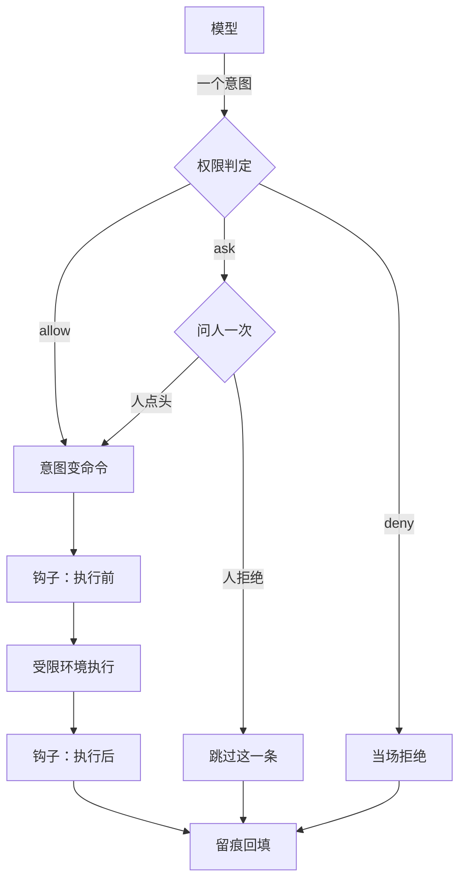
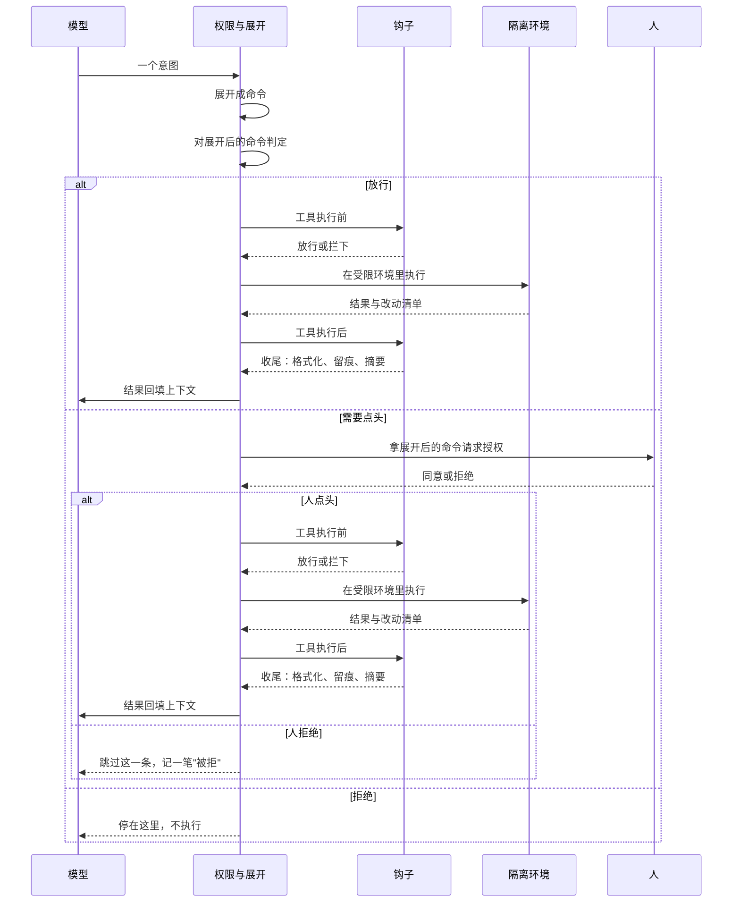
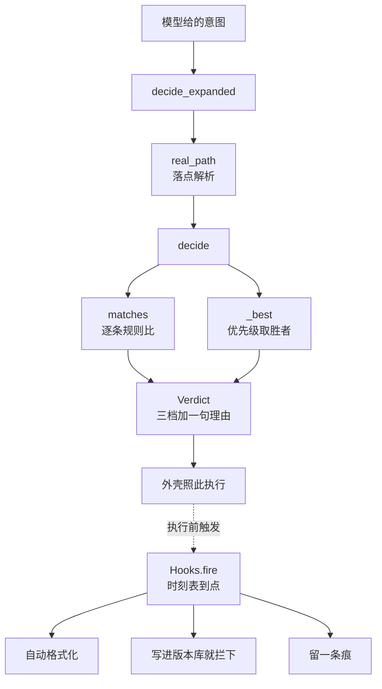

# Ch21 权限、隔离与钩子

> 一句话简介：模型管不住自己，外壳管得住它。

## 本章目标

读完本章你应当能：

- 说清楚权限、执行隔离、钩子各自回答什么问题，以及它们为什么是**串联**而不是二选一
- 拿到一份 `allow / ask / deny` 规则，能推出某个动作会被判成哪一档、依据是哪一条
- 讲明白"工具给模型的是意图、不是命令"这个缺口有多大，以及判定为什么必须落在展开后的命令上
- 为一个具体场景选出只读 / 可写工作区 / 完全放开三档里的哪一档，并说出代价
- 画出一张钩子时刻表，并解释它凭什么比"在提示词里叮嘱一句"可靠
- 用一句话复述本章结论：**提示词是软约束，外壳才是硬约束**

## 本章导览

Ch17 把 harness 拆成七大职责，其中三项留给了本章：**第 1 项「工具与权限」、第 2 项「执行隔离」、第 5 项「生命周期事件」**。这三项是同一条防线上的三道工序——在一次动作里前后挨着，各自补前一个的洞。

先看全图。**注意模型只出现在最上面那一格和最下面那一格：**



⚠️ **`W` 有两个出口，不是问完就往下走。** 人点头才汇进"意图变命令"，人拒绝走 `N`——这一条被跳过，一样留下一笔痕（`N` 和 `S` 都汇进"留痕回填"）。同 Ch17 17.2 的 `if not ask_human(call): continue`。

中间那几步——怎么判、怎么展开、执行前一道钩子、在哪跑、执行后一道钩子、做完谁去收尾——**没有一步能由模型的输出决定**。

赶时间的话，全章只读三处：**21.1 的三个场景**、**21.6 的链路图与结论**、**21.8 的小结**。

## 21.1 先演三次「没有它会怎样」

Ch17 每一项职责都是先演"没有它会怎样"再给定义，本章沿用这个顺序。而且要演**三次**——这三项各自挡住的是完全不同的失败。

### 21.1.1 场景一：规则写了，模型还是绕过去了

你写了一条规则：**不许改 `src/` 以外的文件**。跑得挺顺。第 3 轮，模型要装一个依赖，于是调执行工具跑了一条安装命令，那条命令往全局的包目录里写了东西。规则里没有这一条——判定放行。

**洞在哪。** 规则是**有限的一张清单**，模型的动作空间不是。清单之外的动作不是被拦住的，是**根本没进过判定**。

**类比。** 门禁卡上列了"资料室、档案室"两扇门，闸机查得清清楚楚——**可闸机后面那条走廊是敞开的**。谁能推开哪扇门卡管得了，走廊尽头有没有一扇没上锁的门，不归门禁卡管。

一句话记住：**规则防的是"被写下来的动作"，不是"被想到的动作"。**

### 21.1.2 场景二：判定通过了，执行炸到了外面

这次规则补得很全，每一条命令你都看过、都点了头。但还有一类洞：前面看到的是**命令的字面**，而它跑起来之后发生的**不是字面上那些**。

比如你放行了一条"跑测试"的命令。这条命令字面很干净——跑测试而已。可测试代码里有一段会去读环境变量、把内容发到某个地址。**它跑起来之后在往外发东西，这条命令一个字都没提。**

**洞在哪。** 你审的是意图被展开之后的那一行，**你没法审它跑起来之后会做的事**。

**类比。** 还是拆弹间（Ch17 17.4.2）：重点从来不是"希望拆弹手的手不抖"，而是**"就算他手抖了，墙还在"**。

### 21.1.3 场景三：关键动作，模型压根忘了做

你要求 Agent 改完代码必须先跑一遍格式化再交给你看。它跑了一小时，交上来的东西格式一塌糊涂。

为什么？因为"改完之后记得跑格式化"这句话，写在系统提示里——而这一小时里模型做了两百次工具调用，那句话在第 12 轮就已经不是注意力的重点了。**不是它不听话，是那句话本身没有执行力。**

**洞在哪。** 靠模型自觉的动作，**在长任务里必然衰减**。

**类比。** 机务喊话（Ch17 17.4.5）：他不问飞行员"你打算什么时候检查起落架"，那是固定流程，走到那一步他就喊。

### 三次场景，一个共同点

| 场景 | 洞在哪 | 哪一层挡 |
|---|---|---|
| 21.1.1 绕过去了 | 规则没覆盖到的动作 | **隔离**（执行之中约束）+ **钩子**（补上你没写进规则的动作） |
| 21.1.2 炸到外面 | 命令跑起来之后自己做的事 | **隔离** |
| 21.1.3 忘了做 | 模型的注意力会衰减 | **钩子** |

三层防御按这个顺序推进，是固定的：

> **permission gate（软提示挡不住）→ sandbox（OS 级原语）→ hooks（确定性脚本）**

因为三者**依次补上前一个的洞**：

1. **先上权限。** 提示词是软的（Ch17 17.1.2），但权限是成本最低的一道：判定发生在执行**之前**，拦住一次就是零损失。
2. **再上隔离。** 权限总有覆盖不到的地方——清单是有限的，动作空间不是。而隔离是操作系统级别的原语，**它不依赖任何人的记性**。
3. **最后上钩子。** 钩子不判断"允不允许"（它能拦的那一类见 21.5.3），它管的是判定之外那些**每次都该做、但没人会提醒**的事。它跟前两层不是替代，是补位。

## 21.2 权限：一份规则怎么读

回到 Ch17 17.4.1 的那张门禁卡，把它补完——**规则本身怎么被读成一次判定**。Ch17 给了三类判定的样子，没说匹配语义和优先级；这两个洞在这里补。

### 21.2.1 三档判定，加一个默认档

一份完整的规则读起来大概是这个意思（写法各家不同，这里只看结构）：

```yaml
默认: ask
规则:
  - {动作: 读,   对象: "src/**",     判定: allow}
  - {动作: 读,   对象: "**/.env",    判定: deny}
  - {动作: 读,   对象: "**",         判定: allow}
  - {动作: 写,   对象: "src/**",     判定: allow}
  - {动作: 写,   对象: "**",         判定: ask}
  - {动作: 执行, 对象: "git status", 判定: allow}
  - {动作: 执行, 对象: "git commit", 判定: ask}
  - {动作: 执行, 对象: "rm",         判定: deny}
  - {动作: 执行, 对象: "*",          判定: ask}
```

**白话。** 规则把每个动作判成三档之一，再加一个"都没命中时怎么办"的默认档：

| 档 | 白话 | 谁来拍板 |
|---|---|---|
| **allow** 放行 | 不用问，直接做 | 壳 |
| **ask** 询问 | 停下来请人点一次头 | 人 |
| **deny** 拒绝 | 根本不做，也不问 | 壳 |
| **默认** | 规则没覆盖到时怎么办 | 壳（应选 ask 或 deny） |

**为什么要有 deny，而不是拿 ask 去挡？** 因为 ask 的代价是**人会疲劳**——一个人连着点几十次头之后，点头这个动作本身退化成肌肉记忆，等于没有闸。deny 既省掉这一次问，也是一处"这里明确说了不要"的地方。

### 21.2.2 匹配算法：一条规则要能对上什么

动作要被判定，得先能被"对上"。匹配要回答的是：**一段字符串怎么算跟这条规则说的是同一个东西？**

三种写法，从窄到宽：

- **前缀**——以这段文字开头就算对上。写法最短，适合给整个命令族粗粒度划一条线。
- **通配**——符合一段带 `*` `?` 的模式。适合"某个目录下的所有文件"。
- **正则**——被这段模式匹配。适合"命令行里出现了某个危险子串"，比如任何含 `curl` 或 `wget` 的执行。

**小例子。** 一个动作 `执行 "git status --short"`：前缀 `"git"` 对上，通配 `"git s*"` 对上，正则 `"git (status|log)"` 对上。三种写法都能让它对上——但这里藏着一个必须讲清的矛盾：

⚠️ **通配符看起来最灵活，可它自己就是漏洞。** `执行 "*"` 匹配一切，等于执行这一栏压根没写规则。

⚠️ 还有一个更隐蔽的：**同一个 `*`，在不同匹配器里含义可能不同**——有的不进子目录，有的进。`src/*` 到底覆不覆盖 `src/a/b.py`，取决于你用的那个匹配器怎么定义它。**写规则的人必须先知道自己用的匹配器怎么定义 `*`**，否则会以为自己拦住了，其实没拦住。

这不是纸上谈兵：上面那份 yaml 里有一条 `读 "**/.env" → deny`，指望盖住所有 `.env`；可要是匹配器就是 21.7.1 代码里那个 `fnmatch`，**根目录下那个 `.env` 会从兜底的 `读 "**" → allow` 溜过去**——`fnmatch` 把连续的 `*` 压成一个，`**/.env` 就要求路径里含一个 `/`，而文件名 `.env` 不含 `/`，对不上。**同一份 yaml，换个匹配器就是一套意思**，所以匹配器怎么定义 `*` 必须写进配置里让所有人知道，不能指望谁自己想到。

### 21.2.3 优先级：多规则同时命中时听谁的

现在到了那份规则真正开始干活的地方。动作 `执行 "rm -rf build/"` 同时命中了 `执行 "rm" → deny` 和 `执行 "*" → ask`。听谁的？

规则是这样定的（各家实现细节不同，取舍是通的）：

1. **deny 一票否决。** 只要有 deny 命中，就不看别的了。
2. **同一档里比谁更具体。** 写法越窄优先级越高——正则 > 通配 > 前缀，同级再比目标串的长短。
3. **同样具体时 ask 压过 allow。** 拿不准的那一档，宁可多问一次人。

**为什么 deny 要一票否决，而不是"谁更具体听谁的"？** 因为 deny 通常写得**短**——它是在**显式收窄**，不是在收宽。如果让更具体的 allow 压过它，等于变成"我给你开了个口子"这句话会因为排列上的巧合而失效。

⚠️ 下面这条最容易被当成配置 bug，单独拎出来：

> **书写顺序不是优先级。**

很多配置格式长得像一串列表，读的人会本能地以为"先匹配上的先生效"。如果实现真是这个语义，那用户只要把一条宽规则写在窄规则前面，窄规则就永远不生效——**而这种错误不报错，配置能加载，行为只是不对**。所以正确的做法是：**优先级由规则自己的性质决定**（哪一档判定、哪种写法），**不由它出现的顺序决定**。这样用户重排规则，行为不变。

### 21.2.4 默认为什么是拦住

上面那份规则的"默认"写的是 `ask` 不是 `allow`，理由值得单独一节。

**白话。** 默认拒绝说的是：**没有人明确点头的事，就不要发生。**

**类比。** 公司发门禁卡的默认逻辑是**没领卡的人进不来**，而不是"有卡的人能进所有门"。想进哪间，自己去前台申请。

**小例子。** 假设默认是放行。你今天接了一个新工具，它自带一个"上传文件"的动作。默认放行意味着——**这个新工具一接上就是一把没有编号的钥匙**，而你只有想起来去翻配置才知道它存在。默认拦住则相反：新动作第一次调用会停下来问你一句。

**问题就从"漏配了一条规则"变成了"多问了一次人"**——两种错误的代价根本不对等：前者不可撤销，后者只花三秒。

这套说法在计算机安全里叫**安全默认（fail-safe defaults）**，出自 1975 年 Saltzer 与 Schroeder 那篇讲保护信息该怎么设计的经典论文：**基于"许可"做决定，而不是基于"排除"做决定**——因为你要穷举的是"哪些坏情况"，那是个填不满的列表。所以推荐的组合是**默认拒绝 + 显式放行**，把少量确定安全的动作写进 allow 白名单，而不是反过来列一张长长的黑名单。

## 21.3 从意图到命令：判定通过之后还有一段路

Ch17 17.4.1 的结尾留了一句话：*"工具给模型的是'意图'，不是'命令'……判定与执行之间的差距留给 Ch21 补。"* 这一节就是那个差距，也是本章最有价值的地方——**21.2 那套规则的全部效力，都压在这段路上。**

### 21.3.1 模型给的是意图

模型输出的是一个工具调用，长这样：

```json
{ "工具": "执行", "参数": { "目的": "把构建产物清掉" } }
```

**它没有给出任何一条具体的命令行。** 它给的是意图。

落到 21.7.1 那份骨架上，外壳先把这段 JSON 摘成一个 `Action`——**判定只认 `verb` 和 `target` 两个字段**：

```python
Action("执行", "rm -rf build/")
```

| | 意图 | 命令 |
|---|---|---|
| 例子 | "删掉 build/ 里的构建产物" | `rm -rf build/` |
| 由谁定下来 | 模型 | **必须有人把它定下来** |
| 有几种可能 | 同一个意图有很多种落法 | 一旦定下来就只剩一种 |
| 规则匹配得着吗 | 勉强（只能匹配"工具名 + 语义"） | 直接（匹配一串字 / 一个路径） |

**白话。** 门禁卡验的是"你要去哪"；闸机放你进去之后你走哪条走廊、有没有岔路、能不能从岔路溜出去，**规则一个字都没管**。所以那句话要说重一点：**放行，不等于到得了。**

### 21.3.2 同一个意图，至少有三种落法

模型的意图一个字都没变："把构建产物清掉"。落到命令上却有三种可能：

| 落法 | 具体命令 | 后果 |
|---|---|---|
| A | `rm -rf build/` | 整棵目录树删掉 |
| B | `rm -f build/*.o` | 只删编译出来的目标文件 |
| C | `git clean -xdf build/` | 连还没被版本管理的源文件一起没 |

三条命令对应三个不同的判定：**A、B** 命中 `执行 "rm" → deny` → **拒绝**；**C** 命中 `执行 "*" → ask` → **问人一次**。

**同一条模型输出，因为展开方式不同，从 deny 变成了 ask。** 这就是那一段落差的大小——**它能把一个硬拒绝变成一个软询问。**

### 21.3.3 三种把意图变成命令的方式

这是外壳设计上真正要做的取舍：

| 方式 | 怎么做 | 买到什么 | 付出什么 |
|---|---|---|---|
| **结构化参数** | 模型只能填类型化字段（`动作: 删除`、`范围: build/`），**命令由外壳拼** | 模型碰不到引号、分号、管道符，**注入这条路不存在** | 工具要按"可能用哪些命令"来设计，命令种类会一直增长 |
| **命令预览** | 模型给完整命令，外壳先跑一次"只展开不执行"，把**展开结果连同判定**递给人 | 人看到的是**将要真正跑出去的那一行**，不是"大概要干什么" | 多一次往返，长任务里被打断的次数明显变多 |
| **计划表** | 模型先给步骤表（备份→改文件→跑测试→格式化），权限对**每一步**各判一次 | 动手之前就能看清整个动作的形状，而不是一步一问 | 计划只是一次性承诺，**执行时必须逐条核对**，不能看一眼就撒手 |

### 21.3.4 两条硬要求

判定挂在"意图"上而真正落地的是"命令"，**中间那段路就成了没人看的一段路**。要堵上它，两条硬要求。

**要求一：判定的落点，必须是最后真正跑出去的那一行。**

两种典型的假防线：**只按工具名判**（"执行这个工具一律 deny"）——那不是防线，那是全禁，真要禁就该把整个工具从清单里拿掉；**只按意图判**（模型说要干什么就判什么）——**这等于把判定交给了被判定的那一方**。两者是同一个病：判的东西和执行的东西不是同一个东西。

**要求二：展开本身是不可信输入。**

展开是外壳做的，可**展开用的原料来自模型**。两处最典型的坑：

```text
原料一：路径
  模型给 "src/../../.ssh/id_rsa"
  这串字看着在 src/ 下面，可一路 ".." 弹到底就解析到家目录的私钥上
  → 判定必须落在「解析之后」的路径上，不能落在模型给的那串字上

原料二：命令行
  模型给的参数里带着引号、分号、管道符
  拼进去就是一条你没审过的第二条命令
  → 命令要按参数数组组装，不要按字符串拼接
```

第二条值得多说一句，因为它就是"结构化参数"这种方式真正买到的东西：**拼字符串和拼参数数组的区别，是"能不能拼"和"拼出来是不是一条命令"的区别。**

⚠️ **这条要求只对「落点」成立。** `执行` 的对象是一整条命令，不是路径——把命令当路径去解析，`执行 "rm"` 这类前缀规则就再也对不上，**硬拒绝会悄悄退化成默认的那一次询问**。**判定对象错了，判定就错了，而且不报错**——这正是 21.1.1 那个场景的另一个样子。

⚠️ 还有一条容易被忽略的：**`..` 跳到顶怎么处理，是一个设计决定，不是实现细节。** 常见两种做法——跳到顶就停下（路径被夹在工作区里），或者直接判非法。两种都合理，但**必须明确选一种并让它一致**，否则越界路径的判定结果会时对时错，而这种 bug 极难复现。

**本章的 `real_path` 选第一种：弹到工作区根就停。** 工作区设为 `/home/u/proj`，手推一遍：

```text
模型给 a/b.txt                 → /home/u/proj/a/b.txt       （正常）
模型给 ../a.txt                → /home/u/proj/a.txt         （越界的 .. 被吃掉）
模型给 src/../../.ssh/id_rsa  → /home/u/proj/.ssh/id_rsa   （没爬出去）
一路弹到底的话，后两行分别是 /home/u/a.txt 和 /home/u/.ssh/id_rsa

下面两行是绝对路径那一支（不和工作区混算，.. 只归一、不夹取）：
模型给 /home/u/proj/a.txt      → /home/u/proj/a.txt     （原样；它落在工作区里面）
模型给 /etc/../etc/passwd     → /etc/passwd            （.. 也照常归一）
```

⚠️ **绝对路径完全可以指回工作区内部**（模型给绝对路径是常事），所以它不等于"跑出去了"。

⚠️ 反过来：**指到工作区外面时，这段代码并不拦它。** `real_path` 只归一、不裁剪，落在外面的绝对路径原样去比规则，于是 21.2.2 那条兜底的 `读 "**" → allow` 会把它放行——**和 `.env` 露头是同一个洞，不是新洞**。所以"路径被夹在工作区里"**只对相对路径那一支成立**，绝对路径那一支是敞开的，得另加一条"绝对路径必须以工作区打头"的规则才堵得住。

**一路弹到底才是最坏情况：模型只想动工作区里的东西，落点却到了家目录的私钥上。** 代价也得认：越界的 `..` 是被**吃掉**而不是报错，`../a.txt` 与 `a.txt` 落到同一处——**越界的意图被静默改写成工作区里的某个位置**。想要"一越界就报错"就选第二种。**两种都合理，唯不能不选。**

把这一节收拢成一句：**意图是软的 → 展开把它变成硬的 → 但展开的原料不可信 → 所以判定必须落在展开之后。**

## 21.4 隔离：一个环境怎么框住执行

Ch17 17.4.2 用拆弹间引出了这一项，但没讲它**实际是用什么盖起来的**。

### 21.4.1 拆弹间是用几样东西盖起来的

**白话。** 隔离不是一个开关，是好几层内核机制叠出来的效果。

**类比。** 一间合格的拆弹间是**四面墙 + 一道门 + 一套通风 + 一条总闸**叠出来的。少一面就不叫拆弹间了，只是"一个房间"。

**小例子。** 主流操作系统上一个隔离环境通常是这么几层（**只讲原理，各家的具体命令与配置形态差别很大，本书不展开**）：

| 这一层回答的问题 | 靠什么 | 白话 |
|---|---|---|
| 它能看见什么 | 命名空间 | 给它一副只能看见一部分世界的眼镜 |
| 它能吃多少 | 资源配额 | 吃饭有上限，撑不到把桌子掀了 |
| 它能开哪些门 | 系统调用过滤 | 一份门牌白名单，不在上面的门打不开 |
| 它能摸哪些文件 | 换根 / 路径改写 | 把它的根挪到别处，外面的世界就没路径了 |
| 它是什么身份 | 能力 / 权限位 | 不是"是不是管理员"一刀切，而是把管理员拆成一堆具体能力 |

⚠️ **少一层就有洞，而且是那种平时不显的洞。** 只关文件路径不关网络，它照样能把文件发出去；只关网络不关文件路径，它可以把整盘读出来写进日志。这类洞的共同特点是：**平时跑一百次都好好的，要出事那天才显形。**

### 21.4.2 三档：只读 / 可写工作区 / 完全放开

这三档的名字全 Part 统一：

| 档 | 它能做什么 | 适合什么场景 | 代价 |
|---|---|---|---|
| **只读** | 只能看，不能改、不能装、不能连 | 问答、代码走查、审查类任务 | 很多工具跑不起来（装依赖要写、跑测试要写缓存），只能反复问人 |
| **可写工作区** | 工作区里随便改随便跑；出区不能写；网络默认关 | 绝大多数"让它真的干活"的场景——改代码、跑测试、装依赖 | 装依赖要单独开一次网络；工作区里的东西默认不可信 |
| **完全放开** | 就是本机，不隔离 | 你就是要它动真实的开发环境，且信任当前这一次会话 | **这一道防线不存在** |

**为什么中间那档是默认**：它是唯一一个"能真的干活"和"损失有上限"同时成立的档。只读太憋屈（它什么都干不成），完全放开等于没设防——Ch17 17.1.2 那个删掉 `src/` 的场景就发生在这一档里。

### 21.4.3 三档的差别是"损失上限"，不是"安全程度"

**在可写工作区那一档，"删掉 `src/`"这个动作照样能做成。** 三档的差别不在拦不拦得住坏动作，而在**做成之后损失落在哪里**：

```text
只读：       它做不成（写不进去）
可写工作区： 它做成了，但只落在工作区里 —— 一次 diff 看得见，退得回去
完全放开：   它做成了，落在你的真实文件里 —— 没提交过的那些就没了
```

所以"可写工作区"这一档真正的价值是：**把一次不可撤销的失误，变成一次可撤销的失误。** 这才是 Ch17 17.4.2 那句"重点不是更安全，而是损失有上限"的准确含义。

### 21.4.4 隔离不是沙箱的同义词

必须说清，否则读者会以为"上沙箱"就等于"有隔离"：

> **执行隔离（Isolation）是上位词，沙箱（Sandbox）是它的一种实现形态。**

同一档隔离，不同实现拿到的保证差别大得多——最轻的一种只是"换个目录跑"，最重的一种是"跑在一个带自己内核的环境里"。**这不是实现细节的差别，是"万一被突破，损失多大"的差别。**

### 21.4.5 天花板要当真

最常见的那一类隔离实现有一个共同前提：**它和外面共用同一个操作系统内核。** 由此得出一个必须承认的结论：

- 内核里的一个洞被跑在里面的代码利用了，**隔离挡不住**；
- 隔离能做的是让**"利用成功之后能碰到的东西"变少**，而不是让利用本身不发生。

更强的做法是把被跑的代码放进一个**带自己内核的环境**（轻量虚拟机那一类），代价是每条命令付一次启动时间和一份内存开销。

这段不是为了让人去选虚拟机，而是为了**给"隔离"这个词一个诚实的强度说明**：它能把损失从"整个机器"压到"工作区"，但**不是一个绝对边界**。⚠️ 而这正是三层防御必须都存在的理由——**隔离已经是最强的一道了，它都还不是完美的。**

## 21.5 钩子：在固定时刻跑一段确定性程序

Ch17 17.4.5 用机务喊话引出了这一项，也点出了它的全部理由。这里把机务这个类比往下做深。

### 21.5.1 机务喊话为什么比"叮嘱一句"可靠

对着机务喊话这个画面逐条对：

| 机务喊话 | 钩子里的对应物 | 白话 |
|---|---|---|
| 时机是流程定的 | 时刻表由外壳定死 | 不是模型说"该检查了"才检查，是流程走到那一步 |
| 喊的内容是背好的 | 回调是你写好的程序 | 每次念的是同一段，不随心情变化 |
| 喊完他能按总闸 | 回调可以返回"拦下" | 但只拦"问了也没用"的东西，见 21.5.3 |
| 他不看飞行员心情 | 触发不读模型的任何状态 | 不存在"这次它忘了"这一说 |

**四条里最要紧的是最后一条。** 提示词里的叮嘱要不要执行，取决于模型那一刻注意到了没有；钩子要不要执行，取决于流程走到哪儿了。**前者是一个概率，后者是一个事实。** 这就是 21.1.3 那个"格式化了但忘了跑"在结构上的解法。

### 21.5.2 钩子的三个要素

**要素一：时刻。** 一张时刻表，不是"某个时候会跑"，是这几个固定名字：`会话开始前`（模型还没被叫）、`工具执行前`（判定之后、执行之前）、`工具执行后`（动作落地之后）、`会话结束时`。

先把这四个时刻摆在一次会话上，你才知道它们各自管得住什么、够不着什么：


这张图上最容易看漏的是那条虚线：**`工具执行前` 和 `工具执行后` 是包住执行本身的一对，而 `会话开始前` 在模型之外、`会话结束时` 在一切之后。** 换句话说，钩子没有一个时刻是"模型想干什么的时候"——**四个时刻全部由外壳的流程决定，跟模型的状态无关。** 这正是 21.5.1 那条"他不看飞行员心情"在时刻表上的落法。

顺带记住两条边界，对照着看省事：**`工具执行前` 这一格，权限层已经判完了**（它在图上位于 `权限判定` 之后），所以钩子拿到的是"这一步已经获准"，它管的是"既然获准了，动手前还要不要先备份"；**`会话结束时` 那一格什么都已经发生完了**，所以它只能留痕、不能拦。

**要素二：输入。** 这条限制很重要：钩子**能看到这一步的事实**——哪个工具、展开成了什么、结果是什么、路径落在哪；**看不到模型的意图**，也看不到它"想干什么"。

**要素三：返回值。** 每个回调返回一个结果，三种含义：

| 返回 | 含义 |
|---|---|
| 放行 | 什么都不做，继续往下 |
| 拦下 | 这次动作不执行（执行前）／结果作废（执行后）——**只限"问了也没用"的底线**，见 21.5.3 |
| 改写 | 往事件里补一条信息，让后面的步骤都看得到，也会写进**留痕**——**留痕**就是把这一步原样记下来、事后能复述（见 20.6 的可回放） |

### 21.5.3 钩子能做什么、不能做什么

**能做的**：把一批"每次都该做、但没人会提醒"的动作改造成到点必跑——跑格式化、跑测试、写一条留痕、给事件补一个标签。

**不能做的有两条，第二条最容易被误解。**

**第一，钩子不判断"允不允许"。** 那是权限的活。如果钩子开始判断"这个动作危不危险"，它就变成了第二套权限系统——两套规则两个答案，出问题的时候你不知道该信哪个。

**这条规矩的分界线是"这一步够不够得着人"。** 权限会拿三种答案：**放行 / 问人 / 拦下**，而"问人"这一档只有它给得出来——整条链路上只有它会去摇人（见 21.6.1）。**钩子这一层没有通往人的通道**：回调只有三档，没有第四档叫"去问人"。所以钩子的否决权只留给"连问都不必问"的地方：**凡是可能要人来拿主意的，一律交回权限层。**

按这条线分两边：

- **可能要人来拿主意的，归权限层**，多半判 **ask**（让人点一次头），比如"这个目录要不要让写"。
- **问了也没用的，钩子可以拦。** 比如落点里出现了 `.git`（版本库内部）、产物不是合法的 UTF-8、输出里混进了凭据密钥——**没有人会写一条"允许改 `.git`"的权限规则**：它们不是一份能分配的资源，是外壳自己立下的底线。

⚠️ 最容易搞混的是**"落点不在允许的根之内"**：它看着像算得出来的事实，其实不是——**这个根允不允许写，本来就该问人**，判越界的活因此留在权限层，钩子不碰。一层管落点解析到哪（`real_path`，见 21.7.1），一层管这个位置允不允许写；钩子管的是旁边那件——**落点是不是落在不该落的地方**，那是底线，不是授权。

所以分工是这样三句：**权限判"允不允许"，需要人拿主意时它去问人；钩子判"到点做没做"，只对"问了也没用"的底线有否决权。**

⚠️ 但 Ch17 17.4.5 那张时刻表里，`工具执行前` 那一格写的是「判断这一步要不要先问人、要不要先备份」——按本章口径，**「先问人」那半句归权限层**（"要不要 ask"就是判定档位本身，是配置里的一行规则，不是回调里临场想出来的），**「先备份」那半句归钩子层**（备份是到点就做、不理解意图也能做的确定动作）。Ch17 那一格讲的是"流程走到这一刻会发生什么"，这里讲的是"这些东西分别由谁来写"，两句话不是同一件事。

**第二，钩子看不到意图。** 一个执行后的钩子拿到的是"这次跑了什么、结果是什么"，**它没有能力判断"这次跑的合不合理"**——判断合理需要理解模型的目标，而那需要的是一个模型；把一个不受管的东西放进这道防线里，等于**拆掉防线来加防线**。

所以钩子的正确用法是**在事实层面工作**。对照着看最清楚：

| 想法 | 对不对 | 为什么 |
|---|---|---|
| 改完代码自动跑格式化 | 对 | 纯事实层面的动作，参数全在这次调用里 |
| 落点落进了版本库（`.git`），就拦下 | 对 | 上面第二类：**没有人会想"问一下"**，它是底线不是授权 |
| 跑完把结果摘要写进上下文 | 对 | 摘要要读结果，不需要理解意图 |
| 判断这次测试失败是不是模型改坏的 | 不对 | 要把失败和之前的改动连起来理解，这是意图层面 |
| 测试失败就自动回退那次改动 | 见下 | 回退是机械动作，但**该不该每次都回退**是策略 |

最后一行单独说一句，因为这是实践里最常踩的：**机械的那半写在钩子里，该不该做的那半写在配置里。** 写成"回调里临场判断要不要回退"，钩子就变成了一个需要被审的策略引擎——那就走错了门。

### 21.5.4 "每次都跑"本身也有成本

跑一次格式化是几十毫秒，连着两百个工具调用跑两百次就是几秒，跑测试更贵。**一个每次都发生的钩子，装在热路径上就会变成主要的耗时来源。**

所以时刻表要分成两种：**每次都跑的（便宜、必做）** 和 **有条件的（贵、别每次做）**。第二种**不要**设计一个"有时候触发"的时刻——**正确的写法是在钩子内部先判条件，判不过立刻返回**。这样时刻表保持稳定，条件的演进也不需要动流程。

## 21.6 三层怎么串起来

### 21.6.1 一次动作的完整链路

把 21.2 到 21.5 拼成一次调用。注意模型只出现在第一行和最后一行：



⚠️ **注意最里层那个 `alt`，它和 Ch17 17.3 是同一个形状。** "问人"不是一个状态，是一个带出口的分岔。改动前这张图上只有"同意或拒绝"、没有拒绝的去路——**人拒绝之后会发生什么，是画图的人自己都没写的那一段**；真实外壳里它就是 Ch17 17.2 那行 `if not ask_human(call): continue`：**少了它，问了等于没问。**

**四步，四个不同的把关人：** 展开和判定是壳（21.2、21.3），点头是人（ask 档），执行环境是操作系统（21.4），收尾是你写的那段程序（21.5）。**模型一次都没插手过其中任何一步。**

### 21.6.2 三层各补前一个的什么洞

| 层 | 它挡的是 | 它挡不住 | 所以要下一层 |
|---|---|---|---|
| **权限** | **被写下来的动作**——意图展开后正好落在规则里的 | 没写进规则的动作；命令跑起来之后自己做的事 | → 隔离 |
| **隔离** | **没写进规则的动作**——命令跑起来之后在受限环境里做 | 内核层面的洞；模型压根没想到要做的那件事 | → 钩子 |
| **钩子** | **压根没想到要做的事**——到点必跑，外加"问了也没用"的底线（见 21.5.3） | 需要人来拿主意的事；需要理解意图的事 | → 回到权限 |

三层是一个**闭环**：钩子做不到的判断回给权限，权限管不到的执行交给隔离，隔离拦不住的动作靠钩子在事后留下一条痕，让下一次能被看见。

### 21.6.3 承重结论

三层读完，回到 Ch17 17.1.2 埋下、又在 17.7 预告过的那句话：

> **提示词是软约束，外壳才是硬约束。**

"硬"到底硬在哪？答案只有一句：

> **硬在它不由模型的输出决定。**

- 权限规则写在**配置**里，不在模型的输出里；
- 隔离环境由**操作系统**立起来，不在模型的参数里；
- 钩子的时刻表写在**流程**里，不在模型的注意力里。

**三样东西里没有一样是模型能改的。** 模型可以提出一个动作，但改不了这个动作**要被谁审、在哪儿跑、做完谁去收尾**——这就是"硬"的准确含义。**不是更严格，是不在模型的控制之下。**

反过来读，这句话还带一条诊断用法：⚠️ **这套防线什么时候会失效？当有人为了省事，把三层里的任何一层挪进提示词的时候。** 比如有人嫌麻烦，把"不许删除文件"从 deny 规则挪成系统提示里的一句话——防线少了一层，**而你不会收到任何报错**：配置能加载，任务能跑，一切看起来都正常，只是从这一刻起那道门不再有人守。这就是 21.1.1 那个场景最常见的实际成因。

## 21.7 代码：权限策略与钩子注册

两份骨架都在 `code/part-4/`，都是 `# illustrative only`——读文件即可，不需要运行。

这一节有八千多字代码，进之前先摆一张结构图，看的时候知道自己在文件的哪个位置。这张图上的每个方块都对应文件里一个真实的函数，你可以对着读：



两个文件是分开的两条线，不要混着看：**左边那条是 `permission_policy.py`，回答"允不允许"，它的产物是三档判定加一句理由**（21.2）；**右边那条是 `hooks_register.py`，回答"到点做没做"，它的产物是放行/拦下/改写**（21.5）。两条线唯一的交点是虚线那一句——外壳在执行前会去敲 `Hooks.fire`。**权限不调钩子，钩子也不问权限**，两套规则各答各的（见 21.5.3）。

下面分开讲。

### 21.7.1 权限策略：匹配 + 优先级

这份代码刻意**不是**一个查表函数。它要回答的是 21.2 的两个问题：一条规则**怎么算对上**，以及多条同时命中时**听谁的**。

先接一处线头：21.2.1 那份 yaml 的「对象」一列没写"用哪种写法"（各家字段名不同），落到这份骨架就是 `Rule` 的 `kind`——`"src/**"` 配 `kind="glob"`（通配），`"rm"` 配 `kind="prefix"`（前缀）。**yaml 里可以省这一列，代码里不能。**

```python
# illustrative only
# depends: 无（只用标准库 copy / re / fnmatch）
# usage: 读文件即可，不需运行
#
# Ch21 21.2 的骨架：一份权限规则怎么被读成一次判定。
# 这份代码刻意不是一张查表函数——它要回答两件事：
# 「一条规则要怎样才算对上」和「多条同时命中时听谁的」。

import copy
import re
import fnmatch

ALLOW, ASK, DENY = "allow", "ask", "deny"

# 第四种情况：规则没覆盖到怎么办。选 ask 而不是 allow（21.2.4）。
DEFAULT_VERDICT = ASK

# 三档的严格程度排序，用来比"哪一次更严"。allow 最松、deny 最严。
SEVERITY = {ALLOW: 0, ASK: 1, DENY: 2}

# 匹配写法从窄到宽的排名：越窄的写法越具体，优先级也越高。
# prefix / glob / regex 这三个标识符 = 21.2.2 讲的前缀 / 通配 / 正则。
KIND_RANK = {"prefix": 1, "glob": 2, "regex": 3}


class Action:
    """一次动作。判定只认 verb 和 target 两个字段，别的都不看。"""

    def __init__(self, verb, target):
        self.verb = verb                  # 动作类别：读 / 写 / 执行
        self.target = target              # 落点路径，或者整条命令

    def __repr__(self):
        return f"<{self.verb}:{self.target}>"


class Rule:
    """一条规则。target 用哪种写法匹配，由 kind 决定。"""

    def __init__(self, verb, target, verdict, kind="prefix"):
        self.verb = verb                  # 动作类别：读 / 写 / 执行
        self.target = target
        self.verdict = verdict
        self.kind = kind
        # 优先级由规则自己的性质决定，不由书写顺序决定（21.2.3）
        self.specificity = (KIND_RANK[kind], len(target))

    def __repr__(self):
        return f"<{self.verdict} {self.verb}:{self.target}>"


class Verdict:
    """一次判定的结果。why 必须带，因为它要能被人复述出来（见 20.6 的可回放）。"""

    def __init__(self, result, why):
        self.result = result
        self.why = why


def matches(rule, action):
    """这条规则算不算对上这个动作。对不上是最常见的情况，先判掉。"""
    if rule.verb != action.verb:
        return False
    if rule.kind == "prefix":
        return action.target.startswith(rule.target)
    if rule.kind == "glob":
        return fnmatch.fnmatch(action.target, rule.target)
    return re.search(rule.target, action.target) is not None


def _best(hits, verdict):
    """同一档里挑最具体的那条：先看写法宽窄，再看目标串长短。"""
    pool = [r for r in hits if r.verdict == verdict]
    return max(pool, key=lambda r: r.specificity) if pool else None


def decide(action, rules):
    """给一个动作定档。规则的书写顺序不影响结果（21.2.3）。"""
    hits = [r for r in rules if matches(r, action)]
    if not hits:
        return Verdict(DEFAULT_VERDICT, "没有规则命中，走默认档")

    denied = _best(hits, DENY)
    if denied:
        return Verdict(DENY, f"命中拒绝规则 {denied}")

    asked = _best(hits, ASK)
    allowed = _best(hits, ALLOW)
    if asked and (not allowed or asked.specificity >= allowed.specificity):
        return Verdict(ASK, f"命中询问规则 {asked}")
    if allowed:
        return Verdict(ALLOW, f"命中放行规则 {allowed}")
    return Verdict(DEFAULT_VERDICT, "没有可比的两条")


def decide_expanded(intent, expanded, rules, workdir):
    """21.3.4 的硬要求一：判定必须落在展开之后的那一行上。

    同一个意图展开成不同的命令，可能得到完全不同的判定——
    所以意图和展开后的命令各判一次，哪一次更严就听哪一次。
    展开后那一档一定会被采纳（那是真正跑出去的东西），
    展开前那一档若更严则压住它，免得"意图上就该拦、展开后看着却干净"这一路溜过去。

    硬要求二落在展开后这一侧：落点先过一遍 real_path 再进规则，
    比的是解析后的位置；workdir 是工作区根，意图那侧是对象名，不解析。
    比之前再还原成相对工作区的形状——规则写的就是这个形状（见 21.2.1）。
    """
    before = decide(intent, rules)
    after = decide(_归一落点(expanded, workdir), rules)
    if SEVERITY[before.result] > SEVERITY[after.result]:
        return Verdict(before.result, f"意图本身就该拦（{before.why}），展开后是 {after.result}")
    return after


def _归一落点(action, workdir):
    """落点归一：读 / 写 先过 real_path，再还原成相对工作区的形状去比规则。

    real_path 那一遍防的是模型给的 "src/../../.ssh/id_rsa"；
    还原成相对形状则是为了让配置能照 21.2.1 那份 yaml 写——绝对路径写死
    在配置里换台机器就废了，相对写法配绝对落点则会静悄悄地全落到兜底规则上。

    执行 的 target 是整条命令，不是落点，原样带走、一个字符都不改：
    塞进 real_path 会被拼成 <工作区>/rm -rf build/，`执行 "rm"` 这条前缀
    规则就再也对不上——硬拒绝悄悄退化成默认的 ask。判定对象错了就判错。
    """
    if action.verb != "读" and action.verb != "写":
        return action
    根 = "/" + "/".join(p for p in workdir.split("/") if p and p != ".")
    界 = 根 if 根.endswith("/") else 根 + "/"
    绝对 = real_path(action.target, workdir)
    换过 = copy.copy(action)
    # 工作区之外、相对形式不存在的，保持绝对原样交给兜底规则去判
    换过.target = 绝对[len(界):] if 绝对.startswith(界) else 绝对
    return 换过


def real_path(path, workdir):
    """21.3.4 的硬要求二：展开用的原料不可信，路径要解析成绝对路径再判。

    模型给出 "src/../../.ssh/id_rsa" 时，这串字看着在 src/ 下面，
    一路弹到底却能爬到工作区之外。所以 .. 只准弹工作区里的分量，
    弹到工作区根就停（21.3.4 说的"路径被夹在工作区里"就是这个选择）：
    它最后落在 <工作区>/.ssh/id_rsa，不在家目录里。代价是越界的 ..
    被"吃掉"而不是报错——../a.txt 与 a.txt 会落到同一处。
    绝对路径不和工作区混算，只把 . 与 .. 归一掉，原样交给调用方
    去比对规则——它可以落在工作区里面，也可以落在外面。
    """
    if path.startswith("/"):
        base, raw = [], path              # 绝对路径不和工作区混算
    else:
        base = [p for p in workdir.split("/") if p and p != "."]
        raw = path
    stack = list(base)
    floor = len(stack)                    # .. 弹到这一层就弹不动：工作区根
    for p in raw.split("/"):
        if not p or p == ".":
            continue
        if p == "..":
            if len(stack) > floor:
                stack.pop()
        else:
            stack.append(p)
    return "/" + "/".join(stack)
```

三处值得停下来看：

- **`Rule.specificity` 是一个元组而不是一个整数，`SEVERITY` 则是一把量三档的尺子。** 前者把"写法宽窄"和"目标串长短"编码成一次比较，后者让"哪一次更严"也有法可依——**这就是 21.2.3 那条"优先级由性质决定、不由顺序决定"在代码里的样子**：规则可以随便重排，行为不变。
- **`decide` 里 deny 那一支写在最前面并且直接返回**，不参与下面的比较。这不是代码风格，是"一票否决"那条规则的直接翻译。
- **`decide_expanded` 判了两次，而且展开后那一侧的落点先过了一遍 `real_path`。** 前一半对应要求一——同一件事在"模型说的意图"和"展开后的那行命令"上各判一次，**哪一次更严就听哪一次**；后一半对应要求二——落点先解析成绝对路径，再**还原成相对工作区的形状**去比规则（就是 `_归一落点`）。只判一次的话，无论判的是意图还是命令，都有一半情况判错了对象。**这个还原不能省**：绝对路径写死在配置里，换台机器就废了；相对的规则配绝对的落点，则会静悄悄地全部落到兜底规则上，**一条都不报错**。⚠️ 由此带来一个**副作用**：**两取其严意味着只有两边都放行时才返回放行**——意图那一侧更严就被压过去。

`real_path` 则是要求二的落法：它**不判断危不危险，只判断落点在哪**——这个分工是刻意的，见 21.5.3。拿这个位置去比对规则的是 `_归一落点`，它先过一遍 `real_path`，再还原成相对工作区的形状；至于"这个位置允不允许写"，那是判定档位的事，归权限层——钩子连这个都不碰（见 21.5.3 与 21.7.2）。

### 21.7.2 钩子注册：一张时刻表 + 几个确定性回调

```python
# illustrative only
# depends: 无（纯骨架，所有标识符都是占位名）
# usage: 读文件即可，不需运行
#
# Ch21 21.5 的骨架：钩子 = 一张时刻表 + 挂在时刻上的确定性程序。
#
# 这份文件里故意没有一类回调：「判断这次动作危不危险」。
# 那是权限的活（21.5.3）。钩子只在事实层面工作——
# 唯一能变成"拦下"的，是"问了也没用"的那条底线（见下面那个回调）。

PASS = "pass"        # 放行：什么都不做，继续往下走
BLOCK = "block"      # 拦下：这次动作不执行 / 结果作废
PATCH = "patch"      # 改写：往事件里补一条信息，让后面的步骤和留痕都看得到

# 时刻表由外壳定死，不由模型定。名字可以增，语义不要改。
MOMENTS = ("会话开始前", "工具执行前", "工具执行后", "会话结束时")


class Hooks:
    """一张时刻表。每个时刻挂几个回调，到点按注册顺序跑。"""

    def __init__(self):
        self._table = {m: [] for m in MOMENTS}
        self.fired = []          # 留痕用：谁在什么时刻被叫过（职责六的黑匣子）

    def on(self, moment, fn):
        """挂一个回调。时刻名写错在这里就炸，不留到运行时才炸。"""
        if moment not in self._table:
            raise ValueError(f"没有这个时刻：{moment}；可用的是 {MOMENTS}")
        self._table[moment].append(fn)
        return fn                # 返回自己，可以直接当装饰器用

    def fire(self, moment, event):
        """到点就跑。返回值决定这一层能不能拦住这次动作。

        注意 fire 的调用点在外壳的流程里，不在模型够得着的地方——
        「触发权在流程手里，不在模型手里」就落在这一行。
        """
        if moment not in self._table:
            raise ValueError(f"没有这个时刻：{moment}")
        for fn in self._table[moment]:
            result = fn(event)
            if result is None:
                result = (PASS, None)      # 回调不返回东西就当放行
            verdict, patch = result if isinstance(result, tuple) else (result, None)
            self.fired.append((moment, getattr(fn, "__name__", "?"), verdict))
            if patch:
                event.update(patch)        # 补进去的信息，后面的回调也看得见
            if verdict == BLOCK:
                return BLOCK, fn           # 拦下之后，不再跑后面的回调
        return PASS, None


hooks = Hooks()


@hooks.on("工具执行后")
def 自动格式化(event):
    """纯机械的收尾：每次改完文件都跑，不需要理解模型想干什么。

    顺带演示 21.5.4 的「便宜钩子」——条件不满足就立刻返回，代价接近零。
    """
    if event["工具"] != "改文件":
        return None
    return PATCH, {"已格式化": True}


@hooks.on("工具执行前")
def 写进版本库就拦下(event):
    """拦的是一条"问了也没用"的底线：落点落进了版本库内部。

    路径里出现 .git 这一段就 BLOCK。它不需要配置——没有哪份权限规则
    会写"允许改 .git"，这不是授权问题。它判的不是"允不允许写"（21.5.3）。
    """
    分量 = event.get("展开后路径", "").split("/")
    if ".git" in 分量:
        return BLOCK
    return None


@hooks.on("工具执行后")
def 留一条痕(event):
    """职责六要的可回放（见 20.6；「流水账」这个说法见 17.4.6）：每步追加，不覆盖。"""
    return PATCH, {"留痕": f"{event['工具']} → {event['结果摘要']}"}
```

三处值得停下来看：

- **`on()` 返回 `fn` 自己**，所以回调能直接当装饰器用；时刻名写错在注册时就抛错，**不会等到某次运行时才发现钩子从没被挂上**。
- **`fire()` 里没有一处读模型的状态**，触发条件只有"流程走了这一步"这一句。**21.5.1 那张表里最要紧的第四条，落在 `fire` 的调用点上，不在这段代码里。** **这份文件只给注册表**：里面找不到一处 `fire()` 调用，因为调用点在外壳的流程里——Ch17 17.2 那圈循环里的 `hooks.fire("post_tool", call)` 就是一处。**钩子可不可信，看的不是它注册了什么，而是谁在什么时候调用它。**
- **三个回调没有一个在判断"这件事该不该做"**，全是事实层面的机械动作；`写进版本库就拦下` 拦的是 21.5.3 里"问了也没用"那一档的底线（落点有没有落进 `.git`），**它一行配置都不读**——判越界、判允不允许都是权限层的活。`event.update(patch)` 则让钩子之间可以接力——改写对后面的回调和留痕都可见。

## 21.8 本章小结

- 三次"没有它会怎样"对应三种失败：**规则没覆盖到**、**命令跑起来之后自己做的事**、**模型压根忘了做**。三层防御按 **permission gate → sandbox → hooks** 的固定顺序推进，因为它们依次补上前一个的洞。
- **权限是一份规则**，三档判定加一个默认档：**allow 放行 / ask 询问 / deny 拒绝 / 默认拦住**。匹配靠前缀、通配、正则三种写法；优先级由**规则的性质**决定（deny 一票否决，同一档里比谁更具体，同具体时 ask 压过 allow），**不由书写顺序决定**。
- 默认拒绝（安全默认）的理由是**代价不对等**：漏配一条规则的代价不可撤销，多问一次的代价是三秒。
- **工具给模型的是意图，不是命令。** 同一个"清掉构建产物"能展开成三条后果不同的命令，判定因此可能从 deny 变成 ask。所以两条硬要求：**判定落在最后真正跑出去的那一行**、**展开的原料不可信**（路径要解析成绝对位置，命令按参数数组拼而不按字符串拼）。
- **执行隔离是上位词，沙箱是它的一种实现形态**，由命名空间、资源配额、系统调用过滤、换根、能力位几层叠成，少一层就有那种平时不显的洞。三档统一叫**只读 / 可写工作区 / 完全放开**；三档的差别在**损失上限**而不是安全程度——中间那档的价值是把不可撤销的失误变成可撤销的失误。
- **钩子是一个时刻**，不判断"该不该做"、不隔离，只在固定时刻自动执行一段确定性程序，**触发权在流程手里，不在模型手里**。它的工作面只有事实层面：机械的那半写在钩子里，该不该做的那半写在配置里；**唯一能变成"拦下"的例外，是"问了也没用"的那条底线**——落点落进了版本库内部之类。
- **提示词是软约束，外壳才是硬约束。** 硬在规则在配置里、环境在操作系统里、时刻表在流程里——**三样东西没有一样是模型能改的**。反过来这也是一条诊断：防线失效往往是因为有人把某一层挪进了提示词，而**这种失效不会报错**。

**与 Ch22 的衔接。** 本章做深的是七大职责里的第 1、2、5 项；剩下四项（上下文与记忆、会话与状态见 Ch20，协议接入见 Ch18 与 Ch19）到此已全部走完。Ch22 把整个 Part 收成一张图，然后交棒给 Part 5。

⚠️ 有一项职责本章没碰：**第 7 项「投递接口」**——它**没有专章**。它在 21.6 那张链路图里其实已经露过面（"需要点头"那一步之后，人的同意是怎么回到外壳的），但它属于投递面那一层，展开讲参见 17.4.7。

## 本章参考

### 必读

- [The Protection of Information in Computer Systems（Saltzer 与 Schroeder，1975）](https://nocomplexity.com/documents/securityarchitecture/architecture/saltzer_designprinciples.html)——安全默认、最小权限、完整仲裁这几条设计原则的出处。21.2.4 的默认拒绝出自第一条；「完整仲裁」的白话是**每一次访问都要重新判一遍，而不是放行一次就一路畅通**——本章里最接近它的是 21.4.1 的系统调用过滤那一行，它挡的不是"这个程序可不可信"，而是"这一次调用允不允许"。
- [namespaces(7) —— Linux 手册页](https://man7.org/linux/man-pages/man7/namespaces.7.html)——21.4.1 那张表里"它能看见什么"那一层的权威说明。
- [seccomp(2) —— Linux 手册页](https://man7.org/linux/man-pages/man2/seccomp.2.html)——"它能开哪些门"那一层的权威说明。系统调用过滤器在**调用真正执行之前**判定，这正是 OS 级原语比提示词硬的根本原因。

### 推荐教程 / 参考页

- [Seccomp BPF —— Linux 内核官方文档](https://www.kernel.org/doc/html/latest/userspace-api/seccomp_filter.html)——想深挖"只放行四十来个调用、其余一律拒绝"这套做法时的入口，也是 21.4.5"默认拒绝"在系统调用层的同一个思路。
- [namespaces(7) —— Linux 手册页](https://man7.org/linux/man-pages/man7/namespaces.7.html)——21.4.1 那张表第一行「命名空间」的权威索引，七种命名空间逐个列出各自管什么、挂载参数在哪儿改；[capabilities(7)](https://man7.org/linux/man-pages/man7/capabilities.7.html) 对应最后一行「能力 / 权限位」。中间三行（资源配额、系统调用过滤、换根）分别落在 `setrlimit(2)`、`seccomp(2)`、`chroot(2)` 上，没有一个单页能把五项都列齐
- [pivot_root(2) —— Linux 手册页](https://man7.org/linux/man-pages/man2/pivot_root.2.html)——"它能摸哪些文件"那一层；chroot(1) 单用为什么不够，那两页上有说明。
