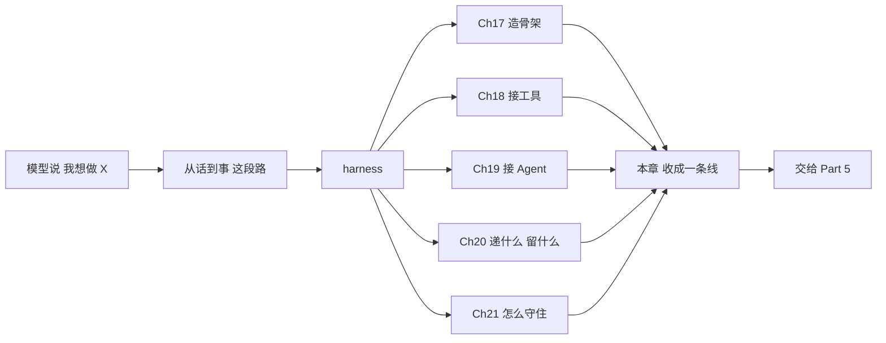

# Ch22 小结与衔接：把 Part 4 装回一条线

> 一句话简介：五章各修一个麻烦，合起来只修同一段路。

## 本章目标

读完本章你应当能：

- 用一句话说清 Part 4 五章合起来在回答什么问题
- 背出 harness（模型之外、围着模型转的那一整套程序）的七大职责，并指出每一项展开在哪一章的哪一节
- 说清三层防御为什么是 **权限 → 沙箱 → 钩子**（英文名 permission gate / sandbox / hooks）这个顺序（三样各是什么，见 22.3），以及"硬"字硬在哪
- 指认两个公开协议各占职责四的哪一格，以及它们各自牵出了哪几项别的职责
- 说清 Part 5 要接着做的是哪一类事

## 本章导览

本章是 Part 4 的最后一章，而它**不教任何新东西**。前面五章每章都在往外壳上加一样东西，这一章一件都不加。它只做三件事：把五章收成一条能随时回忆的线，给你一张七项职责的索引表，把接力棒交给 Part 5。

赶时间的话，全章只读两处：**22.1 那条主线**和 **22.2 那张回表**。

⚠️ 一个前置提醒，它改变了本章的写法：**读者可能不是按顺序读完前五章才来读本章的**——他可能从目录跳进来。所以本章每个术语第一次出现时，都会补一句白话，再指回它被讲透的那一节。这是**索引，不是复述**：它不展开细节，只保证你读到下一个词时不至于卡住。

这里要说一句实话：为了让上面那条承诺兑现，少数几个词的白话和类比，本章会有几句**近乎照抄前章的短句**——照抄是为了你读到时不至于卡住，真正的解释与展开仍然全部在指路的那一节里。本章不做的是**展开**：前五章每一节怎么推导、怎么权衡，本章都不重讲，只给一句结论和一个指路。少数被拿来当自查清单的表格，正文里会当场写明它是从哪张表取哪一部分来的。



这张图里有两处结构值得先记住：**五章都挂在同一段路上**——图里那个 H 就是 harness，指模型之外、围着它转的那一整套程序（白话、类比和小例子见 22.1）。所以它们不是五件独立的事，是一段路的五个区段，区段就是一条路能切开的那五段；**五章全部汇进这一章**（所以你读完前五章会觉得散，是正常状态，散点要在这一章里收拢）。

## 22.1 一条线：五章在回答同一个问题

先演一次「没有它会怎样」。设想你读完 Ch21 合上书，三天后要跟人解释这个 Agent 为什么这么设计。对方问："它凭什么敢自己跑命令？"你脑子里浮出来的是五句不相干的话：Ch18 讲了协议（怎么把外面的工具接进来）、Ch20 讲了压缩（递满的那一格怎么收拾）、Ch21 讲了沙箱（让命令在一个受限制的环境里跑）……每句都对，但拼不成一个回答。**这不是记性问题，是缺一条把散点串起来的线。**

**主线。** Part 4 五章合起来只回答一句话：

> **模型说"我想做 X"，从这句话到 X 真的发生，中间那一段路由谁来修。**

这段路有个名字，英文写作 harness。因为读者可能从 Part 4 之外跳进来，先把它的三件套补一次，之后不再重复。

### harness 是什么（补白话）

**白话。** harness 是**大模型之外、围着 Agent 循环转的那一整套程序**：它把模型说的话变成真的动作，再把真实世界的反应整理成模型读得懂的文字，中间的风险、上下文和流程都在它手里管着。

**类比。** 沿用 Ch17 的那场戏：一个博览群书、记性极好的面试官，坐在一间没有窗也没有门的房间里。要让他能干活，得给他配七样东西——门禁卡、能随手擦的白板、一间墙厚的隔间、一台能查资料的对讲机、一本值班手册、一个黑匣子、一扇门。**这七样合起来就是 harness，模型本人不在这个清单里**：它是被改造的人，不是改造本身。

**小例子。** 同样是一次模型调用，套不套这一圈，差别全在那个 `while` 循环的左右两行——不套，模型吐出一段话就结束了；套上，"这段话要变成一条命令"这一步才有人负责。

**指路。** 词源（从软件测试借来，"被测件 ≠ 台架"）、七样东西与七项职责的对应、以及这段循环的完整骨架，都在 **Ch17 17.2**。

**现在把它写成式子。** 上面这段路，加上要配在它周围的那七样东西，Ch17 把两样合起来压成了一个等式（17.5）：

> **Agent = 模型 × harness**

⚠️ 那个符号是**乘号**，不是加号。乘法的意思是两样东西必须同时在场才成立，缺任何一个结果都是零；它还多带一层——两样东西的权重不同时结果差很多，更强的模型常常不如配得更好的外壳。Ch17 给它配了一句口号，这句也要原样留着：

> **模型是零件，外壳是产品。**

### 那段路有多长

Ch17 用三道墙演过一次：模型**没有手**（看不见也改不动世界）、**没有边界**（错误直接落在真实资源上）、**没有记性**（记忆只有这一轮对话的窗口）。

⚠️ 顺手纠正一个读者容易顺口说出的推论：**三道墙推得出七项职责。** 推不出的——三道墙对应的是前 3 项（工具与权限、执行隔离、上下文与记忆），后 4 项另有出处：协议接入、生命周期事件、会话与状态、投递接口四项来自 Ch17 17.3 对主流做法的横切（外部能力走协议、会话要留痕、界面与循环分开等），以及 17.4 每项各自的"没有它会怎样"。**七项职责是 Ch17 分两处收拢出来的，不是一处推出来的。**

把这条线画成一条竖线，每一项职责就是路上的一道工序：

```text
模型: "我想做 X"
      │
      │  ← 这段路没人修，X 就只是一句话
      ▼
   外壳: 七道工序
      │
      ▼
X 真的发生了
```

而这七道工序有一条共同性质，Ch21 用一整节论证过：**没有一道是由模型的输出决定的**（见 22.3）。这就是 Ch17 那句"模型是零件，外壳是产品"落到工程上的样子。

## 22.2 七项职责：一张可以随时翻的表

先演一次「没有它会怎样」。你要给一个新场景估工时，得知道有哪几件事躲不掉。翻开 Part 4 你会发现：权限（哪些动作要先问人）在 Ch21 的 21.2，隔离（命令在哪个环境里跑）在同章的 21.4，压缩（递满的那一格怎么收拾）在 Ch20 的 20.4，协议（怎么把外面的能力接进来）在 Ch18 和 Ch19——**七项散在五章里，没有一处是把它们排齐的**。排齐的那一处是 Ch17 17.4，但那是全 Part 的第一页，翻回去不方便。下面这张表就是那份排齐的东西，正文位置一栏逐项指路。

| 编号 | 职责 | 一句话白话 | 展开在 | 正文位置 |
|---|---|---|---|---|
| 1 | 工具与权限 | 告诉模型能干什么，并管住哪些要问人 | Ch21 | 17.4.1 → 21.2、21.3 |
| 2 | 执行隔离 | 命令在受限环境里跑，出事炸不到外面 | Ch21 | 17.4.2 → 21.4 |
| 3 | 上下文与记忆 | 决定每一轮递给模型哪些字 | Ch20 | 17.4.3 → 20.2 至 20.5 |
| 4 | 协议接入 | 用公开协议把外部工具接进来 | Ch18、Ch19 | 17.4.4 → Ch18、Ch19 全部 |
| 5 | 生命周期事件 | 在固定时刻跑一段确定性的程序 | Ch21 | 17.4.5 → 21.5 |
| 6 | 会话与状态 | 留下可回放、可恢复的记录 | Ch20 | 17.4.6 → 20.6 |
| 7 | 投递接口 | 决定人从哪儿进来、结果从哪儿出去 | 本 Part 各章（无专章） | 17.4.7 |

⚠️ **这七个名称和七条一句话白话是全 Part 的契约，后面的章节不再改名。** 表里的"一句话白话"一栏是 Ch17 17.4 的原文，不是本章的转述。

横着读这张表，按编号走是一条"从能干活到能交付"的顺序（**这是本章最该带走的一句**）：先让它够得着（1 工具与权限），再让它炸不到外面（2 执行隔离），再让它记得住（3），再让它接得上外面（4），再让它到点必做（5），再让它出事查得出（6），最后再让它换个场景能用（7 投递接口）。这七个动作是**按编号读出来的**，不是 Ch17 的原始顺序。Ch17 17.2 讲七样东西时用的是叙事顺序（顺着"让他能干活"讲），它与编号顺序并不一致——**跨章引用一律以编号为准**，照着叙事顺序去数职责会对不上。

⚠️ 另外提醒一次出处的分工：Ch17 17.6 已经把这七项**反过来**列过一遍——从"工程麻烦"倒查"治它的那项职责"（够不着 → 误判不可撤销 → 装不下，且不能说谎 → 重复造轮子 → 该做而没做 → 出事查不出 → 换场景要重写）。那是给忘了某项职责时查的倒查表；上面这张表是给要按顺序干活时用的正读表。**同一组职责，两个方向，指路的是 17.6。**

**这说的是工程层面**：每一步都可以跳过——多数场景下系统照样能跑，只是会在某个具体场景上塌掉。躲不掉的是另一层的**清单本身**——估工时你得先数清有哪几项，缺一项就估不准。塌在哪，每一项职责展开的那一节里都写着。

读这张表时有三个坑要提前避开：

**其一，第 7 项没有专章，这是有意的。** 它不属于 Ch21，也不属于 Ch20。它在每一章的示意里都露过面——Ch21 21.6 那张链路图里，"需要点头"那一步之后**人的同意是怎么回到外壳的**，就是它（Ch21 21.8 末尾专门点了这件事）。展开讲在 **17.4.7**。

**其二，第 3 项和第 6 项不是一件事，它们方向相反。** 这一对最容易混，因为名字挨着、都在讲"记住"。先把两个词的白话补上：

- **上下文**，白话：**这一轮真正递进模型的那段文字**；类比沿用 Ch17 的**导航仪地图卡**——装不下整座城市是容量设计如此，不是记性差；小例子是"系统提示 + 用户第一句话 + 工具清单 + 到目前为止的对话"，拼成一格，这一格随时可以重新凑出来。详见 **20.3**。
- **会话与状态**，白话：**递完这一格之后我们自己手里留下的那些东西**；类比是 Ch17 的**黑匣子加里程表**——黑匣子让事故能复盘，里程表让车能接着开；小例子是一份能回放的流水账，加上一个可以打点的横杠。详见 **20.6**。

一句话分清（20.6 收尾给了完整版）：上下文是可以随时重装的**投影**——投影仪打出来的那幅画面，灯一关就没了；状态是不能丢的**底稿**——画师压在抽屉里、随时能拿出来重画一遍的原稿。把投影当底稿，事故就不可逆了。

**其三，递进去的那一格满了要收拾，这一步也有名字。** 叫**压缩**：白话是"格子满了，就在递出去之前临时收拾干净"；类比沿用 Ch20 的**值班交接班**——前一班的人不能一直留在房间里，但会留一张交班条；小例子是"十四轮对话加一堆工具输出，换成七行字"。四种策略怎么选、哪一种最容易被做坏，见 **20.4** 与 **20.5**。

最后说一件关于这张表的事：Ch17 把 Ch18 和 Ch19 排在中间，是因为**第 4 项职责已经被公开协议标准化了**——Ch18 与 Ch19 各占它的一半（下一节就说这件事）。被标准化那一格的形状就不由我们自己定了，这也是它值得先读的原因。

## 22.3 那段路上最危险的一段：三层防御

先演一次「没有它会怎样」。Ch20 收尾自己点了这件事：它解决了"递什么给模型"，可**递出去的那些字全是软的**——模型没读进去、读错了、或者干脆没理会，都不会有任何地方拦住它（Ch20 20.8 末尾原话）。所以 Ch21 处理的是另一段：**当 X 真的落地、真的可能伤到你的时候，谁来守住。**

这一段路上有三道工序。因为本章可能被跳读，三个词各补一次三件套：

- **权限**，白话：**一份规则**，回答"哪些可以自己就做，哪些必须先问人一次"；类比沿用 Ch17 的**前台服务台门禁卡**——工种决定能开哪几扇门；小例子是 `allow / ask / deny` 三档加一个默认档。详见 **Ch21 21.2**。
- **执行隔离**（沙箱是它的一种实现形态），白话：**一个受限制的运行环境**，命令在里面跑；类比沿用 Ch17 的**拆弹间**——重点不是"更安全"，而是"损失有上限"；小例子是"只能碰指定目录、默认连不上网络、跑完就销毁"。详见 **Ch21 21.4**。
- **钩子**，白话：**挂在流程固定时刻上的一段程序**，时刻到了就跑，不问模型；类比沿用 Ch17 的**机务喊话**——他不问飞行员"你打算什么时候检查起落架"，那是固定流程；小例子是"改完文件自动跑一遍格式化"。详见 **Ch21 21.5**。

Ch17 把三者的边界压成一句话，这句话是全 Part 反复用的，改不得：

> **权限是一份规则、沙箱是一个环境、钩子是一个时刻**（Ch17 本章小结；三样分别在 17.4.1、17.4.2 与 17.4.5 展开）

前两个是**串联**的，不是二选一：权限全放行时隔离还在，隔离关到最严时权限也还在（Ch17 17.4.2）。

### 三层按一个固定顺序推进

Ch21 21.1 把这个顺序定死了：

> **permission gate（软提示挡不住）→ sandbox（OS 级原语）→ hooks（确定性脚本）**

顺序不能换，因为**三者依次补上前一个的洞**。Ch21 21.6.2 用一张三行的表逐列写清了每一层挡的是什么、挡不住什么、以及挡不住时为什么要下一层。本章只把那张表的后两列留在这里，因为它们是最省事的自查清单：

| 层 | 它挡不住的那一类 | 所以要 |
|---|---|---|
| 权限 | 没写进规则的动作；命令跑起来之后自己做的事 | 隔离 |
| 隔离 | 内核层面的洞；模型压根没想到要做的那件事 | 钩子 |
| 钩子 | 需要人来拿主意的事；需要理解意图的事 | 回到权限 |

第三行值得多看一眼：**它绕回了第一层，三层因此是个闭环而不是一条单行道**——钩子管不了的判断交还给权限，权限管不到的执行交给隔离，隔离拦不住的动作靠钩子在事后留下一条痕，好让下一次能被看见。

补一句上一表里没有、但同属这一列的诚实说明（Ch21 21.4.5）：**隔离已经是最强的一道了，它都还不是完美的**——最常见的那类实现和外面共用同一个操作系统内核。隔离能把损失从"整个机器"压到"工作区"，但它不是绝对边界。

### "硬"字硬在哪

三层读完，回到 Ch21 的承重结论（21.6.3）：

> **提示词是软约束，外壳才是硬约束。**

"硬"到底硬在哪，Ch21 给了三个位置的答案——规则写在**配置**里，环境由**操作系统**立起来，时刻表写在**流程**里：

> **三样东西里没有一样是模型能改的。**

这句话对读者还有第二个用法，Ch21 21.6.3 末尾也点了：**这套防线什么时候会失效？当有人为了省事，把三层里的任何一层挪进提示词的时候。** 而这种失效**不会报错**——配置能加载，任务能跑，一切看起来都正常，只是从那一刻起那道门不再有人守。

⚠️ 别忘了把第 7 项接回这条链：整条链路上唯一会去"摇人"的环节，是权限的 ask 那一档（Ch21 21.5.3）；而**人点完头之后，那个"同意"怎么回到外壳**，就是第 7 项投递接口的活（17.4.7）。这就是它没有专章、却不能没有的原因。

## 22.4 两个协议各占哪一格

先演一次「没有它会怎样」。很多人读完协议那两章还是糊的——但这不是你的问题，**Ch19 开头就点破过：症结不在术语难，而在根本没意识到那是两种不同的接法**（Ch19 开篇）。所以这一节不重讲协议，只把两章的位置钉到表上，让"糊"变成"记错了位置"。

Ch19 19.8 已经把这个对应关系画过一次，这里再列一遍（那一行在 Ch19 里标的是"本"，这里改成 Ch19 是因为它已经讲到协议那一半了）：

```text
职责四 协议接入
├── 接工具    ← Ch18：暴露一个函数，毫秒级返回，不需要中途问你
└── 接 Agent  ← Ch19：暴露一个独立程序，能派活、能中途问你、能跑很久
```

官方对这两者关系的一句话是 **MCP inside agents, A2A between agents**（MCP 在 Agent 内部，A2A 在 Agent 之间），出自 A2A v1.0 的发布公告（Ch19 19.2.2）。

因为读者可能不记得那两章的词，各补一句白话，只为指路服务：

- **原语**，白话：**协议开放给服务端的三类东西**，一个服务端不必全都实现；类比沿用 Ch18 的**图书馆的书架**——馆员（应用）决定这一趟给读者端哪几本书上来，读者自己不能伸手去够最里面的那本，同一个书架，端什么上来是馆员的工作；小例子是"搜索笔记（模型点名要用）、一份 README（应用主动递进来）、一段评审模板（用户点一下）"。按"谁决定何时用它"分，不按"能不能改"分——为什么这个分法才对，见 **Ch18 18.4**（类比在 18.4.2）。
- **状态机**，白话：**一件事会经过哪几个状态、每个状态能往哪儿去**；类比是 Ch19 的**派工单**——工单不会当场干完递回来，流程上可能停在任何一环；小例子是"接单 → 处理中 → 停下来等你补一句 → 做完"。A2A 定义了八个状态，见 **Ch19 19.4.2**。

### 协议牵出来的账，要挂回其他几项职责

协议接入本身只是第 4 项，但它一旦接上外面，**别的几项职责立刻就有活干了**。Ch19 19.8 末段已经把这笔账对过一遍，四条对应如下（本章不展开，各条的展开位置一并列出）：

| 接进来之后冒出的问题 | 归哪一项 | 去哪读 |
|---|---|---|
| 派出去的活儿在对方机器上跑崩了怎么办 | 2 执行隔离 | Ch21 21.4 |
| 对方中途冒出"要授权"，谁来点这个头 | 1 工具与权限 | Ch21 21.2 |
| 对方反问时该递哪些自己的上下文过去 | 3 上下文与记忆 | Ch20 20.3 |
| 任务状态怎么呈现给人 | 7 投递接口 | 17.4.7 |

Ch19 19.8 在这张表下写了一句本章也想再强调的话：**外壳上漏掉一项职责，多出来的能力不会消失，只会变成迟早要还的 bug。** 接进来的能力越多，漏掉的工序就越贵——这是"协议接入"必须和其余六项一起读的原因。

还有一个具体的例子能说明这件事：Ch18 的最小 server 代码里，**代码里没有任何一行拦 `create_note`**（Ch18 18.8 第三条）——server 只管执行，管不了也不该管。"这次调用要不要先问人"是宿主在收到模型意图之后、发请求之前做的事。**协议的边界画在哪里，外壳的边界就得画在哪里**：协议不管的事，正好落回第 1 项职责。

## 22.5 与 Part 5 的衔接

先演一次「没有下一 Part 会怎样」。你现在能画出一张七项职责的表，能说出哪一格最危险。但真要动手，你会问一个表回答不了的问题：**这七格，我要写在哪？** 表是形状，不是代码——你照着它开工，第一天就会撞上"第 4 格到底要不要自己实现一个 server"这种表里没有答案的问题。

**Part 5 讲的就是把这七项职责实现出来。** 六章的分工是：Ch23 工具调用与检索增强、Ch24 记忆与规划、Ch25 多 Agent 协作、Ch26 代码执行、Ch27 协议集成、Ch28 小结。

一句话说清两者的差别：**Part 4 讲的是这一格"该是什么"，Part 5 讲的是这一格"怎么写成能跑的代码"。** 前五章里那些"该问人""该带上下文""该留痕"的判断，在 Part 5 会变成一个函数、一份配置、一条记录格式。

分工的接缝在前五章里已经划好了，这里只把三条列出来，免得读的时候重挑：

- **上下文 vs 记忆**：Ch20 管"这一轮递什么给模型"，"什么东西存到轮次之外去"归 Ch24（Ch20 开篇的红线，见 17.4.3）。
- **隔离 vs 执行**：Ch21 讲隔离环境的原理与三档，代码执行那一侧的做法归 Ch26。
- **协议 vs 集成**：Ch18 与 Ch19 讲两套协议在交换什么，把它们接进一个系统的做法归 Ch27——Ch19 19.7 末尾已经预告过，那两份最小实现会被补成扛得住的版本。

进 Part 5 之前，留一个问题，它在 Part 5 里会一直用着：**七项职责里，哪一项是你这个场景里最容易只做一半的？** 判断依据不用复杂——想一遍每项职责里"跳过它会塌在哪个具体场景"，答案通常自己会浮出来。

## 本章小结

- Part 4 五章合起来只回答一句话：**模型说"我想做 X"，从这句话到 X 真的发生，中间那一段路由谁来修。** 那段路就是 harness，也就是 Ch17 17.5 的 **Agent = 模型 × harness**——模型是零件，外壳是产品。
- 七项职责不是七个偏好，是 Ch17 **分两处收拢出来的工序表**：**工具与权限、执行隔离、上下文与记忆、协议接入、生命周期事件、会话与状态、投递接口**。三道墙撑起来的是前 3 项，后 4 项另有出处（17.3 对主流做法的横切，加上 17.4 每项各自的"没有它会怎样"）——**三道墙推不出七项**，为什么，见 22.1。这七个名称和七条一句话白话是全 Part 的契约，不再改名。
- 第 3 项和第 6 项方向相反：上下文是随时可重装的**投影**，状态是不能丢的**底稿**。第 7 项没有专章，但它在 21.6 链路图上已经露过面。
- 三层防御按 **权限（英文常叫 permission gate，软提示挡不住）→ 沙箱（sandbox，OS 级原语）→ 钩子（hooks，确定性脚本）** 的固定顺序推进，因为三者依次补上前一个的洞；承重结论是**提示词是软约束，外壳才是硬约束**，硬在三样东西没有一样是模型能改的。
- 两个公开协议各占职责四的一半（接工具 / 接 Agent），但它们一接上外面，其余几项职责就都有活干了——Ch19 19.8 对过的那笔账，账在表里，展开在 Ch20、Ch21 与 17.4.7。
- Part 4 讲的是这七格"该是什么"，Part 5 讲的是这七格"怎么写成能跑的代码"（Ch23 至 Ch27，Ch28 小结）。

## 本章参考

**本章不引入任何新论文、博客或课程。** 下面这些是前五章已经引用并核实过的材料，按它们在本 Part 承担的重量列一遍，省得你为了收尾再翻回去找；每条的出处与它支撑的那一节，都在前章的"本章参考"里。

### 必读论文

- [Cognitive Architectures for Language Agents（CoALA，Sumers 等，2023）](https://arxiv.org/abs/2309.02427)——"把 Agent 拆成若干功能模块再讨论它们怎么协作"这套讲法的来源（Ch17）。
- [MemGPT: Towards LLMs as Operating Systems（Packer 等，2023）](https://arxiv.org/abs/2310.08560)——把"上下文窗口不够用"当成内存管理问题的代表作；它的虚拟上下文一节是压缩里"外置"策略的学术祖先（Ch17、Ch20）。
- [Lost in the Middle: How Language Models Use Long Contexts（Liu 等，2023）](https://arxiv.org/abs/2307.03172)——U 形曲线，"注意力预算"那节的事实底座（Ch20 20.2）。
- [The Protection of Information in Computer Systems（Saltzer 与 Schroeder，1975）](https://nocomplexity.com/documents/securityarchitecture/architecture/saltzer_designprinciples.html)——默认拒绝这条设计原则的出处（Ch21 21.2.4）。

### 协议原文（以官方文档为准）

- [MCP 规范（2026-07-28 版）](https://modelcontextprotocol.io/specification/2026-07-28/)——换版本时链接与结论都要跟着改，这正是 Ch18 18.7.4 那条阅读纪律的用处。
- [A2A v1.0.0 规范全文](https://a2a-protocol.org/v1.0.0/specification/)——Agent Card 路径、任务状态、字段定义的出处（Ch19）。

### 代码

Part 4 的八份示例代码都在 `code/part-4/`，八份的文件头都标着 `# illustrative only`——它们是给你读结构的骨架，不是能直接跑起来的程序：循环骨架（Ch17 17.2）、最小协议服务端与客户端（Ch18 18.8、Ch19 19.7）、压缩策略骨架（Ch20 20.7）、权限策略与钩子注册（Ch21 21.7）。

### 视频 / 课程

- 本章不推荐新的。Part 4 五章各自的"本章参考"里已经列过，重复列一遍不会让它们更好记。