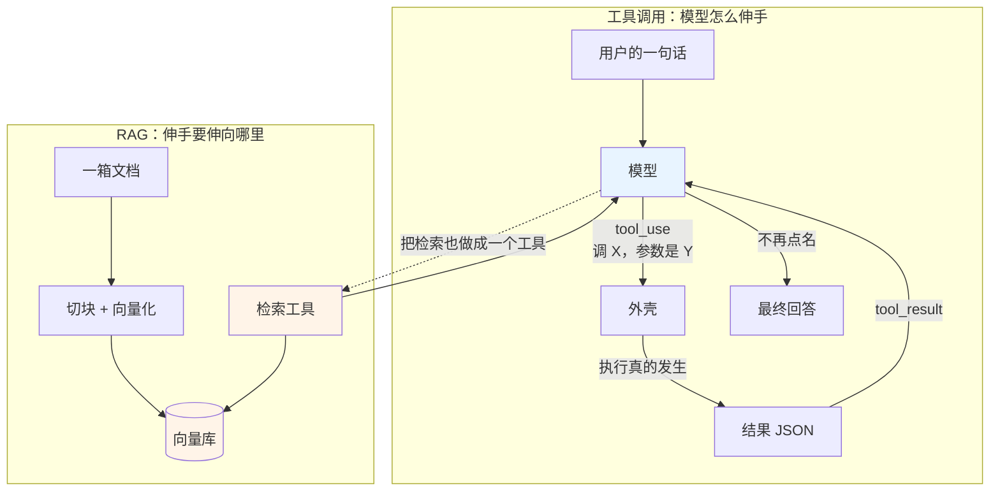
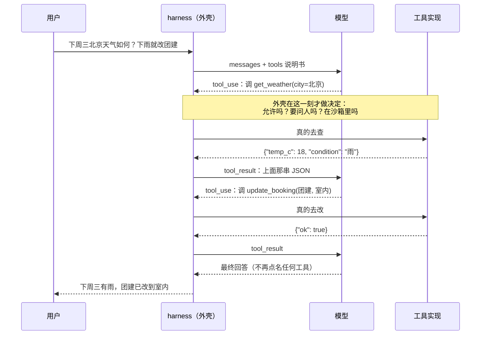
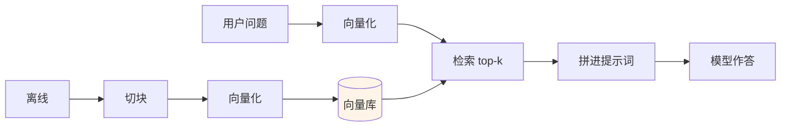
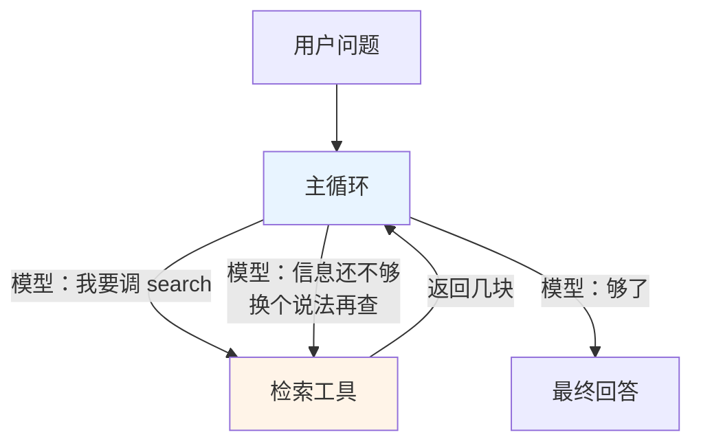

# Ch23 Tool Calling 与 RAG

> 一句话简介：给模型装上手脚，再把公司的知识接进它的脑子里。

## 本章目标

读完本章你应当能：

- 写出一份工具说明书，并说清楚里面哪几栏是模型真正会读的
- 独立实现一个工具调用循环：模型点名 → 外壳执行 → 结果回填 → 下一轮
- 判断一次任务该并行调几个工具，并说出那一档什么时候必须关
- 实现错误处理：把工具抛出的异常变成一段模型能读懂的"观察"，而不是让程序崩掉
- 说出三种 RAG 范式（朴素 / 增强 / 智能体式）各自的形状、代价与适用场景
- 判断一个具体场景该从哪一种 RAG 起步，以及什么时候该升级

## 本章导览

Part 4 Ch17 17.5 给了本书到目前为止最要紧的一个公式：**Agent = 模型 × harness**。上一 Part 把 harness 这一半拆成七项职责（见 17.4）。进 Part 5 要做的，是**把第一格写出来**——「工具与权限」，白话是**告诉模型能干什么，并管住哪些要问人**。前半句是 23.1–23.6，后半句属于 Ch21。

RAG 放在同一章，不是因为它跟工具调用是一回事，而是因为**它是工具调用的第一个真实用例**。你给 Agent 装上手脚，它总得知道手脚往哪儿伸；伸向公司知识库这条路，要先把知识装进一个可查的地方。



上半（蓝）是 23.1–23.6：模型怎么表达意图、外壳怎么执行、错了怎么办。下半（橙）是 23.7–23.13：知识怎么被切碎、装进向量库、再被查出来。**两半的接口是一句话——下半最终会变成上半里的一个 tool。**

## 23.1 先演一遍「没有它会怎样」

任务来了：*"帮我看看下周三北京天气怎么样，如果下雨就把明天的户外团建改成室内。"* 原样扔给一个通用大模型，它回你一句：

> 我无法查询实时天气。建议您查看手机上的天气应用。另外，团建改期涉及与其他同事的协调，建议您通过邮件或即时通讯工具通知相关人员。

这句话没有一个字是错的。天气它确实不知道——训练数据里没有下周三；团建预定它确实碰不到——它没有手。**它不是不会做，它是没有身体。**

回想 Ch17 17.1 那个比喻：博览群书、记性极好的面试官，被关在一间**没有窗也没有门的房间**里。本章要做的事就一件：**给他装上门和窗**。装上之后他并不会因此"变聪明"——参数量没变、训练数据没变、他对"团建"的理解一点没变；变的是**他能影响的世界的范围**，从"只影响他输出的那段字"扩大到"那段字 + 他点名要执行的那几个动作"。这就是 **Agent = 模型 × harness** 里 harness 这个因子开始起作用的地方（参见 17.5）。

## 23.2 工具说明书：模型凭什么知道能干什么

### 23.2.1 三件套：先说人话，再说名字

**白话一句话。** 模型不执行任何动作，它只会输出一段结构化的字。你事先把这句字长什么样规定好，模型照着填，你就照着填出来的内容去干活。

**生活类比。** 你新雇了个助理，他很聪明，但**手边没有电话、没有计算器、没有公司钥匙**。你不能指望他"自己去查一下"，你只能给他一本**工具手册**：第 1 页写"想查天气，请填一张小卡片，第 1 行写城市"，第 2 页写"想查报销标准，填另一张"。他需要查天气时不会直接给你答案，而是**填一张卡片推到你桌上**；你拿着卡片去查，把结果贴回他的桌面。关键在于：**卡片格式是你定的，而且你必须把格式写进手册里**——他不会猜。

**具体小例子。** 上面那张卡片填出来长这样：

```json
{"name": "get_weather", "input": {"city": "北京"}}
```

就这么三样东西：叫什么工具、参数是啥。模型交出卡片的那一刻，它**什么也没做**——北京的气温一个字都没变。真正去查的，是读完卡片的那个人。

现在可以给这个机制一个正式名字了。

### 23.2.2 它叫 Tool Calling，早期叫 Function Calling

**工具调用（Tool Calling）**：让模型输出一段结构化的"调用意图"，由外部程序执行、再把结果喂回模型的机制。部分厂商早期叫它 function calling（函数调用），现在收敛到 tool 这个更宽的词——因为"工具"可能不只是代码函数，也可能是一个搜索接口、一张数据库表。

注意措辞里的"意图"两个字。Ch17 17.4.1 结尾已经埋好了一句：**工具给模型的是意图，不是命令**。模型报上来的 `{"name": "get_weather", ...}` 是意图；`WGET wttr.in/Beijing` 是命令。两者之间隔着权限闸门和沙箱——本章不碰那两截（见 Ch21）。

### 23.2.3 工具说明书长什么样

每份说明书三部分：**名字、描述、参数结构**。前两个是给模型读的自然语言，第三个是给机器校验的结构化描述，它叫 **JSON Schema**——一张"空白表格的规格说明"：这张表有哪些列、每列填什么类型、哪几列必填。

**类比。** 银行开户那张表，左上角印着规格：姓名（文字，必填）、出生日期（日期，必填）、开户金额（数字，可留空）。你照着填，银行不用再看说明书就知道该验什么。

**具体小例子。** 一张"查天气"的空白表格，规格长这样：

```json
{
  "type": "object",
  "properties": {
    "city": {"type": "string", "description": "城市名，例如 北京"},
    "unit": {"type": "string", "enum": ["celsius", "fahrenheit"]}
  },
  "required": ["city"]
}
```

逐行读：`type: object` 说这是一组键值对；`properties` 列出能填的键；`city` 的 description 是给模型看的提示——**这一栏模型会读**；`unit` 的 `enum` 列出允许的两个值，模型不会填第三个；`required` 说城市名不能空。

收个尾：**工具说明书 = 名字 + 描述 + 一张按 JSON Schema 写死的参数表。** 模型的整个"主动行为"就浓缩在这张表里。

## 23.3 三个旋钮：模型怎么调、调几个

说明书交上去了，模型可以开始点名。但你还剩三个决定要下：**要不要它调、必须调哪个、能不能一次调多个**。

### 23.3.1 第一个旋钮：要不要调、必须调哪个

**白话一句话。** 这个旋钮（各家 API 里叫 `tool_choice`）规定"这一轮允不允许点名，以及点名时你有没有把选择权交出去"。还是那张助理的桌子，派活时你可以附一张便条：

| 便条上写什么 | 含义 |
|---|---|
| 不写 | 他可以调也可以不调，调的话自己挑（**auto**） |
| "别调" | 这一轮只准写字，不准推卡片（**none**） |
| "必须调一个，你自己挑" | 他非推一张不可（**any** / **required**） |
| "必须推这张" | 只能推这一张（**tool**，带名字） |

后两档是**把选择权从模型手里拿走**。什么时候需要？一道信息抽取题：输入是用户随手写的"我想订下周三去上海的高铁票"，输出必须是结构化 JSON。让模型"自己决定要不要调工具"纯属浪费——它百分之百会调，让它有机会犹豫反而引入了不确定性。

> ⚠️ **一个容易踩的坑**：钉死只能用在**单轮**。整段对话一直钉死"必须推这张卡"，助理会卡在死循环里——推卡、你填好、还给他、他又推同一张。正确做法是钉一轮，看到他调过了就松手。

### 23.3.2 两家 API 的字段对照：别背，看差异

各家模型 API 在工具调用上收敛得不彻底，同一个意思叫不同的名字、放在不同的位置：

| | 风格 A | 风格 B |
|---|---|---|
| 工具清单 | 请求体的 `tools` | 请求体的 `tools` |
| 描述字段 | `function` 里的 `description` | 直接放在工具对象上的 `description` |
| 参数结构 | `function.parameters` | `input_schema` |
| "自己挑" | `tool_choice: "auto"` | `tool_choice: {"type": "auto"}` |
| "必须调一个" | `tool_choice: "required"` | `tool_choice: {"type": "any"}` |
| "必须调指定那个" | `tool_choice: {"type": "function", ...}` | `tool_choice: {"type": "tool", "name": ...}` |
| 关掉并行 | 请求体顶层一个独立开关 | 塞在 `tool_choice` 对象里面 |

这张表最容易出岔子，先说清楚**它该怎么用**：

> ⚠️ **不要背这张表，也不要照抄任何一列。** 每一格的具体写法都可能在你读这本书的时候就已经变了——这正是 Ch18 18.7.4 那条阅读纪律在 API 层的翻版。真正要带走的是**形状**：工具清单放一块、选择策略是一档枚举、并行是一个开关。哪家的开关在顶层、哪家的塞在选项里，是实现细节，不该进你的设计文档。

表里唯一值得多看一眼的是最后一行：并行控制的**位置**不同，意味着两种 API 风格——一家把"调几个"当成和"调不调"平级的独立配置，另一家把它当成"调的方式"的一部分。后者更贴近一个直觉："随便调"和"只能调一个"本来就是一回事的两种说法。

### 23.3.3 第三个旋钮：一次几个

这个旋钮只有一个作用：**让模型一轮最多只能点一个工具**（风格 B 里叫 `disable_parallel_tool_use`，风格 A 里是同义的独立开关）。默认允许多个。

先演一次为什么需要它。助理面前有两张卡：一张查天气，一张查日历。他把两张**同时**推过来，你并发查，800 毫秒办完。这是并行的全部好处。换个场景：一台只能同时吃一张卡的取款机。用户要取钱、再查余额、再查明细，严格先后——没取完钱查出来的余额是旧的。这时候让模型一次推三张卡，取款机直接报错。**这就是必须关掉并行的那一档：任务内部有依赖，步骤必须串行。**

判据很简单，可以背下来：

> **一批工具调用之间，如果任何一个的结果会被另一个用到，它们就必须串行。** 否则并行。

三个旋钮、四个选择、一个判据，这就是全部。下面看真正的主循环——这三个旋钮都是在循环里转的。

## 23.4 主循环：模型怎么把意图变成一次执行

说明书交上去了，旋钮也定好了。剩下的事情是一圈循环。先把这一圈画出来，这大概是本章最值得记住的一张图。



这一圈里有五件事，顺序不能换：**①** 外壳把说明书和已有对话**一起**发给模型（模型看不到说明书以外的任何工具——17.4.1 的门禁卡逻辑：你给模型的那本手册，就是你允许它知道的全部）；**②** 模型回一段内容，里面可能同时有话和工具调用，也可能只有话；**③** 外壳检查这一轮有没有工具调用，没有就收工——"不再点名"就是它的结束信号；**④** 有的话外壳执行，把结果**原样包成一个回填块**追加进对话；**⑤** 回到第 ① 步。

第 ④ 步有个细节值得单说：**模型这一轮说的话必须一起追加进去**。这不是可选的礼貌——模型下一轮只能看见"历史上已经发生过的事"（Ch20 20.1 同一件事的另一半）。图上那条 Note 是本节与 Part 4 的接缝：**"允许吗？要问人吗？在沙箱里吗"这三个问题不属于本章**（Ch21 21.2、21.4）。

### 23.4.1 把循环写出来

**这段代码在干什么**：文件里第 1 段的 `TOOLS` 就是 23.2.3 那份说明书，原样发给模型；第 2 段的 `dispatch` 是那道把"模型说的"翻译成"机器做的"的门，也是 Ch21 权限闸门要插进来的位置。下面是第 3 段，那一圈循环：

```python
# ---- 第 3 段：那一圈循环（23.4 的主图就是这段代码画出来的）----

def run_loop(client, messages: list) -> list:
    for _ in range(MAX_ROUNDS):
        resp = client.messages.create(
            model=MODEL,
            max_tokens=1024,
            tools=TOOLS,
            messages=messages,
        )
        # 模型这一轮可能说话，也可能点名要调工具。两样都要原样塞回对话里，
        # 因为下一轮它只能看见"已经发生过的事"。
        messages.append({"role": "assistant", "content": resp.content})

        calls = [b for b in resp.content if b.type == "tool_use"]
        if not calls:
            return messages  # 没有工具调用 = 模型收工了

        results = []
        for call in calls:
            try:
                out = dispatch(call.name, call.input)
                results.append(
                    {"type": "tool_result", "tool_use_id": call.id,
                     "content": json.dumps(out, ensure_ascii=False)}
                )
            except Exception as exc:  # 见 23.6：报错也要变成一段能喂回去的观察
                results.append(
                    {"type": "tool_result", "tool_use_id": call.id,
                     "content": f"调用失败：{exc}", "is_error": True}
                )
        messages.append({"role": "user", "content": results})
    return messages
```

三处最容易被写错、也最值得逐行读。**"没有工具调用"就是结束信号**——漏掉那个 `if not calls`，模型答完话之后程序还在傻等。**所有 `tool_result` 要打包成一条消息追加**——一个结果发一条，会让模型以为每次只该拿一个结果回去，是最常见的一个并行失效原因。**`MAX_ROUNDS` 是刹车**——模型完全可能连着八轮都在调工具不收口，你的程序得有上限，否则它能把你的 API 配额烧光（设多高是权衡：设 3 拦得住跑飞，但"先查天气再查日历再回答"这种正常三步也刚好够）。

## 23.5 并行：什么时候拆开、什么时候合并

23.3.3 讲了并行开关什么时候要关。这里讲更前面一步：**该不该主动把一个工具拆成几个**。

任务："把 Q3 三个产品线的营收各自查出来，然后加总。"做成**一个**工具 `get_q3_revenue(products=["A","B","C"])`，模型一次调用，你内部发三个请求、算一次加总，总耗时 ≈ 一个请求的延迟——**完美**。做成**三个**工具 `get_revenue(A)` / `(B)` / `(C)`，模型一轮推三张卡，你并发三个请求，耗时也 ≈ 一个请求。**也没问题**，还额外获得了"模型自己决定要不要查 C"的能力。

但换个任务："先查 A 产品线，确认它在售，再查它在华东区的营收。"第二步要拿第一步的结果决定跑不跑，三步有依赖，**必须串行**。所以拆合的判据和并行的判据是同一条：**结果之间有没有依赖。** 无依赖就合并成一个批量调用（省 token、省一轮往返）；有依赖就拆开 + 关并行。

一个容易被忽略的收益：**拆开之后，模型获得了"选择权"。** 上面的例子里，如果查完发现 C 产品线已经停售，模型可以不查 C 的营收，直接给出前两个的加总并说明。这在合并成一个工具时做不到——你把选择权从模型手里拿走了。

## 23.6 错误处理：让报错变成模型能读的东西

工具会失败。网络会断，参数会填错。所以要分清**两种失败**：一种是**外壳自己的失败**（程序崩了、依赖服务挂了、鉴权过期了），这种失败没有任何信息能给模型看，直接向上抛让监控报警；另一种是**工具返回的失败**（工具跑起来了，但回了一句"城市名不合法"），这是**模型的输入有问题**，模型有能力修正。

第二种失败必须**变成一段文本喂回循环里**，而不是抛异常。先演一次差别：

```text
【抛异常】
  模型：调 get_weather(city="北京天气")
  → ValueError: unknown city
  ✗ 程序崩了，用户看到 traceback，什么也没发生

【喂回去】
  模型：调 get_weather(city="北京天气")
  → "调用失败：城市名只能是纯名称，请重试"
  模型：（下一轮）调 get_weather(city="北京")
  → {"temp_c": 26, "condition": "晴"}
  ✓ 用户拿到答案
```

喂回去的写法有四个要点。**错误文本要人话**——把 `ValueError: unknown city` 直接喂回去，模型多半会再填一次一模一样的错值，它需要的是"哪儿错了、应该怎么填"，不是异常类名。**标记它是错误**——主流 API 的回填块上都留了一个 `is_error` 字段，不标记的话模型可能把失败当成有效结果继续往下推理。**设上限**——反复失败的工具调用进死循环比一次直接崩掉贵得多，回到本 Part 的老规矩（承自 Part 3 Ch11 11.3）：只读的工具可以放心重试，会改动世界的每一次都要过闸，**发邮件、扣款、改数据库的调用失败之后不许自动重试**（Ch21 21.2）。**退避**——报的是"网络超时"而不是"参数错了"，重试之前先等一下，别把下游服务再打一遍。

到这里工具调用这一半讲完了。下一半：**让模型知道的，不只是"能做什么"，还有"公司是怎么规定的"。**

## 23.7 RAG 的动机：模型的三道墙

先造一个具体的痛点，别急着给方案。你问一个通用大模型："我们公司出差住宿费一晚上能报多少？"它会给出一个**极其自信的、极其具体的**数字，而且大概率是错的。为什么会这样？因为它没病，它只是**不知道，而它不知道的时候不会停下来**。

这个"不知道还照答"的现象有个正式名字，叫**幻觉**。但它只是 RAG 要解决的三道墙里的一道：

| 墙 | 具体表现 | 一句话 |
|---|---|---|
| **知识截止** | 模型的知识停在训练截止那一刻，上周的内部公告它不可能知道 | 它的世界里**没有昨天** |
| **幻觉** | 不知道的时候编一个很像样的答案 | 不知道**也不说不知道** |
| **私有知识** | 就算它读过一千本书，也没读过你们公司的制度 | 世界上**根本没有**那本书 |

三道墙的解法是同一个：**不去改模型，改它的输入。** 在问它之前，先把相关的几段原文找出来塞进提示词，让它在"开卷"的状态下回答。这个做法叫 **RAG**：检索（Retrieve）+ 增强（Augment）+ 生成（Generate），三个词连起来就是完整流程。用 Ch17 的老类比收一下：Ch20 说过上下文窗口是"导航仪地图卡"，装不下整座城市；RAG 干的事是**出门之前先查好这一趟要用的那几条路，把它们画在手上那张小卡上**。

⚠️ **边界声明**：RAG 里的"检索"和 Ch24 的"记忆系统"不是一回事。RAG 检索的是**一个静态的、你事先放进去的语料库**——产品手册、FAQ、工单历史；Ch24 讲的是**跨会话存下来的、会自己生长和衰减的东西**。本章只讲前者。

## 23.8 Naive RAG：一条固定流水线

先做最简单、也是 90% 的场景真正够用的那一种。**它的形状是一条没有分支的直线**，中间没有任何东西做决定：



图上分两半。**上半（离线）**只需要在知识库变动时跑一次；**下半（在线）**每个问题跑一次。这条分界线是 Naive RAG 最重要的结构特征——凡是需要模型来判断的地方，这条图上都没有。下面四个框就是接下来四小节。

### 23.8.1 切块：知识库不能整块塞进去

**白话一句话。** 检索的最小单位不是"文档"，是"块"——一段长度可控、语义尽量完整的文字。

**类比。** 你不能拿整本《民法典》去回答"借书要不要还"，你需要的是里面那一段。切块就是**把这本书裁成方便取用的纸条**，每张纸条上大致是一个完整的规定。

**小例子。** 原文 7000 字的一本报销手册，整块塞进向量库有两个问题：太长了，检索出来一次塞不进提示词；太长了，一个不相干的段落会稀释掉关键那一句的向量。所以先切成 300–800 字的块，相邻两块**故意重叠一部分**——切点两侧的半句话，因为重叠，至少有一块里是完整的。用一句话记住为什么要重叠：**切点会切在半句话上，重叠是为了让每块都还有一句完整的话。**

> 一句话点名：更细的分块策略（按标题层级切、按句子边界切、按表格切）做法各异，但**起作用的永远是同一条原则**——块内语义尽量完整。不要在这里堆方法名。

### 23.8.2 向量化：把一段话变成一串坐标

**白话一句话。** 把一段文字变成一串数字，使得**意思相近的两段话，这串数字也相近**。

**类比。** 给每座城市一个二维坐标，北京和天津的距离一定比北京和广州近。给每段文字也来这么一套坐标，"报销期限"和"多久内交发票"的向量距离就一定比它和"年假怎么算"近。

**小例子。** 一块 512 个浮点数的数组（数字本身没有意义，有意义的是它们之间的距离）：

```text
报销期限的规定是……   → [0.12, -0.88, 0.04, ..., 0.31]
多久之内要交发票……     → [0.15, -0.85, 0.02, ..., 0.29]
年假天数的计算方法……   → [0.71,  0.10, 0.55, ..., -0.44]
```

前两块的距离是 0.05，第三块是 1.4。检索做的事就一句话：**找到离问题最近的 k 块。**

这个术语叫 **embedding（嵌入 / 向量化）**，产出它的那套模型叫 embedding 模型。一块文字变成一串数字之后，这串数字加进别的数字里还能算出有意义的结果——这也是为什么它叫"嵌入"：文字被嵌进了一个空间里。

### 23.8.3 检索：取回 top-k

有了空间，检索就是一次"找最近的 k 个邻居"，`top_k` 是那个 k。k 取多少没有标准答案，是个权衡：k=1 太窄——制度里一句话往往带限定条件，只看一块容易漏掉"但如果是跨城出差则另议"这种补丁；k=10 太宽——把八段不相关的文字塞进提示词，模型会被干扰，反而答得更差。起步值：**k = 3 到 5**，先按这个上线，然后拿真实问题去调。

### 23.8.4 拼进提示词：检索结果的落点

最后一步是**把这 k 块原文作为"参考资料"拼进提示词**，请模型基于这些资料回答，并且**明确要求资料里没有的不要编**。这一步是 Naive RAG 里最便宜、也最容易被跳过的一步，一句提示词的事，但它决定了幻觉率：

> 只根据下面这几段原文回答。原文里没有的信息，一律回答"这个我不确定"。

## 23.9 端到端跑一遍

**这段代码在干什么**：`split_text` 是切块（23.8.1）；`build_index` 把块向量化存进向量库（23.8.2）；`retrieve` 把问题也向量化、取回最像的 k 块（23.8.3）。完整文件在 `code/part-5/naive_rag.py`，文件末尾那个 `PROMPT` 是 23.8.4 的落点。

```python
# ---- 第 1 段：切块（chunker）------

def split_text(text: str, size: int = 60, overlap: int = 15) -> list:
    """按字符数切块，相邻两块故意重叠一部分。

    重叠是为了防"一句话被切断"：切点两侧的半句话，
    因为重叠而至少有一块里是完整的。
    """
    chunks, start = [], 0
    while start < len(text):
        chunks.append(text[start:start + size])
        start += size - overlap
    return chunks


# ---- 第 2 段：检索（retriever）------

def retrieve(col, query: str, embed_fn, top_k: int = 2) -> list:
    """把问题也向量化一次，然后要回最相似的几块。"""
    qv = embed_fn([query])[0]
    return col.query(query_embeddings=[qv], n_results=top_k)["documents"][0]
```

现在做一次手算。文档里有这一句：`报销制度：单笔超过 200 元的差旅需在出差结束后 30 天内提交发票。` 用户问"出差住宿费怎么报？"——注意**用户的问题里根本没有出现"报销"两个字**。但 embedding 模型知道"出差住宿费"和"报销制度"讲的是一件事，因为它们的向量相近，于是检索命中了那一块。模型读着这段原文回答，于是说出了一句**有出处**的话，而不是编一个 200 块的数字出来。

**这就是 Naive RAG 的全部。** 但这次命中其实露了馅——那块讲的是发票期限，不是住宿费。下面这节治它。

## 23.10 Advanced RAG：在流水线上补几处判断

Advanced RAG 不是重写这条流水线，而是在流水线上**补几个判断**。常见的补法有四种，本节主推其中最有效的一种，其余一句话点名。

### 23.10.1 主推：先重排，再交给模型

**白话一句话。** 向量检索从十万块里粗筛出 50 块给你，但它是"粗筛"；再拿一个更贵、更精细的模型把这 50 块按**真的能不能回答这个问题**重新排一遍，只让前 3 块进提示词。

**类比。** 你要在十万人里找一个会修车的人。第一步按"住得近"粗筛出 50 个——这一步快但不准，可能筛出一堆住得近但不会修车的。第二步把这 50 份简历给一个懂行的 HR 重新排一遍。这一步慢，但准。代码上就是多一步、一个排序函数：

```text
粗排：向量检索 → 50 块（便宜、快）
精排：对这 50 块逐块算相关性分 → 取前 3 块
拼进提示词 → 交给模型
```

### 23.10.2 其余三种：一句话点名

这一节要克制。它们各有各的适用场景，列出来是为了让你知道**这四个抽屉里还剩什么**：

| 补法 | 一句话 |
|---|---|
| **查询改写** | 用户问"那玩意儿能报吗"，先改写成"差旅住宿费的报销规定是什么"再去检索 |
| **混合检索** | 向量检索之外，再加一路按关键词匹配的检索，两路结果合并 |
| **假设性答案** | 先让模型**猜一个答案**，拿这个猜出来的答案去检索——因为答案的字面表述往往比问题更贴近原文 |

> ⚠️ 混合检索里的"关键词匹配"用的是 **BM25** 这类按词频打分的老算法。它的价值在于**只认字面**："住宿费"和"住宿"它分得清清楚楚，向量模型反而经常把它们揉在一起，所以两路合起来才准。别的关键词算法不必记，知道"有一路只认字面"就够了。

### 23.10.3 为什么本章主推重排

三条理由摆在一起看：**它治的病最常见**——"检索回来的东西相关但答不上"是 Naive RAG 的头号投诉，而重排直接冲着它去；**它不改变你的架构**——查询改写、假设性答案都要在流水线前面加一个模型调用，重排只是在中间加一步后处理，改动面最小；**它同时省 token**——粗筛 50 块丢掉 47 块，那 47 块本来是要进提示词的。用一个新系统的起步顺序说透：答案是**重排**，别的等你真的遇到对应的症状再说。

## 23.11 Agentic RAG：把检索降级成一个工具

再演一次坏掉的版本。用户问："我下个月出差，住宿和报销分别怎么规定？"Naive RAG 会把整个问题做成一个查询去检索，回来三块大概是「报销期限」「住宿费 500/400」「试用期制度（不相关，混进来了）」。模型拿着这三块开始答，大概会说"住宿费一线 500、报销 30 天内交发票"。看起来对。但它**只查到了一次**——如果这几块里恰好没有"什么情况下住宿费可以超标"，它就会漏掉；而它甚至不知道自己漏了。

根源在 Naive RAG 的形状本身：**它只给模型一次机会。** 提问 → 检索一次 → 回答，中间没有任何东西回头问"够了没有"。Agentic RAG 换的只有一件事：**把"检索"从流水线上的一道工序，降级成一个普通工具。**



图里多出来的**那个回环**，就是全部的新东西。模型现在可以：决定要不要查、决定查什么、决定查几次、每查一次都能看到上一次的结果再决定下一次查什么。回到上面那个失败例，一条明显更好的路径是：

```text
轮 1  模型：查"差旅住宿费报销标准"        → 命中「住宿费 500/400」
轮 2  模型：查"住宿费什么情况下可以超标"  → 这一问，Naive RAG 问不出来
轮 3  模型：查"报销的时限要求"            → 命中「报销 30 天」
轮 4  模型：够了，我来说
```

**Naive RAG 问不出来的第 2 轮，在 Agentic RAG 里只是一次普通的工具调用。** 这就是全部的差别——不是检索更聪明了，是**提问的人换了**。原来是一段死代码在提问，固定查询、一次机会；现在是模型在提问，它可以看着上一轮的结果决定下一轮问什么。

⚠️ **一个必须说清的代价**：Agentic RAG 的每多一轮，就是**多一次完整的模型调用 + 多一次检索延迟 + 多一笔 token 费**。上面这个例子从 1 轮变成 4 轮，成本翻了四倍。所以：

> **Agentic RAG 不是"更好的 RAG"，是"更贵的 RAG"。** 它换来的能力是——**答案知道自己不知道**。什么时候这笔钱值得花，见 23.13 的对比表。

### 23.11.1 写出来

完整文件在 `code/part-5/agentic_rag.py`，四处值得逐行读：

- **第 2 段 `RETRIEVE_TOOL` 是检索工具的说明书**，关键在 `description` 里那几句话——**它们就是控制这个回环的旋钮**："只有当问题涉及具体制度时才调用它""一次只问一个子问题""信息不够就换个说法再来一次"。删掉这三句话，回环还在，但模型会乱调。
- **第 3 段的 `search_handbook`** 其实就是 `naive_rag.py` 里那个 `retrieve` 掉了层马甲。
- **第 4 段的 `run()`** 和 23.4 那段 `run_loop` **逐行结构几乎一样**——发消息、把模型的话追加回去、没工具调用就收工、收集结果一起追加。变的只有 `tools=` 那一行塞进去的东西。

**这就是本章最值得带走的一句话：Agentic RAG 不是一种新的架构，它是把 RAG 做成了工具调用。** 你在本章上半部分写的那个循环，下半部分一个字的架构都没改。

## 23.12 向量库选型：先问它三个问题

向量库是三种范式都要用的那一个零件。选型的话题很容易被写成产品对比，所以这里只说**你需要问它的三个问题**。

**问题一：它是怎么存和搜的？** 暴力比对（每个查询都跟全部向量算一遍距离）在几万条以下够用且简单；超过十万条就需要索引结构（近似最近邻算法，本质是用一点召回率换一大截速度）。你的语料库多大，决定了这一栏。

**问题二：它跟你的主数据库是什么关系？** 小团队往往已经有了一个关系数据库，"再引入一个新数据库值不值"就是真问题——很多关系数据库都有向量扩展，你的数据本来就在那儿，多一层反而省掉一次跨库同步。

**问题三：谁负责它？** 这是最容易被忽略、也最容易翻车的一栏。向量库要有人管备份、升级、配额监控。**如果你团队里没人能从零搭起它、出问题时没人能修，那它的功能再强也是负债。**

按这三条，起点通常是这样：一个人做原型、几千份文档，从**本地嵌入式**那类起步（零运维）；生产、百万级、要高可用，从**专门的向量数据库**起步（分布式、持久化、监控都有）；已有关系数据库且数据量中等，用**数据库的向量扩展**（少一个组件，少一份运维）。再往前还有一类**托管的向量服务**——免运维、按量付费，代价是数据要出本方，这里只点名不展开。

最后那句是**点名不是推荐**。选型在你手上，本节的判据在你脑子里。

## 23.13 三种范式怎么选

最后摆一张横着的表。**这张表是本章的落点**——所有内容最后都为了让你在这几行里做一次选择。

| | Naive | Advanced | Agentic |
|---|---|---|---|
| **形状** | 一条直线，问一次答一次 | 直线中间补几个判断 | 一个回环，模型自己决定查几次 |
| **每问一次的模型调用数** | 1（可选加重排那 1 次） | 1–2（改写 / 重排） | 1 到 N（N 不封顶，靠刹车收） |
| **延迟** | 最低，最可预测 | 中等 | 最高，且方差大 |
| **可控性** | 最高，每一步都能画出来 | 高 | **最低**——回环几轮取决于模型当时怎么想 |
| **模型答不出时** | 硬答，编一个 | 稍好一点 | **知道自己不知道，会继续查** |
| **什么时候选它** | FAQ、单一话题、能明确说出"答案就在这几块里" | 大多数生产系统 | 需要多跳推理；用户问题本身说不清要查几样东西 |

选型就三句话：**默认从 Naive 起步**——它的上限比你想的高，而成本、下限和可调试性都是最好的，绝大多数"回答基于我们文档库"的需求到 Naive 就够了。**不满意先上重排**（见 23.10.3）——它治的是同一个病里最常见的那个，改动面最小，别一次上四个补法。**只有当你的问题"问不清要查几样东西"时才上 Agentic**——比如"我下周出差要注意什么"，住宿、报销、交通、作息四样东西，事先谁也不知道要查四轮，付得起这个延迟和方差就上，付不起就用 Advanced 顶一顶。

⚠️ **反模式提醒**：不要因为"Agentic 听起来更高级"就从它起步。它的可控性是三者里最低的——同样的问题问两次，回环轮数可能不一样，你在排障时会非常难受。**先把它测准了再上生产。**

## 23.14 小结与衔接

本章把 Part 4 七项职责里的**第一格**（工具与权限）写成了代码，也把 RAG 的三种形状摆清楚了。收一下：

- **工具调用 = 模型输出一段结构化的意图，外壳执行它。** 说明书三件套：名字、描述、JSON Schema 参数表。**模型给的是意图，不是命令**（17.4.1），意图和命令之间隔着权限闸门与沙箱（Ch21）。
- **主循环只有五步**，最容易漏的两处是"模型这一轮说的话也要一起追加回去"和"没有工具调用就是结束信号"。
- **并行/串行的判据只有一条**：一批调用之间只要有任何一个的结果会被另一个用到，就必须串行。
- **工具失败要变成模型能读懂的文本**，不是异常；但会改动世界的操作失败之后**不许自动重试**。
- **RAG 治的是三道墙**：知识截止、幻觉、私有知识。解法不是改模型，是改输入。
- **Advanced RAG 主推重排**；**Agentic RAG 把检索降级成工具**，多出来的回环让答案"知道自己不知道"。按表选，不按名选。

交给 Ch24 之前，先把七格里另外几格的位置对一下：

| 我们讲过的 | 归哪一格 | 下一站在哪 |
|---|---|---|
| 工具清单怎么给模型 | 1 工具与权限 | 本章 23.2 |
| 这条工具调用要不要先问人 | 1 工具与权限 | Ch21 21.2 |
| 执行要放进哪个受限环境 | 2 执行隔离 | Ch21 21.4 |
| 提示词怎么装：工具说明 + 检索结果 + 报错 | 3 上下文与记忆 | Ch20 20.3 |
| 每一轮调用的记录怎么留 | 6 会话与状态 | Ch20 20.6 |
| **语料库**（手册、FAQ、工单） | —— | **Ch24：持久层** |

最后一行是本章留给 Ch24 的接口，值得多说一句。**RAG 的语料库和记忆系统，物理上都是"存在轮次之外的东西"，但它们回答的是两个完全不同的问题：**

- **RAG 的语料库回答"世界是什么样"**——公司的制度是什么。产品手册不会因为你今天心情不好就变一变，它是被动的、被检索的、按相似度取回的。
- **Ch24 的记忆系统回答"我们刚才说到哪儿了"**——它有写入时机（什么时候该记）、有衰减（三个月前的偏好大概该忘了）、有召回策略（按什么触发才想起来的）。

"检索"这个动作两边都有——但 Ch24 的召回要考虑**什么时候该想**，RAG 的检索只考虑**像不像**。这个区别，就是 Ch24 要展开的那道缝。

## 本章参考

### 必读论文

- [Retrieval-Augmented Generation for Knowledge-Intensive NLP Tasks（Lewis 等，2020）](https://arxiv.org/abs/2005.11401)——RAG 这个名字和那条直线结构就是这篇定的。
- [Dense Passage Retrieval（Karpukhin 等，2020）](https://arxiv.org/abs/2004.04906)——双塔向量检索的代表作，对应 23.8.2。
- [ColBERT（Khattab 与 Zaharia，2020）](https://arxiv.org/abs/2004.12832)——"粗筛再精排"最早的完整表述，对应 23.10.1。
- [ReAct: Synergizing Reasoning and Acting（Yao 等，2022）](https://arxiv.org/abs/2210.03629)——23.4 那个循环，原理部分在 Part 3 Ch13 讲过。
- [Adaptive-RAG（Jeong 等，2024）](https://arxiv.org/abs/2403.14403)——"简单问题别开回环"，即 23.13 那句反模式提醒的学术版本。

### 推荐博客 / 教程

- [Tool use with Claude（Anthropic 官方文档）](https://platform.claude.com/docs/en/agents-and-tools/tool-use/overview)——字段写法以它为准；23.3.2 那张表的**风格 B** 就是它。
- [Parallel tool use（Anthropic 官方文档）](https://platform.claude.com/docs/en/agents-and-tools/tool-use/parallel-tool-use)——23.3.3 那个判据，官方给的理由在这里。
- [RRF: Cormack 等，SIGIR 2009](https://plg.uwaterloo.ca/~gvcormac/cormacksigir09-rrf.pdf)——两路检索结果怎么合并，一页纸，读完就懂 23.10.2。
- [Chroma](https://docs.trychroma.com/) / [Qdrant](https://qdrant.tech/documentation/) / [pgvector](https://github.com/pgvector/pgvector)——23.12 那三类东西的官方文档，用的时候再翻。

### 视频 / 课程

- [DeepLearning.AI 短课：Building and Evaluating Advanced RAG Applications](https://www.deeplearning.ai/short-courses/building-and-evaluating-advanced-rag-applications/)——23.10 那几个补法视频里逐个演示了一遍，读完 23.10 之后再看。
