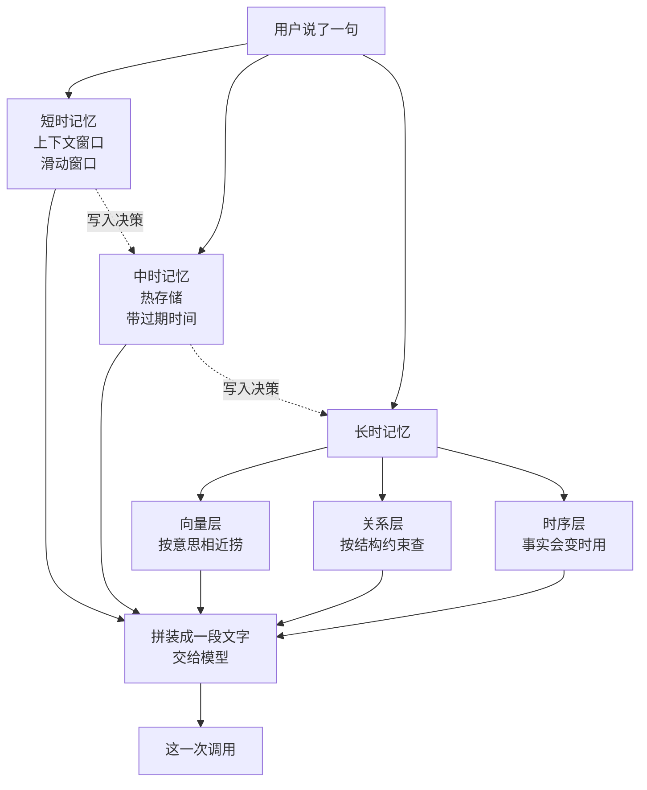
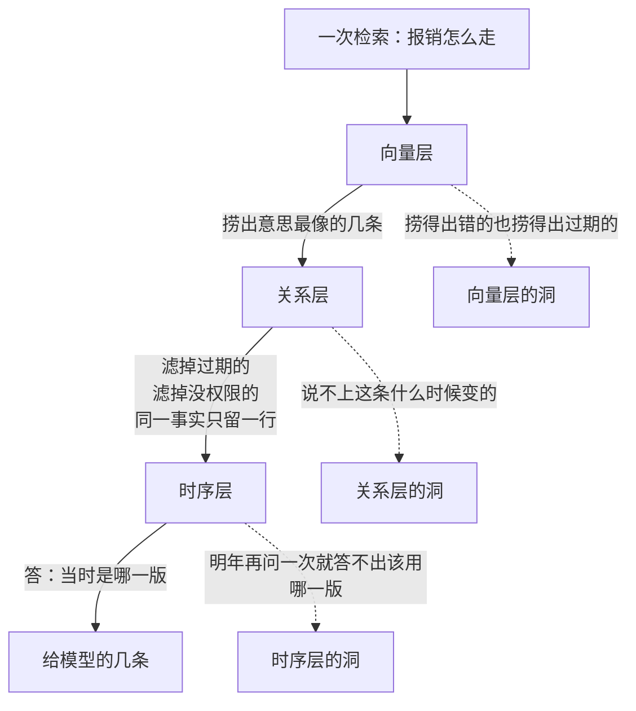
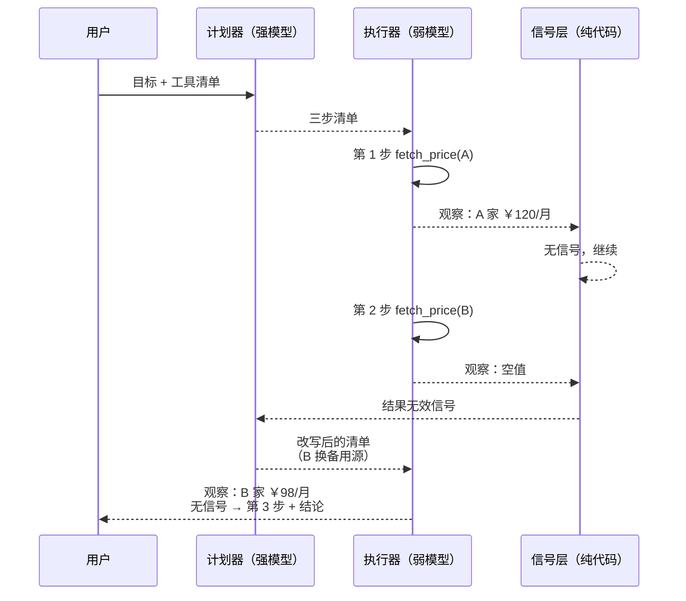

# Ch24 记忆与规划

> 把"记得住"和"想得清"从口号变成可以照着写的代码。

## 本章目标

读完本章你应当能：

- 说清 Part 3、Part 4、本章分别回答了关于记忆的哪一个问题，并独立设计一个短时 / 中时 / 长时三层存储
- 为一个 Agent 选出合适的记忆写入策略，并说出另外两种在什么场景下更合适
- 写出一条完整的记忆检索流水线，并解释每一道闸为什么必须放在那个位置
- 实现 Plan-and-Execute 的四个接口（含重规划钩子）与 Reflection 的评审 / 修改循环
- 面对一个新任务，在三种规划范式之间选型并估出工程量

## 本章导览



这张图里有两条线。**实线那条是"读"**：这一次调用时东西从哪儿来，到"这一次调用"为止。**虚线那条是"写"**：一条信息怎么往下沉。两条虚线是**首尾接着的**——一条从 `W` 出发到中间那个节点，另一条再从那个节点到 `L`，中间那一跳才是「写入决策」：那不是搬运，是判断，是 24.5 要处理的东西。

两半图各带一套能力：记忆解决"它记不记得"，规划解决"它会不会想"。规划那部分只有两节，原理在 Part 3 讲过了，本章只给接口。

## 24.1 引子：窗口不是记忆

### 先演一遍「没有它会怎样」

从一件具体的事开始：用户周一上午说过"我们公司报销上限 5000 元"，周五下午开新会话问"出差订酒店一般走哪个流程"。Agent 答得很流畅，格式也挑不出毛病，就是把"订酒店要提前三天"当成了通用常识——而那是上次那家酒店的规矩。

问题出在哪？它**没有忘**。周五那一轮发给模型的文字里从头到尾没有出现过那家酒店的任何信息。模型自己脑子里不存东西——白话说，它没有"本体记忆"这个能力（这个词指模型训练完之后、参数里就固定下来的那部分知识，见 Part 2 Ch10）。它此刻能想起来的，完全等于这一次递进去的那段文字。**这不是记忆系统失灵，是根本没有组件负责把那句话带过来。**

方向相反的也有一个：用户上午纠正 Agent"我们这儿写周报要先写结论再写数据"，同会话里 Agent 照做了；下午问"上次的周报格式是什么"却答"不知道"——那条纠正还在窗口里，Agent 只是没把"上次"和"此刻"对上号。**两个症状，一半是缺零件，一半是有零件但没接线。**本章讲的就是零件和接线。

### 又一把尺子：这一章按"存到哪儿"分

到这一章为止记忆已经被分过两轮，读到这里的人多半已经晕了，这个锅得认。理一次：Part 2 Ch10（10.3）按**活多久**分过一轮；Part 3 Ch13（13.2）按**装什么**分过一轮，并明确说了那是第二把尺子。

本章的短时 / 中时 / 长时是**第三把**，按**存到哪儿**分。Ch13 那两句原话是：**「竖着这把尺子量"装什么"」和「横着这把尺子量"活多久"」**——**本章这一把既不竖也不横，它量的是第三个东西：这条信息躺在哪个物理存储里。** 短时躺在上下文窗口，中时躺在会过期的键值库，长时躺在向量库和关系库里，一说就清。三把尺子不冲突：同一条信息在每一把上都各有一个位置。

| 本章的档（存到哪儿） | ≈ Part 3 Ch13 的哪一格 | ≈ Part 2 Ch10 的哪一层 | 物理载体 |
|---|---|---|---|
| **短时** | 工作记忆那一格 | 短期 + 工作两层合起来 | 上下文窗口 + 一段滑动摘要 |
| **中时** | 情节 / 语义的**短尾** | 长期层的**前半段**，带过期时间 | 键值存储（Redis 这类） |
| **长时** | 长期记忆那个"公司档案柜" | 长期层 | 向量层 / 关系层 / 时序层 |

> 中时那一行是本章唯一没有现成对应物的一格，它填的是两把旧尺子之间的缝：**"用户三天前说的，今天还要用，一周后大概不用了"**。硬塞进长期层是给档案柜塞没归档的便利贴。

分工也钉死，免得读者踩到重复的坑：**Part 3 Ch13 回答"记忆是什么"**（分类、载体、写 / 读 / 忘的判据，不给代码）；**Part 4 Ch20 回答"这一轮往窗口里塞什么"**（预算、压缩策略、装配顺序，不讲持久化）；**本章回答"持久层怎么搭"**。

## 24.2 短时记忆：把窗口做成一个对象

### 没有它会怎样

上下文窗口的默认状态是**一个不断往里追加的数组**。它一直涨，涨到某轮突然塞不下，你才想起处理——要么报错，要么从中间截一刀。前者用户看到"超出最大长度"，后者用户看到 Agent 忽然把三分钟前的事忘得一干二净。病根是：窗口没有"预算"这个概念，它不知道该多大，所以永远撑到爆为止。Part 4 Ch20（20.4.1）讲过"滑窗"作为一种压缩策略；本节讲的是把它从一个数变成**一个对象**。

### 一个窗口对象的三样东西

白话：**滑动窗口（Sliding Window）就是一个会自己擦桌子的桌面，规则是"擦掉最旧的，一直擦到桌面够用为止"。**它只记三样东西：**条目**（一条消息、一次工具调用、一次工具返回）、**预算**（能占多少）、**驱逐策略**（满了丢谁）。前两样照抄就行，第三样才有讲究。

看一个预算 4 条的窗口怎么演。第 1 轮进来用户那句"这酒店要提前三天订"，窗口变成 `[Q1]`；第 3 轮工具返回，变成 `[Q1, A1, T1]`；第 4 轮助手回话，正好装满 `[Q1, A1, T1, A2]`；第 5 轮用户又说话，超出预算。**最朴素的实现会把 Q1 一起丢出去**——而 Q1 正是任务原点。这是滑窗最朴素也最危险的行为。补救有两条：给第一条留个保留位、把要丢的旧内容先压成摘要（怎么压见 Part 4 Ch20 20.4.2）。**本节代码取的是第一条**：下面那个 `evict` 从第二条开始丢，`len(self.items) > 1` 就是那道保险。更彻底的做法则是让工具返回的那种大块内容**根本不以原文形式进历史**——这就是下一小节。

### 观察遮罩：让大块工具输出换个姿势进历史

术语落地。**观察遮罩（Observation Masking）**，白话一句话：**工具吐回来的东西，先自己处理一遍再进历史，别整坨塞进去。**生活里的对应物是会议速记——录音是原始素材，秘书记的是"客户对交付日期有异议"，不是把四十分钟的录音抄一遍。例子：上面那个 `查询返回 3 条结果`，遮罩之后进历史的是 `查询结果：3 条，最佳匹配=城南那家`。

要处理的有三样：**截断**（留头尾，中间一行省略号，很多错误信息在中后段，不能一刀切在尾）、**归一**（把五花八门的失败收敛成有限几种信号）、**结构化**（抠出模型下一步真正要用的字段，其余留一个取回句柄）。**归一这一条和规划咬合了**：历史里的失败长成同一个形状，24.9 的信号层才认得出来——观察遮罩决定了升级信号能不能被判定。

### 代码：窗口对象长什么样

完整文件在 `code/part-5/memory_short_term.py`（纯标准库，182 行，本书全程不执行，供逐行阅读）。核心是这一个方法：

```python
# 节选自 code/part-5/memory_short_term.py —— 驱逐（完整文件另含 mask / append / used）
    def evict(self) -> list[Item]:
        """驱逐：一直丢最旧的直到回到预算内；第一条永远不丢。

        「第一条不丢」不是优化是保底——那一行通常是用户的任务原话，
        丢了它，后面所有步骤都不知道自己在为谁干活。
        """
        dropped = []
        while self.used() > self.budget and len(self.items) > 1:
            dropped.append(self.items.pop(1))
        return dropped
```

`evict` 返回被丢掉的条目而不是直接扔，是为了给上层留"该做摘要了"或"该写进中时记忆了"的钩子。**驱逐本身不该知道被驱逐的东西要去哪。**另外注意观察遮罩发生在入队之前（`append` 第一件事就是 `if item.kind == "observation": item = mask(item)`），窗口里永远不会出现没遮罩过的大块输出。`used()` 按**条目数**算预算，不按字符数——因为用户回一句"好的"和一次十万行的工具返回，长度能差上万倍；按字符算的话，你就得给每种条目定一套"多少字算一条"的换算规则，纯属给自己找麻烦。

## 24.3 中时记忆：会自己过期的热存储

### 没有它会怎样

接着上面那个报销规矩。用户周一说的记在了长期层，周二改口"今年政策调整了，上限降到 3000"，Agent 又记了一条。库里现在躺着两条互相矛盾的事实，向量检索对它们算出的相似度差不多，谁先被捞出来全看运气。**没有过期机制的记忆库，只是一个永远只增不减、并且互相打架的垃圾堆。**

### 过期时间：让数据自己走人

术语落地。**过期时间（TTL，Time To Live）**，白话：**给一条数据贴张条子，写明"到点我自己消失，不用你操心"。**生活里的对应物是冰箱里贴了保质期的牛奶。例子：中时存储里那把 `session:u42`，写入时带上"2 小时后过期"，两小时后读它会得到一个明确的"没了"，而不是一个过期的旧值。

实现上不必写定时任务去删，**懒删除（lazy delete）**更划算：读的时候顺手判断到没到点，到了顺手删掉，省掉一个后台线程和一类"定时任务和主流程抢锁"的 bug。**代价是你得接受"数据实际消失的时刻比条子上写的晚一点"**——它要等下一次有人碰它才真的没，没人会去问"你上周三那条还在不在"。

粒度是这一节唯一的设计决策，而且**比一个全局默认值重要得多**：会话临时变量配几分钟到几小时（下一轮就该重问）；用户即时偏好配几小时到几天（说过就算，不必进档案）；一次任务的中间进度配几天（中途断掉隔天回来还能接上）。全局默认值是"记忆系统一上线就不好使"的第一原因。

惯例上还要**把过期时间编码进键名**，值里只放内容：`sm:{用户}:{会话}:{变量名}` 是中时记忆，一小时过期；`lm:{用户}:{作用域}:{条目 id}` 是长期记忆，不过期。好处三重的：过期时间跟着键走，清理时可按前缀批量删，前缀天然是租户边界。**键的名字就是元数据**。

写什么读什么的判断先记一条：**凡是你能通过问一句"那这个上次是怎么定的来着"从用户嘴里问出来的，都不进中时层。**中时层只装问起来会让用户烦的——进行中的任务状态、上个会话没聊完的尾巴。

## 24.4 长时记忆：三个东西各管一段

### 没有它会怎样

只有中时层行不行？行，但有个硬伤：中时层就是一堆按名字取值的键，对"找和这句话意思相近的旧结论"几乎无能。而长期记忆真正的需求恰恰是"帮我找一下我们之前对价格保不保量的讨论"——这是**语义**需求。反过来只用向量库也不行：它没有"这条属于谁、什么时候失效"这种约束，也没法做行级权限。**关系型存储和向量检索各不会对方的活**，于是长时层的做法是叠着用。

### 三层的分工

一句话版本：**向量层负责"找得到"，关系层负责"信得过、管得住"，时序层负责"说得清它什么时候变的"。**向量层问"哪几条和这句话意思最像"——"报销怎么走"捞出"报销需 30 天内提交"，弱点是捞得出错的也捞得出过期的；关系层问"这条属于谁？和谁冲突？现在还有效吗？"——只有财务角色的会话才读得到限额那条，弱点是不会捞；时序层问"这条什么时候变的"，弱点是比前两个重得多。

三层各自补的是前一个的哪一个洞，这张图比三段话更好记：



**看这张图时只记一件事：三个洞是错开的，一个比一个靠后。** 最前面那个洞（捞不准）人人都知道，中间那个洞（捞出来没人管）要半年才暴露（下一段就讲它），最后那个洞（规则改过几版）只在财务、合规这类规则会变的领域才出现。

**记忆会过期的系统，上面三层一个都不能省；记忆不会过期的（用户偏好），只留向量层就够。** 这句话是判断你要不要做后面两层的唯一依据。

### 向量层：管"找得到"

这一层承担的是 Ch13 13.2 主表里"语义记忆"那一格的职责；检索本身 Ch23 已经讲透了，本章只补三条向量库特有的事：**每条记忆要有稳定的身份**——向量只是坐标，得配一个 id 和"这条什么时候写的"，没有 id 就无法覆盖一条过期的记忆，只能再写一条，而模型看到两条矛盾说法时不知道该信谁；**写入粒度要细**，一条记忆最好是**一句可以独立成立的陈述**而不是一整段对话；**写进去之前先查一次**，同一条内容第二次出现时不要新建要更新。

### 关系层：管"信得过、管得住"

向量层有三个洞只有关系层能补：**过期没标记**（老规矩改了，库里还是老的）、**来源不可追**（捞回来一句错的，谁也不知道它哪来的）、**权限没边界**（A 用户的记忆被捞进了 B 用户的上下文）。

做法是把每条记忆拆成结构化的行——主体、谓词、客体、来源会话、写入时刻、失效时刻——存进普通表，再接三样东西：**唯一约束**（保证"同一条事实只有一行"，为覆盖更新打底）、**失效时间列**（让"这条还有效吗"变成能用索引加速的查询）、**行级权限**（第 1 号职责"工具与权限"在记忆场景下的具体形态，见 Part 4 Ch17 17.4：谁能看到哪一行由角色决定，不由检索分数决定）。**这一层是三层的重心，也是最容易被省掉的一层**——很多人搭完向量检索就宣布记忆系统完成了，半年后线上问题全是"Agent 引用了三个月前作废的规定"。**判据：如果你的记忆会过期，就必须有一层能表达"过期"。**

### 时序层：管"说得清它什么时候变的"

前两层加一起能回答"现在的规矩是什么"，回答不了"一月那会儿是什么"。**需要**的是财务、合规这类规则会变的领域；**不需要**的是偏好类记忆（"我不吃辣"改成"我现在吃辣"，覆盖旧的就行）。

两条路，量级差很多：轻的一条是在关系层加两列（生效 / 失效时刻），旧事实不删只标失效；重的一条是上真正的时序知识图谱。**主推轻的一条**——时序图谱在 24.7 那套东西里是核心组件，但自己搭的时候先把关系层的两列加上，就能拿到八成收益，成本是十分之一。**什么时候该加第三层？判据只有一条：业务里有没有"同一个人在不同时刻需要拿到不同答案"的场景。**

### 代码：三层的读写接口

完整文件在 `code/part-5/memory_long_term.py`（248 行，纯标准库，三层各一份可替换实现）。核心是这个接口定义：

```python
# 节选自 code/part-5/memory_long_term.py —— 三层的公共接口（骨架，完整实现见文件）
class MemoryStore(Protocol):
    """长时记忆的公共接口。三层各自实现一份，上面只认这一个。

    抽出这层是因为：换掉向量库不该改调用方代码——这和 Ch23 讲
    JSON Schema 作为「契约」是同一个思路的另一处应用。
    """
    def upsert(self, record: MemoryRecord) -> str: ...                                             # 写入或更新
    def search(self, query: str, top_k: int) -> list[MemoryRecord]: ...                            # 语义
    def by_subject(self, subject: str, include_expired: bool = False) -> list[MemoryRecord]: ...   # 精确
```

后两个方法**是两个方法，不是一个方法加参数**：一个走向量索引扫近似最近邻，一个走数据库索引。合成一个再加开关，等于把两条路径塞进同一个 if 里。

## 24.5 记忆的写入策略：什么值得记下来

### 没有它会怎样：两种相反的翻车

**事故一（太少）**：每轮循环顺手追加一条原始对话，三个月后四十七条里三十一条是"用户：好的"这类客套话，真正有用的埋在噪声里——Agent 明明存过东西，需要时捞不上来。**事故二（太多）**：每轮结束调一次模型问"这次有什么值得长期记住的"，模型每次答三条，三个月后十八万条里十七万是同一件事的三种说法——Agent 比没有记忆时更笨，它开始引用自己上个月编造的结论。

Part 3 Ch13 13.2 把这两个病叫"只写不捞"和"脏数据永不清"，判据在那里。本节不重讲判据，只给三种可以直接抄的策略：**全量写入**——每条观察都写事后清理，适合"漏一条"代价远大于"多一条"的场景（比如安全审计日志），代价是库涨得飞快、检索质量断崖下跌；**显著性写入**（本节主推）——先判值不值再决定写不写，大多数产品形态的默认答案，判据写松了退化成全量、写紧了退化成不写；**不写入**——Agent 只读不写，记忆由外部系统灌，适合金融合规这类记忆来源必须可控可审计的场景，代价是学不到会话里冒出来的新事实。

### 显著性写入：判据写死，模型只填内容

常见写法是"让模型自己判断"——每轮问它一次"有什么值得记住的"。这个写法**方向对、位置错**：它把"要不要记"这件工程决策交给了概率最高、最容易顺杆爬的那一环。面对一个"请总结要点"的指令，模型几乎不会回答"没有值得记的"，它总能挤出三条。

正确的分工是：**判据在代码里，模型只负责填内容。**三步——**先触发**：主推机械触发，一句话里出现指代个人事实的线索（"我们公司"、"我一般"、"以后"、"别再"）就触发，一次字符串匹配就能做；**再判值不值**：过了触发线的内容进一个固定检查，有没有指代长期事实的主体（我们公司 / 我 / 这个项目）？有没有可复用的属性（一个数字、一条规则、一个偏好）？两个都占才进下一步；**最后才让模型出场**，模型的任务压缩成一句话：**"把下面这段原话改写成一句可以独立成立的陈述。"**注意不是"请总结"——总结会带出原文没有的东西，改写不会。

拆完之后，模型的输出从"一份需要审核的判断"降级成"一份需要审核的文本"，判断回到了确定性代码手里。**这就是 Part 4 Ch17 那句「提示词是软约束，外壳才是硬约束」在记忆写入上的直接应用。**

### 覆盖：重复写入的两种处理

触发之后还有一步：**先查旧，再写新。**拿新内容去向量层和关系层各查一次，命中了走更新而不是新增——省下的不只是空间，更是"模型看到两条矛盾说法"的风险。但有个例外：**矛盾不等于更新。**"上限 5000"和"上限 3000"不该互相覆盖，它们是同一个槽位在不同时间的两个值——这正是时序层存在的理由。**准确的判据是：同一条事实的不同表述才更新，时序上不同的两个值要并存。**

## 24.6 记忆的检索流水线

### 先让一条事实走一遍

抽象讲流水线之前，先跟一条具体的事实走一遍。**场景**：用户说"下个月出差帮我订个会议室"。看 Agent 在**发出这一次调用之前**依次做了什么。

```text
用户：下个月出差帮我订个会议室
  │
  ├─ ① 用户画像    "张三，行政；会议室要能投屏、10 人以上"   ← 常驻
  ├─ ② 最近窗口    "……再确认一下时间、地点。"                ← 刚刚说的
  ├─ ③ 中时记忆    "当前行程：3 月 12-15 日，深圳"           ← 昨天的会话
  ├─ ④ 语义检索    "会议室要能投屏、10 人以上"               ← 上周问过
  ├─ ⑤ 主体筛选    只保留"张三本人说过"或"行政部发布的"      ← 权限
  └─ ⑥ 拼装成一段话                                          ← 交给 Part 4 Ch20 的装配管线，本章到这就停手
```

六道闸的顺序，是这条流水线里**唯一不能自由发挥**的部分。

### 六道闸，一题一答

**① 用户画像注入。**白话：**每次必带、不用查的那部分。**它装稳定偏好和硬约束，比如"这个用户只用中文回答"。为什么排第一且不参与检索？因为它每轮都要用，一次检索的延迟都不该花在它身上。**它不是记忆检索的结果，它是记忆的一个特例——命中率 100% 的检索就是没在检索。**

**② 最近窗口。**承接 24.2，原文照搬不遮罩，因为下一步的正确性完全依赖上一轮的字面内容。**它和中时记忆的边界是"本次会话之内还是之外"，不是"重要不重要"。**

**③ 中时记忆。**按键取，几毫秒，装的是 24.3 那类"三天前说过、这几天还要用"的东西。排在语义检索前面，因为它便宜得多，而且**它答的是"现在是什么状态"这种向量检索根本答不了的问题**——搜"下个月出差"会捞到去年那次出差，捞不到"这次是 3 月 12 号"。

**④ 语义检索。**Ch23 讲过的部分直接复用，只补一条：**查询串不要用用户原话。**用户说"帮我订个会议室"，库里存的是"会议室需要投屏"，按意思能捞到，按字面捞不到——**把查询改写成陈述句，命中率差别是肉眼可见的。**

**⑤ 主体与权限筛选。**24.4 提过，在流水线上再强调原因：**向量检索按相似度排序，而相似度和"这条能不能给这个人看"完全无关。**这一步必须在检索之后、拼装之前完成——一旦越权内容混进上下文，后面的排序和裁剪都救不回来。**⑥ 拼装**到这里候选集已经成形，再往后交给 Part 4 Ch20 的装配管线（见 Part 4 Ch20 20.3），本章不重复。

### 顺序为什么是这六道

三处换序，代价各不相同：**① 挪到别处** → 画像被裁掉，裁剪永远从最便宜的挑，硬约束最容易被误裁；**③ 和 ④ 对调** → 语义检索把"当前行程"当成一条普通记忆，按相似度排到第 5 位，重要状态被埋在后面；**⑤ 挪到 ⑥ 之后** → 越权内容已经进了上下文，就算最后被裁掉它也已经占过预算、模型可能已经"看到"了——**这是六道里唯一一条会造成安全问题的换序**。

**通用规律：凡是不可逆的操作——越权、放进上下文——都必须排在可逆的优化之前。**裁剪、排序、压缩可以反悔，接入上下文不行。这条规律在 Part 4 讲权限时也出现过。

## 24.7 三个记忆框架，各抽一个模式

产品名在这里出现一次，但**不讲它们怎么用**，只抽三条模式——看陌生系统时抽模式比记 API 有用。**mem0** 是挂在现有 Agent 外面的通用记忆层，值得抽的是**"提炼发生在写入路径上"**：写入时就压缩成一句陈述，顺带做更新和冲突消解，代价是每次循环多一次模型调用。**Letta**（前身 MemGPT）把 Agent 当成操作系统，上下文满了由 Agent 自己决定换页，值得抽的是**"自我管理"**：整理和换出由模型提议、宿主只执行，前提是你有可靠的写入判据，否则等于把控制权交了出去。**Zep**（引擎开源为 Graphiti）用时序知识图谱当记忆，值得抽的是**"事实失效而不删除"**——这个模式可以脱离图数据库实现，24.4 那两列法就是轻量版，代价是构建和检索都明显更重。**抽模式要连代价一起抽，只抽好处会做出一个跑不动的系统。**

## 24.8 规划范式：原理在别处，这里只说接口

三种范式——ReAct、Reflexion、Plan-and-Execute——的动机、账单和选型决策树，Part 3 Ch12 已经讲透了（12.1 / 12.2 / 12.3 与 12.5），这里一句不重复，只补一句关系：**Part 3 讲"为什么这样跑"，本章讲"要写哪几个函数"。**一个团队要把 Ch12 的三段式状态机变成能上线的东西，卡住的不是不懂为什么要拆角色，而是不知道拆完之后每个角色的**输入签名**长什么样、失败的时候往哪抛。

## 24.9 Plan-and-Execute：四个接口

### 四个函数撑起整件事

假设你已经接受 Ch12 的角色划分（计划器 / 执行器 / 重规划器，那套比喻那边有，本节不复述）。真正要写出来的只有四个函数：**`plan(goal, tools) -> list[Step]`** 计划器出清单，跑一次；**`execute(step, context) -> Observation`** 执行器跑单条，跑 N 次；**`replan(plan, obs, signal) -> list[Step]`** 重规划器改清单，条件触发；**`finish(plan, results) -> str`** 收尾拼答案。四个里只有 `execute` 的实现是平凡的——把 Ch23 的主循环跑一遍跑一条。**真正难设计的是 `replan`，因为它要决定什么时候被触发。**

### 重规划钩子：三种触发信号

Ch12 的 12.3.4 讲了升级信号的原理——把"这条路是死的"从模型手里拿到宿主程序手里。本节给的是**信号清单本身**，主推三类：**结果无效**（工具返回空值、报错、或明显不对的形状）立刻 replan，空结果下继续跑只会一路空；**前提失效**（上一步成功，但拿到的事实推翻了计划赖以成立的前提）replan，但**要把发现写进计划备注**，否则下一轮重规划会重复犯同一个错；**停滞**（连续 N 步没有产生任何新信息）replan 或中止，**这条要设硬阈值**，不然 Agent 会在无解问题上转到超时。之外还有第四类"计划本身变长了"——执行到一半发现漏了一步，**这个不算信号，要主动做**：每步结束后让计划器花一次很短的调用评估剩下的还够不够。

信号设计原则承自 12.3.4 那句「**事先定好**」：**信号必须是代码里的一条判据，不是让模型临场想的一句话。**它必须有限、可枚举、能写成 `if`。

### 强模型计划 + 弱模型执行

四个函数里，`plan` 和 `replan` 调大模型，`execute` 调小模型甚至不调模型。理由来自 Ch12 12.4.2 那张账单：一次完整的"想"要读整份清单，是重活；一次"做"只需要读一条步骤加一条工具输出，是轻活。**把重活和轻活分流，两个模型各司其职。**



这张图唯一想传达的设计要点是：**信号层是独立参与者，不属于任何一方。**判据在模型看到那句 `Error: 权限不足` 之前就已经判过了。把信号写成执行器返回值里的字段、让执行器自己解释，等于把判据还给了模型。

### 代码：四个接口的实现

完整文件在 `code/part-5/plan_and_execute.py`（160 行），模型调用都是占位实现。下面这段是信号层：

```python
# 节选自 code/part-5/plan_and_execute.py —— 信号层（纯代码，全链路唯一不许调模型的地方）
class EscalationSignal(Enum):
    """升级信号。有限、可枚举、能写成 if —— 这是它能被测试的前提。"""
    RESULT_INVALID = "result_invalid"      # 空值 / 报错 / 形状不对
    PREMISE_BROKEN = "premise_broken"      # 拿到了推翻前提的事实
    STALLED = "stalled"                    # 连续 N 步没有新信息


def judge(obs, stall_count):
    if obs.is_empty or obs.is_error:
        return EscalationSignal.RESULT_INVALID
    if obs.contradicts_plan:
        return EscalationSignal.PREMISE_BROKEN
    if stall_count >= STALL_LIMIT:           # 硬阈值，不交给模型判断
        return EscalationSignal.STALLED
    return None
```

**为什么 `judge` 不能放进 `executor`：**executor 只负责返回"结果"，而"结果算不算无效"是宿主程序的判断，混进 executor 等于把判据交回给执行它的那一方。

主循环本身很短，值得逐行看的是两处**顺序**。**第一，replan 之后 `continue` 而不是 `break`**：重规划后立刻回到循环顶部再判一次——新清单本身可能立刻触发另一个信号（比如换成备用源之后还是空的）。**第二，`steps.pop(0)` 写在信号检查之后**：触发重规划时当前步没被划掉，因为它可能只是换了参数而不是做完了，留着它重规划器才知道刚才那条试过了。**这两个顺序反了，就会出现"同一件事被反复重试"的经典 bug。**循环变量也刻意只有四个——清单、当前步、结果字典、停滞计数，不设全局知识缓存，清单本身就是全部状态。

## 24.10 Reflection：评审和修改的循环

Ch12 12.2 讲过 Reflexion 的原理，这里只讲实现的两个要点，因为它们和"让模型反思一下"这句口号差得很远。

### 评审要窄，不要宽

**评审的问题是窄的，不是"这份产出好不好"。**❌ 太宽的"评价一下这个报告的质量"，评审员说什么都算对，等于没有评审；✅ 够窄的"第三段那个'显著提升'，对应到第二章的哪一行实验数据"——**只有一个答案，要指出来。**窄到一个只可能有有限个答案的问题，评审员才不是在做散文点评。这也是本书**叫它 critic（裁判）而不是 judge（评委）**的原因：裁判判规则，评委评喜好，而这一格要的是前者。

### 修改循环要防回退

**改完要跟改之前比。**同一个评审员、同一把尺子，在修改之后必须再跑一次：v1 评审出 3 个问题，改完出 v2，用同一把尺子再评审 v1 和 v2——v2 只剩 2 个问题就接受；如果 v2 反而涨到 4 个，就丢弃 v2 再改。

**评审的输出必须是一个可以比较的分数，不是一段评价。**v2 存在不代表 v2 更好——生成式模型非常容易"改 A 的时候顺手弄坏了 B"，没有对照的修改循环只会把这种回退固化成最终产出。**这个分数怎么算，取决于你能不能拿到判据。**能判对错的场景（有测试、有标准答案）直接用判据；判不了的用评审员给的分，但**两轮必须用同一套标准和同一个评审员**。

## 24.11 三种规划范式怎么选：按工程量选

先说清楚这张表和 Part 3 Ch12 12.4 那张**不是一回事**：12.4 那张比的是**原理**（核心假设、主要局限），本章这张比的是**你得写多少东西**。同一类任务，选了不同范式，代码量能差一个数量级——这个差别在 Ch12 那一层是看不见的。

| | ReAct | Plan-and-Execute | Reflection |
|---|---|---|---|
| 要写的函数数 | 1（一个主循环） | **4**（plan / execute / replan / finish） | 2（critic / revise），加在被跑的循环外面 |
| 主要翻车现场 | 长链路上绕圈，一轮成本随历史线性涨 | 计划在没看到观察时写就，偏了整段偏；且要先定出**升级信号清单** | **改完比改前更差，而你不知道** |
| 20 步机械任务的模型调用 | 约 21 次 | **2 次**（重规划另加） | 约 21 次 + 若干次评审 |
| 一个具体例子 | 「帮我看看这段代码哪里不对」——步骤事先说不清，但每问一次模型都能多知道一点 | 「把这 20 个网页的标题抓下来」——清单一开始就能列全，改动的只是列表 | 「写一封道歉信」——对错很难自动判，但明显写得糙，让一个窄评审指出来 |

**最后一行是最反直觉的一行。**Reflection 的调用次数比裸 ReAct 还多——它不是在省钱，是在买质量。**所以它该出现在"一次做对比一次错更贵"的场景**：客户邮件、对外公告、要进审的代码。出现在批量抓网页这种机械活上，就是纯浪费。完整决策树（五问）在 Part 3 Ch12 12.5，这里不重印；**要补的只有工程量这一维：判据收敛得越厉害越该选 Plan-and-Execute，判据越模糊越该选 ReAct。**

## 本章小结

- 记忆的三把尺子是三回事：Part 3 按"装什么"分，Part 2 按"活多久"分，本章按"存到哪儿"分。本章的短时 / 中时 / 长时对应上下文窗口、带过期时间的键值存储、向量 + 关系 +（可选）时序三层。
- 短时记忆是一个对象不是一个数字：条目、预算、驱逐策略三样里只有驱逐策略有讲究。**观察遮罩让大块工具返回换个姿势进历史，同时把五花八门的失败收敛成有限几种信号——这是记忆和规划咬合的地方。**
- 长时记忆三层各管一段：向量层管找得到，关系层管信得过、管得住，时序层管说得清什么时候变的。**主推向量 + 关系；"记忆会不会过期"是判断时序层要不要上的判据。**
- 写入策略的默认值是显著性写入，且**判据写在代码里、模型只负责改写成一句独立成立的陈述**。覆盖时要看清"重复表述"和"时序不同的两个值"不是一回事。
- 检索流水线的六道闸顺序固定：画像 → 最近窗口 → 中时 → 语义 → 权限 → 拼装。**凡是不可逆的操作都要排在可逆的优化之前。**
- 规划这边只记四个接口：plan / execute / replan / finish。最要紧的两条是**升级信号必须是纯代码判据**，以及 **replan 之后 `continue` 而不是 `break`**。Reflection 的成败在两处：评审问题要窄到只有一个答案，改完要和改之前比分数。三种范式按工程量看差别巨大：ReAct 一个函数，Plan-and-Execute 四个，Reflection 贵在评审调用——先按 Ch12 12.5 选范式，再加上"我打算写几个函数"这一维。

下一章讲多 Agent 协作：什么时候该把一件事拆给几个人，以及状态怎么传。

## 本章参考

### 必读论文

- [Cognitive Architectures for Language Agents](https://arxiv.org/abs/2309.02427)（CoALA，记忆模块分类的出处）
- [Generative Agents: Interactive Simulacra of Human Behavior](https://arxiv.org/abs/2304.03442)（记忆流与检索打分，本章流水线的思想源头）
- [ReAct: Synergizing Reasoning and Acting in Language Models](https://arxiv.org/abs/2210.03629)
- [Reflexion: Language Agents with Verbal Reinforcement Learning](https://arxiv.org/abs/2303.11366)
- [Plan-and-Solve Prompting](https://arxiv.org/abs/2305.04091)（Plan-and-Execute 家族的理论出处之一）
- [Mem0: Building Production-Ready AI Agents with Scalable Long-Term Memory](https://arxiv.org/abs/2504.19413)
- [MemGPT: Towards LLMs as Operating Systems](https://arxiv.org/abs/2310.08560)（Letta 的前身，自我管理式上下文的出处）
- [Zep: A Temporal Knowledge Graph Architecture for Agent Memory](https://arxiv.org/abs/2501.13956)（时序图谱做记忆，"事实失效而不删除"的出处）

### 推荐博客 · 教程

- [Graphiti 官方文档](https://help.getzep.com/graphiti)（Zep 那篇论文配套的实现说明，讲怎么落库比论文细，对应 24.4 的时序层）

### 视频 · 课程

- [AI Agents for Beginners](https://github.com/microsoft/ai-agents-for-beginners) —— 仓库形态短课程，记忆与规划两节和本章的接口划分对得上
