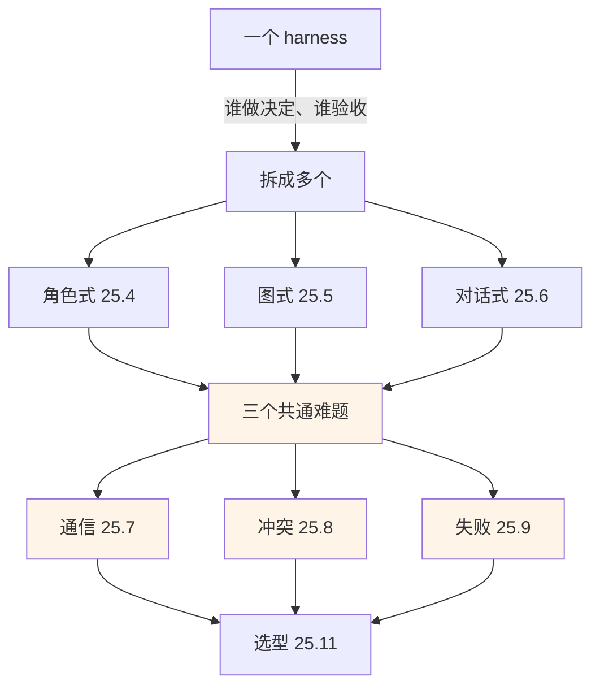
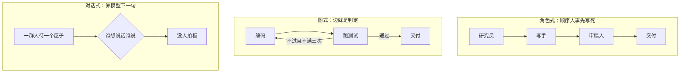
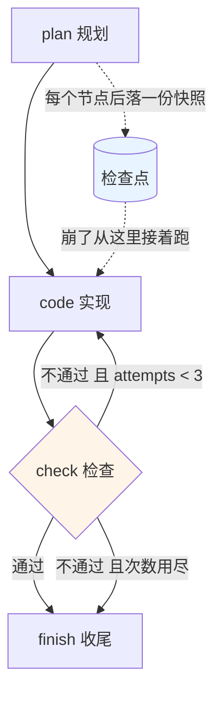

# Ch25 多 Agent 协作

> 让几个外壳互相传话：从"一个人干"到"一支队伍干"的工程写法。

## 本章目标

读完本章你应当能：

- 说出三种多 Agent 架构各自的形状，并知道该在哪一种上起步
- 独立实现角色式编排：角色、任务、顺序 / 并行 / 分层三种执行形态
- 把角色式升级成图式：状态显式化，循环变成图上的一条回边
- 在消息总线、共享状态、共享文件系统之间做出选择
- 处理冲突：抢同一份输出、投票还是仲裁
- 用"任务图 + 检查点 + 重试范围"把一个 Agent 的失败关进笼子里

## 本章导览

Part 4 Ch17 给了起点：单个 harness 就是七项职责的一个完整实现（见 17.4）。Part 3 Ch14 讲清楚了**为什么要拆**、以及**为什么大多数时候不该拆**。这一章只做剩下那一件：**拆了以后，工程上怎么搭**。

本章最重要的一句判断，是整章的骨架：

> **多 Agent 的难点从来不是"多写几个循环"。** 单个 Agent 的循环你在 Ch17 已经学过，复制四份不难。难的是三件全新的事——**它们怎么传话、它们吵起来谁说了算、其中一个崩了怎么办**。从 25.7 开始才是承重墙。



橙色那三块是本章真正想给你的东西。

---

## 25.1 先演一遍「不拆会怎样」

任务：*"帮我写一篇 2000 字行业分析，要求有数据、有观点、结论可靠。"* 原样交给一个 Agent，它会这么干：一次推理里同时扮演研究员、作者和审稿人——先想写什么，边想边查材料，写到中间自我怀疑，再推翻重来。

**它不一定错在事实，错在一个更麻烦的地方——它没法认真怀疑自己。** 提出观点和检验观点这两个职责住在同一个上下文里，调用的注意力是同一份。前一句刚写下的"数据显示"，后一句就可能顺着它继续编。**类比。** 让一个人既写工程方案、又当场给自己做代码评审，还不许喊外援——你做得出来，但你在同一个屋子里看不出它哪里虚，**因为屋子里没第二个视角**。

**拆开就一定好吗？** 不一定。Part 3 Ch14 已用整章讲过：多 Agent 在主流基准上相对单 Agent 的提升常常微乎其微（[Why Do Multi-Agent LLM Systems Fail?](https://arxiv.org/abs/2503.13657)）；成本则实打实——一份工程记录实测，多 Agent 大约比单轮对话多用 **15 倍 token**（[Anthropic 工程博客](https://www.anthropic.com/engineering/multi-agent-research-system)）。

本章立场因此明确：**拆不拆是业务决策，拆了怎么搭才是工程决策。** 后面所有判据都能还原成一句：**这份预算换来的那个角色，是否干了一件别的角色干不了的事。**

---

## 25.2 三种多 Agent 架构

"多 Agent"是个筐，里面至少三种**形状完全不同**的筐。它们不是三档高低，是三种编排契约——你实际上是在决定"下一步该谁干活"由谁回答。

### 25.2.1 角色式：先把活分好，再排好队

**白话。** 先写一份名单（谁干什么），一张顺序表（第几步轮到谁），照着跑。**类比**是**剧组**：每个演员一份**角色说明书**（是谁、追求什么、什么性格），另有一张**通告单**写着哪场戏谁上。**例子**：名单写"研究员 / 写手 / 审稿人"，表写"研究员 → 写手 → 审稿人"，三者之间**没有对话**，只有交接。

这就是全部机制。角色式（role-based）最好上手，因为它**没有决策**——顺序人事先写死，不靠运行时商量。拿来做这个名字的例子是 CrewAI，它的角色定义就是三段文本：**角色名、目标、背景设定**。这三个词本身就是秘密：**角色的差别，纯粹是提示词的差别。**

### 25.2.2 图式：把状态摊开，让下一步变成一次判定

**白话。** 手里始终有一块**记事板**，写着"进行到哪一步、手上有什么东西"。每做完一件事，读一下记事板，**决定下一步进哪个房间**。

**类比**是**一条洗衣线的动线图**：进洗衣机 → 脱水 → 烘干 → 折叠。而"甩干不合格要重洗"那条**回头的线**，是这张图上最要紧的箭头——没有它，流程就是死的。**例子**：记事板上写着 `attempts: 1`、`test_report: FAIL`；规则是"检查没过且尝试不到三次，就退回编码那一步"。一条规则，一次判断，流程自己走成了环。

这就是图式（graph-based）。核心不是"有图"，而是**状态显式化**——状态是第一公民，节点只是读写状态的函数。名字上最常被当作代表的 LangGraph，官方把定位写得很直白：这是一个**编排运行时**，提供持久化、可中断执行和人在环路（[LangGraph 文档](https://docs.langchain.com/oss/python/langgraph/overview)）——**这几个词没有一个跟"智能"有关，全是运行时该干的事。**

### 25.2.3 对话式：谁该说话，靠约定或靠模型判断

**白话。** 一群人待一个屋子里，谁想说话谁说话，没有固定顺序。**类比**是**一支对讲机频道**：什么时候该谁按键，是频道约定好的，或者有人**替你判断**。**例子**：写手发现材料不够，直接问研究员；控制流不在编排代码里，在**模型的下一句话**里。它的上下文里装着**所有角色说过的话**，最难的是**没人拍板**。三个工程坑 Part 3 Ch14 已讲透（见 25.6）。

### 25.2.4 三者的真实差异：谁来回答"下一步"

别被名字吓住，真正的区别只有一句话——**"下一步该谁干活"，是人事先写死的，还是运行时算出来的？** 角色式是**人**写在任务清单里，图式是**一段代码（边）**，对话式是**模型的下一句话**。

先用两张图把三种形状摊开，差别会自己冒出来。第一张是**控制流**：箭头从哪儿来。



**看图上一件极要紧的事：只有中间那张图有回头的那根箭头。** 角色式的四个方块排成一条直线，因为清单上就写了四步；对话式的那根箭头是虚的，因为下一步本来就说不准；图式那根实打实的回边是**你画上去的**，画不画、往哪画，都是代码里的一行。

（这里三张图只画形状、不画细节。图式那一格在 25.5 会展开成一张真的记事板流程图，到时候那张才是能照着写代码的。）

第二张是**同一个任务的同一步**（"测试没通过怎么办"）在三种形状下的答案：

| | 角色式 | 图式 | 对话式 |
|---|---|---|---|
| 谁回答"下一步" | 人（清单第 3 行） | 一段代码（那根边） | 模型的下一句话 |
| 状态放在哪 | 传来传去的变量 | 一块显式记事板 | 对话历史本身 |
| 能不能回头 | 不能（清单是直线） | 能，画一根回边 | 能，但没人知道何时停 |
| 三个坑 | 顺序错了整条错 | 记事板和真实世界不同步 | 没人拍板、越说越贵 |

这几行差异是后面所有内容的根：25.8 的冲突解决要写那么多行，是因为角色式里**没有"决定"这个环节**，得现造一个；25.9 的失败传播做得干净，是因为图式的状态是一块**可以整体存下来**的记事板。

顺便记一笔 2026 现状：**AutoGen 已经不是微软多 Agent 的主要落点**——微软的 Agent Framework 是它的直接继任者，官方文档说它把 AutoGen 的抽象和 Semantic Kernel 的企业特性合到一起（[Agent Framework 文档](https://learn.microsoft.com/en-us/agent-framework/overview/)）。**按形状找东西，别按框架名字找。**

**本节主推角色式作为起点**，理由只有一条：它没有决策点、没有运行时状态机、没有隐藏控制流。图式是升级路线，不是起点。

---

## 25.3 角色分工的直觉：四个角色跑一遍

不抽象地谈"要不要专精化"，直接把四个角色跑一遍：

**项目经理**：输入一句需求，输出三行清单，不写一个字。
**研究员**：输入清单，输出材料。指令里明写"**你不知道主题之外的事，不许猜**"。
**写手**：输入材料，输出稿子。指令里明写"**你不负责核实，材料给什么你写什么**"。
**审稿人**：输入材料 + 稿子，输出一份"第几段、哪一句、支撑在哪"的问题清单。

**四个角色的上下文是刻意不一样的**，这就是分工真正买到的东西——**上下文隔离**。

| 角色 | 输入 | 输出 | 上下文里**没有**的东西 |
|---|---|---|---|
| 项目经理 | 需求 | 步骤清单 | 材料、稿子 |
| 研究员 | 步骤清单 | 材料 | 用户的原始措辞 |
| 写手 | 材料 | 稿子 | 研究员的推理过程 |
| 审稿人 | 材料 + 稿子 | 问题清单 | 写手的写作意图 |

最后一列是重点。**一个角色看不到的东西，它就不会去操心。** 写手看不到研究员的推理，就不会替研究员圆场；审稿人看不到写手的意图，就不会因为"作者可能想表达别的"而放过一个没支撑的断言。**这是把"怀疑"制度化——比在提示词里写"请认真核查"可靠得多**，因为后者要靠同一份注意力去执行，前者是结构上做不到。**类比：** 一条质检流水线上的四道工序，每道只看自己该看的那几张纸；质检员手上没有生产工的工艺笔记，恰恰因为他**不该**有。

这里只补一条纯工程的判据：**角色数量有甜点，过了就往下掉。** 经验数字是：**超过约四个角色后，token 成本继续线性上涨，收益很快变成噪声**——因为**传递损耗**也在涨（还是那份 Anthropic 博客）：研究员用 8 个字概括的一手材料，写手只收到摘要；审稿人拿到稿子，压根没见过原始材料。**每一跳都在丢信息。**


---

## 25.4 角色式实现：一份名单 + 一张顺序表

**代码在干什么，先用文字说清。** 一份角色式编排需要四个零件：**角色**（每次调用都要重复的身份说明）、**任务**（做什么 + 等谁）、**提示词拼装**（角色 + 任务 + 上游产物 + 失败反馈）、**编排**（按什么顺序跑、失败怎么办）。

前两个只是数据类。**角色只有三段文本**；任务多两样：`depends_on` 声明它等谁，`max_retries` 声明能被重试几次。**这里没有任何魔法**——一个角色的全部差别，就是每次调用时系统提示里那几行字不同。**编排层只认"哪个角色接哪条任务"，不认角色背后是谁。** 第三个零件是全部魔法所在，25.4.1 拆开看。

### 25.4.1 交接到底怎么发生

**先演「没有它会怎样」**：如果每个 Agent 只拿到自己的角色说明和任务描述，研究员做完之后，它的材料就**丢在地上没人捡**——写手醒来时手里是空的。多 Agent 有一半工程量花在把这个交接接上。编排层做的事只有一件：**把这段字符串塞进写手下一次调用的提示词里。**

完整文件 `code/part-5/multi_agent_crew.py`（187 行，不依赖任何框架）。以下是**节选**，只保留交接这一个零件：

```python
def render_prompt(role: Role, task: Task, ctx: Dict[str, str],
                  inputs: Dict[str, str], feedback: str = "") -> str:
    parts = [role.system_prompt(), "", f"任务：{task.description}"]
    if inputs:
        parts.append("原始输入：" + json.dumps(inputs, ensure_ascii=False))
    if ctx:
        # 交接的全部秘密就在这几行：上游的输出，变成下游的输入。
        parts.append("你将收到这些上游产物：")
        for k, v in ctx.items():
            parts.append(f"[来自 {k}]\n{v}")
    if feedback:
        # 重试不是从零重来，而是带着上一轮的批评重来。
        parts.append(f"上一次没能通过，原因如下，请针对性修改：\n{feedback}")
    parts.append(f"交付要求：{task.expected_output}")
    return "\n".join(parts)
```

**请特别注意 `feedback` 那一段。** 一个"重试"如果只是把同样的提示词再发一次，那是白花钱——同一个模型在同样的输入上大概率给出同样的输出，**确定性是免费的**。真正的重试必须带上"上次哪里不行"。另外 `ctx` 存的是**任务名 → 产出字符串**，每条都标了来源——这个标注值一整个调试时间。

### 25.4.2 三种执行形态

编排层只回答一个问题：**下一个任务是谁。** 不同的回答方式就是三种形态：

| 形态 | "下一个是谁"怎么定 | 用在哪 |
|---|---|---|
| **顺序** | 按清单的声明顺序一路走到底 | 角色有明确依赖，最常见 |
| **并行** | 按依赖分层，**同层任务同时跑** | 几件互不依赖的调研 |
| **分层** | 主管角色先出派工单，再按单子跑 | 需要有人拆需求、验收 |

三者共用同一套执行函数，差别只在"喂给它的顺序表怎么来的"——这是角色式最大的工程红利：**换形态不用重写执行逻辑。**

**并行那一层要小心**：它要求层内任务互不写同一个键。两个任务都在写 `ctx["report"]`，那是 25.8 要处理的冲突，不是并行的正确用法——**正确姿势是各写各的格子，层结束之后再合并。** 分层则要小心另一件事：主管的上下文要装下所有下游的状态，既要看得见才能验收，又要装得下（见 Part 4 Ch20）。

---

## 25.5 图式实现：把记事板摊开

角色式的天花板在 25.4.2 已经露出来了：**顺序是死的。** 审稿人说"材料不足，该让研究员补"，角色式无能为力——它没有"退回"这个动作，只能报错。图式的解法是加一根回边。

### 25.5.1 先看那张洗衣机动线图



三条要点：**实线是主路，虚线是回头路**，而回头路是图式相对角色式**唯一**的结构性增量；回边**必须有刹车**，条件是 `attempts < 3`，不是"不通过就重来"——**没有刹车的回边是一台烧 token 的机器**；蓝色那个是检查点，不参与流程，只在每个节点之后把记事板整个存一份，**它是 25.9 的地基**。

### 25.5.2 状态机就是一个 while 循环

**这一节要消掉一个错觉。** 很多人看到"状态机""图"会以为有什么神秘的运行时。**没有。图式编排的完整实现就是一个 `while` 循环、一张字典、一张"节点名 → 下一个节点名"的表。**

完整文件 `code/part-5/multi_agent_langgraph.py`（167 行，不依赖任何框架）。状态就是八个键的普通字典：`task`、`plan`、`code`、`test_report`、`attempts`（**唯一的循环计数器**）、`history`、`status`。

下面是**边**那段节选。静态边是常态路线；只有该被推翻时才走 `route()`，推翻条件就三条：已终结、检查通过、次数用尽——都不满足才回头。

```python
MAX_ATTEMPTS = 3            # 循环硬上限：回环必须有刹车
STATIC_EDGES = {"start": "plan", "plan": "code", "check": "finish"}


def route(state: State) -> str:
    """动态边：这张表的返回值就是下一个节点名。"""
    if state["status"] != "pending":
        return "finish"
    if state["test_report"].startswith("PASS"):
        return "finish"
    if state["attempts"] >= MAX_ATTEMPTS:
        return "finish"
    return "code"
```

最后是**执行**，也就是那个 while。完整版见上面那个文件，它做三件事：算下一步、判断这是不是一次"回头"（回头先把 `attempts` 加一）、执行节点后立刻落一份快照。**图里必须有至少两道互相独立的刹车**——`MAX_ATTEMPTS` 和 `max_steps`；只靠业务条件那道，迟早被一条没预料到的路径绕过去。

**还有一处容易搞错的细节。** `run()` 里有一句 `state["plan"] = state["plan"]`，是句空操作，写在这儿只为说清：**回头路改的是产出，不是目标。** 要改的是 `code`，不是 `plan`——每次回头都重跑一遍规划，跑三十圈也回不到原地。**回边的语义是"重做这一步"，不是"从头来"。**

### 25.5.3 什么时候该升级

三条判据，命中一条就升：**需要回头**（上游被判不合格，且你不接受"只能报错"）；**控制流本身有分支**（写进角色式会变成一堆 `if` 包着任务清单）；**需要人在中途接手**（跑到第三步停下等人批一下，图式是一次存盘加一次读盘）。

反过来，**三个都不命中就别升。** 图式的代价是：状态里每个键都得想清楚谁写谁读，多写一个就多一个可能出错的地方。**图式只在控制流本身复杂时才划算。**

---

## 25.6 对话式：一句话点名

对话式的编排控制流落在**模型的下一句话**里，25.2.3 那个对讲机频道就是它的全部样子，**本章不展开它**。真要用时额外提醒只有两条：给它一个**轮次上限**；并在 25.9 那套失败隔离上多花力气——对话式没有明确依赖关系可挂检查点。

---

## 25.7 通信原语：三个 Agent 到底怎么说话

到这里造了两个编排器，但都回避了同一个问题：**研究员和审稿人之间到底发生了什么？** 角色式的答案是"编排层把字符串塞进下一个提示词"，图式的答案是"编排层把字符串写进状态字典"。两种都是**传递**。但真实系统里还有第三种：**共享**——一个角色写进去的东西，另一个自己会去读。

三种原语不是三档选项，是**三个不同的问题**：

> 需要让对方知道一件事 → **消息总线**（我推给你）
> 需要让对方随时查到当前状态 → **共享状态**（摆在那儿）
> 需要的东西太大，塞不进提示词 → **共享文件系统**（你自己去取）

### 25.7.1 消息总线：我说给你听

**白话。** 有一个中间人，不存东西，只负责**转发**：谁发了一条，它投给订阅了这条的所有人。**类比**是**一个工作群**：你发一条，所有人手机同时响；它不整理、不判断、不回复。

**例子。** 研究员在总线上发 `{"topic": "定价", "content": "..."}`，订阅了"定价"的写手收到，审稿人也收到。研究员**不知道**订阅者是谁，也不需要知道。它适合事件驱动、订阅者事先不确定的场景。

**代价你必须知道：投递顺序不保证。** 总线只保证"都送到"，不保证"按这个顺序"。而**顺序恰恰是多 Agent 正确性的基础**——审稿人先于写手收到材料，这次协作就白搭了。所以任何用总线的系统都得额外解决乱序（消息带序号自己排，或按主题分区、每区内部保序）。**这不是可选的工程细节，是用这个原语必须付的账。**

### 25.7.2 共享状态：一块谁都能写、谁都能读的白板

**白话。** 一块摆在公共区域的白板，每个角色都能上去写，也能擦掉重写。**类比**是**消防出警时那块记录板**：到场的人写时间、处理的人写进展、指挥的人擦掉重写一条决定。

**例子。** 白板上写着 `{"draft": "...", "review_notes": "...", "status": "reviewing"}`。写手写 `draft`，审稿人读 `draft`、写 `review_notes`。**这其实正是图式的状态字典**——25.5 那个 `State` 就是一块白板。所以严格说，**图式就是共享状态做得最规整的样子**：规定了哪些键、谁写、何时写。

**共享状态真正的坑是并发写。** 白板只有一个，两个角色同时写 `draft`，后写的默默覆盖了前一个。**这种丢失是静默的**——不报错，图照样跑完，最后你看着一个完整结果，发现里面少了一块，而且没有任何日志记录它被覆盖过。三条防坑规矩，第三条最重要：

1. **每个键只允许一个写者。** 需要"多人往同一处写"就换成文件，不在状态里合写。
2. **一次只跑一个写者。** 需要并行写同一状态，就分配独立键（`draft_a`、`draft_b`），跑完再合并。
3. **把合并变成你能看见的那几行代码。** 真有非合写不可的场合（投票结果、多个研究员的各自结论），就先各写各的格子，收敛那一步用**显式的合并逻辑**合成一个键。

### 25.7.3 共享文件系统：东西太大，就别硬塞

**白话。** 一间公用仓库：任何人把东西写进一个盒子、贴上标签，任何人路过都能取出来看。**类比**是**共用的档案柜格子**——原始数据、下载的论文、生成的中间文件，大到塞不进任何一句提示词的东西，都该住这儿。

**例子。** 研究员查出 20 篇文档，下载到 `docs/001.md` … `docs/020.md`，然后**只往状态里写一行**：`{"sources": ["docs/001.md", ...]}`。写手收到的不是 20 篇全文，是 20 个路径和取用说明。

**这就是 25.3 那张"传递损耗"表的解药。** 前面说加角色之前要问"这一跳传的东西能不能压成一句话"——**压不进去时，正确答案不是加一个中转角色，而是把东西放进文件系统让对方自己取。** 中转角色传的是摘要，文件系统传的是原件。

**但它有一个必须警惕的失效场景：对方到底去不去读。** 总线的坏处是顺序，文件系统的坏处是**读了没有**。写手收到 20 个路径，完全可能一份都不取，凭训练数据把稿子写了——**而且它不报错，稿子看起来还挺完整。** 所以接收方指令里必须写明"先取哪几个文件、取不到就停下来问"，而不是留一句"参考资料在 docs/ 下"。跟 Ch23 的教训同源：**你给了模型一条路走，它不一定走。**

### 25.7.4 三原语怎么选

一句话：**消息总线解决"告诉对方一件事"，共享状态解决"让对方查当前进度"，共享文件系统解决"给的东西太大塞不进提示词"。** 对应的账分别是：乱序要自己加序号、并发写会静默覆盖、对方根本不去读。**你要做的不是三选一，是知道每件事该走哪条路。**

---

## 25.8 冲突解决：两个 Agent 抢同一份输出

前两节都假设"上游交给下游"，没考虑**抢**。**先演「没有它会怎样」**：三个研究员同时查同一主题，都把结论写进 `ctx["结论"]`，谁后写谁赢。先写的那个**没有任何机会知道自己被覆盖了**——它返回成功，日志显示"成功"，你手里却只剩两个结论里随机的一个。这类事故的特点是**不报错、不留痕、很难复现**。

### 25.8.1 三种解法，从省事到费事

**解法一·排他。** 不让两个角色写同一个键——前面 25.7.2 那条规矩就是它的具体化。**这是成本最低的解法，因为它什么都不用写——只是不去制造冲突。** 但它有边界：**有些活天生就是"多份答案取一份"**，排他解决不了，因为冲突是任务本身要求的。

**解法二·投票。** 让几个角色各写一份，按事先定好的规则挑一份。**类比**是三个评委各打一个分，去掉最高最低，取剩下的。**例子**：三个研究员各写一份 200 字方案，交给第四个"评委"角色选最高分那份。

**最后一个动作是投票的成败所在。** 一个被要求"评估三个方案"的模型，很容易输出"三个各有优点的长篇评论"——它本质上在做**总结**而不是**决策**，跑完三个方案都还在那儿，谁也没被淘汰。**指令里必须写死"你只能选一个，选不出来也必须选，并说明为什么难选"。** 此外还有三个隐含成本：多一个裁判角色；裁判要读完所有候选（**新的上下文瓶颈**，十个读不完、五个勉强）；裁判自己也会判错，而**它的错误是系统性的**——一个带偏好的标准会把所有正确答案一起筛掉。

**解法三·仲裁。** 冲突双方把话说清楚，交给一个不参与生产的角色拍板。**类比**是两个部门吵不出结果，交给一个既不属于这边也不属于那边的人裁决。**例子**：研究员和写手对"这段该不该保留"僵住了，两边材料一起交给仲裁角色，它只回一句"删掉，材料里没有对应数据"。

**仲裁比投票贵，但贵得有道理**：投票处理"多份同级答案"，仲裁处理"不同角色对同一件事有分歧"——后者信息量更大，**没人想选一个角色当答案，他们想要的是这件事的结论。** 两条纪律：**仲裁角色必须不生产内容**（一个既写稿又审稿的仲裁者就是 25.1 刚批评过的"自己怀疑自己"）；**必须拿到双方原材料，而不是只听一方转述**——丢掉的那一半通常正是有争议的地方。

### 25.8.2 一张选型表

| 冲突类型 | 用哪个 | 判据 |
|---|---|---|
| 两个角色都写 `结论` | 排他 | 冲突是实现不小心 → 改实现 |
| 三份同级调研选一份 | 投票 | 候选同级，只需选一个 |
| 研究员与写手吵起来了 | 仲裁 | 需要判断，不是选择 |

**还有第四种解法**：**干脆不解决，把冲突本身当成信息。** 两个角色的结论矛盾往往说明**问题问错了**——把矛盾连同两边理由一起交回给用户，比强行选一个更有价值。

---

## 25.9 失败传播：一个崩了，为什么不能拖垮整组

这是本章最承重的一节。前面两节解决"正常时怎么配合"，这一节解决**不正常时**。

### 25.9.1 先演一遍「没有它会怎样」

顺序式 Crew 跑四步：项目经理 → 研究员 → 写手 → 审稿人。研究员跑到一半，模型服务端返回 429（限流）。

**最蠢的写法是让异常一路往上冒**：整个 `kickoff` 抛出，`ctx` 里留着半成品，调用方只看到 stack trace。这是最容易写出来的版本，因为它是 Python 的默认行为。**它错在把失败当成了全局事件**——研究员崩了，写手和审稿人根本没有活干，是编排代码把一个局部故障升级成了全局中止。

### 25.9.2 三件套：任务图、检查点、重试范围

**第一件·任务图。** 白话：先画一张"谁等谁"的图，然后**沿着它判断：谁的下游因为这件事不能干活了**。类比是一份工序依赖表——冲压车间停电了，后面那道热处理得停，但同时还在上料的上料工序可以继续。例子：研究员崩了，沿任务图找下游——写手（依赖 research）**不能跑**，审稿人（依赖 draft）**也不能跑**，因为它的输入依赖写手。**传递性必须算进去**，只查直接依赖是最常见的漏判。

**第二件·检查点（checkpoint）。** 白话：每做完一步就把记事板整个存一份，崩了从最近一份接着跑。这里要回到 Part 4 Ch17 的**职责六：会话与状态**，白话是"留下可回放、可恢复的记录"（见 17.4.6）。**多 Agent 的检查点就是职责六在编排层的具体实例**——只不过这次存的不是一轮对话，是一整块状态字典。

**它真正的价值不在"崩了能接着跑"，而在"能回到过去某一步，从那儿换个走法"。** 前者只省下半次执行；后者让你能**改判**——那次失败换个模型重跑能过，是模型问题；怎么跑都一样，是设计问题，**要改的是图**；还能**定位**——存盘时间戳就是时间线。**恢复只是"可回放"的一半用途。**

**第三件·重试范围（retry scope）。** 白话：重试时要说清楚**是从整张图第一步重跑，还是只从出事那一步重跑**。类比是装修返工——墙面刷歪了，是把那面墙铲了重刷，不是把整套水电瓦工全重来。例子：25.5 那个 `attempts` 计数器就是最小实现——**状态原封不动保留，只有 `code` 那一个键被重写**，`plan` 没动、`history` 没清。那份代码里三处设计是同一件事的三个面：①`state["plan"] = state["plan"]`——重做产出不是目标；②`feedback` 槽位——重试带上"上次哪里不行"，**这是最容易被漏掉的一项**；③`attempts` 有上限——范围再精确也得有刹车。

> **任务图决定"谁能跑"，检查点决定"从哪儿跑"，重试范围决定"跑多少"。**

### 25.9.3 失败要先分类

失败有很多种。**先分类，再对症下药**——这是 Part 3 Ch14 讲误差放大时给的方法，这里落到编排层：

| 失败类型 | 例子 | 处理 | 重试范围 |
|---|---|---|---|
| 瞬时 | 限流、超时、临时 5xx | 等一下重试 | 当前任务，带反馈 |
| 契约性 | 交付格式不对 | 重试；无效就抛 | 当前任务，带反馈，次数很少 |
| 依赖性 | 上游崩了 | **不重试**，标记为"被阻塞" | 无——**重试是浪费** |
| 设计性 | 反复撞同一个墙 | 不重试，**改图** | 无——这是最贵的一类 |

**第四类最容易被当成第一类处理。** 判据是：**同一任务重试三次，如果每次失败原因一样，那就不是瞬时失败，是设计失败。** 正确动作是停下来改图（或改提示词），而不是把重试次数从 3 调到 5。**每次调大重试次数来解决一个固定失败，是多 Agent 系统里最常见的烧钱方式。**

而"依赖性失败"最容易写错：一个 `try/except` 包住整条链，于是研究员一崩，写手的任务也标成失败——**明明它的输入根本没到**。修法只有一个词：**分开记。** 失败的任务记失败，被阻塞的记阻塞，否则复盘时你看着一堆红色以为全是根因。

### 25.9.4 最后一道：别让它跑到用户面前

**先演「没有它会怎样」**：四个角色全部"成功"，交出一篇稿子。而研究员三次查询里有两次失败，只是它失败之后**自己编了一个数字填进去**。角色层面全绿，用户拿到的是一篇带假数据的稿子。**类比：** 一条流水线全绿不等于产品合格——最后那道检验台才是，**工序状态和成品状态是两件事。**

**但验收角色也是模型，它也会出错。** 所以验收不能是"再问一个模型觉得行不行"——那等于没验收，只是多花一份 token 换一个更晚的坏消息。**真正的验收是结构性的**：审稿人**必须拿到原材料**（而不是稿子里引用的说法），必须**逐句对照**，必须**能输出"这句没有支撑"这句话**。它的价值来自"手里握着证据"，不是"它是个更强的模型"。

---

## 25.10 可观测性：交给 Part 6

多 Agent 的运行记录比单 Agent 复杂一个量级，展开留给专门讲可观测性的那章（**详见 Part 6 Ch29**）。这里只点一句最低要求：**一次多 Agent 运行至少能回答四个问题**——每个角色花了多少 token 与多少步、这一步的输入是从哪个键来的、崩在哪一步、重试了几次才过。**这四项恰好一一对应本章的四个零件**：角色、执行形态、通信原语、检查点。没按这四类把编排结构建好，也就拿不出这四项数据。

---

## 25.11 三种架构怎么选

**一句话判据**：

> **任务形状确定 → 角色式；控制流有分支、有回头、有人工介入 → 图式；任务形状本身不确定 → 对话式，且必须给它装刹车。**

| | 角色式 | 图式 | 对话式 |
|---|---|---|---|
| **可控性** | **高**。跑错了一定是某个角色的提示词或某次交接 | **最高**。控制流是你的代码，逐行可读 | **低**。下一步谁说话是模型的判断 |
| **学习曲线** | 平缓。一个列表加一个循环 | **陡**。要先想清楚状态里有几个键、谁写谁读 | 平缓起步、**陡收尾**。上线容易，停不下来难 |
| **适用规模** | **2–5 个角色**，再多就传不动 | **5–20 个节点**，再大状态键的依赖就难维护 | **3 个左右**，人再多就吵成一锅粥 |
| **典型失败模式** | 上游产出塞不进下游窗口；错误一路传到底没人发现 | 状态里某个键没人写，下游读到 `None` 却继续跑；回边没刹车烧 token | 无限互相点评；两人同时改同一份东西；没人拍板 |
| **该先学哪个** | **它** | 第二个 | 最后 |

**"典型失败模式"那一行最实用**：塞不进窗口就是 token 超限；状态里没人写就是**读到默认值还往下走**，这条尤其阴险，因为它不报错，只是让后面所有环节在处理一个空字符串。

**最后一行是我真正想给的建议。** 从角色式起步；等你第一次遇到"需要让审稿人退回给研究员"，**那天**再升级到图式。**永远不要因为"图式更强大"而从零就用它**：你会花两天调状态键，而那两天本可以用来跑通一条直线。

---

## 25.12 接到 Part 5 的后半程

到本章为止，Agent 的**四肢**（Ch23）、**记性**（Ch24）、**编制**（本章）都装上了。但有一件事贯穿这三章、始终被绕开：**Agent 写出来的那些代码，谁来执行？** 前面所有章节默认"执行"是安全的、是现成的，到下一章这个假设不成立了。本章已经埋了两个伏笔：25.7.3 说共享文件系统最适合传大件——**那些大件里就包括代码**；25.9.2 说检查点让状态可回放——**回放的另一半是"重新执行一遍，结果要一样"**。

---

## 本章小结

- **难点不在数量，在通信、冲突、失败传播三件事。** 多写几个循环最容易，25.7–25.9 才是承重墙。
- **三种架构按"下一步该谁干活由谁决定"区分**：角色式人事先写死、图式由代码判定、对话式由模型判断。**从角色式起步。**
- **角色式 = 角色（一段提示词）+ 任务（做什么、等谁）+ 编排（顺序 + 重试）。** 换模型不改变角色，改提示词才改变角色。交接的全部秘密是把上游字符串塞进下游的下一次调用；**重试必须带上"上次哪里不行"，否则重试等于重跑。**
- **图式 = 一个 while + 一张转移表 + 一块显式记事板。** 回边是它相对角色式唯一的结构性增量，**它的语义是"重做这一步"，不是"从这一步重头来"**，而且必须配刹车。
- **通信三原语各解一个问题**：消息总线（要自己管乱序）、共享状态（最怕并发写静默覆盖）、共享文件系统（最怕对方根本不去读）。**压不进一句话的东西，放文件系统，别加中转角色。**
- **冲突三种解法**：排他（冲突源于实现，改实现）、投票（**指令里必须写死"只能选一个"**）、仲裁（仲裁者必须不生产内容、必须拿到双方原材料）。
- **失败传播三件套**：任务图决定"谁能跑"（**传递性别漏判**）、检查点决定"从哪儿跑"（真正价值是可回放改判）、重试范围决定"跑多少"。失败要先分类——**同一任务三次失败原因一样，那是设计失败，不是瞬时失败。**

对回 Part 4 Ch17 的七项职责，本章真正占住的是**第 6 格「会话与状态」**：单个 harness 的状态由它自己管，多 Agent 的状态是**跨 harness 的**。

---

## 本章参考

### 必读论文

- [Why Do Multi-Agent LLM Systems Fail?（Cemri 等，2025）](https://arxiv.org/abs/2503.13657)——多 Agent 三大失败类的出处，25.8、25.9 的判据大半来自它。
- [MetaGPT: Meta Programming for A Multi-Agent Collaborative Framework（Hong 等，2023）](https://arxiv.org/abs/2308.00352)——角色式"把流程固化进提示词"的最早完整表述，对应 25.2.1。
- [AgentOrchestra（2025）](https://arxiv.org/abs/2506.12508)——多 Agent 编排的工程化版本，可作 25.4.2"分层"的补充读物。

### 推荐博客 / 教程

- [How we built our multi-agent research system（Anthropic，2025-06）](https://www.anthropic.com/engineering/multi-agent-research-system)——15 倍 token、约四角色甜点、传递损耗三处数字的来源。
- [LangGraph 官方文档](https://docs.langchain.com/oss/python/langgraph/overview)——25.5 那张图能对上号的持久化与人在环路设计。
- [CrewAI 官方文档 · Crews](https://docs.crewai.com/en/concepts/crews)——`role` / `goal` / `backstory` 三段式角色定义的正式写法。
- [Microsoft Agent Framework 文档](https://learn.microsoft.com/en-us/agent-framework/overview/)——AutoGen 的直接继任者。

### 视频 / 课程

- [DeepLearning.AI 短课：AI Agents in LangGraph](https://www.deeplearning.ai/courses/ai-agents-in-langgraph)——25.5 那种 while + 转移表的写法在这里从零手写一遍。
