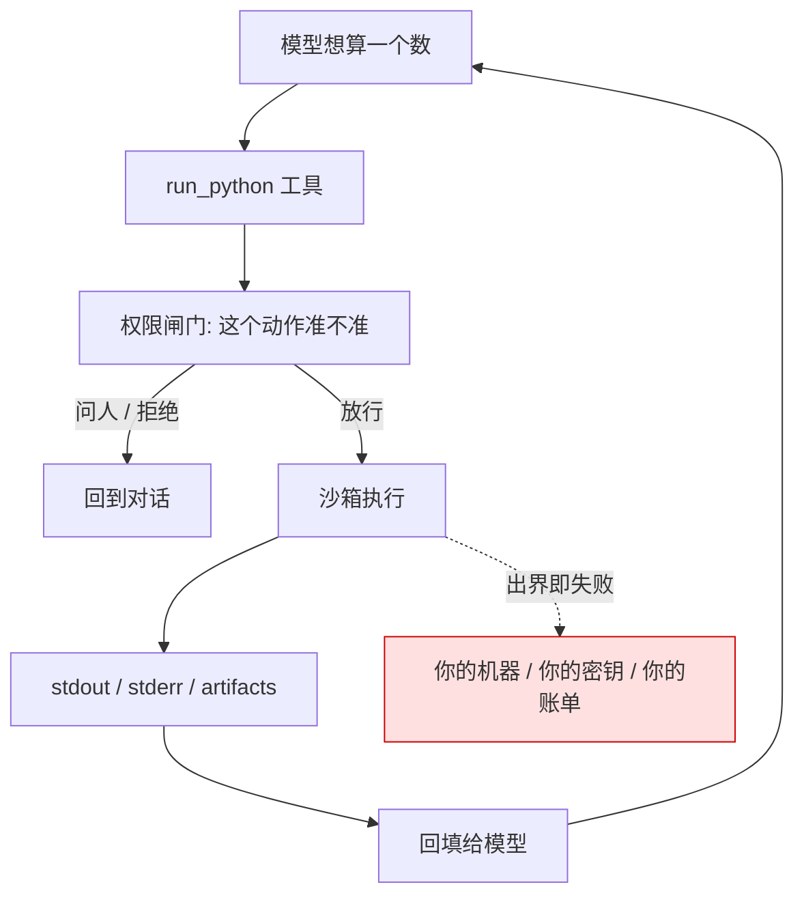
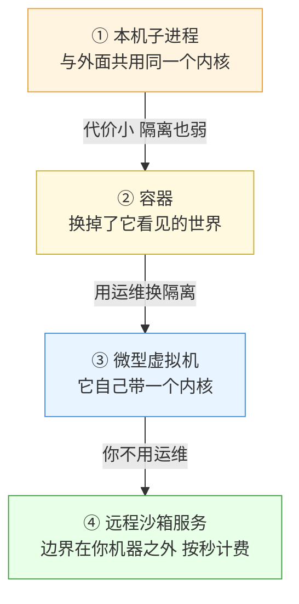
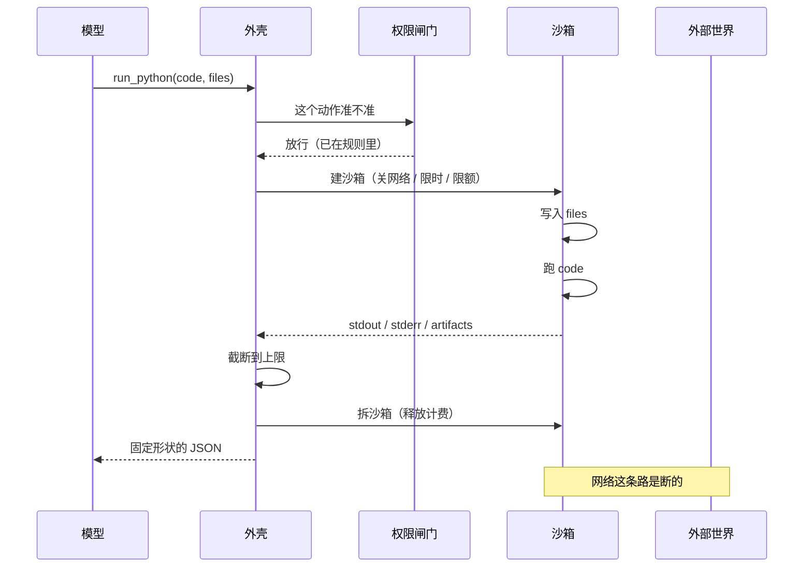
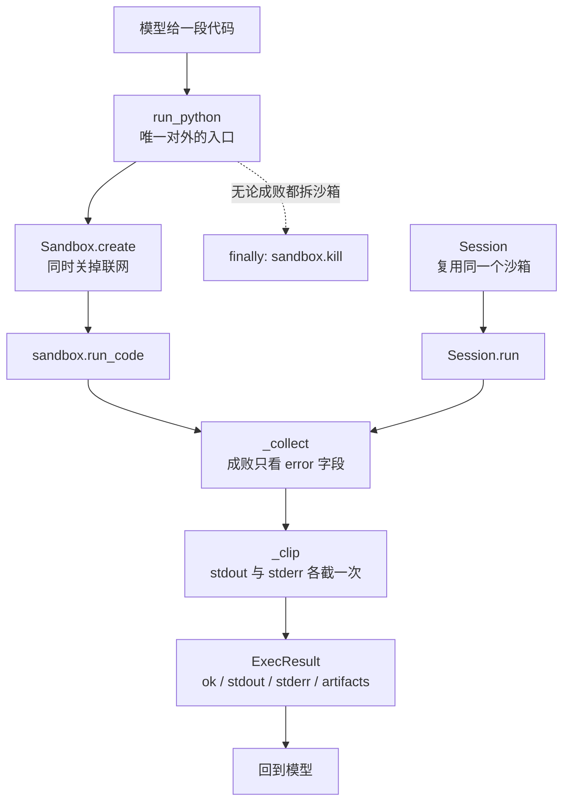

# Ch26 Code Execution

> 把「让模型自己写代码并执行」做成一个工具，以及该把它放进哪一档的墙里。

## 本章目标

读完本章你应当能：

- 说清"为什么 2026 的主流外壳几乎都带一个执行代码的工具"，而不只是知道它有
- 在四个隔离档位之间做选择，并说得出每个选择的代价落在哪里
- 独立设计一个 `run_python` 工具的输入输出契约，包括上限与截断
- 决定沙箱是每次新建还是会话复用，并为此付对应的账
- 逐条说出四条不能碰的安全红线，并指出那段最常见的错误写法错在哪

## 本章导览

先摆位置。Part 4 Ch21 讲了**怎么把 Agent 管住**——权限是一份规则、沙箱是一个环境、钩子是一个时刻。那一章回答"防线怎么搭"。

**Part 4 讲了怎么框住它，这一章讲怎么接上它。** 具体说：那边说"命令必须跑在一个受限环境里"，本章回答——这个环境具体是哪一档？接一个执行代码的工具时，输入输出该定成什么形状？沙箱的生命周期怎么管？哪些红线一碰就出事？



这张图和 Part 4 Ch21 21.6 那张链路图是同一副骨架，**换的只是 D 那一格里的东西**。本章所有内容都挂在 D 这一格上。

## 26.1 引子：为什么"自己写代码"成了标配

看一件具体的事。下面这段对话每天都在发生：

> **用户**：这份 CSV 里有多少行的 `amount` 列大于平均值？按 `region` 分组统计一下。
> **模型**：我先算一下。

按 2023 年的做法，模型接下来要自己写一段 Python、贴进终端、自己敲回车、自己读输出。**这三步全是模型的活，而每一步都要求它精确复述一段代码。** 一次分组统计要来回改四遍。

2026 年的主流外壳把这件事做成了一个工具：模型不写命令、不敲回车、不读终端，只交进一段代码，拿回三样东西。**这就是本章要做的全部——设计这个工具，然后决定它跑在哪一档墙里。**

值得单独一章，因为它在 Part 5 里**风险最高**：其他功能做坏了 Agent 变笨，这个做坏了是你的机器出事。⚠️ 但它收益也最直接——过去"模型算错一个数"要靠人复核，现在模型**真的把数算出来了**。

## 26.2 先演三次「不隔离会怎样」

**白话。** 不隔离就是"把模型写的代码直接交给本机解释器跑"。大多数时候它好使；问题在于**不好使的那几次，代价和好使的那些不在一个量级上**。

**场景一：一次跑飞，把你自己的服务拖下水。** 模型想清空一个列表，写的是：

```python
data = []
for i in range(10**9):
    data.append(i)
```

没有恶意，思路也合理。但在**没有上限的环境**里，这个进程会一直吃内存直到被系统杀掉。如果它跑在你的 Agent 服务进程旁边，那不是你一次调用失败，是**你的整个服务 OOM 了**。

```text
没有上限：  一个任务吃满内存 → 整台机器的进程被挤出去 → 别人的会话一起断
有上限：    这个任务超过 512MB → 这一个任务被杀 → 模型收到"内存超限"，改写法重试
```

**场景二：把不该出网的代码放出去。** 模型处理一份用户提交的表格，写着"顺便看看这个 API 文档确认字段含义"：

```python
import requests
resp = requests.get("https://example.com/api/docs")
```

在**能出网**的环境里，这行代码什么事都能干——包括把刚读到的文件内容 POST 到它自己的地址。这不是模型"想"这么做，是**它手里只要有网这个能力，这行代码就永远存在**。

**场景三：上一次运行留下的东西毒害这一次。** 模型第一次调用装了个包，版本不对，它没在意（stdout 里那句 warning 被截断了）。第二次调用，那句被截掉的 warning 早就没人记得，而**环境里还留着那个版本**。模型的推理链是连贯的，环境却是脏的。

⚠️ **三个场景没有一个需要"模型变坏"这个前提。** 第一个是模型犯了个小错，第二个是模型写了个再正常不过的代码，第三个是环境没复位。

这正是 Part 4 那句结论在执行侧的具体含义——**提示词是软约束，外壳才是硬约束**。你没法用提示词说"请不要把内存吃满"，因为吃满内存的那个进程跑起来之后，提示词已经不在它的作用域里了。**所以答案是：给它一面墙。**

## 26.3 为什么需要沙箱：四个理由

先把词摆正。Part 4 Ch21 已经划过线：**执行隔离（Isolation）是上位词，沙箱（Sandbox）是它的一种实现形态。** 本章沿用这个定义，只往下做一件事：**同一份隔离需求有四种强度不同的实现，代价完全不同。** 你要做的选择是"付哪一份代价"。

| 理由 | 白话 | 少了它会怎样 |
|---|---|---|
| **安全** | 里面炸了，外面不炸 | 场景一、二直接成立 |
| **可重放** | 同一段代码再跑一次，落点一样 | 出问题没法查第二次，也没法验证修复 |
| **资源限制** | 它最多吃多少，说了算 | 事故从"这一个任务"升级成"整台机器" |
| **状态隔离** | 一次运行留下的东西不带到下一次 | 场景三；长会话里出现"越跑越不对劲"的漂移 |

⚠️ **后两个经常被忽略，但它们才是让 code execution 真正可用的原因。** 只谈安全的那套论证，最后会得出"所以只能不开这个工具"的结论；而实际上**可重放和状态隔离带来的收益比挡住的那几个风险更大**——它让模型能放心地"跑一遍看看"，这正是这个工具的全部价值。

## 26.4 沙箱的四档：从"换个目录跑"到"换台机器跑"

### 26.4.1 先看全景：一条越走越远的轴

**白话。** 四档的差别不是"哪个功能更多"，而是**一旦被突破，损失能落到哪里**。



抓住两件事：**箭头方向上隔离变强，同时运维成本也变高**；第四档用一次付费把运维成本**换成了钱**。这就是它存在的意义——不是隔离更强（它底层常常就是第三档），而是**责任转移**。

⚠️ 顺带拆掉一个常见误解：**第一档和外面共用同一个操作系统内核。** 这正是 Part 4 Ch21 21.4.5 那句警告——**内核里的一个洞被跑在里面的代码利用了，隔离挡不住**。第一档隔离的不是"被利用的可能性"，是"一次误操作能碰到的东西"。这个差别，是安全评审时最容易被糊弄过去的地方。

### 26.4.2 四个档位逐个看

下面是本章最该记住的一张表。**每格最后都跟一个具体例子**，因为光看维度对比，读者的脑子里不会长出画面。

| 维度 | ① 本机子进程 | ② 容器 | ③ 微型虚拟机 | ④ 远程沙箱服务 |
|---|---|---|---|---|
| **隔离强度** | 最弱。换个目录、换个进程，**和外面共用一个内核** | 中。换掉了它能看见的路径和能调用的接口，**内核仍是同一个** | 强。**它有自己的内核**，外面是一道硬件虚拟化边界 | 强。同第三档，且**边界还在服务商那边** |
| **启动开销** | 几毫秒，fork 一下就起来了 | 几百毫秒到几秒 | **亚秒级**（这是它被设计出来的原因） | 亚秒到数秒（含一次网络往返） |
| **部署复杂度** | 零，现成的 | 中。要装守护进程、备一份镜像 | **高**。裸机、硬件虚拟化、镜像和池化都得自己管 | **零**。一个 API key |
| **成本形态** | 免费 | 免费，付的是那台机器 | 裸机的钱 + 你自己的运维时间 | **按秒 / 按次计费**，不跑不花钱 |
| **适合什么** | 你自己写的、看得懂的、一次性脚本 | 单租户或可信多租户；内部工具链 | 多租户执行**不可信代码** | MVP，以及绝大多数"我先跑起来看看" |
| **一个例子** | 跑在本地的一段你自己审过的转换脚本 | 内部数据服务，容器里跑固定的 ETL 镜像 | 公有云上的 Serverless 执行环境 | 把模型写的代码交上去，拿回 stdout |

⚠️ "启动开销"那一列有一处**常见误解值得当面拆掉**：读者常以为虚拟机一定慢。微型虚拟机的存在意义恰恰是**把这个误解打掉**——它为了快，主动砍掉了传统虚拟机绝大多数硬件模拟，只留下跑一个普通进程真正需要的那几样。**所以"亚秒级启动"不是营销话术，是设计目标本身。**

选型三句话：**先用第四档**——除非有明确理由，MVP 阶段不该自己运维第三档，理由不是它更强，是**你会把两周花在调虚拟化和镜像上，而不是花在 Agent 本身**；**单租户或半可信场景用第二档**——容器在"能真的干活"和"损失有上限"之间给了一个便宜的平衡点，也是 Ch21 那三档里"可写工作区"在实现上最常见的落法；**面向不可信代码的多租户才上第三档**，并要接受它是**运维工程**。

**一句话点名**：业界的隔离设施主要就是这四类实现——`Firecracker`、`gVisor` 属于第三档（前者是虚拟化监控器，后者是用用户态重写的应用内核），`Docker`、`containerd` 属于第二档，E2B、Modal 一类属于第四档（E2B 官方明确说明它的每个沙箱是一个 Firecracker 微型虚拟机而不是容器）。**它们的具体 API 会变，上面这四档的划分不会。**

### 26.4.3 维度之外的第二个轴：环境从哪儿来

真做选型时还有第二个轴：**"这个环境是不是模型自己弄出来的"**。**预先烘焙的**——基础镜像和依赖在沙箱启动之前就装好了；**运行时装出来的**——模型这次调用里现场 `pip install`，装完这次就没了。

这个轴独立于隔离强度，**但它决定你要不要开网络**：依赖必须运行时装的话，你多半得给沙箱开一个受限的出网口子——而"给沙箱开网络"是 26.2 场景二那个最危险的动作。

⚠️ 这里有个反直觉的结论：**把依赖预装进去，往往是更安全的选择。** 预装让"出网"这个需求消失，而**需求消失比需求被管住可靠得多**。代价是每次改依赖都要重新烘焙一次。

## 26.5 把执行代码做成一个工具：契约怎么定

墙选好了，外壳和沙箱都通了。**怎么定义这个工具本身？**

### 26.5.1 入参：为什么只要一段字符串

**白话。** 入参就是一个字符串，装的是模型写的代码。

**类比。** 像给同事一个只能递纸条的窗口——纸条上写什么他照做，你管不了他写什么，但你能管**这张纸条要递到哪扇门**去。

**小例子。** 模型的输出长这样：

```python
rows = [("华东", 120), ("华北", 80), ("华东", 200)]
total = sum(a for _, a in rows)
avg = total / len(rows)
for region in sorted({r for r, _ in rows}):
    n = sum(a for r, a in rows if r == region)
    print(f"{region}: {sum(a for a in rows if a > avg)} 条超过均值，占比 {n/total:.1%}")
```

除了 `code`，实际还该有几项：

| 入参 | 白话 | 谁提供 |
|---|---|---|
| `code` | 要跑的那段代码 | **模型** |
| `timeout` | 最多跑多久 | 外壳（模型说了不算） |
| `files` | 要喂进去的数据文件 | 外壳 |
| `network` | 要不要放行出网 | **外壳**（模型说了不算） |

⚠️ 标粗的两项是这一节的核心：**`timeout` 和 `network` 绝不能是模型可填的字段。** 模型若能自己填一个极大的 `timeout`，它就等于没有上限——这不是"可能被滥用"，是**把闸门的钥匙挂在了墙上**。**触发权在流程手里，不在模型手里**（Part 4 原话，在这一条上照搬，因为它本来就是关于边界的判据）。

顺带一个反向的坑：**别给模型一个 `run_shell` 就完事。** shell 能做的事比"跑一段 Python"宽得多——装包、起后台进程、读任意路径。**能收窄就别放开。**

### 26.5.2 出参：为什么是固定形状的三样

**白话。** 返回三样：`stdout`、`stderr`、`artifacts`。前两样是文字，最后一样是文件。

**类比。** 像拿回来一个**信封**：里面是正文（`stdout`）、附注（`stderr`）、附件（`artifacts`）。信封的形状永远一样——即使里面什么都没有。

**小例子。** 上面那段代码跑完，你会拿到这样一封"信"：

```json
{
  "ok": true,
  "stdout": "华东: 1 条超过均值，占比 66.7%\n华北: 0 条超过均值，占比 33.3%",
  "stderr": "",
  "artifacts": []
}
```

如果它把 `total` 拼错成了 `totl`，回来的信封**还是这个形状**，只是换了一处内容：

```json
{
  "ok": false,
  "stdout": "",
  "stderr": "NameError: name 'totl' is not defined\n  File \"<cell>\", line 2",
  "artifacts": []
}
```

**"固定形状"这四个字值很多。** 模型看到第一封就知道去看 `stdout`，看到第二封就知道去看 `stderr`。如果契约是"成功时返回 stdout、失败时返回 error 对象、有图时返回图"——**模型每一次都得先判断这次会拿到哪种形状**，这在长会话里累积起来的判断错误，比一次报错贵得多。

| 字段 | 装什么 | 不装什么 |
|---|---|---|
| `stdout` | 脚本 `print` 出来的**结果本身** | 进度条、调试信息 |
| `stderr` | **诊断**：异常、警告、traceback | 结果 |
| `artifacts` | **文件**：图、CSV、报表 | 文字 |

⚠️ 最容易漏的一处：**`stdout` 必须有长度上限。** 26.2 场景一的反面版本是——模型写了个循环，打印一百万行。这些字会**一路挤回上下文窗口**，把它自己顶出去。所以截断不是可选项。⚠️ 而截断时**必须在断口留一句说明**，否则模型会把半张报表当成完整结果继续推理——**这是 code execution 里最常见的一种幻觉，比报错难发现得多。**

### 26.5.3 一次完整调用的时序

上面两小节是静态契约。跑起来，一次调用是这样串起来的：



这张图和 Part 4 Ch21 21.6.1 那条链路是同一个形状，**故意画成一样**——这就是承重的意思：外面几层不是每章重新发明的，它们是同一个骨架在不同层面的展开。变的是 `H -> S` 那一格：**这次要选的是哪一档墙，以及墙上开不开网。** ⚠️ 图里最不能略的两步是**"截断到上限"**和**"拆沙箱"**：前者是上下文预算问题，后者是账单问题——远程沙箱通常按秒计费，忘了拆就在一直付钱。

## 26.6 代码：把契约落成一行 `run_python`

契约讲完了，看一份把它写成代码的样子。⚠️ 先说一句必要的话：**这份文件里没有、也不该有"把模型输出直接交给本机子进程执行"的代码。** 那是本章要警告的反例（见 26.10）。

先看结构，不然读下去容易迷路。这份文件只有一条主干，其余都是给它兜底的零件：



**先看两条虚线，它们是这份骨架里最容易写漏的地方。** 右边那条：`sandbox.kill()` 写在 `finally` 里——这类沙箱服务是**按秒计费**的，忘了拆就一直在你账号下活着。第二条不在图上但同样要紧：**`_collect` 判定成败只看 `error` 字段，不看 stdout**。模型往标准输出里印了什么不算成功，程序没抛错才算。

**关于"返回形状恒定"这条契约，要说准它的边界——这份骨架并没有做到完全不抛异常。** `_collect` 保证的是：**执行本身跑完了但跑砸了**（模型写的代码有语法错误、变量不存在），出来的仍然是结构化的 `ExecResult`，模型读到的是"哪一行错了"而不是一个 Python 堆栈。但 `Sandbox.create()` 连不上、超时这类**沙箱层面的失败，这份代码是直接往上抛的**——`finally` 只保证沙箱被拆掉，并不把异常包成返回值。

所以真正稳的做法是**在这个骨架外面再包一层 `try`**，把沙箱层面的异常也转成同一个 `ExecResult`。为什么这份骨架没有替你包：**它是示意代码，故意把"哪里需要你自己补"留成一个看得见的缺口**，而不是让你以为照抄就完事。26.5 契约里说的"形状恒定"，到这里就得由你在外面那层补齐。

```python
# runnable: no
# depends: e2b-code-interpreter
# usage: python code_exec_e2b.py   （需要先把 E2B_API_KEY 写进环境变量；本书全程不执行代码文件）

# Ch26 的示范：把「执行代码」做成一个工具。代码不跑在你的机器上，
# 跑在一台别人托管的沙箱里——你需要的是一个远程沙箱服务的 API key。

# ⚠️ 刻意缺席的一段：全文没有任何一处把模型输出的字符串交给本机子进程执行。
#    那是 26.10 要点名的反例，不是示范。真要写，也必须先经过一层隔离环境。

import json
import os
from dataclasses import asdict, dataclass, field
from typing import Any

# 一份执行契约的全部硬边界。集中放在这里，是为了让"上限是什么"在第一屏就有答案。
MAX_STDOUT_CHARS = 8000        # 标准输出最多回传多少字符
MAX_STDERR_CHARS = 4000        # 标准错误留的窗口小些——它多半是给人看的诊断
SANDBOX_TIMEOUT_SECONDS = 300  # 一个沙箱连续运行多久之后自动挂起
CODE_TIMEOUT_SECONDS = 60      # 单次执行的墙钟超时


@dataclass
class ExecResult:
    """run_python 的返回值。

    成功有 ok、失败有 error，而 stdout / stderr / artifacts 三样在任何情况下都存在，
    所以模型不必先猜"这次会返回什么"再决定怎么读。固定形状比省几个字段重要。
    """

    ok: bool
    stdout: str
    stderr: str
    artifacts: list[dict[str, Any]] = field(default_factory=list)

    def to_json(self) -> str:
        # 用 JSON 而不是 repr：模型见过的训练数据里 JSON 远多于 Python 对象的打印形式。
        return json.dumps(asdict(self), ensure_ascii=False)


def _clip(text: str, limit: int) -> str:
    """截断一段输出，并在断口留一句说明。

    留这句说明是因为：模型看到戛然而止的 stdout，会以为"程序就是这样算完的"，
    然后拿着半张报表继续往下推理——这是 code execution 里最常见的一种幻觉。
    """
    if len(text) <= limit:
        return text
    return text[:limit] + f"\n...（已截断，这段原本共 {len(text)} 字符）"


def _collect(execution: Any) -> ExecResult:
    """把 SDK 返回的执行结果压成契约里那一个固定形状：合并、截断、判定成败。

    成败只看 error 字段——它不为空才叫跑砸了；stdout 里印了什么不算数。
    """
    # artifacts 收的是"存到文件里的东西"：图、CSV、报表。
    # 这里不实现取文件那一步，只把契约里的这一栏占住并写清它该装什么。
    return ExecResult(
        ok=execution.error is None,
        stdout=_clip("\n".join(execution.logs.stdout), MAX_STDOUT_CHARS),
        stderr=_clip("\n".join(execution.logs.stderr), MAX_STDERR_CHARS),
        artifacts=[],
    )


def run_python(code: str, timeout: int = CODE_TIMEOUT_SECONDS) -> ExecResult:
    """在一个新建的沙箱里跑一段 Python：建 → 跑 → 收 → 拆。

    每次调用一个干净环境，代价是每次都付启动开销。26.7 讲另一种写法——
    会话内复用同一个沙箱——以及它的两种代价。
    """
    from e2b_code_interpreter import Sandbox

    # 一个沙箱也不开网络。模型写的代码里冒出一个网络请求是常态，
    # 而它一旦能出网，机器上一切可读的东西都成了可以被外传的数据。
    # 需要装包时走模板预装，而不是在这里现开一个口子。
    sandbox = Sandbox.create(
        timeout=SANDBOX_TIMEOUT_SECONDS,
        allow_internet_access=False,
    )
    try:
        return _collect(sandbox.run_code(code, timeout=timeout))
    finally:
        # 本文件里最要紧的一行：忘了拆，沙箱就在你的账号下一直活着，
        # 而这类服务是按秒计费的。
        sandbox.kill()


class Session:
    """会话内复用一个沙箱（26.7 的另一种写法）。

    沙箱建一次，之后每次执行都在同一个环境里——上一次装好的包还在，
    上一次定义的变量还在，上一次写下的文件还在。
    """

    def __init__(self, timeout: int = SANDBOX_TIMEOUT_SECONDS):
        from e2b_code_interpreter import Sandbox

        self._sandbox = Sandbox.create(
            timeout=timeout,
            allow_internet_access=False,
        )

    def run(self, code: str, timeout: int = CODE_TIMEOUT_SECONDS) -> ExecResult:
        return _collect(self._sandbox.run_code(code, timeout=timeout))

    def close(self) -> None:
        """会话结束时必须调它。

        与 run_python 里的 finally 是同一个道理，区别只是这次要靠调用方记得，
        所以被做成显式的一步，而不是藏在对象被回收时。
        """
        self._sandbox.kill()


# 错误示范（26.10.1 的完整分析在这里）：
#     import subprocess
#     subprocess.run(["python3", "-c", model_output], check=True)
#
# 第一条错：model_output 是一段还没被执行过的字符串，而第一步执行的就是"交给解释器"。
# 第二条错：它跑在你的进程旁边而不是墙里，写文件、读密钥、占内存都是默认而非可能。
# 第三条错：它根本没有上限可绕，因为根本没有人设过上限。


if __name__ == "__main__":
    # 没有凭据就早退并说清原因，而不是让读者对着栈回溯猜。
    if not os.environ.get("E2B_API_KEY"):
        raise SystemExit("需要先设置环境变量 E2B_API_KEY")

    # 一次最小调用：交一段代码，拿回一段结果。
    print(run_python("print(1 + 1)").to_json())

    # 一次会话内复用：两段代码共享一个沙箱，第二段看得见第一段留下的变量。
    session = Session()
    try:
        session.run("total = 6 * 7")
        print(session.run("print(total)").to_json())
    finally:
        session.close()
```

**读之前先说清它在干什么**，这样你读的时候是在对照理解，不是在逐行辨认语法：

- **上限集中到文件头。** 那几个常量堆在顶上而不是散在函数里，因为它们是**这一份契约的全部硬边界**。以后有人问"输出上限多少"，答案在第一屏。
- **`_collect` 是契约的收口点。** SDK 返回的东西经过它，**压成同一个形状**——无论这次跑成功还是失败。这就是 26.5.2 那句"固定形状"的代码形态。
- **`timeout` 和 `network` 写在 `Sandbox.create()` 里，不来自入参。** 那个 `timeout: int = CODE_TIMEOUT_SECONDS` 是外壳的默认值，模型改不了它——**这就是"触发权在流程手里，不在模型手里"在这份代码里的样子。**
- **那段标注"错误示范"的注释是故意留在代码里的。** ⚠️ 把它删掉，这份代码会更"干净"，但下一份复制这个文件的人就少了一道防线。

换一家服务商的话，**要改的只有三处**：导入名、`Sandbox.create(...)` 的参数名、收结果那两行。⚠️ **契约本身一个字都不用改**——`ExecResult` 那四个字段、`ok` 的判定标准、截断留说明这个动作，全在这一层。**如果某家服务逼着你必须改契约的形状才能用，那不是"适配成本"，那是选错了档位。**

## 26.7 状态管理：每次新建，还是会话内复用

回到 26.3 那四个理由里的最后一条：**状态隔离**。它对应一个具体问题——**一次会话里的多次执行，跑在同一个环境里吗？**

| | **每次新建**（26.6 的 `run_python`） | **会话内复用**（26.6 的 `Session`） |
|---|---|---|
| 白话 | 交一张纸条，换一间新屋子 | 交一张纸条，还是上次那间屋子 |
| **好处** | 每次都是干净环境，**不会有 26.2 场景三那种漂移** | 装过的包还在、定义的变量还在、下载的文件还在 |
| **代价** | 每次付启动开销；模型没法"分几段写一个脚本" | 上一次留下的东西会跟下一次纠缠；**沙箱活得更久，计费更久** |
| 适合 | 一次性计算、数据清洗、互不相关的任务 | 探索式任务、要迭代同一个脚本、要装大依赖 |

⚠️ **两者的差别，一句话就是"这一次的语境要不要延续到下一次"。** 模型做一次性数据清洗时选"每次新建"几乎总是对的——干净环境意味着结果只取决于这段代码。反过来，模型要"先试着加载数据看看长什么样，再写清洗逻辑"时，两次之间必须共享状态，否则它得在两段代码里各写一遍加载逻辑。

**还有第三个选项值得知道：中间档。** 按会话分组复用——同一会话内的调用共享一个沙箱，会话结束就拆。好处是模型在一次任务里的多步探索能连贯，同时不同用户之间不会互相污染。⚠️ 缺点也实际：**会话可能一直不结束**（用户挂着页面就是一晚上），所以必须给一个"连续空闲多久自动挂起"的兜底。⚠️ 远程沙箱服务一般把这做成了产品能力（按秒计费、超时自动挂起、挂起后原样恢复而不是重启），**但"服务提供了"和"你的代码用了"是两回事**——那份 `Session` 里 `SANDBOX_TIMEOUT_SECONDS` 就是那个兜底，它必须被显式设上。

⚠️ 会话复用一个具体的坑：模型第一次装了 `pandas==1.5`（照着几个月前的记忆），第二次按 `pandas==2.x` 的语义写代码，读到的是 1.5，报了个它看不懂的错。**模型看到的是一个"和它的记忆矛盾"的世界。** 三种应对：**用完就拆**；**每次调用后校验环境**（把版本信息回传给模型）；**接受它，但在工具描述里写明"环境在调用之间是持久的"**——最后这一条最便宜，也最容易被忘掉。**契约里没写的事，模型只能猜。**

## 26.8 资源限制：把"能吃多少"写成数字

26.2 场景一说过了后果，这里说怎么落地。**沙箱要限四样，缺一不可：**

| 限什么 | 为什么 | 忘了会怎样 |
|---|---|---|
| **时间** | 一段死循环能占住一个实例到天荒地老 | 场景一，而且不报错，只是慢慢把机器吃干 |
| **内存** | 一个大列表能撑爆进程 | 场景一；进程被杀，你**可能拿不到任何输出** |
| **输出** | 一百万行 `print` 能把上下文窗口顶爆 | 模型看不见自己刚才算出了什么，进入瞎猜 |
| **并发** | 十个任务一起来能打满 CPU | 一个用户的任务拖垮所有人的任务 |

⚠️ 关于内存那条"**你可能拿不到任何输出**"，值得多说一句，因为它反直觉：内存超限杀掉进程时被杀得很干脆，**缓冲区里没落盘的东西一起没了**。模型收到的是一句"进程被杀了"，它不知道自己的代码已经算到第 4000 步。**所以"限制"和"返回结果"这两件事要一起设计**——被杀的那一次，外壳得替它说清楚发生了什么。

⚠️ 关于**并发**还有一条观察：**并发上限不只是一道保护，它还是一个公平性问题。** 一个用户发起 50 次重试，不该把其他 49 个用户的任务全饿死。所以隔离不只管"能碰什么"，还管"能占多少"——**这和 Part 4 Ch21 21.4.1 里资源配额那一层是同一个机制在不同层面的展开。**

## 26.9 四个典型场景

机制讲完了，落回场景。四个最常见的，各自该选哪一档：

| 场景 | 选型 | ⚠️ 危险在哪 |
|---|---|---|
| **数据清洗**（去空行、按列去重、统计每组数量） | 第四档或第二档，**每次新建** | 不设输出上限的话，模型很可能顺手 print 整个中间结果 |
| **一次性脚本**（把一个目录里的图片转成 webp） | 第二档起步；图片来自不可信上传时上第四档 | **让代码直接读宿主机目录**——那等于把"读你的文件"这个能力给了模型 |
| **数学与统计计算**（30 个点的相关系数、p 值） | 第四档，**每次新建** | 纯计算无副作用，是最干净的应用面，也最适合当第一个上手场景 |
| **文件批量处理**（200 个 xlsx 按第三个 sheet 合并） | 第四档 + **确认超时**；会话内复用 | 这类任务跑二十分钟是常事，而默认超时通常一两分钟。超时之后模型多半会重试——**于是你同时付了两次钱和时间** |

第二行那一条要展开半句：**数据要靠 `files` 参数喂进去，不要靠路径把它引进来。** 理由见 26.10.3。

## 26.10 安全红线：四条，一碰就出事

**这一节写得比其他章节更明确，是有意的。** 前面的内容帮你把工具做出来，这一节告诉你什么绝对不能做。**这四条没有"看情况"。**

### 26.10.1 第一条：永远不要在宿主环境直接执行模型输出

这是最重要的一条，也是唯一一个"做了就没有第二次机会"的——后面三条都是"被突破了会怎样"，这一条是**根本不设墙**。26.2 的场景二、场景三，在有墙的情况下只是损失上限问题；没有墙的时候，是你的密钥、你的文件、你的账单、你的同事的机器。

**所以那行代码不能写，本书不提供它。** 但读者一定会遇到，所以这里说清它错在哪——**必须说清，不能只说"别这么写"**：

```python
import subprocess
subprocess.run(["python3", "-c", model_output], check=True)
```

| 它错在哪 | 具体是什么 |
|---|---|
| **它就是在执行** | `model_output` 是一段还没被执行过的字符串。第一步执行的是"把它交给解释器"，**这一步本身就是执行** |
| **它没有墙** | 跑在你的进程旁边。它写你的文件、读你的密钥、占你的内存，**不是"可能"，是默认** |
| **它没有上限** | 写死循环、申请一大块内存，都不需要绕过任何东西——**因为根本没有上限可绕** |

⚠️ 交接时常有人说："这段代码我审过了，没问题。"——**这句话在调用来源是模型时不成立。** 因为被审的是**这一次**的输出，而模型每次输出都不一样；而且就算这一次没问题，**这条调用路径一旦存在，它就成了所有未来输出的通路**。判断必须发生在你控制的地方（墙里），而不是发生在读代码的那个人心里。

### 26.10.2 第二条：出网默认关掉

⚠️ 常见事故是：新加一个功能（"让代码能装个包"），顺手在沙箱配置里把网络打开，然后**没人记得关回去**。所以规则要写成：**网络是默认关 + 白名单例外，不是默认开 + 黑名单例外。** 差别在于前者的新功能默认落在"没有网"里（安全失败），后者的新功能默认落在"有网"里（不安全失败）。需要出网时，白名单按**域名**给，别按网段给——网段粒度太粗，域名可以直接对准那个 API 主机。

### 26.10.3 第三条：宿主文件不靠路径暴露

**喂数据靠参数，不靠路径。** `files=[...]` 参数传进去，数据进墙里，代码能看见**你给的那几份**；让代码去读 `/home/you/...`，则是把**整个目录树**交给了它，而且这份授权不在任何一份规则文件里。

⚠️ 后者还有一个隐蔽的坏处：**它绕过了你所有的规则。** 你的权限规则都作用在"工具调用"上，而"路径"不是一次工具调用——它是环境本身。**规则管不到它。** 沙箱要写文件，只让它写**沙箱自己的盘**；要读文件，只让它读**你显式塞进去的那几份**；确实需要访问外部目录时，用挂载并且挂成只读（Part 4 那三档里的「只读」档）。

### 26.10.4 第四条：凭据不出墙

**白话。** 墙里不能有能出去的东西。墙外的一切凭据，墙内的代码都看不见。

这条和第二条看着像，其实不同：**第二条管"网络通不通"，这一条管"就算通了也拿不到"。** 两条一起上，才叫纵深。**密钥不写进沙箱环境变量**（沙箱的环境是模型能读到的，`print(os.environ)` 就能看到）；**文件型凭据不挂进沙箱**（挂进去就是挂给了模型）；**要发网络请求，是外壳发，不是沙箱里的代码发**——这是最干净的一种：需要调某个 API 时，给模型一个**专门的那个 API 的工具**，沙箱本身依然没网。

⚠️ 最后这一条是四条的收敛处。**"把网络请求做成工具"这一招同时解决了两者**：网络是关的（沙箱出不去），凭据在外壳里（沙箱看不见），而模型要的能力通过工具接口正常提供。

## 26.11 本章小结

- **Part 4 讲了怎么框住它，这一章讲怎么接上它。** 那边的承重结论原样承接：**提示词是软约束，外壳才是硬约束**；沙箱三档仍叫**只读 / 可写工作区 / 完全放开**。
- **"让模型自己写代码"成了 2026 主流外壳的标配**，因为它把"模型算一个数"从模型的活变成了工具的活。⚠️ 而它的风险在 Part 5 里最高：别的功能做坏了 Agent 变笨，这个做坏了是你的机器出事。
- **不隔离的代价不需要"模型变坏"这个前提**：跑飞拖垮服务、能出网导致外泄、上一次运行污染下一次。⚠️ 而"可重放"和"状态隔离"才是它真正可用的原因。
- **四个档位是一条越走越远的轴**：本机子进程（共用内核、零成本）→ 容器（换掉它看见的世界）→ 微型虚拟机（有自己的内核）→ 远程沙箱服务（边界在你机器之外、按秒计费）。**先用第四档；单租户用第二档；多租户不可信代码才上第三档。**
- **一条常被忽略的第二轴：环境预装还是现装。** 它决定你要不要开网络——而预装往往比管住网络更安全，因为需求消失了。
- **`run_python` 的契约：入参只有 `code` 是模型能填的**，`timeout` 与 `network` 归外壳。**出参是固定形状的 `ok / stdout / stderr / artifacts`**，成功失败形状一样。
- **`stdout` 必须有长度上限，截断处必须留说明**——否则模型会拿半张报表当成完整结果继续推理。**沙箱用完必须拆**——按秒计费不等人。
- **状态管理的三种写法**：每次新建（干净、贵）、会话内复用（连贯、脏）、按会话分组（推荐，务必加空闲挂起兜底）。⚠️ 持久环境必须写进工具描述，否则模型只能猜。
- **资源限制四件套**：时间、内存、输出、并发。⚠️ 内存被杀时缓冲区里的输出一起没了，所以"限制"要跟"说清楚发生了什么"一起设计。
- **四条红线**：不在宿主直接执行模型输出（**本书不提供这行代码**）、网络默认关且按域名开白名单、宿主文件靠参数喂而不靠路径挂、凭据不出墙。⚠️ 最彻底的收敛是**把网络请求做成工具**。

**与 Ch27 的衔接。** 本章把"执行代码"这块最难的接上了，工具调用、检索、记忆、规划、多 Agent 协作也各自成章。剩下一个明显的缺口是**协议**：一个 Agent 怎么把自己做出来的这些工具，安全地开放给另一个进程甚至另一台机器？Part 4 Ch18 与 Ch19 讲清了协议的形状，Ch27 把它落到可运行的代码上。

## 本章参考

### 必读

- [namespaces(7) —— Linux 手册页](https://man7.org/linux/man-pages/man7/namespaces.7.html)——26.4.1 里"换个目录跑"那一档的真实机制。
- [seccomp(2) —— Linux 手册页](https://man7.org/linux/man-pages/man2/seccomp.2.html)——"它能开哪些门"这一层的权威说明。**系统调用过滤器在调用真正执行之前判定**，这正是 26.10.1 那条"墙必须在操作系统里，不能在提示词里"的机制层根据。
- [getrlimit(2) —— Linux 手册页](https://man7.org/linux/man-pages/man2/getrlimit.2.html)——26.8 那张表里"时间"和"内存"两项的原始定义。**软上限由内核强制、硬上限是不可逆的天花板**，这个区分在设计限额时要记住。

### 推荐教程 / 参考页

- [Firecracker 设计文档](https://github.com/firecracker-microvm/firecracker/blob/main/docs/design.md)——26.4.1 那句"亚秒级启动不是营销话术"的一手依据：它写清了为快砍掉了哪些硬件模拟，以及在最小内核 + 单核 + 128 MiB 配置下每主机核每秒能创建多少个微型虚拟机。
- [gVisor 安全模型导论](https://gvisor.dev/docs/architecture_guide/intro/)——第三档的另一种实现路径。它把自己定义为"应用内核"，既不是虚拟机监控器也不是系统调用过滤器——这个定位差异解释了为什么它能拿到比普通容器强的边界，又比虚拟机轻。
- [E2B 沙箱文档](https://docs.e2b.dev/)——第四档的完整形态参考：沙箱生命周期、按秒计费与配额、出网开关与域名白名单。⚠️ 它官方明确说明每个沙箱是一个 Firecracker 微型虚拟机而非容器——正好印证 26.4.1 那张图里"第四档的隔离强度来自第三档"。

### 视频 / 课程

本章刻意不列视频。这一章的内容几乎全是**约束与代价**，而这类内容看视频的吸收率明显低于读原文——尤其 26.10 那四条，读者需要能回翻、能逐条对照。若想看实操演示，建议按 26.4.2 的选型建议从第四档的公开文档走一遍它的沙箱生命周期，而不是从演示视频里看一个"跑起来好厉害"的片段。
