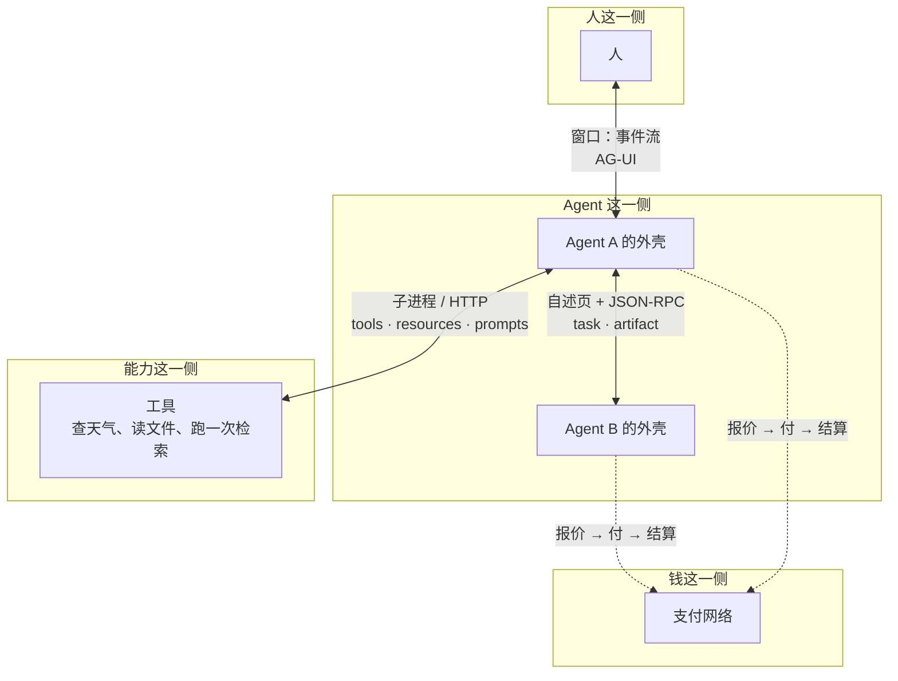
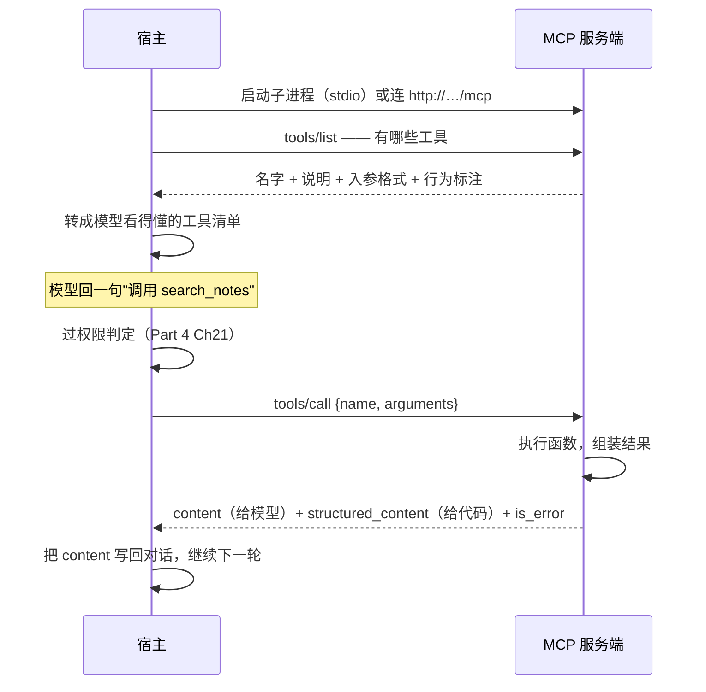
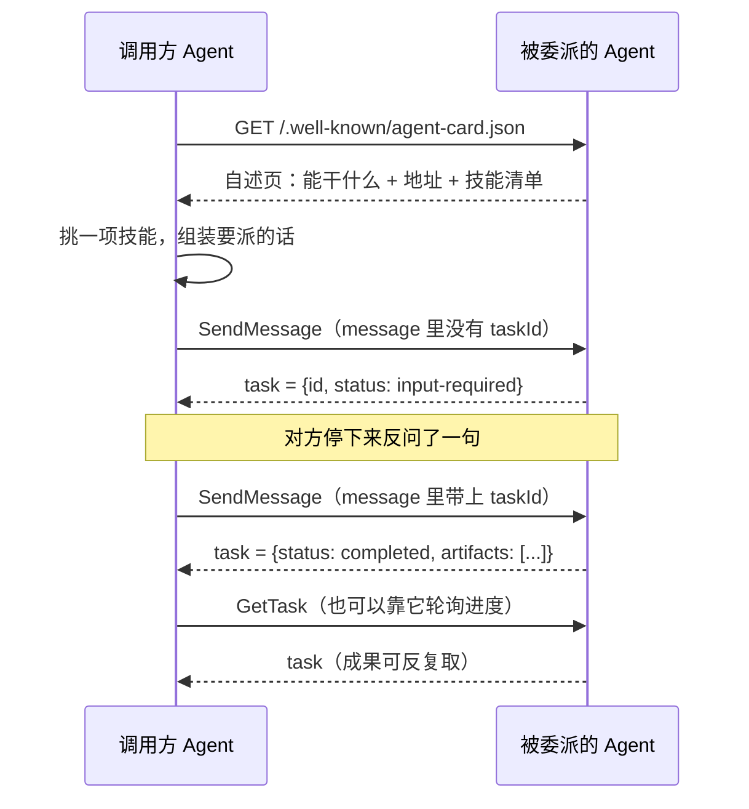
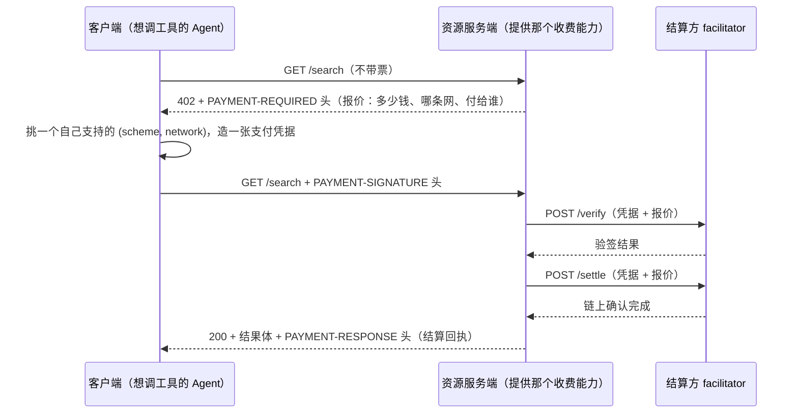

# Ch27 协议集成：把能力装上插座

> 手写三个协议的最小服务端与客户端，看懂 Agent 能力怎么对外通电。

## 本章目标

读完本章你应当能：

- 说清 MCP、A2A、x402 各自补哪一块缺口，在协议栈里分处哪几层
- 手写一个同时提供工具、数据和提示模板的 MCP 服务端，以及配套的客户端
- 手写一个 A2A 服务端的自述页与任务端点，以及配套的"发现—派活—轮询"客户端
- 说清 HTTP 402 在 x402 里承担的是哪一步，一条微支付链路要经过哪几次往返
- 面对一个陌生的外部能力，凭三条判据决定它该做成工具、资源，还是一个被委派的 Agent

## 本章导览

Part 4 花了整整两章讲协议本身长什么样：MCP 的三种原语（见 Part 4 Ch18），A2A 的自述页与任务状态机（见 Part 4 Ch19）。**那一层是"字典"——协议里每个词是什么意思。本章是"造句"——手上有一件具体的能力，怎么花几十行代码把它接出去。**

本章按"写代码的顺序"组织：没有协议的日子（27.1）→协议栈全景与判据（27.2）→MCP 服务端与客户端（27.3、27.4）→A2A 服务端与客户端（27.5、27.6）→x402（27.7）→三协议对照表（27.8）。

下面这张全景图是全章的锚，**它只回答一个问题：我要接的那个东西，到底该用哪个协议？**



读这张图有一个诀窍：**别把它当成四层，先认出它画了几条线。**

- 贴着"人"的那条实线，标的是 AG-UI——人看着 Agent 干活，屏幕上发生什么；
- 从 Agent A **往下**连到"能力"的那条实线，是 MCP——往下连，意思是"能力是被 Agent 调的"；
- Agent A 和 Agent B **平着**连的那条实线，是 A2A——平着连，意思是它不是下层，是**另一个平级的角色**；
- 往右伸的那两条**虚线**是 x402——虚线表示可选：不是每一步都要付钱，付不付看那一次调用的是什么。

所以图上画的是**三条实线加两条虚线**，不是叠起来的四层。**这四个能不能互相替换，取决于你要接的那个东西是"一个函数"、"一件要跑很久的活儿"，还是"一件要付钱的活儿"**——这正是 27.2 那张判据表要回答的问题。

关于 **AG-UI**，这里只做一行点名：它是连接前端应用与 Agent 后端的双向事件流协议，规范已发布到 1.0，传输走 HTTP + Server-Sent Events。**它管的是"人看着 Agent 干活时屏幕上发生什么"，和另外三个管的不是一件事，本章不展开。**

## 27.1 没有协议的日子：先把三段苦日子各演一遍

先反过来想：**没有协议的这三种接法，各自会过什么日子？**

**第一段，能力接不出去。** 你做了一个"查报销标准"的能力，手写成 `def get_reimbursement_rule(city)`。第二个用户用另一个 Agent 产品来了，接口改了、返回结构改了；第三个用户在别人的服务器上，你只能开个 HTTP 接口，鉴权怎么带、超时怎么算、报错怎么传，又要重来一轮。**问题出在函数签名是私有的**：它只在你和你的调用方之间有意义。一句白话说：**能力已经有了，只是没有插头。** 早年的电器每家都自己拉线；国标插座出来之后，电器厂商不必再关心你家的墙是怎么砌的——**协议不改变电器怎么工作，它只统一"怎么插上去"。**

**第二段，接进来的不是函数。** 如果对面那个东西不是函数，而是**一个要跑很久、中途可能要问人的独立程序**——比如"审这 30 页合同，审到第 12 页发现关键条款缺失，你是按通用条款补，还是先停下来问你"——一套一问一答就够用的接口就不够了。**你需要一个能挂着、能问、能交付的容器。**

**第三段，能力能用，但没人付得起。** 对方是一个 Agent，它没有银行卡，没有钱包，也没有一个能弹出"是否支付"对话框的人。合同里写"按次收费，每次 0.01 美元"，**它不知道怎么把这行字翻译成一次转账。** 传统的 HTTP 支付流程是为浏览器设计的：跳转收银台、用户输卡号、跳回来——这条路背后没有人。而**HTTP 402（Payment Required）这个状态码早就躺在协议里睡了几十年**，x402 做的事是把这个空位填上。

三段苦日子对应三个缺口：**接不出去（MCP）、接进来的不是函数（A2A）、付不了钱（x402）。**

## 27.2 三条判据：接到手的东西该怎么归类

**x402 不是和 MCP 并排的第四个协议，它是套在一次 HTTP 调用外面的一层信封。** 这解释了 27.7 那节为什么会把 x402 写在"某个工具要按次计费"的语境里。

那为什么不干脆做一个万能协议？**因为它们约束的东西根本不是一类。** MCP 约束的是**一次调用的形状**（叫什么名字、要哪些参数、失败怎么表示），它对"这件事要花五分钟、中途要问你"完全无话可说；A2A 约束的是**一件事的生命周期**，它对"你传三个参数、我返回一段文本"这种小事太重；x402 约束的是**一次调用之前的钱怎么到位**，它对参数和返回都无所谓。

于是有了本章最实用的一张判据表：

| 问题 | 答案 | 结论 |
|---|---|---|
| 被调用方是一个**函数**（瞬时返回、不反问）吗？ | 是 | 用工具类接口，MCP |
| 被调用方是一个**会自己规划、可能中途反问、可能跑很久的独立程序**吗？ | 是 | 用委派类接口，A2A |
| 这次调用**需要付钱**吗？ | 是 | 在外面套一层 x402 信封 |

三条不互斥：**同一次调用完全可以既被委派、又付费**——把一次委派接上一个付费信封，就是三者叠加的样子。

## 27.3 MCP 最小服务端：三种原语一次写齐

Part 4 Ch18 已经把三种原语的分界线划清楚了，这里只回顾一句话：**工具由模型决定要不要调，资源由应用决定端哪一份上来，提示模板由人决定用不用。** 三者在代码里的写法几乎一样——都是在函数上挂一个装饰器。**分界线不在代码里，在"谁来决定用它"。**

**27.3 与 27.4 的代码都节选自 `code/part-5/mcp_server.py`（服务端）与 `code/part-5/mcp_client.py`（客户端）：**

```python
from mcp.server import MCPServer
from mcp.types import ToolAnnotations

# 构造函数只回答"我是什么"：名字、版本、给客户端看的一句话说明。
# 端口、路径这些"怎么被访问"的东西属于 run()，写在这里会直接 TypeError。
mcp = MCPServer(
    "读书笔记库",
    version="1.0.0",
    instructions="一个演示用的笔记库。改动写操作前请先问人。",
)


# ---- 中间略：记忆体 NOTES 与 _next_id() ----


@mcp.tool(
    title="检索笔记",
    annotations=ToolAnnotations(read_only_hint=True, open_world_hint=False),
)
def search_notes(keyword: str, limit: int = 5) -> str:
    """在笔记里按关键词检索，返回最多 limit 条的标题与 id。"""
    # ---- 函数体略：就是一段列表推导 ----
```

就这么多。**没有 JSON Schema、没有请求解析、没有校验代码、没有协议处理。** 给新同事安排工位要填一张**入职登记表**（姓名、岗位、简介、要填哪几栏、有没有破坏性操作的风险等级），`@mcp.tool()` 就是那张表：**姓名取自函数名，简介取自 docstring，要填哪几栏取自类型注解**，这三样 SDK 替你填；`title=` 和 `annotations=` 是留给你的补充栏。

**表是别人填的，但你得知道表上有什么**——因为宿主要拿着这张表做决定。`annotations` 尤其要当心：它给的是**行为提示**，官方文档说得很直白——提示可以被无视，**永远不要依赖客户端遵守它**。真正拦不拦这次调用，是宿主在收到模型意图之后、发请求之前做的事（见 Part 4 Ch21）。

> ⚠️ **本书写作时官方 Python SDK 最新版为 2.x。1.x 里的 `FastMCP` 更名为 `MCPServer`，导入路径变成 `mcp.server`；旧的 `mcp.server.fastmcp` 模块已被删除。** 抄到旧教程里的 `from mcp.server.fastmcp import FastMCP`，在 2.x 上报的是 `ModuleNotFoundError` 而不是 `AttributeError`——这就是"读任何协议文档先确认版本"那条纪律的一个具体代价（见 Part 4 Ch18 18.7.4）。下面两节的示例统一用 2.x 的写法。

### 27.3.1 工具：给模型的动词

```python
@mcp.tool(
    title="新建笔记",
    annotations=ToolAnnotations(read_only_hint=False, idempotent_hint=False),
)
def create_note(title: str, body: str) -> str:
    """新建一条笔记，返回它的 id。"""
    note_id = _next_id()
    NOTES[note_id] = {"title": title, "body": body}
    return note_id
```

`title=` 是给人看的，界面上显示"新建笔记"而不是 `create_note`。`read_only_hint=False` 声明它会改动东西——**一个写操作必须说这个**，宿主据此决定要不要先问你一句。`idempotent_hint=False` 声明调两次和调一次不一样（幂等就是"调几次都一样"）。规范写明这一栏**只在 `read_only_hint=False` 时才有意义**：一个只读工具重复调用本来就没有副作用，再声明一次幂等是废话。而 `body: str` 这个注解就是全部的接口契约，你不需要手写 JSON Schema（Part 5 Ch23 讲过工具契约）。

### 27.3.2 资源：给应用的地址

资源是三种原语里唯一一个**用 URI 而不是函数名当主键**的。

```python
@mcp.resource("notes://index")
def note_index() -> str:
    """当前所有笔记的清单，一行一条：id + 标题。"""
    return "\n".join(f"{nid}\t{note['title']}" for nid, note in NOTES.items()) or "（空）"


@mcp.resource("notes://{note_id}/body")
def note_body(note_id: str) -> str:
    """一条笔记的正文。URI 里的 {note_id} 必须和函数参数同名，否则导入即报错。"""
    note = NOTES.get(note_id)
    if note is None:
        raise ValueError(f"没有这条笔记：{note_id}")
    return note["body"]
```

**第一条固定地址，第二条地址模板。** 模板里的 `{note_id}` 不是随便写的花括号，它是一份契约：

> URI 里占位符的名字，**必须和函数参数的名字完全一致**。写成 `{id}` 而参数叫 `note_id`，装饰器会在**导入时**就拒绝加载这个模块，报一个说清了两边名字的 `ValueError`。
>
这条限制挡住的是一整类线上事故。还有两条值得带走的规则：**资源函数在列清单时不会执行**，只有真的去读那个 URI（`resources/read`）时你的函数才跑；**返回值类型决定它怎么被送回去**（`str` 是文本，`bytes` 变 base64，`mime_type=` 是你自己声明的，SDK 不替你猜）。

### 27.3.3 提示模板：给人准备的开场白

第三种原语返回的不是数据，是**一段可以直接塞进对话框的消息**。

```python
from mcp.server.mcpserver import AssistantMessage, Message, UserMessage


@mcp.prompt(title="两分钟读完一篇笔记")
def summarize(note_id: str) -> list[Message]:
    """生成一段"请把这篇笔记讲给我听"的多轮对话。"""
    note = NOTES.get(note_id, {"title": "（未命名）", "body": ""})
    return [
        UserMessage(f"先通读这篇《{note['title']}》，然后准备一段口头讲解。\n\n{note['body']}"),
        AssistantMessage("读完了，我准备好了。"),
        UserMessage("请讲一遍，控制在 120 字以内，不要罗列原文。"),
    ]
```

**类比：便利贴模板**（Part 4 Ch18 18.4.4 建立的，这里落到代码上）。返回 `str` 会变成一条用户消息；返回一个消息列表则铺一段多轮对话的开头。**上面这个例子有个值得学的设计**：它把"限 120 字"放在最后一条用户消息里，而不是塞进一条大提示词——**越靠近生成位置的要求越有效**（Part 4 Ch20）。

### 27.3.4 两种传输入口：stdio 与 Streamable HTTP

服务端写完了，怎么跑起来？只有一行：

```python
if __name__ == "__main__":
    mcp.run()
```

**不写参数就是 stdio**：宿主把你的文件当子进程拉起来，请求写进它的标准输入，响应从标准输出读回来。**没有端口。** 这是本地 server 的默认形态。想上端口就换一行 `mcp.run(transport="streamable-http", port=3001)`，客户端随后连 `http://127.0.0.1:3001/mcp`。

这里有一条**极容易写反、而且写反了报错信息完全帮不上忙**的规则：**传输参数属于 `run()`，不属于 `MCPServer(...)`。** 构造函数回答的是"我是什么"，`run()` 回答的是"我怎么被访问"。把 `port=` 写进构造函数，你会收到一个 `TypeError: unexpected keyword argument 'port'`——**这个错在 MCP 还没参与之前就发生了**，所以任何查 MCP 文档的尝试都找不到它。

`run()` 上还有几个常用开关：`host` / `port`、`streamable_http_path`、`stateless_http=True`（每个请求一条新连接，不记会话）。**最后这个值得留意**：Part 4 Ch18 18.6 讲过 2026-07-28 版把**隐式的会话**从协议里拿掉了、`Mcp-Session-Id` 这个头也移除了——你还看到教程教怎么维护那个 ID，那是旧版文档。SSE 传输在 2025-03-26 那次修订里就被取代了。



对照着这张图看：**中间那两步（转成工具清单、过权限判定）一个都不在协议里。** 这正是职责四（协议接入）在七大职责里的位置（见 Part 4 Ch17 §17.4.4）。

**至此，一个 MCP 服务端的全部内容都在这儿了**：三种原语各一个装饰器，再加一行 `mcp.run()`。你写的 Python 代码行数，约等于要回答的问题数——**协议替你省掉的，恰恰是那 80% 的 JSON 搬运。** 下面 27.4 换个方向，把同一份服务端从另一头看一遍。

## 27.4 MCP 最小客户端：发现 → 调用 → 处理结果

客户端要做的事就三件：**问它有什么、要一个、拿到结果之后判断成功还是失败。**

```python
# 传一个 URL 字符串，Client 就按 Streamable HTTP 连——这是你部署时用的那种。
async with Client(SERVER_URL) as client:
    # 第一步：发现。这一步拿回来的每一项，就是宿主要塞进工具清单的东西。
    listed = await client.list_tools()
    for tool in listed.tools:
        print("·", show_tool(tool))

    # 第二步：调用。注意失败不是一个异常，而是一个结果对象——先看 is_error。
    created = await client.call_tool(
        "create_note", {"title": "读后感", "body": "这本书让我重看了三遍目录。"}
    )
    # ---- 后面处理结果的四行，见 27.4.2 ----
```

**传一个 URL 字符串就等于选了 Streamable HTTP**（本例的 `SERVER_URL` 就是 `http://127.0.0.1:3001/mcp`）。客户端靠参数类型判断怎么连：传 `StdioServerParameters` 就把 server 文件当子进程拉起来走 stdio，传 server 对象本身则进程内直连、不开进程不占端口。**三种连法都在 `code/part-5/mcp_client.py` 里**，正文这里只留最常用的 HTTP 一种。

### 27.4.1 发现：把协议返回变成工具清单

`list_tools()` 拿回来的每一项，就是宿主要往模型的工具清单里塞的一行。这中间的翻译工作属于外壳，不属于协议。一个诚实的提醒：**服务端写的 docstring 就是模型看到的那句话，没有第二次机会去润色。**

### 27.4.2 调用：失败不是一个异常

这是本章最想让你记住的一段：

```python
created = await client.call_tool(
    "create_note", {"title": "读后感", "body": "这本书让我重看了三遍目录。"}
)
if created.is_error:
    # is_error 为真时 structured_content 可能是 None，务必先判它。
    print("工具内部报错：", created.content)
    return
note_id = created.structured_content["result"]
print("建好了：", note_id)
```

**先判 `is_error`，再碰别的字段。** 原因有两条：**调用一个不存在的工具不会抛异常**——你会拿到一个同形状的结果对象，只是 `is_error` 为真；**`is_error` 为真时 `structured_content` 可能是 `None`**——顺序反了就会在 `None` 上取键，抛出一个跟真实原因八竿子打不着的 `TypeError`。

### 27.4.3 一份结果，两个读者

一次调用回来三个字段，各有各的读者：`content` 给模型（内容块，通常是文本）、`structured_content` 给你的代码（已解析好的 JSON）、`is_error` 也是给你的（布尔）。两份内容都在时文档说这是**有意重复一次**，不是冗余：`content` 要能被模型直接读进对话，`structured_content` 要让你的代码不用再解析字符串。**同一件事，两种读者，两个格式**——这与 Part 5 Ch26 讲过的信封契约是同一个思路，`content` 就是那份 `stdout`。

### 27.4.4 资源与提示：不经过模型

这一节的几种调用，分属三条不同的"谁来决定"：

| 调用 | 谁决定用它 | 一句提醒 |
|---|---|---|
| `list_tools()` / `call_tool()` | 模型 | 就是 27.4.1 和 27.4.2 讲的那两步 |
| `list_resources()` / `read_resource()` | 应用 | 带 `{}` 占位符的资源**不在** `list_resources()` 里，而在 `list_resource_templates()` 里；`read_resource()` 传一个普通字符串 URI，客户端自己拿它去匹配模板 |
| `get_prompt()` | 人 | 参数**永远是字符串到字符串**，所以别设计成"传一个数字进来"，设计成"选一个 id" |

**至此，一个 MCP 客户端的全部内容都在这儿了。** 剩下的事情——权限怎么判、结果怎么写回上下文、工具清单怎么组织——都是外壳的活儿，Part 5 Ch23 到 Ch26 各管一段。

## 27.5 A2A 最小服务端：一份自述页 + 两个方法

先回顾判据：**被调用的东西如果会自己规划、可能中途停下来反问、可能跑很久，它就不是工具，它是一个 Agent。** A2A 只规定四个动作——怎么找到对方、怎么派活、怎么知道进度、怎么取成果。**类比换一个：外卖平台。** 商家页面写着卖什么；你下了单，订单有状态；中途商家打电话问"要不要加辣"，你答完他继续做；最后送到你手上。

### 27.5.1 自述页：我能干什么，地址在哪儿

Agent Card 的地址是规范定死的（`/.well-known/agent-card.json`），零配置发现的意思就在这里。它长这样（节选自 `code/part-5/a2a_server.py`）：

```python
def agent_card() -> dict:
    """自述页。地址被规范定死，拿到域名就能找到你。"""
    return {
        "protocolVersion": PROTOCOL_VERSION,
        "name": "行程整理助手",
        "description": "把一堆零散行程排成一份可执行的时间表，只排表不出门。",
        "version": "1.0.0",
        "url": BASE,
        "preferredTransport": "HTTP+JSON",
        "capabilities": {"streaming": False, "pushNotifications": False},
        "skills": [
            {
                "id": "itinerary",
                "name": "行程排程",
                "description": "输入若干条零散行程，输出一份带先后顺序与冲突提示的时间表。",
                "tags": ["travel", "planning"],
                "inputModes": ["text/plain"],
                "outputModes": ["text/markdown"],
            }
        ],
        # 鉴权方案在这里声明，客户端据此决定要不要先换票。演示用 Bearer 即可。
        "securitySchemes": {"bearer": {"type": "http", "scheme": "bearer"}},
    }
```

**写这份自述页的时候，脑子里要有一个陌生人。** `description` 是给对方**判断要不要派活**用的，"只排表不出门"这半句划出了边界。一个自测：**把这份自述页交给一个完全不知道你这套系统的人读，他能判断出该不该派活吗？** 读不出来，说明 `skills[].description` 写得太笼统。

顺带说两个读代码时容易划过去的地方。`"protocolVersion"` 写的是变量 `PROTOCOL_VERSION` 而不是字面的 `"1.0"`，因为协议版本是要跟着一路升的——填字面量就等于给自己埋一个**升版本时必然漏改**的点。同理，`"url"` 和 `"preferredTransport"` 成对出现：**地址和走哪条路是一起声明的**，少写一个，客户端就得靠猜。

### 27.5.2 任务端点：整个 A2A 的会话逻辑就在一个字段上


```python
def send_message(params: dict) -> dict:
    """JSON-RPC 的 SendMessage：有 taskId 就是接话，没有就是开新单。"""
    message = params.get("message", {})
    text = "".join(p.get("text", "") for p in message.get("parts", []))
    task_id = message.get("taskId")

    if task_id is None:
        # 第一次派活：先承认收到，再把最该问的那一句问回去。
        task = {"id": str(uuid.uuid4()), "contextId": str(uuid.uuid4())}
        TASKS[task["id"]] = task
        _status(task, "TASK_STATE_SUBMITTED")
        _status(task, "TASK_STATE_INPUT_REQUIRED", "你打算哪天出发？我按这天重排一遍。")
        return task

    task = TASKS.get(task_id)
    if task is None:
        raise KeyError(task_id)

    _status(task, "TASK_STATE_COMPLETED")
    task["artifacts"] = [
        {
            "artifactId": str(uuid.uuid4()),
            "name": "行程表",
            "parts": [{"text": f"已按「{text}」排定：\n1. 09:00 出发\n2. 14:00 抵达"}],
        }
    ]
    return task
```

**整段代码里，A2A 的"灵魂"就是 `task_id is None` 这个判断。** 有它，才有"接话"这个概念；所有对话都变成一次性调用的话，A2A 就退化成了 MCP。状态机的九个取值（`TASK_STATE_UNSPECIFIED` 是 proto3 的默认占位值，讲解时不算）Part 4 Ch19 已经逐个走过，这里只强调两条：**`input-required` 不是失败**，它是一个正常状态，表示"这活儿还活着，在等一句话"；**`artifact` 和过程消息分开存放**，成果要能被反复取，过程是流水。

### 27.5.3 错误怎么表达：协议里容易写错的一格

⚠️ **这一格先说清一件事：A2A v1.0 有三种协议绑定，每一种都规定了各自的错误格式。** 别把某一种当成"A2A 的错误格式"——这是初学者最容易踩的坑。

| 绑定 | 规范位置 | 错误长什么样 |
|---|---|---|
| JSON-RPC | §9.5 | JSON-RPC 2.0 error object：`{code, message, data}`，`data` 是**数组** |
| gRPC | §10.6 | `google.rpc.Status`，细节装在 `status.details` 里 |
| HTTP+JSON/REST | §11.6 | 也是 `google.rpc.Status` 的 JSON 写法：`{error: {code, status, message, details}}` |

三行里只有第一行长得跟另外两行不一样：**gRPC 和 REST 其实是同一种形状**（`google.rpc.Status`），差别只在它怎么送（状态码 vs gRPC 状态枚举）。JSON-RPC 那条最特殊——它把细节字段叫 `data`，另外两条都叫 `details`。

**本章这份示例走的是 JSON-RPC 绑定**，所以按 §9.5 要用标准 JSON-RPC 2.0 error object（方法不存在用 `-32601`，业务层找不到用 `-32001`）：

```python
        self._reply(200, {"jsonrpc": "2.0", "id": rid, "error": {"code": code, "message": message}})
```

注意 HTTP 状态码仍然是 **200**——JSON-RPC 把"传输成功但方法失败"放在响应体里表达。

**照抄旧教程最容易踩的一格在这里。** v0.3 时代 REST 绑定用的是 `application/problem+json`——一种通用的"问题详情"格式，`{"title": ..., "status": 404}` 就是那个时代的形状，网上和早期模型里到处都是。**v1.0 已经改掉了**，改用上面第三行那种 `google.rpc.Status` 写法，Content-Type 也换成了 `application/a2a+json`。`problem+json` 在 v1.0 规范里只剩两处用到——协议版本协商失败、查询参数不合法——都不是任务错误。**读到旧代码里的 `{"title": ..., "status": ...}`，先怀疑它是 v0.3。**

**还有一处变动容易漏掉**：`data` 字段的形状在 v1.0 变过。v0.3 时代 `data` 是一个自由对象，v1.0 改成了**一个数组**，里面放带 `@type` 的结构化对象：

```json
"error": {
  "code": -32001,
  "message": "Task not found",
  "data": [{
    "@type": "type.googleapis.com/google.rpc.ErrorInfo",
    "reason": "TASK_NOT_FOUND",
    "domain": "a2a-protocol.org"
  }]
}
```

所以真实客户端**解析时要按数组读**，并且**按 `reason` 分支，而不是按数字码分支**。为什么？规范 §5.4 那张对照表里，`TaskNotCancelableError`、`PushNotificationNotSupportedError`、`UnsupportedOperationError` 全都映射到 **HTTP 400**——换到 gRPC 或 REST 绑定，好几种错误会挤进同一个码。**走 JSON-RPC 时数字码确实分得开**（`-32001` 到 `-32008` 一家一个），但 `reason` 是三种绑定都有的那一个，按它写才是能换绑定的写法。顺便说，本章示例里那个 `-32001` 不是随便挑的——规范 §5.4 里 `TaskNotFoundError` 的 JSON-RPC 码正是 `-32001`。

## 27.6 A2A 最小客户端：发现、派活、轮询

下面是 `code/part-5/a2a_client.py` 的节选。四步和外卖下单一模一样：看商家页、挑一项技能、下单、查物流。**第一步是零配置的**——地址是规范定死的，拿到域名就完成了发现。第三步是派活：

```python
reply = _post(
    {
        "jsonrpc": "2.0",
        "id": 1,
        "method": "SendMessage",
        "params": {"message": text_message("帮我把下周的行程排一下")},
    }
)
task = reply["result"]["task"]
task_id = task["id"]
```

**`id` 这个字段是 JSON-RPC 的地基**（Part 4 Ch18 18.6.2 解释过：它是这次提问的编号，答复要靠它对回问题），换掉任何 SDK 你也得自己处理它。第四步（轮询）才是这一节真正值得学的部分：

```python
for _ in range(3):
    if task["status"]["state"] == "TASK_STATE_INPUT_REQUIRED":
        question = task["status"]["message"]["parts"][0]["text"]
        reply = _post(
            {
                "jsonrpc": "2.0",
                "id": 2,
                "method": "SendMessage",
                "params": {"message": text_message("下周三", task_id)},
            }
        )
        task = reply["result"]["task"]
        continue

    # 没停在等你回话上，就真的去问一次进度。这才是"轮询"。
    reply = _post(
        {"jsonrpc": "2.0", "id": 3, "method": "GetTask", "params": {"id": task_id}}
    )
    task = reply["result"]["task"]
    if task["status"]["state"] == "TASK_STATE_COMPLETED":
        break
    time.sleep(1)
```



**这个循环体的形状，比它里面的任何一行都重要。** 它必须同时应付三种情况：还在做，就用 `GetTask` 轮询；做完了，就取 `artifacts`；**要你回话，就把那句话转交给人**，拿到答案后再发回去。

最后一种是 A2A 客户端里唯一"有产品味道"的代码：**`input-required` 意味着对方 Agent 想说话，而对面坐着的是你的用户。** 你怎么把这句话呈现出来、答案怎么递回去——协议一个字都没规定，因为 A2A 到这里已经出了它的辖区。**那个口子在哪、谁来点，取决于你的外壳**（职责七，见 Part 4 Ch17）。

## 27.7 x402：让机器替自己付钱

### 27.7.1 402 的语义：这个状态码在等一份报价单

**HTTP 402（Payment Required）** 是 HTTP 状态码表里的一个空位，定义了几十年，几乎没被真正用过。**它的字面意思就一句：这次请求我需要你付钱，而且我会告诉你怎么付。** 拆开是三件事：**要付**（而不是"必须登录"或"出错了"）、**需要付**（因此附带一份报价）、**我能告诉你怎么付**（因此附上付款条款）。x402 把这三件事标准化了：

下面这张图里有个新角色，先给它起个名字：**结算方 facilitator**——夹在你和对方之间的一个中介。它替你验票、替你把账结清，客户端和服务端都不用直接碰那条链。



**这张图里最要紧的是那个顺序：先验后干。** 服务端在验证通过之前绝不能开始干那件收费的事——这是整个协议唯一的硬约束，也是它和"先给结果回头再要钱"的本质区别。

### 27.7.2 客户端怎么付：不谈 gas，不谈私钥

x402 有一条设计原则决定了 Agent 能不能用这条链路：**客户端和服务端都不需要考虑 gas（每笔交易的手续费）、RPC（跟区块链说话的那套接口）或者别的链上细节——这些被抽象进了 facilitator。** 换个说法：**Agent 不需要自己是一条链。** 它手里可能只有一个受限制的钱包地址，甚至只是一个签名接口。配套的还有一条"信任最小化"原则：**除了符合客户端本意的付款，任何一方都不许替客户端挪动资金。**

### 27.7.3 scheme 与 network：成对支持

报价单上有一对字段，客户端必须**成对**匹配：`scheme`（方案）说的是钱**怎么走**的逻辑，例如 `exact` = 服务端报一个确定数额，你照数付；`upto` = 你只授权一个**上限**，最后按实际用掉多少结算（按 token 计费就走这一种）；`network`（网络）说的是在**哪条**网络上执行。

**为什么必须成对？** 因为同一种"怎么走"在不同链上实现起来完全不同。客户端和结算方必须显式支持某个组合，才能造出正确的凭据。实践含义很直接：**你的 Agent 要能付钱，第一步不是去申请什么，而是先看清楚自己支持哪几个 `(scheme, network)` 组合**——报价单上的组合一个都不支持，那就只能返回失败。

### 27.7.4 落到 Agent 上：一个工具怎么变成收费工具

**记住 x402 是套在一次 HTTP 调用外面的信封，不是并列的第四层。** 所以它在宿主里的位置是：模型说"调 summarize 这篇笔记"→ 工具清单里 summarize 这条多了一个标记：收费 → 宿主决定钱从哪个钱包出、上限多少、超了要不要问人 → 收到 402 后挑组合、造凭据、带票重试（27.7.1 那张图）→ 拿到结果 + 结算回执。

**这里有三个判断点，一个都不在协议里，但每一个都决定这套东西能不能上线：**

1. **钱从哪儿出。** 哪个钱包、什么额度上限、要不要人批。这属于职责一（工具与权限，见 Part 4 Ch21）——**一次会花钱的调用，权限门槛必须比只读调用高得多。**
2. **能不能自动重试。** 带上凭据重试在协议上是合法的，但**钱已经付过一次了**。Part 3 Ch11 11.3 那句"会改动世界的动作每一次都要过一道闸"在这里适用得最狠。
3. **回执要不要记账。** `PAYMENT-RESPONSE` 头带着结算结果，这条记录要落进会话状态（职责六），否则事后你没法回答"上周付了几次钱"（见 Part 6 Ch29）。

## 27.8 三个协议的对照

| 维度 | MCP | A2A | x402 |
|---|---|---|---|
| **谁调谁** | 宿主（harness）调 server | 一个 Agent 调另一个 Agent | 客户端给资源服务端付款 |
| **粒度** | 一次函数调用 | 一件事（可跨天） | 一次 HTTP 调用（横切） |
| **失败怎么表达** | `is_error` 标记的结果对象 + JSON-RPC error | 任务状态本身（`failed` / `rejected` / `input-required`） | 状态码回到 402，报价单再来一次 |
| **能不能中途反问** | **不能**。这是它与 A2A 的分水岭 | **能**，状态机为此专门留了 `input-required` | 不关它的事，它只管钱 |
| **一个具体的例子** | 模型说"检索笔记里含'目录'的"，宿主过完权限判定后发 `tools/call`，回一段文本加一份结构化结果 | 你说"排一下下周行程"，对方回 `input-required` 问"哪天出发"，你补一句，两秒后拿到一份时间表 | 你调一个外部检索接口，对面回 402 加"10000 单位给某地址"，你签一张票重试，拿到结果和一张结算回执 |
| **对应的外壳职责** | 职责四 协议接入 | 职责四 + 职责六 会话与状态 + 职责七 投递接口 | 职责一 工具与权限 + 职责六 |

**读这张表最有用的一行是"能不能中途反问"。** 它是 MCP 和 A2A 之间唯一真正本质的分界：不是"谁更快"，不是"谁更复杂"，而是**这个能力会不会需要你的用户补一句话**。需要，就不是工具。

## 本章小结

- 四个协议各管一段，**互不替代**：MCP 管能力接入、A2A 管 Agent 之间的协作、AG-UI 管人和 Agent 的交互、x402 管一次调用上的钱。它们约束的根本不是一类东西——这也正是"把它们叠成四层"那张图画不出来的原因。
- MCP 服务端的核心是**在函数上挂一个装饰器**：名字取自函数名、描述取自 docstring、入参格式取自类型注解；`annotations` 是给客户端的提示，不是安全保证。客户端三步是**发现、调用、判断**，最容易踩的是**先判 `is_error` 再碰 `structured_content`**——调用不存在的工具也不抛异常，而 `is_error` 为真时后者可能是 `None`。
- A2A 服务端代码量更小，因为它**不做发现、不做工具注册、不做权限判定**。它的灵魂是 `task_id is None` 这个判断——有它才有"接话"，没有它 A2A 就退化成 MCP。**错误格式按绑定而定**（见 27.5.3）：走 JSON-RPC 绑定用标准 JSON-RPC 2.0 error object（规范 §9.5，细节字段叫 `data`），走 gRPC 或 REST 绑定用 `google.rpc.Status`（细节字段叫 `details`）——**`application/problem+json` 已经是 v0.3 的老格式，别再照抄**；客户端的循环体必须同时应付"还在做""要你回话""做完了"三种情况。
- x402 的 402 是"这次请求需要付钱，并且我会告诉你怎么付"。链路是 **402 + 报价 → 造凭据 → 带凭据重试 → verify → settle → 200 + 回执**，硬约束是**先验后干**。它是**信封不是层**：客户端不用碰 gas 和 RPC。

**与前面的接缝。** 本章的三个最小实现都是**各自独立**的：MCP server 不知道 A2A 客户端存在，x402 信封也不知道自己包着一次工具调用。真实系统里更常见的情况是——**同一个能力要同时被本地的 Agent 和远端的 Agent 用到，其中一部分还要收费**。这就把三个问题挤到了一起：一个能力怎么按权限分成不同档？多个 Agent 同时调一个服务端时状态怎么不打架？

前一个问题——**一个能力怎么按权限分成不同档**——本章的三条判据表（见 **27.2**）给了分类的方法，真落到「哪些档放行、哪些要问人」是 Part 4 Ch21 的权限策略。后一个问题——**多个 Agent 同时调一个服务端时状态怎么不打架**——是 Part 5 Ch25 的主题，尤其要看 **25.7.2「共享状态：一块谁都能写、谁都能读的白板」**，那里讲的正是并发调用同一服务端时的状态归属。本章之后是 Ch28，把 Part 5 的五块积木收成一张图并接上 Part 6。

## 本章参考

### 必读

以下页面是写作时实际访问并逐条核对过的，本章的协议事实全部以它们为准：

- [MCP 规范（2026-07-28，写作时最新版）](https://modelcontextprotocol.io/specification/2026-07-28/)——本章涉及的传输与原语以这一版为准。
- [MCP Python SDK 文档](https://py.sdk.modelcontextprotocol.io/)——`MCPServer` / `Client` 的 API；[Tools](https://py.sdk.modelcontextprotocol.io/servers/tools/) / [Resources](https://py.sdk.modelcontextprotocol.io/servers/resources/) / [Prompts](https://py.sdk.modelcontextprotocol.io/servers/prompts/) 三页给出三种原语的写法与占位符规则；[Running your server](https://py.sdk.modelcontextprotocol.io/run/) 是"传输参数属于 `run()`"那条规则的出处；[Clients](https://py.sdk.modelcontextprotocol.io/client/) 是 `content` / `structured_content` 分工的出处。
- [A2A v1.0 规范全文](https://a2a-protocol.org/v1.0.0/specification/)——自述页路径、任务状态取值、HTTP 绑定路径；错误格式看三节：JSON-RPC §9.5、gRPC §10.6、REST §11.6，错误码对照表在 §5.4。
- [x402 仓库 README](https://github.com/x402-foundation/x402)——27.7 全节的事实来源。**注意仓库已从 `coinbase/x402` 迁到 `x402-foundation/x402`，旧地址现在是开发分支。**

### 推荐教程 / 演示

- [x402 官网](https://x402.org/)——协议的对外表述与生态清单；页脚显示 x402 现为 LF Projects 成员。[AG-UI 文档](https://docs.ag-ui.com/introduction)——事件族的完整定义（本章只做一行点名）。
- [x402 规范目录](https://github.com/x402-foundation/x402/tree/main/specs)——**本章唯一没有逐字段核到的部分**：两个 JSON 对象（报价与支付凭据）的字段名。对照这一节把 `code/part-5/x402_demo.py` 里的字段名逐个核一遍，是使用那段代码前的必要动作。

### 视频 / 课程

MCP 与 A2A 都有官方站附带的快速上手教程，但**协议更新速度快过大多数课程的制作周期**。以本章实际核对过的规范页与 SDK 文档页为准，比追课程更可靠。