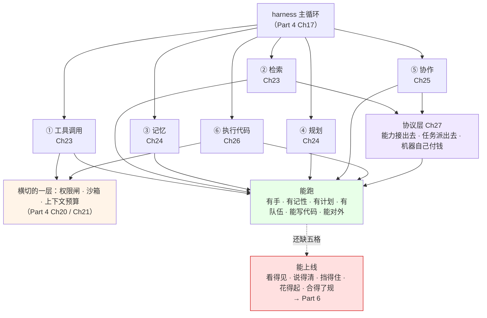

# Ch28 Part 5 小结与衔接 Part 6

> 一句话简介：把五章的积木收成一张图，再指出上线前还缺的五格。

## 本章目标

读完本章你应当能：

- 在一张图上指出 Part 5 的六块积木，分别补的是外壳七大职责（见 Part 4 Ch17）里的哪一格
- 拿到一个陌生的 coding agent，说出它缺哪些通用要素、缺的那条该找 Part 4 还是 Part 6
- 说出一个"能跑"的 Agent 上线后最先在哪一格出事，以及为什么在本地看不出来
- 完成两个练习：给本地 Agent 接一个 MCP server、让两个 Agent 通过 A2A 互派任务

## 本章导览

下面这张图是全章的锚。**它不引入任何新东西，只把 Part 2 的配料单（见 Part 2 Ch10）和 Part 4 的外壳（见 Part 4 Ch17）之间，那五章补上的东西摆平。**



图里有两个形状值得先记住：**实线那一圈是"长出来的能力"，橙色和紫色那两块是"长出来之前必须先有的墙与插座"。**积木可以后加，墙不能后补——这是 28.4 要算的那笔账。

## 28.1 引子：手里有了哪些积木

Part 2 Ch10 给你一张配料单：上下文、记忆、工具、规划、执行。Part 3 Ch11 给你装配图。Part 4 Ch17 告诉你外面那层壳该有哪七项职责。**Part 5 这五章做的事，是把配料单上的每一块真正装上去，并且配上插头。**

所以此刻你手里的东西是这样一个 Agent：

- 它有一副**能自己动手的胳膊**，还有一张**能查到公司知识的网**——前者是模型点名、外壳执行、结果回填，后者是先捞原文再回答（Ch23）。
- 它有一个**不会只涨不消的上下文**，还有**跨会话存得下、分档取得到**的记忆（Ch24）。
- 它能**先出计划再执行**，事情不对时改计划而不是硬撑（Ch24 四个接口）。
- 它能**拆成一支队伍**，队伍之间传话、抢活、崩了不连坐（Ch25）。
- 它能**自己写一段代码跑一遍**，而这段代码永远跑在一面墙里（Ch26）。
- 它做出来的这些能力**能通过公开协议接给别的进程、别的 Agent、别的机器**（Ch27）。

⚠️ 但这份清单里**没有**什么：没有账单，没有看板，没有攻击清单，也没有合规检查表。**Part 5 造的是一台能跑的机器，不是一台敢开机的机器。**两者的距离就是 28.4 的全部内容。

## 28.2 这六块怎么咬合：跟一个真任务跑一遍

积木单独看都懂，难的是它们在**同一个任务里前后咬住**。跟一件事走一遍：*"把这季度三条产品线的营收异常查清楚，写一份说明给我。"*

```text
用户："把这季度三条产品线的营收异常查清楚，写一份说明"

  ├─③ 记忆      捞出上次记下的"华东口径含退款"——没有这条，
  │             后面算出来的差异全是假的
  ├─② 检索      捞出"异常"的定义（阈值 15%）——捞不到就没有分母
  ├─④ 规划      出四步清单：取数 → 逐条对比 → 追问可疑项 → 成文
  ├─① 工具调用  取数、对比都顺；"追问可疑项"返回空数组
  │             → 失败被包成一句人话喂回去（Ch23 23.6）
  │             → 模型换个说法再查一次，这回命中
  ├─⑥ 执行代码  2000 行对比逻辑不靠模型口算，整段丢进墙里跑，
  │             拿回固定形状的 stdout（Ch26 26.5）
  ├─⑤ 协作      写手只拿到成稿，看不见原始数据；审稿人拿得到，
  │             能指着说"这句没有支撑"
  └─  横切一层   取数与跑代码两处过权限闸；那一千行 stdout
                 先遮罩再进历史，不顶爆窗口
```

看完这条链子，两件事不用背也记住了：

1. **每块积木单独看都解决不了这件事。**记忆答"上次怎么算的"，检索答"异常怎么定义"，规划答"按什么顺序做"，执行代码答"这一千次加总谁来算"。少任何一块，答案都会错，只是错法不同。
2. **积木靠接口咬合，不靠约定。**记忆给规划的是一句陈述句，检索给规划的是几段原文，工具给规划的是固定形状的 JSON。形状定死了，模块才能换。

## 28.3 通用要素自检表：拿它去量任何一个 Agent

下面这张表是本章最实用的一件东西：**拿到任何一个 coding agent——不管它叫什么名字——逐行往下走，答"有 / 没有"。**

先说它**为什么长这样**：它**不按产品分列，只按要素分行**。把某个产品的名字换成另一个产品，表里这一行仍然是同一件事——**这才是我们要抽出来的要素**；哪一行换个产品就不成立，那是产品特性。"落在哪一章"这一列只有六种取值：Ch23 到 Ch27，以及"未覆盖"。

| 通用要素 | 你刚见过的那个具体例子 | 落在哪一章 |
|---|---|---|
| 模型可以自己点名要调什么，不是一问一答 | 那个五步主循环；"没有工具调用"就是结束信号 | Ch23 |
| 工具说明书是一份契约，参数有结构化规格 | `get_weather` 的那张表，`required: ["city"]` | Ch23 |
| 一批调用之间有依赖就串行，没有就并行 | 查完 A 在售，才决定要不要查 B 的营收 | Ch23 |
| 工具失败会变成一句模型读得懂的话 | "调用失败：城市名只能是纯名称，请重试" | Ch23 |
| 外部知识靠检索接进来，不指望模型记得 | 三种检索范式；默认从最朴素那种起步 | Ch23 |
| 上下文不会只涨不消 | 窗口有预算、有驱逐，大块输出先遮罩 | Ch24（见 Part 4 Ch20） |
| 跨会话的东西分档存，不靠一次窗口 | 短时 / 中时 / 长时三层，中时那层带过期时间 | Ch24 |
| 过期的事实被标记失效，不是被静默覆盖 | 关系层里那两列生效与失效时刻 | Ch24 |
| 复杂任务先出计划再执行，计划中途可以改 | `plan` / `execute` / `replan` / `finish` 四个接口 | Ch24 |
| 产出在交付前过一道**独立**的检查 | 审稿人拿到的是原始数据，不是稿子里的说法 | Ch25 |
| 角色之间有明确的交接机制 | 把上游那段字符串塞进下游的下一次调用 | Ch25 |
| 压不进一句话的大件走文件系统 | 传 20 个路径，不传 20 篇全文 | Ch25 |
| 一个环节崩了不拖垮整组 | 任务图决定谁能跑、检查点决定从哪跑、重试范围决定跑多少 | Ch25 |
| 模型可以自己写代码跑，但代码永远在墙里 | 四档隔离，`run_python` 的固定形状契约 | Ch26 |
| 上限由流程给，不由模型填 | `timeout` 和 `network` 不是模型可填的字段 | Ch26 |
| 能力通过公开协议对外，不靠私有函数签名 | 一个装饰器就是一个 MCP 服务端 | Ch27 |
| 一次调用需要付钱时，机器能自己付 | 402 加报价 → 造凭据 → 带凭据重试 → 结算回执 | Ch27 |
| 跑出来的每一次调用都能被回放和归因 | —— | **未覆盖 → Part 6 Ch29** |
| 质量有一个分数，而不是只有 anecdote | —— | **未覆盖 → Part 6 Ch30** |
| 系统是持续被试探的，不只是"单次调用要合规" | —— | **未覆盖 → Part 6 Ch31** |
| 同一个任务能用更便宜的路走完 | —— | **未覆盖 → Part 6 Ch32** |
| 对外提供服务要满足监管的硬性要求 | —— | **未覆盖 → Part 6 Ch33** |

**怎么读这张表：前十七行是你已经装上的，剩下五行一行都没装。**这不是 Part 5 的疏漏——这五行都要求你先有数据、再有判断，而"数据从哪来"要到下一 Part 才回答。**六块积木全部在"造东西"，没有一块在"看东西"。**

⚠️ 表里**没有**"多 Agent 一定更好"这一行，也没有"用某家的框架"这一行。前者不是要素（Part 3 Ch14 已用整章说明它常常不划算），后者是产品特性。**要素和特性混在一起，这张表就没法拿去量别人。**

## 28.4 从"能跑"到"能上线"：那五格缺的是什么

先别急着列清单，先让疼一下。

上线第三周，一位用户发来一句："它昨天把我的配置改错了。"你想回答三个问题——**它当时看到了什么、动了什么、为什么放行**。三样都答不上来：日志里有四十万行文本，没有一次工具调用被记下是谁批准的；没有一条记录标出哪一轮特别慢；也没有一个数字告诉你这个用户花了多少钱。**你手上唯一有的，是 Part 5 那六块积木。**而本地开发时它们让你觉得一切正常——因为本地从来不出账单，也从来没有人算账。

这就是那道缝的真实形状。**五格，Part 5 一格都没碰：**

| 缺的格子 | 一句话后果 | 谁来答 |
|---|---|---|
| **可观测性** | 你只知道"它慢了"，不知道"慢在哪一轮、为什么慢"——优化只能靠猜 | Part 6 Ch29（已写） |
| **错误率与质量** | 你只有几个 anecdote，没有分数——改一版提示词，你不知道是变好还是变坏 | Part 6 Ch30 |
| **安全（被持续试探）** | Part 4 Ch21 装的是"单次动作前的闸"；挡不住的是"一次长会话里被一步步带过去" | Part 6 Ch31 |
| **成本** | Agentic 检索从 1 轮变 4 轮就是 4 倍开销（Ch23 自己算过这笔账）——一个重度用户能一天烧掉你一周的预算 | Part 6 Ch32 |
| **合规** | 数据出了境、记忆里存了什么、谁看过——这不是技术故障，是根本不能上线 | Part 6 Ch33 |

⚠️ **这五格都不在 Part 5 的射程里，因为它们全都建立在一个前提上：你得先能看见。**没有 trace，你算不出成本；没有 trace，你拿不到线上评测的数据；没有基线，红队回归无从对比。所以这五格不是五个平行的任务，是**一个地基加四层楼**——顺序不能乱。

**有一件事不要误会**：Part 5 不是漏做这五格，是做了取舍——理由在 Ch23 那张选型表里已经出现过一次：**先把它测准了再上生产**。一个你还看不见的 Agent 推上线，不叫勇敢，叫赌。

## 28.5 与 Part 6 的衔接

Part 6 回答一个问题：**这台能跑的机器，怎么被管住。**六章按依赖顺序排。

**地基是 Ch29（已写，见 Part 6 Ch29）。**它先立起一次请求的完整记录——三类记录、三张该盯的图。**没有这条记录，后面四章全都无从谈起**：成本归因要拿它算账，线上评测要拿它当数据源，红队回归要拿它当基线。

其余四章是并行的四层楼：**Ch30** 让质量有一个分数而不是几个 anecdote；**Ch31** 处理"单次调用都合规、整段会话被带沟里"的风险；**Ch32** 处理成本与速度；**Ch33** 处理监管的硬性要求。**Ch34** 收全书，用真实案例和一张知识地图把它们串一遍。

⚠️ 一条纪律先说在前面，它和 Part 4、Part 5 是同一条：**Part 6 讲的是通用要素。**监控平台、评测框架、路由器都只是"承载要素的那件东西"，点到名字、抽出模式就够，不做使用手册。**判断一份资料是不是你要的，就看它讲的是要素还是手册。**

## 28.6 写给读者的两个练习

理论收完，做两件事。**它们不是"再读一遍"，是你动手时会撞到墙、回头翻前面章节的地方。**

### 练习一：给自己的本地 Agent 接一个 MCP server

**做什么。** 你手上那个跑得起来的 Agent（哪怕只是 Ch23 那个五步循环），挑一个它现在**只能靠模型瞎猜**的领域——查报销口径、查内部接口文档、查一张静态价目表——做成一个 MCP server，让它通过协议而不是硬编码去拿。

**验收标准（三条都要过）：**

1. 用客户端连上去，`list_tools()` 拿回来的每一项，**description 单独读一遍就像一份能交给人的说明书**——不是函数名，不是 `Returns the value`。
2. 故意调错一次参数，确认拿到的是**一个 `is_error` 为真的结果对象**而不是一个异常。
3. 把 server 关掉，Agent 明确说"这个能力现在不可用"，而不是卡死或胡说。

**你会撞到的三个墙（撞到再回去翻 Ch27）：**资源 URI 里的占位符名必须和函数参数名**完全一致**，不一致会在**导入时**就报错；传输参数写在 `run()` 上，不写在构造函数里；客户端先判 `is_error` 再碰别的字段，因为调用一个不存在的工具也**不抛异常**。

### 练习二：让两个 Agent 通过 A2A 互派任务

**做什么。** 从练习一那个 Agent 里挑一个"**会自己规划、可能中途要反问、可能跑很久**"的能力单独做成 A2A 服务端，再让另一个 Agent 通过标准流程去调用它。

**验收标准（四条都要过）：**

1. 调用方**只凭域名**就完成发现——拉到那份自述页，**一个完全不知道你这套系统的人读完能判断该不该派活**。做不到，说明 `skills[].description` 写得太笼统。
2. 对话真的发生过一次往返：服务端回 `input-required` 反问一句，调用方把这句**转交给人**，拿到答案再发回去。
3. 成果能被反复取——拿 `taskId` 随时能再拉一次产物。
4. **故意调一个不存在的方法**，确认返回的是**标准的 JSON-RPC 错误对象**，且 HTTP 状态码仍然是 200。

**你会撞到的两个墙：**`task_id is None` 这个判断是 A2A 的全部灵魂——去掉它，A2A 就退化成 MCP，那个"中途反问"的能力凭空消失；`input-required` **不是错误**，把它当失败处理，客户端会在对方只是想问你一句话时直接放弃。

**它比练习一难，因为你要处理一个不完全受你控制的东西**——对面那个 Agent 有自己的计划和脾气。

## 本章小结

- **Part 5 的六块积木是：工具调用、检索、记忆、规划、协作、执行代码；协议层横切在最底下。**它们的共同点是全都在"造东西"，没有一块在"看东西"。
- **积木靠接口咬合，不靠约定。**输出形状定死了，模块才能换；横切的那一层（权限闸、沙箱、上下文预算）不属于任何一块，但每块都要穿过去（见 Part 4 Ch20 / Ch21）。
- **28.3 那张表按要素分行、不按产品分列。**换个产品名这一行仍然是同一件事——这才是要素。前十七行你已装上，最后五行一行没装。
- **那五行的共同前提是"你得先能看见"。**所以 Part 6 不是五个并列的专题，是一个地基加四层楼；而**能跑不等于能上线**——本地没有账单、没有对手方、没有人算账，这正是上线第三周开始出事的原因。

## 本章参考

本章不引入新代码，只列**回头复查用**的资料；出处在它原本那一章末尾已写全。

### 必读论文

- [Toolformer（Schick 等，2023）](https://arxiv.org/abs/2302.04761)——模型自己决定何时调工具的最早系统性工作，对应 Ch23。
- [Why Do Multi-Agent LLM Systems Fail?（Cemri 等，2025）](https://arxiv.org/abs/2503.13657)——Ch25 那张失败分类表的出处。
- [Judging the Judges（2024）](https://arxiv.org/abs/2411.15594)——Part 6 Ch30 的入口，本章只作前瞻。

### 推荐博客 · 教程

- [MCP 规范与 Python SDK 文档](https://modelcontextprotocol.io/) / [A2A v1.0 规范全文](https://a2a-protocol.org/v1.0.0/specification/) / [x402 仓库](https://github.com/x402-foundation/x402)——两个练习动笔前各回去核一次当前版本。
- `code/part-5/` 下的十四个示例文件——练习时**优先改现成的**。
- Part 4 Ch17 §17.4 的七大职责表——对照着看 Part 5 补的是哪几格、还空着哪几格。

### 视频 / 课程

本章刻意不列：全是"收口与对照"，视频的吸收率明显低于读原文。
