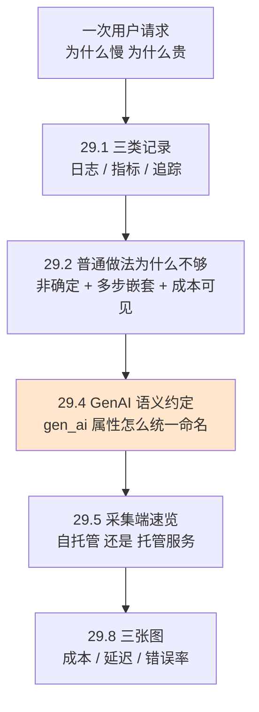
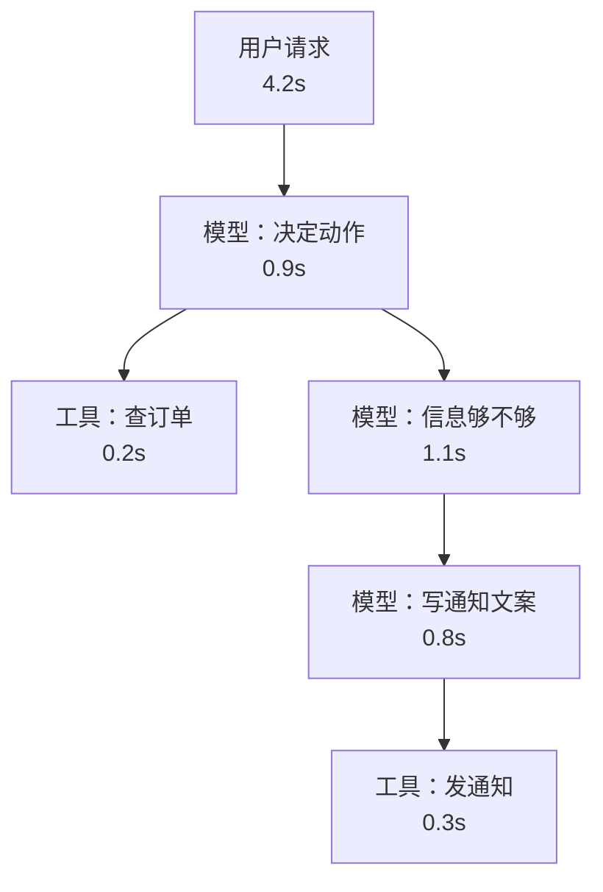

# Ch29 LLM-native 可观测性：让「这次请求为什么慢、为什么贵」有答案

> 把 Agent 的一次请求拆成看得见、点得动的记录。

## 本章目标

读完本章你应当能：

- 说清日志、指标、追踪各自回答什么问题，以及它们在一次 Agent 请求里怎么配合
- 解释为什么给大模型应用做可观测性，不能照搬普通 Web 服务的做法
- 说出 GenAI 语义约定里的 `gen_ai.*` 属性到底约定了什么
- 照着一次真实请求的形状，画出你自己的 span 嵌套图
- 从一条 trace 反推出三张该盯的图：成本、延迟、错误率

## 本章导览



29.3 讲一次请求的 trace 长什么样（本章唯一需要读者在纸上画一遍的地方），29.6 给出最小接入代码，29.7 讲部署取舍。**图里涂了浅橙色的那个节点是重心**——其他节点都围着它转，因为没有哪个采集端会替你发明属性名。

先说清本章与前文的边界：Part 4 讲过外壳（harness）的第 6 项职责「会话与状态」，那是**怎么记**（见 Part 4 Ch20）；本章讲**记下来的东西怎么变成能回答问题的视图**——同一条记录，用日志看是一行灰字，用追踪看是一棵能点开的树，用指标看是一条曲线。

## 29.1 三类记录：三种不同的问题

先演一次「什么都没有」的场景。你上线了一个客服 Agent，昨天用户抱怨「转人工之后要等很久」。你打开服务器，能看到的只有一行进程启动日志。三个问题随之而来：「很久」是多久？——**你不知道**，日志没记时间分布；是模型慢、工具慢还是排队慢？——**你不知道**，日志没记层次；昨天到底有多少次这样的慢请求？——**你不知道**，你没计数。

三种「不知道」恰好对应三种记录。下面用一次具体的订单查询摊开看：用户说「订单 A123 什么时候发货」，Agent 查了订单、发现地址不全、问了用户、最后发了通知。用户等了 4.2 秒。

| | 日志（Log） | 指标（Metric） | 追踪（Trace） |
|---|---|---|---|
| **白话** | 一行行文字，记下发生过什么 | 定期记一个数字，攒成曲线 | 把一次请求拆成若干步，记下谁调用了谁 |
| **生活类比** | 医院病历本上的一行行医嘱 | 体温计上的一格格读数 | 一次手术的流程记录单 |
| **这次请求里长什么样** | `order_lookup returned status=shipped` | `本次延迟 = 4.2s`、`本次成本 = 0.0031 元` | 一棵树：四个节点，带父子关系和各自耗时 |
| **回答什么问题** | 那一刻到底发生了什么 | 最近整体是变好了还是变差了 | 这一次慢在哪一步 |
| **能单独回答「为什么慢」吗** | 不能 | 不能 | **能** |

横着看下来，最后一行是全部要点：**只有追踪记下了结构**。那棵树的形状是外壳决定的——链路上每多一层决策，追踪树里就多一层。

trace 树里的每个方框叫一个 **span**（中文习惯译作「跨度」）。直白理解就是**一次操作的开始时刻、结束时刻，以及它的父子归属**；两个 span 构成父子，就得到那棵树。

## 29.2 为什么大模型应用需要一套「专门的」可观测性

给 Web 服务做了十几年的可观测性，套在 Agent 上行不行？行，但会漏三样东西。

**第一，同一个输入，输出不一样。** 传统服务的接口是确定的——同样的参数返回同样的东西。大模型的接口不是，同一个问题问两次答案可能不同。所以「上次没复现」这句话在 Agent 上不成立，你必须把当次的输入和输出一起存下来才可能对着比对。语义约定把这件事定成了两个可选属性：`gen_ai.input.messages` 和 `gen_ai.output.messages`，都标为「Opt-In」（要你主动开）。

**第二，一次请求是一棵树，不是一个点。** 普通 Web 请求常见的是「前端 → 后端 → 数据库」这种固定三段。Agent 请求的长度不固定：可能一次模型调用就答了，也可能转了八轮、调了五个工具才收尾。事先不知道它会长什么样，就没法预先画一张调用链的图。

**第三，钱和延迟要归因到具体那一步。** 模型按 token 计费，而一次请求里可能有十几处用到 token。同一笔账要能拆到「哪一次调用、哪个工具、哪一轮对话」头上，否则没法优化（见 29.8）。

三条合起来是一句话：**给 Agent 做可观测性，重点不在「记更多」，而在「记结构」。** 记下来的东西必须能还原成那棵树。

## 29.3 一次请求的追踪长什么样

这是本章唯一需要动手画一遍的地方。先不管字段名，只画形状。

还是那个订单查询 Agent，它在这 4.2 秒里做了六件事：调一次模型决定去查订单，调一次工具查订单，发现地址不全后再调一次模型问用户确认地址，用户回答之后调第三次模型写通知文案，最后调工具发通知。夹在第 3 和第 5 步之间的空档值得先记一下：**用户要想一会儿才打字，这段时间你的代码根本没在跑**。



这棵树告诉你「慢在哪一步」了吗？告诉了。三个模型调用加起来 2.8 秒，两个工具调用加起来只有 0.5 秒——**大头在模型，不在工具**，这个结论直接决定了优化方向。

还有一个细节值得停一下：树上六节加起来只有 3.3 秒，而这次请求一共花了 4.2 秒。**差的 0.9 秒是刚才说的那个空档**。这正说明追踪树记录的是「你的系统花掉的时间」，不是「用户等的时间」。

但这棵树还有三个洞：**看不出这次用了哪个模型**（同名调用可能这次便宜、下次贵）、**看不出花了多少钱**（图里没有 token 数）、**看不出为什么慢**（是提示词长、还是模型在排队、还是输出太长？）。这三样要靠字段补，而字段怎么起名正是下一节的内容。

## 29.4 GenAI 语义约定：给字段名立个规矩

上一节留了三个洞：缺一个模型名、一个 token 数、一个「为什么慢」的理由。补它们不难，难的是**保证所有人在不同项目里用同一个名字**。

先交代背景，避免术语裸用。**OpenTelemetry**（下文简称 OTel）是一套中立的开源规范，作用相当于「给系统内部状态定一套通用语法的行业标准」，跟 Part 4 讲的协议同一类角色——不规定你用哪家后端，只规定大家说话的方式。它定义的三类记录，正是 29.1 说的日志、指标、追踪。OTel 之上还有一层专门为大模型应用加的约定，官方名称是 **GenAI 语义约定**（全称「生成式 AI 的语义约定」，文本里统一以 `gen_ai` 作为属性名前缀）。

> 📌 **截至本书写作时（2026 年 10 月）的一个变化**：GenAI 语义约定已经从前身 OpenTelemetry 语义约定主仓库里**独立出去**，单独放在 `open-telemetry/semantic-conventions-genai` 这个仓库里（该仓库创建于 2026 年 5 月）。找文档时直接搜新仓库。

### 29.4.1 它约定了什么

约定分三部分：**span 的名字怎么起**、**span 上挂哪些属性**、**指标叫什么名**。

先看节点。约定给了一个固定动词表作为操作名 `gen_ai.operation.name` 的取值，截至本书写作时包括对话补全、生成内容、文本补全、向量嵌入、检索、**执行工具**、**调用 Agent**、创建 Agent、规划、调用工作流，以及一串记忆相关的操作。29.3 那六件事映射过去，就是最外层那个「调用 Agent」，里面挂着两次「执行工具」、三次对话补全。节点名字也有格式：推理类用「操作名 + 空格 + 模型名」，工具类用「操作名 + 空格 + 工具名」。

再看属性。属性是挂在节点上的一串「键 = 值」，约定给它标了四档要求等级，**这四档不是术语，是四种不同的成本选择**：

| 等级 | 白话 | 举例 |
|---|---|---|
| Required（必填） | 缺了这条记录等于没法用 | `gen_ai.operation.name`（做了什么）、`gen_ai.provider.name`（打给哪家） |
| Conditionally Required（有条件必填） | 满足某条件时必须填 | `gen_ai.conversation.id`（会话标识）、`gen_ai.request.model`（请求的模型） |
| Recommended（推荐） | 应该填，很多聚合查询靠它 | `gen_ai.request.temperature`、`gen_ai.usage.input_tokens` |
| Opt-In（要你主动开） | 默认不记，可能很大或很敏感 | `gen_ai.input.messages`、`gen_ai.output.messages` |

第四档本身就是设计者的一个态度声明：**输入输出的全文默认不记**。一次 Agent 请求的完整对话可能有几十 KB，塞进追踪系统既贵又可能含敏感信息。这是「默认安全」的例子——Part 4 讲权限时提过同一个原则（见 Part 4 Ch21），这里在数据侧又遇到一次。

token 属性比想象中细。除了输入输出两类总量，还有三个分开记的：`gen_ai.usage.cache_read.input_tokens`（输入里有多少 token 命中了服务商侧的缓存）、`gen_ai.usage.cache_write.input_tokens`（这次写进缓存的有多少）、`gen_ai.usage.reasoning.output_tokens`（输出里有多少属于「推理过程」本身）。缓存为什么单列？因为命中的 token 通常按更低的价计费，这一档漏记成本就会虚高。

最后是指标。约定给推理定义了三个时间量：`gen_ai.client.inference.duration`（推理总耗时，单位秒）、`gen_ai.client.inference.time_to_first_chunk`（发出请求到收到第一个数据块，等于用户感知的「多久开始出字」）、`gen_ai.client.inference.time_per_output_chunk`（之后每块之间隔多久）。后两个单列，是因为流式输出时「总共 4 秒」和「0.6 秒就开始出字」是两回事。

### 29.4.2 三个跨协议属性

约定里还给了三个带 `mcp.` 前缀的属性：`mcp.method.name`（这次调的是 MCP 协议里的哪个方法）、`mcp.session.id`（会话标识）、`mcp.protocol.version`（协议版本号）。Part 4 讲 MCP 那套协议表达的是「怎么把工具接进来」（见 Part 4 Ch18），语义约定在这里补的是「调用它的那一刀怎么在追踪里留痕」。

> 📌 **另一个截至本书写作时的事实**：上面列的 `gen_ai.*` 属性，在规范里**稳定性一栏全部标着「开发中」（Development），没有一个标「稳定」（Stable）**。这不是说它们不能用——大量主流采集端已经按它们实现——而是说字段名还可能改。做法是把属性名集中在一处，将来改名只改一处。

**约定帮你把「要记哪些东西」定下来，你不用自己想。**

## 29.5 四类采集端速览

采集端是「把节点和属性收集起来、存下来、画成界面」的那一环。这里只做**一句话点名 + 抽模式**，不写任何一家怎么用。先抽三个模式：**只做追踪**（轻，接入几行代码就够）、**追踪与评测同平台**（线上捞到一条坏 trace，顺手挂个评分、沉淀成回归用例，省掉「导出到本地再跑一遍」的工序，下一章讲的评测正好接在这里，见 Part 6 Ch30）、**不自带后端只提供埋点**（给的是一套遵循 GenAI 语义约定的埋点库，数据发给谁由你定）。

按这三个模式看当下四个主流项目（许可证与星标数取自 2026 年 10 月 13 日 GitHub API 的仓库快照）：

| 项目 | 模式 | 开源协议 | 可自托管 | 星标数（2026-10-13） |
|---|---|---|---|---|
| Langfuse | 二（追踪 + 评测） | 核心 MIT 协议，`ee/` 等目录另附商业协议 | 是 | 约 35,700 |
| Arize Phoenix | 二（追踪 + 评测） | 弹性许可证 2.0 | 是 | 约 11,800 |
| Helicone | 一（偏追踪） | Apache-2.0 | 是 | 约 6,200 |
| OpenLLMetry | 三（埋点库） | Apache-2.0 | 不适用（无自有后端） | 约 7,500 |

读这张表有三个提醒。**一，协议和星标数是两回事**：弹性许可证 2.0 不是「不能自托管」，它限制的是「能不能拿去做成托管服务对外卖」。**二，星标数只说明关注度，不说明成熟度**。**三，这四个项目都能发出符合 GenAI 语义约定的数据**——这是这一节最该记住的一点：**你埋点时按标准属性名填，将来换采集端，要换的是接出去的那一段（SDK 或 exporter），不是你业务代码里的埋点。** 今天存到 A 家，明天想换 B 家，换的是出口，不是重新埋一遍。29.6 选一家做代码示例，也正因为它的公开接口里能直接指定模型名、采样参数和 token 用量——恰好是 29.4 讲的那几个洞。

## 29.6 最小接入：把上一节那棵树埋出来

下面这段对应 29.3 那棵树的主体（节选，完整文件在 `code/part-6/langfuse_trace.py`）：**一层根节点罩住整次请求，底下并排挂着三段**——规划、检索、写答案。`model` 对应 29.4.1 表里的 `gen_ai.request.model` 那一格，`usage_details` 的三个键分别对应三类 token。

```python
# --- 主链路：with 块嵌套几层，trace 树就长几层 -------------------------------
def handle_user_request(client, question: str) -> str:
    """一次用户请求 = 一条 trace。层级关系由代码的嵌套关系自然形成。"""
    # 最外层：一层 span 覆盖用户的一次完整请求，是整条 trace 的根
    with client.start_as_current_observation(
        as_type="span",
        name="handle_user_request",
        input={"question": question},
        metadata={"release": "2026-10-13", "channel": "cli"},
    ) as root:
        # 第 1 段：规划。让模型决定这活儿要怎么干
        with client.start_as_current_observation(
            as_type="generation",
            name="plan",
            model="demo-model-small",
            input={"messages": [{"role": "user", "content": question}]},
            model_parameters={"temperature": 0.0, "max_tokens": 512},
        ) as plan:
            plan_text, plan_usage = fake_llm(question)
            # 用 update 而不是等退出代码块：出问题时这段也留在 trace 里
            plan.update(output=plan_text, usage_details=plan_usage)

        # 第 2 段：工具。工具失败不往上抛到根，只记在自己这一层
        with client.start_as_current_observation(
            as_type="tool",
            name="search_docs",
            input={"query": question},
        ) as tool:
            try:
                docs = search_docs(question)
                tool.update(output={"docs": docs})
            except TimeoutError as exc:
                # level 决定它算不算进错误率；status_message 保留原始原因
                tool.update(output={"error": str(exc)}, level="ERROR",
                            status_message=str(exc))
                raise

        # 第 3 段：拿检索结果去写最终答案
        with client.start_as_current_observation(
            as_type="generation",
            name="compose_answer",
            model="demo-model-large",
            input={"question": question, "retrieved": docs},
            model_parameters={"temperature": 0.2, "max_tokens": 800},
        ) as compose:
            answer, compose_usage = fake_llm(question)
            compose.update(output=answer, usage_details=compose_usage)

        root.update(output={"answer": answer})
        return answer
```

三处值得停下来看的地方。

**第一，父子关系不是配置出来的，是代码的嵌套缩进出来的。** 写进 `with` 块里的东西就自动挂在当前父节点下。上面那三段用的是同一层缩进，所以它们是**三个平级的子节点**；**要是把"写答案"那一段缩进到"检索"那一段里去，它就会变成检索的子节点**，追踪树也真的会多出一层。这一条是这一节最值得带走的：**「改埋点」和「改控制流」是同一件事**——外壳怎么写，追踪树就怎么长（见 Part 4 Ch17）。

**第二，失败记在哪一层是有讲究的。** 代码里工具超时只更新工具那一层就往上抛，没有去更新根节点，理由是错误属于工具、不属于这次请求的意图。界面上会显示成「根节点报错，但子节点标着 ERROR」，一眼就知道错在哪个环节；如果只在根节点记一个笼统的「失败」，你就得自己进去翻。

**第三，`usage_details` 的三个键少一个都不行。** 少填缓存那一档，成本曲线就会偏——这不是精度问题，是方向性错误：你会以为缓存策略没起作用，进而加大缓存力度，反而可能更贵。字段少填比报错更难发现，因为**它是安静的**。

## 29.7 自托管还是托管服务

采集端那一层摆在面前的是一个二选一：自己装一个，还是用别人的。这不是技术问题，是四个问题的加权。

| 维度 | 自托管 | 托管服务 |
|---|---|---|
| 数据出境 | 数据不出你的机房，适合有合规约束的场景 | 数据要出你的机房，看对方在哪儿、用什么协议 |
| 长期成本 | 有服务器账单，无按量计费 | 按量计费，量小的时候几乎为零 |
| 运维负担 | 升级、备份、扩容都是你的活，通常还有一个团队要盯 | 对方负责，你只管接一个地址 |
| 能改多深 | 后端可以自己改，接不上标准的地方能打补丁 | 受限于对方实现了什么 |

怎么权衡，取决于你的规模处在哪一段：**还没跑量、团队没人**，选托管服务，运维负担那一行的权重会压倒另外三行；**已经在跑量、有运维能力**，选自托管，数据出境和长期成本这两行开始值钱；**有明确合规约束**（哪些框架、哪些阈值在约束你，见 Part 6 Ch33），选自托管，或至少确认对方的数据处理协议满足要求。

## 29.8 从一条 trace 到三张该盯的图

采集端存下来的原始数据是海量的树，人看不过来，真正每天看的应该是三张图。先交代一个缩写：**`p99` 指把所有请求的耗时从快到慢排一遍、取第 99% 那一项的值**——统计学管这叫**分位数**，白话是「慢到不能再慢的那个请求有多慢」。看平均值没用——快的请求会把平均值拉低，人只会被最慢的那部分影响。

### 图一：成本归因

**驱动的问题：这笔钱花在哪了？**

一条 trace 里可以有十几次模型调用，要能按四个维度切：**按模型**（是不是把该用便宜模型的活儿全塞给了贵模型）、**按操作名**（规划阶段和生成阶段哪个更贵）、**按工具**（有没有哪个工具的返回太长，把上下文撑大了）、**按会话**（是不是有少数几个会话吃掉了大部分成本）。

成本有个特点值得单独说：**它不像延迟那样「出问题才有人管」，它是每天都在变的背景噪声。** 提示词改两个字、上下文多塞一份检索结果、用户量涨 10%，都会让成本曲线动。所以这张图要跟发布批次对照着看——埋点里的 `release` 字段就是干这个用的。`cache_read_input_tokens` 这一档就是在这张图上兑现的：假设缓存命中率从 30% 掉到 5%，总 token 数没变，成本却上去了，而这个变化在「总 token」那条曲线上**完全看不见**。

### 图二：延迟分位

**驱动的问题：慢在哪儿？**

这张图至少拆两个维度：整体耗时的分位分布，以及按操作名拆开的分位分布。29.3 那棵树里两个最大块都是模型调用，对应到这张图上就是「模型调用这条线的 p99 明显高于工具调用」——结论不用再靠翻日志。比整体延迟更值得盯的是 29.4.1 提到的**首个数据块耗时**：流式输出时，用户感知的快慢主要来自「多久开始出字」，而不是「总共多久说完」。这两个数会背离——一个改动可能让总耗时变长、但让出字变快，用户的主观感受是变好了。只盯总耗时会把它误判成退步。

### 图三：错误率

**驱动的问题：什么坏了，坏了多少？**

按 29.4 的约定，出错的节点要填一个 `error.type`（错误的类别）。这一条不属于 `gen_ai.*`，但它是全 OTel 语义约定里少数几个**已经标为稳定**的属性之一，在 `gen_ai.*` 整体还标着「开发中」的当下，算是少数几个可以放心依赖的字段。

这张图至少有两个切法：按错误类别切，看是超时多、参数错多还是被拒多；按节点层级切，看是模型调用失败多还是工具失败多。工具失败比模型失败更值得盯，因为工具是**确定性的**——同一个工具在同样的输入下失败，原因基本是环境问题（超时、服务挂了、限流），修好就是修好了；模型调用失败则可能只是偶发。

三张图之下还站着 29.1 说的第三类记录：日志，它负责在你发现异常之后告诉你那天的具体情况。**三者是流水线，不是三选一**：指标告诉你「出事了」，追踪告诉你「为什么」，日志告诉你「当时到底怎么了」。顺序不能颠倒——先建指标，再建追踪，最后才是日志的检索。

按模型切开的成本图是 Part 6 Ch32 模型路由器的输入，trace 数据则是 Part 6 Ch30 评测的素材来源。本章是这块的地基，后面三章都在读它记下来的东西。

## 本章小结

- Agent 需要专门的可观测性，三个原因：**同一个输入输出可能不同**（所以必须存当次输入输出）、**一次请求的形状事先不知道**（所以必须记结构）、**钱要归因到具体某一步**（所以必须记 token）。核心不是记更多，是记结构。追踪的最小单位是 **span**，一次 Agent 请求就是一棵 span 树，形状由外壳的嵌套关系决定。
- **GenAI 语义约定**给字段名立了规矩：节点按「操作名 + 模型名或工具名」命名，属性分四档，输入输出全文默认属于「要主动开」那一档。截至本书写作时 `gen_ai.*` 属性**仍标为开发中**，建议把属性名集中在一处便于改名。
- 采集端可以换，要换的只是接出去的那一段，埋点代码不必重写——这是采用语义约定的全部收益。**先按标准埋点，再决定自托管还是托管服务。**
- 每天盯三张图：**成本**（按模型 / 操作名 / 工具 / 会话切）、**延迟**（分位分布，且要分开看首个数据块耗时与总耗时）、**错误**（按错误类别和节点层级切）。缓存命中的 token 要单列一档，否则成本曲线会在总 token 不变的情况下骗你。

## 本章参考

### 必读

本章没有引入新论文，核心材料是标准文本与官方文档。**GenAI 语义约定是必读**，其余为查阅型参考。

- [OpenTelemetry GenAI 语义约定（官方文档总入口）](https://opentelemetry.io/docs/specs/semconv/gen-ai/)——29.4 全节的依据
- [GenAI 语义约定仓库（`open-telemetry/semantic-conventions-genai`）](https://github.com/open-telemetry/semantic-conventions-genai)——查字段名与稳定性等级以它为准
- [客户端推理的 span 与指标约定](https://opentelemetry.io/docs/specs/semconv/gen-ai/gen-ai-spans/)——节点命名与操作名取值表
- [Agent 的 span 约定](https://opentelemetry.io/docs/specs/semconv/gen-ai/gen-ai-agent-spans/)——「调用 Agent」这一层的字段
- [MCP 的语义约定](https://opentelemetry.io/docs/specs/semconv/gen-ai/mcp/)——29.4.2 那三个跨协议属性的出处

### 推荐博客 / 教程

- [OpenTelemetry 观测性入门](https://opentelemetry.io/docs/concepts/observability-primer/)——三类信号的定义与关系，29.1 的概念底座
- [Langfuse 观测 SDK 总览](https://langfuse.com/docs/observability/sdk/overview)——29.6 示例代码的接口依据
- [token 与成本追踪](https://langfuse.com/docs/observability/features/token-and-cost-tracking)——`usage_details` 各键的含义与计费口径
- [Langfuse 自托管部署](https://langfuse.com/self-hosting)——29.7 的自托管选项
- [Langfuse](https://github.com/langfuse/langfuse)｜[Arize Phoenix](https://github.com/Arize-ai/phoenix)｜[Helicone](https://github.com/Helicone/helicone)｜[OpenLLMetry](https://github.com/traceloop/openllmetry)——29.5 表格的取数来源，取自 2026 年 10 月 13 日的 GitHub API 快照

### 视频 / 课程

- [OpenTelemetry Demo（官方可运行样例）](https://opentelemetry.io/docs/demo/)——一套跑得起来的完整应用，埋点、采集、存储、后端查询四段都接好了；读完本章想看「一条 trace 从头到尾长什么样」时照着它跑一遍最快
- [OpenTelemetry Demo 架构说明](https://opentelemetry.io/docs/demo/architecture/)——上一条的配套文档，讲清上面那个 Demo 每一段用哪个组件