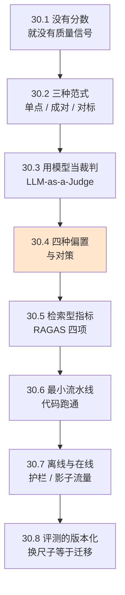

# Ch30 Evaluation：让 Agent 的好坏可被衡量

> 没有分数的优化，是靠感觉在原地打转。

## 本章目标

读完本章你应当能：

- 说清「用户没投诉」为什么不能当作质量指标，以及质量信号为什么会滞后
- 在单点打分、成对比较、对照标准答案这三种评测范式之间做出选择
- 复述位置偏置、冗长偏置、自我偏好偏置、讨好偏置这四种已知偏置，并各给出一条对策
- 用一条由数据集、候选答案、裁判、聚合门禁四段组成的流水线，跑通一次最小评测
- 分清离线评测和在线评测各自回答什么问题，以及影子流量为什么比 A/B 更适合先做
- 解释为什么评分细则一改，之前所有的历史分数就作废了

## 本章导览



图里涂了浅橙色的那个节点（30.4 偏置）是本章的重心。三种范式只是「把题目摆出来」的方式，真正决定分数可不可信的是裁判手里那把尺子稳不稳——四个偏置就是尺子会歪的四种方式。30.5、30.6 是在认识了偏置之后给出的工程做法。本章的数据源是前文 Ch29 已经建立的 trace：Ch29 回答「这一次请求发生了什么、花了多久、多少钱」，本章回答「这一次的**结果**好不好」，衔接点在 30.1 末尾点明。

## 30.1 没有分数，就没有质量信号

先演一个「什么都没有」的场景。你的客服 Agent 上线三个月，投诉工单是零。老板问「质量怎么样」，你说「没人投诉」。这句话有三个洞。

**第一个洞：不投诉不等于满意。** 用户遇到一个不对的回答，有五种反应——关掉页面、换个说法再问、骂一句然后关掉、去客服群吐槽、或者打电话。只有最后两种会变成工单。前三种在你的系统里长什么样？**一次正常结束的 trace。** Ch29 那套埋点会忠实记下：耗时 4.2 秒、模型调用三轮、token 1800 个、花费三分钱。用户满意还是不满意，这些字段一个都不会变。

**第二个洞：滞后。** 用户会不会投诉，取决于他有没有空、心情好不好、别家有没有更差的——这三样都不由你控制。今天质量跌了三个点，工单可能两周后才出现，那时你已经又上线了两个版本。**你想优化的是发布那一刻的质量，最早能拿到的信号在两周后。**

**第三个洞最关键：Ch29 记下来的东西本来就不包含「对不对」。** 把两件事放在一起看。Ch29 那个订单查询的 trace 树里，Agent 跟用户说的是「您的订单已于昨天发出，预计明天送达」，而订单的实际状态是「待付款，未发货」。Ch29 的每个字段都如实记录了：模型调用了、工具执行了、没报错、没超时。**但没有一个字段能告诉你这句话是错的。**

这就是可观测性和评测的分工：前者记过程，后者判结果。过程记录得再细，也推不出结果的好坏——就像一本把每一步都写清楚的病历本，未必诊断得出病人有没有事。所以需要补一层：**给每次请求的最终结果打一个分，而且这个分要能被机器读、能被聚合、能跟上一版比。** 这一层叫评测（Evaluation）。

## 30.2 三种评测范式：怎么把题目摆到裁判面前

第一个问题不是「怎么打分」，而是「这道题怎么出」。因为手上往往有两条候选答案要判高下，也可能只有一条要判及不及格。先把三个词的白话说清楚，再上名字。

**第一种：只看一条，问「这个几分」。** 摆一条答案，让裁判打 1 到 5 分。像语文卷上的作文题，老师看完打 82 分。好处是**分数可以直接平均**——跑一百条，你有一个数能跟上一版比。坏处是绝对分数本身没意义，不同批次的「82 分」是不是同一个水平，你无从判断。

**第二种：两条一起看，问「哪个更好」。** 摆两条答案，让裁判选一个或判平。像比较两篇作文谁写得好——中文有个词叫「比稿」。好处是**裁判的任务一下子变简单了**：从「判断这是几分」变成「判断 A 是不是强于 B」。坏处是它只给得出**相对关系**，而且换个顺序结论可能就变了——这个坑是 30.4 的头号内容。

**第三种：有标准答案，比对。** 手上有份人工确认过的参考答案，让系统去比。数学批改基本如此。最省心的一种，前提是你得有标准答案。

| | 单点打分 | 成对比较 | 对照标准答案 |
|---|---|---|---|
| **正式叫法** | pointwise scoring | pairwise comparison | reference-based evaluation |
| **摆几份答案** | 一条 | 两条 | 一条答案 + 一份标准答案 |
| **裁判输出什么** | 一个分数（1–5） | A 更好 / B 更好 / 平局 | 相似度或命中与否 |
| **具体例子** | 客服答「退款 3–5 个工作日到账」，裁判打 4 分（准确，但没说清退回哪家银行） | 同一问题，答案甲「退款 3–5 个工作日原路退回」，答案乙「退款很快的亲」，裁判选甲 | 数学题标准答案 42；答 42 判对，答 41 判错 |
| **能不能算平均值** | 能，分数天然可聚合 | 不能，只能算「A 胜率」 | 能，但只有命中与否两种取值 |
| **最大的坑** | 跨批次的「82 分」不可比 | **换顺序结论可能翻转**（见 30.4） | 很多真实任务没有标准答案 |

**主推成对比较。** 三个理由：裁判的任务真的更简单，只需说出一个偏好而不用校准标尺；它天然免疫「绝对分不可比」，因为它关心的相对关系正是你想知道的（改了一版提示词，到底是变好还是变坏）；它和 30.4 的对策是同一件事——既然换顺序会翻转，**每次换着判两遍**就顺手解决了，几乎不增加成本。代价是必须成对准备样本，聚合出来的是「A 的胜率」而不是「平均分」。

## 30.3 用模型当裁判：先看见问题，再看见名字

这一节按顺序走，顺序不能颠倒。先说问题：你要给一个 Agent 打分，办法只有三种——请人、写规则、找个模型。

**请人打分**，问题在时间和规模。300 条样本按一条两毛算只有 60 块，钱不是问题；但一轮要等一周，这一周里你只能凭感觉决定要不要发布。感觉一旦和「我已经改了一周了」绑在一起，就一定会偏。

**写规则匹配**，问题在它判不出最难的部分。规则能查「含不含数字」「含不含语气词」，可一旦有人写出一段既没有数字、又不用语气词、却依然废话连篇的话，规则就哑了。**规则能判格式，判不了内容。**

**找个模型来打分**能走通，是因为它恰好补上了规则补不上的那一块：内容判断。这需要一个模型具备「读一段话，说出它好不好」的能力，今天的模型确实有。

给这个做法找个日常说法：**请一位有经验的老师批考卷。** 有标准答案的照着批，没有标准答案的（比如「这篇作文切不切题」）靠经验和评分细则给出判断。我们要做的就是让模型扮演这位老师，而且要让它**按事先写好的评分细则**判，而不是凭当时的直觉。

到这里，这个做法才配得上它的名字：**LLM-as-a-Judge，中文通常译作「用大模型当裁判」**。名字里的 Judge 是法庭上那个 judge——**主审法官不写判决书，只判断谁有理**。这个比喻正好点出了它的性质：**它给出的是判断，不是事实。** 记住这一层，后面对偏置的讨论就都不奇怪了。

看裁判实际吐出来的东西。问题：用户问「订单 A123 的退款什么时候到账」，候选答案：

> 订单 A123 已于 3 月 2 日发起退款，原路退回，通常 3–5 个工作日到账。

裁判返回的不是光秃秃一个 `4`，而是：

```json
{
  "score": 4,
  "reasons": [
    "给出了具体发起日期，命中要点 1/1",
    "给出了到账时间范围，但未说明退回原卡还是原账户",
    "语气直接，无冗余客套"
  ]
}
```

三件事值得停下来看。

**第一，分数和理由必须一起返回。** 理由不是装饰，它是这套系统唯一的自查入口。三个月后发现平均分从 78 掉到 71，翻开理由一眼就能看出是「裁判开始偏好长答案了」还是「某个工具的输出格式变了导致理由栏全是抱怨」。只存分数，你只知道出事了，不知道为什么。

**第二，理由里的「未说明……」是这类输出最值钱的部分。** 它是一个**没有被满足的要求**——细则里没写「必须说明退回路径」，但裁判自己注意到了。这类信息是改进细则的原料：补进细则，下一轮所有样本都按新标准判。

**第三，1 到 5 的整数刻度比 0 到 1 的小数刻度好用。** 因为模型对「这是 4 分」有稳定直觉，对「这是 0.83」没有。这是个纯经验规则，但被广泛采用。

裁判判分需要依据，这份依据叫**评分细则（rubric）**。白话是「判卷时对照的那张标准卡」：看哪几个维度、每维占多少权重、几分算好几分算差。**评分细则本身是一段会进版本管理的文本**，它比裁判模型重要得多——30.8 会回到这一点。

## 30.4 四种偏置：裁判的尺子会往哪边歪

先演一个「以为已经做完」的场景。流水线跑通了，分数出来了，你把它当客观量在用。三个月后你换了个模型当裁判，重跑同一份评测集，发现同一个版本产品的分数变了 6 分——**你换了裁判，没换产品，理论上分数不该变。**

它变了。因为裁判不是一台没有刻度的仪器，它是一把**有自己惯性的尺子**。这一节密度高，每种偏置单独一小节，每小节讲三件事：怎么歪、一个具体例子、对策。

### 30.4.1 位置偏置

**白话**：同样两份答案摆在面前，放在前面的那份更容易赢。

**具体例子**：比较甲乙两份答案，甲是那份啰嗦的客套话，乙是精准的两句话。第一次判甲在前，裁判选甲——因为甲开头一大段热情洋溢，读起来「很完整」。第二次判乙在前，裁判选乙。**两次是同一份答案、同一份判断规则，结论完全相反。** 这个操作叫交换位置（position swap），它的存在本身就是位置偏置的证据。2023 年那篇把裁判立为一门方法的经典论文第一次量化了它：量级在几个百分点上下。**听起来不多，但裁判常常在做「A 略强于 B」这种本来就很接近的比较**——几个百分点的系统偏移，足够把一堆势均力敌的对比全部翻过来。

**对策**：**每次判两遍，两遍交换顺序，只在结论一致时采信，不一致记为平局。** 成本翻倍，实现多写三行代码（30.6 的 `pairwise_score` 就是这个逻辑）。这是本章性价比最高的一条，没有例外。

### 30.4.2 冗长偏置

**白话**：写得长的答案更容易得高分，哪怕它只是把一句话说了三遍。

**具体例子**：这是四种里**危害最大**的，因为它给了系统一个明确的优化方向，而那个方向是错的。假设三个月里平均答案长度从 80 字涨到 400 字，平均分从 76 涨到 83。**你以为是 Agent 变聪明了，其实它只是学会了把一句话说四遍。** 那篇论文做过更极端的实验：用一份纯重复内容的长答案去骗裁判，早期模型被骗过的比例高达九成以上，即便是当时最强的裁判也有 8.7% 上当。行业对长度偏置成因的分析给出的结论之一是：它主要来自裁判对「看起来用心」的文本的偏好，而非对信息量的真实测量。

**对策**：**在细则里把「冗长」显式写成扣分项，而不是让它作为隐含的加分项存在。** 更进一步，在评测集里放几条「短而全」和「长而空」的配对样本——如果裁判系统性地偏好后者，说明细则需要改。

### 30.4.3 自我偏好偏置

**白话**：**裁判和被测系统出自同一个模型时，会给自己家的高分。**

这是四种里**唯一一个可以通过选型绕开**的，处置方式最干脆：不要用被测系统的模型当裁判。成对比较范式顺带解决了一个更隐蔽的问题——不同厂商的模型各有各的「文风」，同厂商裁判对这种文风更熟悉，打分自然更高。**这分不是给质量的，是给自己厂出产的句式习惯的。**

有研究专门量化过这个效应——用某个模型评自己的摘要，胜率高得不合常理；但另有工作对同一批数据给出了不同解释，认为主要驱动因素是「文本对自己而言更熟悉」（即**困惑度更低**）而不是「认出了这是自己写的」。**两方都有实验支持，这恰恰说明机制还没定论；实践上正确的应对是同一个：裁判选另一家。**

**对策**：裁判与被测对象不同厂商；同厂商内评测时换一个不同规模的裁判模型；实在必须同厂，务必在结论里写明这个风险。

### 30.4.4 讨好偏置

**白话**：**裁判倾向于给「顺着提问者说」的答案打高分，哪怕那个答案不成立。**

这一种最隐蔽，因为它披着「礼貌」的外衣，而且没有专门的论文把它单列——它散落在两类相邻研究里：一类是裁判的「谄媚」现象，一类是裁判对「模棱两可」答案的系统性扣分，这其实是同一枚硬币的两面。

**具体例子**：用户问「这个功能要不要开」。答案甲说「不建议开，它会让响应时间增加约 30%，但能省下约 15% 的成本。」答案乙说「建议开启，开启后整体体验会更顺畅，具体可以看你们的实际情况。」大多数用户觉得乙更顺耳——**它没说错，但它什么也没说**，而裁判常常也给乙高分。反向的实测更硬：有一项研究在把正确性控制住不变的前提下发现，**裁判在 1280 组两两对比里有 1276 组偏好那个更果断的答案**。那份研究也诚实列出了局限：被测的是 2B 到 8B 级别的模型，场景只有 30 个，尚未在前沿模型上复现。

**对策**：**细则里明确写出「承认取舍不算缺点」，并且造几条「模棱两可但诚实」的样本当探针。** 这些样本不是用来给产品打分的，是用来体检裁判的——裁判一旦开始偏好油滑答案，你会先在探针上看到。这和 30.4.2 的配对探测是同一个套路，可以合并成一套固定的**裁判体检集**。

四种偏置汇总如下，每格都配了具体例子：

| 偏置 | 白话 | 具体例子 | 对策 |
|---|---|---|---|
| **位置偏置** | 前面的答案更容易赢 | 甲（啰嗦）放前面判甲赢，换顺序后乙赢 | 交换顺序判两遍，不一致记平局 |
| **冗长偏置** | 长的更容易赢 | 「退款很快的亲」写成 200 字客套话后得分高于精准两句 | 细则里显式写冗长扣分；造「长而空」探针 |
| **自我偏好偏置** | 裁判偏爱自家输出 | 同厂裁判评自家模型，胜率异常高 | 裁判换厂商；结果里注明风险 |
| **讨好偏置** | 裁判偏爱顺着说的答案 | 「建议开启，但要看你们情况」输给「建议开启，收益多多」 | 细则写明「承认取舍不算缺点」；造探针体检 |

一句话小结这张表：**四种偏置都不是随机的。** 这比「裁判有点不准」严重得多——随机的误差多判几遍就平均掉了，系统性的偏差判一万遍只是得到一个更精确的**错数**。所以四条对策全部指向同一件事：**改变裁判的输入条件**（换顺序、换细则、换厂商、换探针），而不是增加判定次数。

## 30.5 检索型 Agent 的专用指标：四个分数管四件事

前面讲的是通用做法：给定答案、给定标准、给定裁判。但如果 Agent 会先检索资料再回答（见 Part 5 Ch23），光看最终答案不够——答案错了，你分不清是「没检索到」还是「检索到了但没用好」，这两种错法的修法完全不同。

2023 年有一篇专门做这件事的论文，提出了一套指标，现通常按其框架名 RAGAS（Retrieval Augmented Generation Assessment，中文可译作「检索增强生成评估」）被引用。其中前三个**不需要标准答案**：

| 指标 | 白话 | 回答什么问题 | 分数低了说明 |
|---|---|---|---|
| **忠实度**<br>faithfulness | 答案里每一句话，资料里有没有依据 | 是不是在瞎编 | 生成环节把资料编造了 |
| **答案相关性**<br>answer relevance | 答案有没有在回答这个问题 | 是不是答非所问 | 生成跑偏，或问题本身含糊 |
| **上下文精确率**<br>context precision | 检索到的资料，有用的排在前面吗 | 检索排序好不好 | 检索把噪声塞在了前面 |
| **上下文召回率**<br>context recall | 该找到的资料，找到没有 | 检索全不全 | 检索漏了关键资料 |

**主推忠实度这一个。** 三个理由：它抓的是「有没有编造」，这是所有质量事故里代价最高的一类——答得不够好的答案用户会再去查，编造的答案用户会直接照着做；它的计算方式最直观，把答案拆成若干独立论断，逐条去资料里找依据，找不到依据的论断占比就是扣分项；它对检索和生成两个环节都敏感，所以它一掉你就知道往哪查。

有一件事决定了你该怎么用这套指标：**这四个指标本身也是裁判打出来的，误差不小。** 论文自己报告的与人工标注的一致程度大致是——忠实度约 95%、答案相关性约 78%、上下文精确率约 70%。翻译成工程语言：**忠实度高说明这个分数大概率可信；上下文那两项对不上人工判断，只能当粗筛。** 后续社区复现也印证了这一点：这套指标会把一些质量不错的答案判低分，对两个接近版本之间的细微差别不敏感。

所以正确用法只有一种：**把分数当作版本之间的相对信号，不当作绝对的质量证书。** 「这一版比上一版忠实度高 4 个点」是有意义的结论；「这一版忠实度 0.92，可以上线」不是。

工具承载一句话点名：目前有若干开源框架实现了这套指标（RAGAS 是其中最有名的一个，因此这些指标常被统称为「RAGAS 指标」；另一个是 DeepEval）。这类框架的分工是数据集管理、批量并发调用、结果看板，**指标怎么算、偏置怎么处理始终是你自己的活**，本章不写任何一家怎么用。

## 30.6 一条最小评测流水线

前面四节的概念现在拼成一条流水线。骨架非常朴素——**四个环节，一个循环都不需要**：


**第一步，数据集。** 一组样本，每条至少三样：输入（用户问的话）、预期要点（答案里必须出现的关键信息，判忠实度要用）、可选的完整参考答案。

**第二步，候选答案。** 拿被测版本跑一遍数据集。这一步要和 Ch29 的 trace 共用同一次调用——**别为了评测再跑一遍 Agent**，那样测出来的延迟和成本都不是真实的。这条衔接正是 Ch29 29.5 末尾埋的伏笔：线上捞到一条坏 trace，顺手挂个评分、沉淀成回归用例。

**第三步，裁判。** 对每条样本调一次裁判，拿到分数和理由。这是唯一花钱的一步，成本大致正比于「样本数 × 每条输入长度」。

**第四步，聚合与门禁。** 把分数聚合成一两个数，跟上一版比；再定一条线（比如通过率低于 70% 就不许发布）。**门禁必须写成一个能自动跑的判断**——它的价值在于不需要任何人做决定；如果需要人拍板，它就会在某次赶发布的夜里被绕过。

下面是这条流水线跑通的最小实现（节选，完整文件在 `code/part-6/eval_pipeline.py`，共 140 行）。文件里的裁判是一个**确定性的假实现**——不调用任何模型，而是用关键词命中和字数算分。跑通流水线不该依赖 API key，也不该花钱；等数据结构和聚合逻辑确认无误了，再把 `call_judge` 这一个函数换成真模型调用，其余一行都不用动。

```python
RUBRIC = {
    "version": "2026-10-13.v1",
    "dimensions": {"faithfulness": 0.6, "conciseness": 0.4},
    "pass_line": 0.7,
}


def call_judge(sample: dict, rubric: dict) -> dict:
    """假裁判：确定性打分。换成真模型时，只替换这一个函数。"""
    answer = sample["answer"]
    hit = sum(1 for key in sample["must_mention"] if key in answer)
    # faithfulness 管「说到了没有」，conciseness 管「有没有为凑字数而啰嗦」
    faithfulness = hit / len(sample["must_mention"])
    conciseness = min(1.0, 0.4 + len(answer) / 400)   # 冗长偏置的最小复刻
    score = round(
        rubric["dimensions"]["faithfulness"] * faithfulness
        + rubric["dimensions"]["conciseness"] * conciseness, 3,
    )
    return {"score": score, "reasons": [
        f"命中要点 {hit}/{len(sample['must_mention'])}",
        f"答案 {len(answer)} 字",
    ]}


def pairwise_score(answer_a: str, answer_b: str) -> str:
    """成对比较：交换 A/B 各判一次，不一致就判平——位置偏置的最小对策。"""
    def one_winner(first: str, second: str) -> str:
        if len(first) == len(second):
            return "tie"          # 长度一样就没有胜者，别硬分
        return "A" if len(first) > len(second) else "B"

    forward = one_winner(answer_a, answer_b)
    backward = one_winner(answer_b, answer_a)
    return "tie" if forward != backward else forward
```

两段代码对应两件事。

**`call_judge` 里那行 `conciseness` 是故意埋的缺陷。** 它把「字数多」当成「用心了」，就是 30.4.2 说的冗长偏置的最小复刻。完整文件里的第 5 条样本就是这么设计的：答案又长又堆砌，却恰好命中要点，于是在这个假裁判这里拿了全场最高分。**这个设计留着给你改**——把按字数算换成按「要点密度」算，那一行立刻从一个 bug 变成一个可用的近似度量。真实裁判也一样：你先意识到它偏在哪，才能在细则里给它写上约束。

**`pairwise_score` 是 30.4.1 那个对策的可执行版本。** 它判两遍，结论不一致就返回 `tie`。文件末尾拿啰嗦的 `s2` 和简洁的 `s3` 比：只看长度 `s2` 会赢，交换位置后结论翻转，于是判平。**这个 `tie` 不是「没分出高下」，而是「这一次比较的结论不可信」的诚实表达**，比硬报一个胜者有用得多。

聚合只产出两个数：平均分看趋势，通过率给门禁用。选后者是因为它**可解释**：「100 条里 78 条过线」比「平均 0.83」更容易在会上达成共识，也更容易在没过线时定位是哪几条出了问题。完整运行结果里有一行必须指出来的现象：**得分最高的是 `s5`，那条又长又堆砌的答案；被判 FAIL 的 `s2` 反而比它短。** 假裁判按字数给分，冗长样本自然占便宜。这不是代码写错了，这是**故意的**——它演示了一件真事：偏置不是理论问题，它会真的出现在你的仪表板上，而且看起来还挺合理。

## 30.7 离线评测与在线评测：什么时候问哪一个问题

前面六节讲的都是同一件事：**发布之前，用一批固定样本把新版本考一遍。** 这叫**离线评测**，输入是冻住的数据集，输出是一个分数。长处是可比——同一份数据集跑两个版本，分数之差有意义。短处是它只能考你想到的问题。于是有了另一条路：**在真实用户面前评测**，即**在线评测**。两者不是二选一，而是分工——它们回答的根本不是同一个问题。

**护栏（guardrail）**：一套在请求进入或返回时自动检查的硬规则，触发就把这次输出拦下或降级。类比是机场安检门——它不管你的行李合不合规，只管有没有带违禁品。它不评分，它**阻止**。

**A/B**：把真实流量分成两半，一半给旧版本一半给新版本，比较两边指标。它的价值在于**唯一能回答因果问题**：分数提高了，到底是这个改动带来的，还是今天天气特别好。只有随机分流量能排除后一种。

**影子流量（shadow traffic）**：真实请求照常发给线上版本返回给用户，**同时**复制一份发给候选版本，但候选的输出**记下来、不返回给任何人**。类比是驾校陪练：学员坐副驾，新手开的车不载客，教练在旁记问题。

这三个不是并列三选一，而是一条**从安全到确定的阶梯**：

| 手段 | 用户看得到候选输出吗 | 回答什么问题 | 什么时候用 |
|---|---|---|---|
| **离线评测** | 否 | 固定题目上的相对分数 | 每次提交，最先做 |
| **影子流量** | 否 | 候选版本在真实输入分布上会怎么表现 | 离线分数通过后，看真实长尾 |
| **护栏** | 拦下来的看不到 | 有没有触发不能放行的红线 | 全程 |
| **A/B** | 是，一半用户看到 | 这个改动的因果效果有多大 | 前面三关都过了，最后确认 |

阶梯顺序不能随便调，因为**失败代价依次升高**：离线失败只是白跑一次；影子失败是多花一份推理成本，一个用户都没影响；A/B 失败则有一半用户在用你的坏版本。所以是**先离线，再影子，最后 A/B**。

影子流量有一个坑值得单独说，因为它反直觉：**候选版本的输出虽然没返回给用户，但它做的副作用是真发生的。** 客服 Agent 影子跑一遍可能真发出一封邮件、真改了数据库一条记录、真调了一个付费接口。输出被丢掉了，动作没有。所以影子流量必须配套两件事：给候选版本接一套只读的假工具（记录它「打算」调什么，但不真调），以及给它独立的限流和超时，绝不能让它拖慢线上主链路。这一条是实践中最容易翻车的地方，翻车方式还很朴素——**测试环境的假接口忘了加**。

护栏则不给质量分数，它给**否决权**。一个版本可以分数很高但护栏频繁触发（比如准确率不错却频繁输出个人信息的版本），这必须被拦住；反之护栏全过但分数平庸的版本也不该放行。

## 30.8 评测的版本化：换了尺子，之前量过的都作废

最后一节讲一件在上线后才显出问题的事，它也是整条体系里最容易漏掉的一环。

假设你按 30.3 的例子建好了评分细则，用它跑了三个月，每天分数入库，团队形成默契：85 分以上算好。某天你把「未说明退回路径」这条从裁判的动态发现提升成了细则里的显式要求——这就是 30.3 说的「从裁判反馈里进化」的正常路径。改完重跑，新分数是 71。团队炸了：**同一个产品，昨天 87 今天 71，这周该怎么汇报？**

答案是：**这两个数不是同一把尺子量的，不能比。** 评分细则升级，等价于**把评分体系整体迁移了一次**，后果和你升级数据库 schema 同性质：老数据不会自动变兼容，它们只是突然失去了解释力。具体四件事：

**一、历史分数全部作废。** 不是变错，是不再可比——不能画一条跨版本的分数趋势线，因为折线上的两个点来自两套不同标准。

**二、门禁阈值要重设。** 原来 70 分过线，改完 71 分不过线，这个阈值现在卡掉了一个本来合格的版本。**阈值永远是相对于细则定义的，必须跟着重设。**

**三、裁判模型可以换，细则不能混着用。** 换裁判模型（升级厂商、换型号）同样是换尺子，同样要重设阈值。所以 `version` 字段挂在哪有讲究：**它必须挂在评分细则上，不是挂在裁判模型上**——因为定义「什么算好」的是前者。

**四、新老版本要有一小段并行期。** 别改完就切。合理做法是让两套细则各跑一遍同一批样本，得到一个换算关系，再拿它去解释历史分数。成本是双倍裁判调用，买的是**连续性**——没有它，你的评测体系在每次升级细则时都会断一次，而断掉的那段数据永远补不回来。

这四条是本章唯一需要照着做清单的地方，因为它是**元层面的纪律**：前面讲的评分卡、偏置对策、流水线，都是**在尺子给定之后**才谈得上的事。**尺子本身也是需要被版本管理的东西**，这是把评测从「一个脚本」升级成「一套体系」的分界线。落到实践上就是三件事：给评分细则编号进版本库（代码里那个 `"version": "2026-10-13.v1"` 就是这个意思）；分数入库时**连同当时的细则版本号一起存**，不存就等于这个分数没有意义；报表上任何跨时间的对比，都要能一眼看出期间细则有没有改过。

相邻两章（Ch31 安全与红队、Ch32 模型路由与成本控制）会回来吃本章的评测产物，本章不展开，只记下这条依赖关系。

## 本章小结

- **「没人投诉」不是质量指标。** 不投诉有很多方式，而 Ch29 的 trace 忠实记录了其中每一次——耗时、成本、token 数，一个都不包含「这次答对了没有」。过程记录推不出结果好坏，这是评测存在的全部理由。
- **三种出题范式**：单点打分（能算平均分，但绝对分跨批次不可比）、成对比较（裁判任务更简单，但会换顺序就翻转）、对照标准答案（最省心，前提是得有标准答案）。**主推成对比较**，因为它和位置偏置的对策是同一件事。
- **裁判给出的是判断，不是事实。** 返回值必须带理由，理由是整套系统唯一的自查入口。**评分细则比裁判模型重要得多**，因为定义「什么算好」的是前者。
- **四种偏置都是系统性的，不是随机的**：位置偏置（换顺序判两遍）、冗长偏置（细则里显式写扣分并造探针）、自我偏好偏置（裁判换厂商）、讨好偏置（细则写明承认取舍不算缺点并造探针）。**对策全是改变裁判的输入条件，不是增加判定次数**——多判一万遍只是得到一个更精确的错数。
- **RAGAS 那组指标里主推忠实度**，它抓的是编造，代价最高。**这套指标本身误差不小**，与人工一致度最低的约 70%，只能当版本之间的相对信号。
- **流水线只有四段：数据集 → 候选答案 → 裁判 → 聚合门禁**，没有循环。裁判与被测对象共用同一次调用，不要为评测重跑一遍 Agent。**聚合优先产出通过率**，因为它可解释、能定位问题。
- **在线评测三手段分属三问**：影子流量（候选输出不返回，但**副作用是真的**，必须配只读假工具）→ 护栏（不给分，给否决权）→ A/B（唯一能回答因果问题的）。顺序不能颠倒，因为失败代价依次升高。
- **评分细则升级 = 评分体系迁移。** 历史分数失去可比性、门禁阈值要重设、`version` 挂在细则上而不是裁判模型上、改细则要有并行期算换算关系。**这是把评测从脚本升级成体系的分界线。**

## 本章参考

### 必读论文

- [Judging LLM-as-a-Judge with MT-Bench and Chatbot Arena](https://arxiv.org/abs/2306.05685)（Zheng 等，NeurIPS 2023 Datasets & Benchmarks）——30.3 的主要依据：把「用模型当裁判」确立为一门方法，并首次系统量化了位置偏置、冗长偏置与自我偏好偏置
- [Ragas: Automated Evaluation of Retrieval Augmented Generation](https://arxiv.org/abs/2309.15217)（Es 等，2023）——30.5 那四个指标的出处
- [LLM Evaluators Recognize and Favor Their Own Generations](https://arxiv.org/abs/2404.13076)（Panickssery、Bowman、Feng，NeurIPS 2024）——30.4.3 自我偏好偏置的原始研究；同一议题另有工作提出「困惑度更低」这一不同解释，正文对两方说法都做了标注

### 推荐博客 / 教程

- [Judging the Judges: A Systematic Study of Position Bias in LLM-as-a-Judge](https://arxiv.org/abs/2406.07791)——30.4.1 位置偏置的专题研究
- [Explaining Length Bias in LLM-Based Preference Evaluations](https://aclanthology.org/2025.findings-emnlp.358/)——30.4.2 冗长偏置的成因分析
- [RAGAS 官方文档：可用指标](https://docs.ragas.io/en/stable/concepts/metrics/available_metrics/)——30.5 各指标的定义与算法
- [RAGAS 仓库](https://github.com/explodinggradients/ragas)｜[DeepEval 仓库](https://github.com/confident-ai/deepeval)——30.5 末尾「工具承载」的取名来源，本书不展开
- [FastChat 的裁判实现](https://github.com/lm-sys/FastChat/tree/main/fastchat/llm_judge)——第一篇论文配套的参考实现，30.6 `pairwise_score` 的原型可在这里看到

### 视频 / 课程

本章没有必须看的视频课程。查字段名时用 [OpenTelemetry GenAI 语义约定](https://opentelemetry.io/docs/specs/semconv/gen-ai/)——30.6 第二步「评测与 trace 共用同一次调用」要落到具体字段上时，这份标准是权威来源（见 Part 6 Ch29）。
