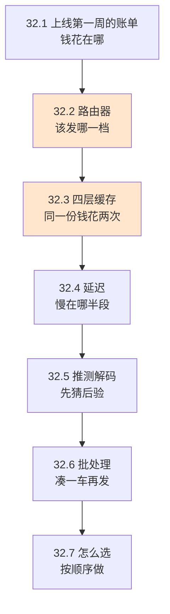
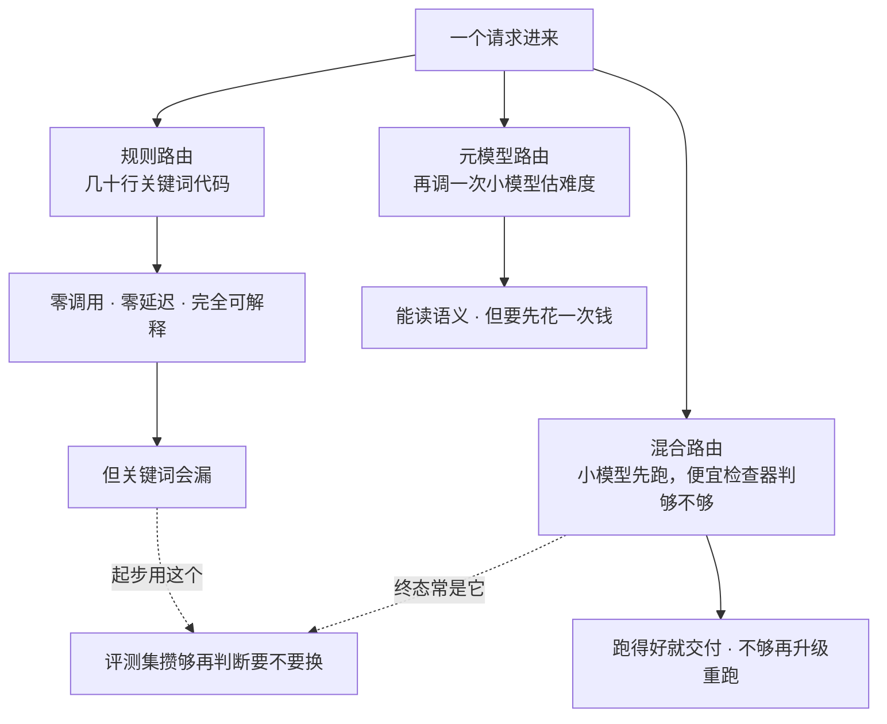

# Ch32 模型路由器与成本控制：把每一分钱花在值得的地方

> 同一个 Agent，"全部发最贵那档"和"每 10 条请求省下 70%"之间，差的不是技术，是有没有人在看账单。

## 本章目标

读完本章你应当能：

- 说清 Agent 的账单上主要有哪几项开销，以及哪一项通常被低估
- 讲出路由器的三类策略分别适合什么场景，并判断自己的项目该从哪一类开始
- 区分四层缓存各自缓存什么、什么时候失效、能不能跨会话共享
- 解释前缀缓存那条"稳定在前、变动在后"的规则，以及违反它会发生什么
- 用自己的评测集给一个阈值拍板，而不是拍脑袋
- 说清推测解码与批处理各自优化的是哪一段开销，为什么它们不能互相替代

## 本章导览



上一章讲的是有人会来打勾。这一章讲的是**在那之前，你自己的钱要怎么花得更聪明**——但先把话说在前面：**这一章所有手段的优先级，都排在"效果对不对"之后。** 一个省 80% 成本但让用户拿到错答案的方案，不是优化，是事故。

Part 6 到这里已经有了三样东西可以互相咬合：**Ch29 让你看得见账单从哪来，Ch30 让你能测出改完变好还是变坏，Ch31 让你知道省钱的动作不能捅出安全窟窿。** 这一章讲的每一个手段，都要过 Ch30 那把尺子。

## 32.1 上线第一周的账单：钱花在哪

先演一遍「没有它会怎样」。

一个团队上线了客服 Agent，功能正常，Ch29 那套 trace 也埋好了。第一周财务发来账单，月化预估是预期预算的 4.6 倍。团队拉出 trace 一看，80% 的调用集中在**两件极简单的事**上：把用户的一段话改写得更礼貌，以及从知识库里摘出三条相关片段。剩下的 20% 才是真正需要推理的复杂问题。

如果一开始就知道这件事，那个 4.6 倍根本不会发生。

**先看清"钱花在哪"的三个来源。** 这是本章第一张图，也是唯一一张必须先画的图：

| 开销项 | 是什么 | 通常被低估的程度 |
|---|---|---|
| **输入 token** | 每次请求塞进上下文的所有字：系统提示、工具定义、检索结果、对话历史 | ⭐⭐⭐ 最被低估。多数人以为它等于"用户说的话"，实际通常是它的十倍 |
| **输出 token** | 模型生成的那些字 | ⭐ 很少被低估。它同时是延迟的主要来源 |
| **轮次与工具** | 一个任务往往不是一次调用，而是三五次；每次都重发一遍上下文 | ⭐⭐ 容易被当成"功能多"而不是"成本项" |
| **重试** | 失败的调用要重来，失败原因往往还是那个失败原因 | ⭐⭐ 匿名且隐蔽，Ch29 追踪一次失败重试链才发现 |

这张表里加粗的那一行值得单独说一句：**第 2 行和第 1 行的比例，往往和你的直觉相反。** 很多人以为"回答越长越贵"，于是把回答压短——但如果回答短了导致要追问一轮，**输入 token 的重新发送**会把省下来的输出费还回去三倍。

这就是本章为什么把路由器放在缓存前面讲：**决定"发哪一档"比决定"缓存什么"更靠前**，因为档位决定了后面每一层缓存的键怎么算。

## 32.2 路由器：该发哪一档

生活里有一个和这件事几乎一模一样的场景：**快递分拣中心的格口。** 一件快递进网，工人看两样东西——**它多重、有没有"易碎"或"大件"标记**——然后把它推进对应的那条流水线。轻的走自动分拣，重的走人工，重且易碎的走特殊通道并加保护套。

**格口不负责决定货最终送到哪家，它只决定这条流水线怎么走。** 路由器也是。它不改变任务，它改变的是"用什么能力去完成这个任务"。

三类路由的差别，说到底是**"判档这件事由谁做、要花多少钱"**。先把三条路摆成一张图：



**看图上三个分支的一个共同点：没有一条是"换掉了前一条"，前一条永远是后一条的起点。** 规则路由起步，元模型路由在规则明显失灵时换上去，混合路由往往是最终形态——但你得先有评测集（Ch30）才判断得出该不该换。**这正是为什么本节主推规则路由：它不需要你先有评测集就能跑起来。**

### 32.2.1 第一类：规则路由 —— 主推

**规则路由**指用可读的规则（关键词、长度、结构特征）直接判断请求的难度，映射到某个模型档位。

白话：**你替模型先做一次分类，用几十行代码，而不是再调一次大模型。**

先看它长什么样。这段的三个信号各管一件事——**词管任务性质，长度管体量，多步迹象管链条长度**。以下是 `code/part-6/router_demo.py` 的节选（完整文件 209 行）：

```python
def classify(text: str) -> tuple[str, int, list[str]]:
    """给请求打难度分，返回 (档位, 分数, 理由)。

    三个信号各管一件事：词管**任务性质**，长度管**体量**，多步迹象管**链条长度**。"""
    reasons, score = [], 0
    for words, delta in ((HARD_WORDS, 2), (EASY_WORDS, -2)):
        hit = [w for w in words if w in text]
        if hit:
            score += delta * len(hit)
            reasons.append(f"{'高' if delta > 0 else '低'}难词 {hit}")
    if len(text) > 200:
        score += 1
        reasons.append(f"偏长（{len(text)} 字）")
    elif len(text) < 30:
        score -= 1
        reasons.append(f"很短（{len(text)} 字）")
    steps = [w for w in MULTI_STEP if w in text]
    if len(steps) >= 2:
        score += 2
        reasons.append(f"多步迹象 {steps}")
    tier = "large" if score >= 3 else ("mid" if score >= 0 else "small")
    return tier, score, reasons
```

这段代码里最容易被略过、但最该学的是 `reasons`。**路由决策必须自带理由。** 理由不是给人看的日志，是给 Ch30 的评测用的——当你改了关键词表，评测集能直接告诉你"哪些请求的判档变了"，而不是靠你感觉。

**规则路由的三个优点必须说清楚，因为它解释了为什么它被主推：** 第一，零额外成本（不调模型）；第二，零额外延迟（不调模型）；第三，**完全可解释**——每个决策都能追到具体是哪条规则命中的，这在受监管的场景里往往比省钱更重要。

它的软肋同样要讲：**关键词会漏。** 用户说"这个数怎么算出来的"和"这个数字是怎么得出来的"，一个字面词都没命中，但第二句明显更难。**所以规则路由不是终点，是起点。**

### 32.2.2 第二类：元模型路由

**元模型路由**用一个额外的模型来预测"这个请求该交给哪一档"。

白话：**让一个小模型先给这道题估个难度，再决定派哪个老师来答。**

生活里的对应物是医院的**分诊台**：护士判断你是感冒还是急腹症，决定挂普通号还是急诊号。

它的优势是规则做不到的两点：一是能读懂语义（"怎么算出来的"能识别出这是道推理题），二是能处理"这个问题哪句话难"这种上下文相关的情况。它的代价也很直接：**你为了省下下游的钱，先花了一次调用的钱和时间。**

**什么时候它才划得来？** 三个条件同时成立：请求量大到路由本身的成本可以被摊薄；任务里"显式难度信号"确实少（纯开放式写作、代码理解这类，关键词很失灵）；且你已经有 Ch30 的评测集能量化"路由准不准"。

外部有专门做这件事的服务（元模型路由这一类的商业代表），但**这一类你完全可以先用规则起步，等评测集攒够了再判断要不要换。**

### 32.2.3 第三类：混合，以及一个容易被忽略的附加规则

**混合路由**指的是"先用便宜的手段解决一部分，剩下交给贵的"。典型形态是：**先用小模型跑，跑完让一个廉价的检查器判断结果够不够好，不够再升级到高档重跑。**

它在结构上和 Ch30 的评测思路是同一个东西——**你在用一个便宜的信号去预测一个昂贵的信号。** 所以它的失败模式也一样：检查器太松，白白升级；太紧，永远不升级。

还有一个规则比"选哪一类"更影响账单，很多团队漏了：**会话粘滞。**

> 一个会话进行到一半换模型，等于让已经建立的一切前功尽弃。

具体为什么，见下一节的前缀缓存。

### 32.2.4 三个容易踩的坑

**坑一：把路由做成了"省钱优先"。** 路由策略的失败不会表现为"省钱失败"，只会表现为"下游任务质量下降"——而这个损失通常要到 Ch30 的评测集上才会显形。**所以路由策略的任何改动都必须过一遍评测。**

**坑二：只许升不许降。** 这是代码里特意保留的一条规则（节选自 `code/part-6/router_demo.py`）：

```python
def route(text: str, sid: str = "s", pinner: SessionPinner | None = None):
    """路由决策。返回的 reasons 是给人、给评测看的，不是给日志看的。"""
    pinner = pinner if pinner is not None else SessionPinner()
    tier, score, reasons = classify(text)
    pinned = pinner.get(sid)
    if pinned and pinned != tier:
        # 只许往上调、不许往下调：中途给任务换脑子，比多花点钱更容易出事。
        if ORDER.index(tier) > ORDER.index(pinned):
            pinner.pin(sid, tier)
            return tier, score, reasons + [f"会话从 {pinned} 上调到 {tier}"]
        return pinned, score, reasons + [f"会话粘在 {pinned}（不降档）"]
    pinner.pin(sid, tier)
    return tier, score, reasons
```

理由写在注释里了，值得展开：**任务执行到一半换模型，丢掉的不是钱，是"已经想清楚的那部分上下文"。** 前几轮推出来的中间结论，在新模型看来是不存在的。一个任务掉级，远比它多花点钱更容易出事。

**坑三：缓存键里忘了带档位。** 下面这张表会详细讲，这里先留一句：改路由策略会让旧缓存失效，这一点必须在键的设计里体现出来，否则改完策略会读到用旧策略生成的答案——**而且它看起来完全正常，只是悄悄变差了。**

## 32.3 四层缓存：同一份上下文，别花两次钱

先说清为什么缓存这件事在 Agent 场景里比普通应用重要得多：**Agent 的上下文里绝大部分内容，在连续几轮之间是不变的。** 系统提示不变、工具定义不变、长期记忆不变——只有用户这轮说的话和检索结果在变。**每一轮都把这些不变的字重新算一遍，是纯粹的浪费。**

但"缓存"这个词底下是四层完全不同的东西。**混着谈是这一章最常见的错误**，因为它们的失效条件、跨会话能力、你能控制到什么程度，全都不同。

### 32.3.1 先把四层摆在一张表里

| | 缓存什么 | 键是什么 | 失效条件 | 跨会话 | 你能控制吗 |
|---|---|---|---|---|---|
| **第 1 层 精确缓存** | 整个答案 | 归一化后的问题全文 + 档位 | 提示词或模型变了 | ✅ 能 | 完全 |
| **第 2 层 语义缓存** | 整个答案 | 问题的向量（意思） | 同上；以及相似度阈值 | ✅ 能 | 完全 |
| **第 3 层 前缀缓存** | **不缓存答案，只缓存"这批 token 算过了"** | 从头逐字节相同的前缀 | **前缀任何一个字节变了** | ✅ 能 | 部分 |
| **第 4 层 KV cache** | 模型内部的中间结果 | 模型自己定 | 你基本管不了 | ❌ 不能 | ❌ 不能 |

**这张表最关键的一行是第 3 层。** 前两层缓存的是"答案"——命中就完全不调模型了；第 3 层缓存的是"这段前缀我们已经算过了"——**模型照样要跑，但读过的 token 不用重算**。这两件事经常被混为一谈，导致一个很常见的误解：以为"开了前缀缓存就不用付输入 token 的钱了"。不是的，前缀 cache 的**读取**通常仍有单价，只是比写入和重新计算便宜得多。

### 32.3.2 前两层：答案缓存，以及它的致命陷阱

第 1 层精确缓存的实现只有一个需要注意的地方——**归一化**（节选自 `code/part-6/router_demo.py`）：

```python
class ExactCache:
    """同一个问题问出同一个字面答案，直接返回，零 token。可跨会话共享。

    失效只有一种：提示词或模型变了——所以键里必须带档位名。"""
    def __init__(self) -> None:
        self._store: dict[str, str] = {}

    @staticmethod
    def _key(text: str, tier: str) -> str:
        # 归一化：去空白转小写。否则用户多打一个空格就 miss。
        raw = f"{tier}|{''.join(text.lower().split())}"
        return hashlib.sha1(raw.encode("utf-8")).hexdigest()
```

注意 `_key` 的两个组成：**归一化后的文本，加上档位名。** 后者是坑三的解药——档位在键里，改了路由策略，旧档位的缓存自然不再命中。

第 2 层语义缓存要危险得多，因为它会把"意思差不多"当成"问题一样"。代码里把它最大的坑写进了注释（节选自 `code/part-6/router_demo.py`）：

```python
class SemanticCache:
    """换个说法但意思一样，也直接返回。

    骨架用 Jaccard 相似度（交集 / 并集）当代理，够看清结构。生产里两个坑：
    一是**相似不等于同义**——「怎么退款」和「怎么不退款」相似度很高但答案
    相反，带否定语义的句子要么不进缓存要么提高阈值；二是**阈值不能拍脑袋**，
    唯一靠谱的办法是在自己的评测集上跑一遍（见 Ch30）。"""
    def __init__(self, threshold: float = 0.9) -> None:
        self.threshold = threshold
        self._entries: list[tuple[set[str], str]] = []
```

**「相似不等于同义」是本节要记住的一句话。** 一个加了否定词的句子，和不加否定词的句子，在向量空间里几乎是邻居，但答案完全相反。

而"阈值不能拍脑袋"这句，正是 Ch30 的用途第一次在成本章里显形：**拍不出阈值，不是因为你不会调参，是因为你需要一个自己的评测集。**

### 32.3.3 第 3 层：前缀缓存那条不能违反的规则

**前缀缓存**是四层里对 Agent 收益最大、也最容易因为一个代码改动而失效的一层。它的机制一句话说完：

> **提示词里从开头起连续相同的那一段，可以只算一次；一旦有任何一个字节不同，从那个位置往后的全部作废。**

"逐字节、从头"这两个词是全部难点所在。所以那条规则没有第二种表述方式：

```python
def split_prefix(user_text: str) -> tuple[str, str]:
    """把提示词切成「稳定段」与「变动段」，顺序不能反。

    规则一句话：**稳定的在前，会变的在后。** 系统提示、工具定义、长期记忆
    属于稳定段；用户这轮说的话、检索结果、时间戳属于变动段。稳定段只要有
    一个字节变了，它后面全部作废——前缀匹配是从头逐字节比的。"""
    return ("系统：你是客服助手。工具：订单查询 / 退款发起。知识库快照：2026-10-13。",
            user_text)
```

**"稳定的在前，会变的在后"——违反它一次，整轮的前缀缓存就没了。** 而它最常见的违反方式不是写错，是**顺手加了个时间戳**。上面这个例子里，知识库快照日期放在稳定段，看起来很合理；但只要客户那边还在线（比如"当前时间""剩余库存"这类每轮都变的值），把它放进稳定段，就等于每次都让缓存归零。

这里也解释了 32.2.4 坑三的**会话粘滞**：换模型 = 前缀变了 = 缓存作废。**粘滞省下的钱有两笔——不多付那一次全价读缓存的钱，以及不丢掉已经算过的前缀。**

### 32.3.4 第 4 层：KV cache，以及"你管不了它"这件事

**KV cache（键值缓存）**是模型内部的机制：已经读过的 token，它的中间结果留着不用重算。原理在 Part 1 Ch3 §3.8 讲过。

对应用层，这一层只有一条要记住的话：**它由模型服务端管理，你碰不到它的键，也决定不了它的失效。** 你唯一能做的是**通过第 3 层间接影响它**——稳定前缀写得越规整，这一层命中得越好。

所以本章的代码里，第 4 层只留了一行注释，没写实现。这不是偷懒：**写不出实现，说明它不属于你的代码。**

## 32.4 推测解码：先派个人跑一趟

先说清它解决的是哪一段开销。上一节讲的是省**输入**；这一节省的是**输出**。

生活里的对应物：**主厨做菜之前，先让帮厨尝一口报个大概。** 如果帮厨报的方向对，主厨就照着做，不容易跑偏；如果方向明显不对，主厨立刻接手推翻。**帮厨那份"大概"是白做的，但主厨的注意力被省下来了。**

**推测解码（speculative decoding）**就是这个结构：**用一个小的、快的草稿模型先写出若干个 token，再让大的目标模型一次性校验这段草稿；对的部分全部采纳，错的从第一个错处重来。**

它有两个必须讲清的性质，缺一个就会用错：

**第一，它不改变输出。** 严格实现下的推测解码，保证**输出分布与不用它完全一致**——不是"差不多"，是分布意义上一模一样。这是它和"用小模型直接出结果"的根本区别：**后者的质量损失是真的，前者的质量损失是零。**

**第二，它只在有冗余的地方有收益。** 生成是自回归的，一步接一步；如果目标模型"这一步几乎确定"，草稿模型就猜得准，一段能全对。**而当目标模型正在想一件难事时，它每一步都不确定，草稿几乎必错，等于白猜两次还多花了草稿的钱。**

所以本节给使用者的判据只有一句：**在你的 trace 上按"输出 token 耗时"分组，看看时间主要花在输出多还是多轮上。** 输出占比高、且任务里大量是模式化生成的（格式化、抽取、改写），收益大；反过来，以复杂推理为主的场景，收益有限。

## 32.5 批处理：凑够一车再发

**批处理（batching）**是把多个请求合并成一次提交给模型，换取更高的单位吞吐。它优化的是**服务端资源的利用效率**，不是单次请求的延迟——这一点经常被搞混：**开批处理通常会让单次请求变慢一点，但单位时间内能处理的请求变多。**

生活里的对应物是**拼车**：三个人各自打车，各付一份起步价；拼一辆车，分摊油费和过路费，人均便宜——**代价是大家要等 slowest 的那个上车。**

对 Agent 场景，批处理有一个特殊之处值得点出：**它和前面的缓存是冲突的。** 批处理要求请求尽量在时间上靠近；而缓存尤其是前缀缓存，要求同一会话的请求尽量挤在一起——**否则稳定前缀反复被写入缓存、反复读不到，读写比很难看。** 这两件事在同一个会话密集的 Agent 里是对立的，所以批处理更适合**跨会话聚合**，而不是在会话内部做。

## 32.6 怎么选：按这个顺序做

把全章的工具按"先做什么"排成一列，而不是按"能省多少"排。**这个顺序本身就是本章最该被记住的东西**，因为绝大多数团队是从最后一格开始做的：

| 顺序 | 做什么 | 典型收益 | 前置条件 |
|---|---|---|---|
| **1** | **看账单**：Ch29 的成本归因，找出花得最多且最简单的那些调用 | — | 前置步骤，不省钱但决定后面值不值得做 |
| **2** | **规则路由**（32.2.1） | 通常最大的一刀 | 有一份可回放的请求样本 |
| **3** | **前缀排序**（32.3.3） | 大，且几乎零风险 | 把每轮变化的字段挪到末尾 |
| **4** | **精确缓存**（32.3.2） | 取决于重复率 | 先用 trace 量重复率，重复低就别做 |
| **5** | **输出 token 治理**：压回答长度、砍掉复述 | 中 | 要过 Ch30 评测，别压过头 |
| **6** | **语义缓存**（32.3.2） | 不确定，可能为负 | 阈值必须在评测集上定 |
| **7** | **推测解码**（32.4） | 视任务而定 | 前提是输出 token 确实是瓶颈 |
| **8** | **批处理**（32.5） | 吞吐导向 | 更适合服务端而非应用层 |

**三条要贴在工位上的提醒：**

**第一，第 1 步不做，后面全是猜。** 没有成本归因就动手优化，最常见的结果是优化了一个占 3% 的项。

**第二，第 3 步的性价比最高，因为它不改变行为。** 调换提示词里两段的顺序，模型收到的内容一模一样，账单的形状却可能完全不同。**它不需要过一遍效果评测就能上**——这是它排在第 5、6 位之前的真正原因。

**第三，任何一项都必须能被 Ch30 量出来。** 这是 Part 6 前三章咬合的地方：Ch29 给你"改之前是什么样"，Ch30 给你"改之后是不是更好"，Ch31 给你"改的方式有没有捅出安全窟窿"。**三样都缺，就是在做无法验证的优化——而成本优化恰恰是最容易做出"看不出变差但确实变差了"的那类改动。**

## 本章小结

- **先画成本归因，再谈优化。** 不知道钱花在哪就动手，最容易优化一个占 3% 的项。
- **路由器有三类，从规则开始。** 零成本、零延迟、完全可解释是规则路由被主推的理由；元模型路由要等评测集攒够、显式难度信号确实少的时候再换。
- **路由决策必须自带理由**——那是给评测用的，不是给日志用的。
- **会话里只许升不许降**：任务执行到一半换模型，丢的是已经想清楚的那部分上下文。
- **四层缓存不能混谈**：前两层缓存答案，跨会话可用；第 3 层缓存"算过没有"，前缀变一个字节就全废；第 4 层 KV cache 你管不了，只能间接影响。
- **前缀那条规则只有一种表述：稳定的在前，会变的在后。** 顺手加进去的时间戳就能让它归零。
- **语义缓存里"相似不等于同义"，阈值不能拍脑袋**——那两件事都要靠 Ch30 的评测集。
- **推测解码不改变输出分布**，但只在输出 token 确实是瓶颈时才有收益；**批处理换吞吐不换延迟**，且与会话内的缓存聚合相冲突。
- **本章最该带走的是 32.6 那张顺序表**，尤其是第 3 步：调换提示词顺序不改变任何东西，却可能是最省事的一刀。

## 本章参考

### 必读

- [Fast Inference from Transformers via Speculative Decoding](https://arxiv.org/abs/2211.17192) —— 推测解码的原始论文，Part 1 Ch5 也涉及其背景
- [Towards Efficient Generative Large Language Model Serving: A Survey from Algorithms to Systems](https://arxiv.org/abs/2312.15234) —— 批处理、KV cache、推测解码、TTFT 与吞吐的取舍，LLM 服务的系统侧综述；32.3 与 32.5 那一节的理论背景在这里
- [Prompt Caching — Anthropic Docs](https://docs.anthropic.com/en/docs/build-with-claude/prompt-caching) —— 前缀缓存的机制与计价口径（以你所用厂商的文档为准，各家口径不同）

### 推荐博客 / 教程

- [vLLM 官方文档](https://docs.vllm.ai/) —— 批处理、前缀缓存、连续批处理在生产实现里的样子；**读它的概念页即可，不要当成教程通读**
- [LiteLLM 文档](https://docs.litellm.ai/) —— 多厂商统一调用与成本记账的常见做法
- 模型路由与缓存相关的商业服务各有其定价与实现细节，**本章只讨论机制，未点名具体服务商**；要用请自行评估

### 视频 / 课程

- [DeepLearning.AI 短课程目录](https://www.deeplearning.ai/short-courses/) —— LLM 推理与 serving 有多个免费短课，挑与「推理优化」「成本」相关的看即可；**本节不给具体某一门课**，因为这类课程更新极快，指向目录比指向某门课更耐用
