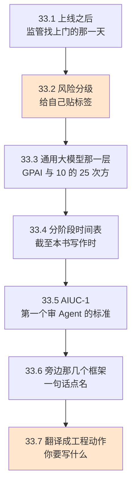
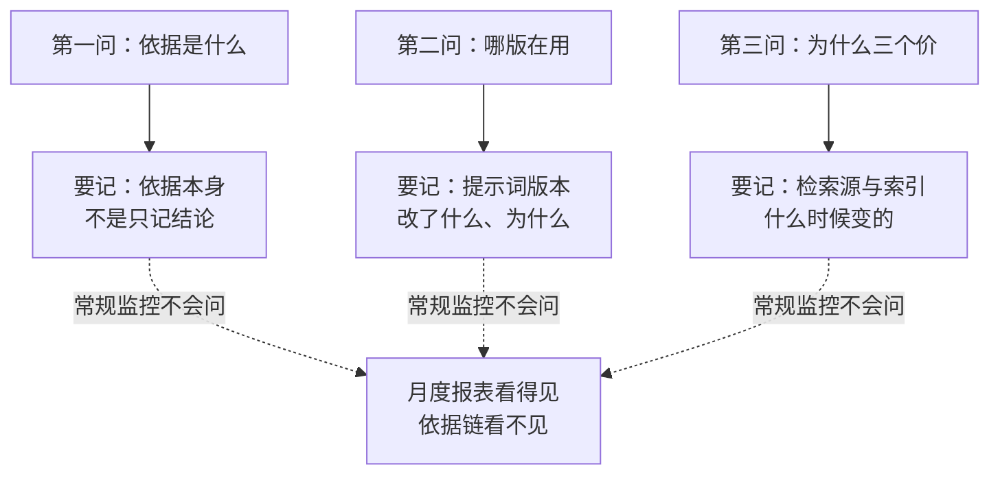
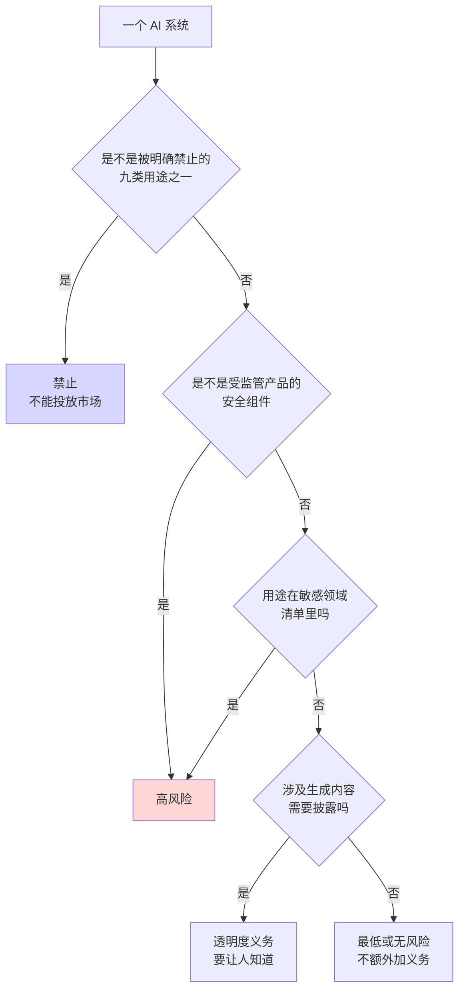

# Ch33 合规与标准：把监管清单翻译成工程动作

> 监管不看你想做什么，只看你能不能当场拿出证据。

## 本章目标

读完本章你应当能：

- 说清 Agent 的合规问题比传统软件难在哪三处，而不是泛泛地说"AI 风险大"
- 拿着 EU AI Act 的四级风险标签，给一个具体的 Agent 判档，并说得出这一档要多做什么
- 讲清通用大模型那一层（GPAI）的义务落在谁头上，以及 $10^{25}$ FLOPs 这个数字到底在划哪条线
- 分清 EU AI Act、AIUC-1、ISO 42001、SOC 2 各自管哪一段，为什么它们互相不能替代
- 把任意一条合规要求翻译成一个具体的工程动作——哪个文件、哪个字段、哪个开关
- 回答"我团队这周该先做哪一件事"

## 本章导览

**这一章是 Part 6 的横切汇总。** 前六章各自讲了一个侧面——系统内部要看得见（Ch29）、效果要量得出来（Ch30）、攻击面要堵得住（Ch31）、模型和成本要选得对（Ch32）。这一章把它们的共同问题拎出来：**这些工程动作，为什么突然从"最佳实践"变成了"有人会来查"**。

先给一个总的类比，它贯穿全章。**合规这件事，本质上是出厂检验。** 一台机器下线时，检验员拿着一张几十行的清单，逐项打勾，全过才签一张合格证；之后每年还要复查一次，工艺改了还要重新过一遍。

这个类比有三个要点，后面反复用到：

1. **清单是公开的。** 上面写着要检什么，你事先就知道，不用猜。
2. **证据是打勾的单子。** 检验员不看你口头说"我们测过了"，他要看那张单子上每一行后面签的字。
3. **复查是常态。** 不是一次性验收。

监管本质上做的就是这三件事。所以本章的组织方式就是：先看那张清单（33.2–33.5），再看你手上那张打勾单子要怎么填（33.7）。

## 33.1 上线之后，监管找上门的那一天

先演一遍「没有它会怎样」。

设想一个做得很扎实的团队。他们上线了一个给保险公司核保定损的 Agent——拍照上传，模型看损伤照片，出一个定损金额。人是复核的，工具权限是收窄的，日志记得清清楚楚（Ch29 那套）。上线前跑过红队（Ch31 那套）。从工程角度看，这是一个相当体面的系统。

一年后，保险公司的合规部门要做年度内审。审计员提出了三个问题：

**"上个月拒赔的 412 起，你们能给我看每一案的定损依据吗？"** 团队把日志拉出来——有。每一案都有输入照片、模型输出、金额、人工复核结论。

审计员看了三行，说："**我看到的只是结果。** 你告诉我模型判这是左前门受损，依据是什么？依据在你上下文里第 47 段的一句话，还是检索回来的一张行业理赔手册第 12 页？我看不出来。"

团队答不上来。因为**他们的日志记录了这次调用，没有记录这次调用的依据。**

**"这三个月里你们的系统提示词改了几版？"** 团队答：记不清了，改过，大概四五版吧。

审计员："**哪一版在用？改了什么？为什么改？"** 答不上来。

**"上周有人报告说你们的 Agent 给同一个人报了三个不同价格，你们发现了吗？"** 团队说不知道，得查。

查了两个星期，最后在日志里发现：是检索源更新了，导致同一条信息的索引变了，同一个 case 检索到了三个表述略有不同的条款。但**这个现象本身没有被任何机制发现**——是因为一个用户投诉才暴露的。

三问，全灭。而**没有一条是技术故障**。系统一秒钟都没挂，指标全部正常，代码一行没改。

这三问各自戳在哪一层，画出来就清楚了——**上面一排全是工程答得了的，下面一排全都不在工程的问题清单里**：

这就是合规和工程的分界线：**工程问的是"它现在好不好"，合规问的是"三个月前的那个结论，凭什么"。** 上面这三问里，第一问和第三问是 Ch29 可观测性的事——但 Ch29 教的是怎么让今天的系统看得见，而合规要的是**依据本身**被记录下来，不只是结果被记录下来。第二问是本章 33.7 会重点讲的提示词版本化。

**这一节要你带走的一句话是那句"没有一条是技术故障"。** 合规缺口不会以故障的形式出现在告警里——它安静地躺在"一切正常"的仪表盘下面，直到有人来问"凭什么"。这就是为什么它不能靠出事之后再补：**补的成本是重建三个月的历史，而重建不了。**

### 33.1.1 Agent 让这件事更难的三处

传统软件的合规问题已经存在几十年了（权限、数据留存、审计日志）。Agent 之所以更难，不是因为"AI 更危险"这种笼统的说法，而是三处具体的结构差异。

**第一处：结论和依据之间隔着一层不可读的推理。** 一个数据库查询返回"余额不足"，依据就是那一条 WHERE 条件，写在代码里，谁都能读懂。一个模型输出"定损 8000 元"，依据分散在一段几十页的上下文里——可能是检索来的一段行业手册，可能是系统提示词里的一条规则，可能是几个示例里的一个模式。**这些依据没有任何一个地方是以"这是判断依据"的形态存在的。** 它们只是被拼进上下文的一段文本，和问题、和用户的闲聊混在一起。

这不是"模型很神秘"这种玄学问题，是一个很具体的工程问题：**上下文的输入项和判断依据的输出项，被当成了同一种东西。** Part 4 Ch20 讲上下文工程的时候，我们把上下文当成一个"注意力预算"来管——装不下就压缩、就淘汰。合规要的是另一件事：在这堆被压缩被淘汰的文本里，**哪些是当时真正影响了结论的**，得被单独摘出来、单独存下来、单独能对照。

**第二处：责任主体在链条上是模糊的。** 你用的那个大模型，不是你训的。你基于它做的 Agent，也不是模型供应商提供的——是你自己写的编排逻辑。出了事，模型供应商说"我提供的是模型"，你说"我用的是你的模型"，中间那段"提示词 + 工具 + 检索 + 判据"是谁的？**这一段恰恰是决策真正发生的地方，也是没人负责的地方。**

EU AI Act 在这里给了一个非常具体的答案，它甚至精确到了"什么动作会让你从部署者变成提供者"——33.2.2 会讲这一条，因为它对工程团队的实际影响比想象中大。

**第三处：同一个系统，隔一段时间行为会漂。** 传统软件改了就是改了，版本号变了你就知道变过。Agent 有一个更麻烦的性质：**你什么都没改，它也可能给出不一样的结果**——因为外部的检索源更新了、因为上游模型做了静默的版本更新、因为工具返回的数据变了、因为长上下文里前面几轮的位置微移影响了后面几步的判断。

这意味着一句在合规语境里几乎致命的话：**"我们只在上线前测试过。"** 对传统软件这是一句充分的陈述；对 Agent，它只覆盖了时间轴上的一个点。

这三处合起来就是本章的核心命题：**Agent 的合规负担，几乎全部落在"能不能拿出可核对的记录"上，而不是"模型够不够安全"上。** 后者是一个研发命题，前者是一个记录命题——而记录命题是可以用工程手段解决的。这也是本章最后能给出一张工程动作表的原因。

## 33.2 给 AI 系统贴标签：EU AI Act 的分级机制

**《欧盟人工智能法案》（EU Artificial Intelligence Act，简称 EU AI Act）**是欧盟通过的一部法律，全称里"人工智能"和"法案"两个词都是直译。白话一句话：**它给每一类 AI 系统贴一个风险标签，标签决定你必须额外做什么。**

生活里的对应物你一定见过：**电器外壳上那个触电警示三角形。** 一台电饭煲和一台工业变压器都合法生产、合法出售——法律不禁止任何一种。区别在于警示等级不一样，而等级对应的是**你要额外做的工作**：变压器的绝缘层、接地、警示段说明书，是电饭煲不需要的。

**关键在于：EU AI Act 的绝大部分条款不是禁令，是加义务。** 全书最重要的一句话先说在前面——你不需要害怕这部法律，你要做的是查一下自己的系统落在哪一档，然后按那一档加事情做。

EU AI Act 于 2024 年 8 月 1 日生效，分阶段适用（33.4 专门讲时间表）。它的核心机制是**四级风险标签**。

### 33.2.1 先给一个具体系统判档

抽象的等级定义很容易读过去就忘，所以从例子进。先取三个系统，都是真的可能存在的：

| 系统 | 干什么 | 猜它落在哪一档 |
|---|---|---|
| A：一个给电梯做故障预测的模型 | 读传感器数据，预测哪部电梯下周可能出故障，推给维保班组 | ？ |
| B：一个招聘简历初筛 Agent | 读 800 份简历打分排序，给 HR 看前 50 名 | ？ |
| C：一个客服问答机器人 | 回答产品怎么用，退换货政策是什么 | ？ |

先看最反直觉的 A。**电梯故障预测，听起来比简历筛选危险得多**——电梯夹死人要判刑，简历筛选错判顶多让人家多等一轮。但这两者的答案可能是相反的。

原因在 EU AI Act 高风险的两条判定路径上：

**路径一（产品的安全组件）**：如果这个 AI 是某个**受监管产品**的**安全组件**（safety component），而这个产品的失效可能危及人的生命健康，那么它是高风险。电梯、机械手术机器人、汽车制动系统都属于受监管产品。A 里模型的角色是"预测"，它是维保决策的辅助材料，不是电梯安全回路的一部分——所以它**不在**这条路径上。

**路径二（用途清单）**：另一批高风险是由**用途**定义的，写在一张清单里。招聘属于其中一项——因为它决定一个人能不能得到一份工作，属于基本权利范畴。B 落在这一档。

**贴标签的判断顺序**，大致长这样：

把这张图和刚才三个例子对上：**B（招聘初筛）落在"高风险"**。**C（客服机器人）落在"透明度"**——因为它得让人知道对面是机器，不是人。**A（电梯故障预测）落在"最低或无风险"**。

第三个答案大概率会让不少工程读者意外，但它是这部法律的真实意图：**EU AI Act 管的是"你的系统替人做了关于他自己权益的决定"这类事情，不是"你的系统会不会造成物理伤害"这一件事。** 造成物理伤害这件事，产品安全法（电梯归哪个法规管、手术机器人归哪个法规管）已经管了几十年了，EU AI Act 明确要避免和这些产品安全法重复（33.4 会讲它怎么划界）。

所以那个最容易搞混的地方要再说一遍：**高风险不是"最危险"，而是"涉及基本权利"。** 一个只算电梯预测的模型再错，受伤的是电梯；一个简历初筛模型再错，损失的是一个公民的就业机会和尊严。后者被归进高风险，不是因为它算力更大，而是因为**它决定的事情直接落在一个人不可转让的权利上**。

### 33.2.2 四档标签，各对应什么义务

| 档位 | 白话 | 落在这一档的例子 | 你要额外做什么 |
|---|---|---|---|
| **不可接受风险** | 法律直接禁掉，不许投放市场 | 社会信用打分、职场和教育场所的情绪识别、无差别抓取人脸建库、执法场景的实时远程生物识别 | **没有义务——因为不许做。** 欧盟委员会列了九类禁止用途，其中第 1 至 8 类已于 2025 年 2 月适用；第 9 类（生成非自愿色情内容与儿童性虐待材料）自 2026 年 12 月起适用 |
| **高风险** | 涉及基本权利，必须满足一整套严格义务 | 招聘初筛、教育考试评分、信贷审批、关键基础设施的安全部件、移民与边境审核、司法辅助 | 风险管理体系、高质量数据集、日志留存、技术文档、**适当的人工监督**、稳健性与网络安全（第 9 至 15 条那一整套） |
| **透明度** | 不禁，但必须让人知道 | 客服机器人、AI 生成的深度伪造内容、公关性质的 AI 生成文本 | 披露交互对象是 AI；让生成内容可识别；特定内容要清晰标注 |
| **最低或无风险** | 不加义务 | 垃圾邮件过滤、游戏里的 AI、AI 会议助手 | 什么都不用多做 |

这张表里有三处，是工程团队真正要动手的地方，值得单独拆开说。

**第一，"适当的人工监督"（Article 14）不是"安排一个人坐在旁边"。** 这条在书里出现过好几次，但从未被精确定义过。EU AI Act 对它的要求是：系统要**设计成让人能够有效监督**——人得能看懂系统在做什么、能理解它的局限、能推翻它的决定、能中止它的运行。落到 Agent 上，这意味着"人工复核"这个动作必须真的有效。如果你的复核界面只给一个"同意/驳回"按钮，复核人平均两秒点一次同意，那这个环节在设计上就不满足要求——**监督的强度是设计出来的，不是安排出来的。**

**第二，"日志"不是 debug 日志。** Article 12 要求系统能自动记录事件，让系统的动作可以被回溯；Article 19 要求这些日志**至少保存六个月**，如果涉及个人数据保护等法律有更长要求就按更长的来。一个只在内存里滚动、关进程就没的调试日志，满足不了这条。

**第三，"技术文档"（Article 11）和"运行日志"是两样东西。** 前者是描述系统是什么的静态文档，后者是系统做过什么的动态记录。很多人把这两个搞混。文档必须在投放市场前准备好并持续更新；日志必须在运行中自动产生。Ch29 讲的是后者，而**前者这件事没有任何一章工具能替你做**——它是 33.7 那张表里最需要人写的部分。

### 33.2.3 分级不是贴一次就完：两个容易漏掉的机制

有两件事初读法规时很容易划过去，但对工程团队的实际影响比想象中大。

**机制一：分级判的是"用途"，用途一变，等级就变。** 你做一个通用的文档处理模型，如果只用于内部归档，那是最低风险；同一个模型接到一个自动批准报销单的流程上，它就变成了高风险。**同一套代码，风险等级可以因为业务方的接入方式不同而完全不同。** 实践上的含义是：模型上线时的那次定级不能一劳永逸，**每一次有新的业务方接进来，都要重新过一遍这个判断**。这也是为什么这张判断值得做成一个能复用的清单，而不是在启动会上凭印象吵一次。

**机制二：Article 25 说，谁改了它，谁就变成"提供者"。** 这条极其容易被忽略，也极其有实际后果。EU AI Act 里"提供者"（provider）是承担主要义务的角色——技术文档、合格评定、上市后监测，这些都是提供者的活；"部署者"（deployer）的义务要轻得多。

**如果你不是原始提供者，但你做了下面任何一件事——给自己的系统挂上名字、做了实质性修改、改变了它的预期用途以至于它变成高风险——从法律上你就成了这个系统的提供者**，要承担提供者那一整套义务。原始模型供应商要把相应信息和必要的技术访问权给你。

对工程团队的实际含义是：**你不能用"我们只是接了个别人的模型"来免除大部分合规责任。** 恰恰相反，在 Agent 场景里，你写的那段编排逻辑（提示词 + 工具 + 检索 + 判据）就是"实质性修改"最可能发生的地方。EU AI Act 的 AI Office（欧盟委员会里专门管这件事的职能单位）在 2026 年 8 月 2 日之后对基于 GPAI 模型搭建的系统也收紧了集中监督，这条机制是配套的。

## 33.3 通用大模型那一层：GPAI 与 $10^{25}$

上一节的分级有一个前提：你已经知道自己做的是"一个系统"。但现实是绝大多数团队做的是**在别人的模型上加一层编排**。这两件事在 EU AI Act 里被分成了两层，责任落在不同的人头上——**这一节就是讲清楚这个分层，因为搞错了会直接导致"我们以为不用管"。**

用检验厂的语言说：EU AI Act 检查的不只是你组装出来的那台机器，**还包括造发动机的那家厂**。发动机合格证是发动机厂出的，不是组装厂的；发动机厂要的是另一份文件，和你手上那张打勾单子不是同一张。

**通用人工智能模型（General-Purpose AI model，GPAI 模型）**在法规里的定义（Article 3(63)）拆开看有四个要件：能胜任**广泛范围**的多种任务（不是只做一件事）、**无论以何种方式投放市场**、能被集成进各种下游系统或应用、并且在投放市场之前不处于"研究、开发或原型"阶段。

白话一句话：**它指的是 GPT、Claude 这类能拿来干很多活的通用大模型，不是某个只做 OCR 的小模型。**

GPAI 提供者要履行的义务写在 Article 53（基础档）和 Article 55（系统性风险档），两档是包含关系：

| 档 | 谁适用 | 要做什么（法条里的清单） |
|---|---|---|
| **基础档**（Article 53） | 所有 GPAI 模型提供者 | ① 编制模型的技术文档（含训练与测试过程）；② 向要把它集成进系统的下游厂商提供信息与文档；③ 制定遵守欧盟版权法的政策；④ 公开训练内容的概要说明 |
| **系统性风险档**（Article 55） | 追加五项 | ⑤ 按标准化方案做模型评估；⑥ 做对抗性测试以识别和缓解系统性风险；⑦ 评估并缓解系统性风险；⑧ 跟踪、记录并上报严重事件；⑨ 确保恰当的网络安全保护 |

### 33.3.1 那个十的二十五次方，到底在划哪条线

上面那张表有个前提：如果某个模型有"系统性风险"，就要多做五条。**那么谁来判定一个模型有没有系统性风险？**

Article 51 给了一条自动触发的线：**如果一个模型训练时累计消耗的浮点运算次数大于 $10^{25}$，就被推定具有高影响能力（high-impact capability）**。

三个词要拆开，因为它们各自解决一个歧义：

- **浮点运算次数（floating point operations, FLOPs）** —— 白话：**模型训练过程中做过的乘法加法次数。** 这是衡量"往里投了多少算力"最常用的一个数，就像"盖楼用了多少车次的混凝土"一样，它不衡量房子好不好，只衡量规模。
- **十的二十五次方** —— 这个数量级大到需要换算才有意义：约等于 $10^{19}$ 次一秒的运算、连续跑 300 亿年。法规写这个数字不是为了让人心算，**是为了在没有别的度量方式时，给出一个自动生效、不需要争论的门槛。**
- **"推定"（presumed）** —— **这个词是全条的关键，也是最容易被跳过的一个词。** 推定意味着：**达到这条线就被认定有，不需要你自己举证证明你没有。**

**对读者的实际含义：如果你做的是通用大模型，越过 $10^{25}$ 之后，举证责任在你这边。** 你需要拿出证据说明这个模型没有系统性风险；拿不出来，就按有对待。反过来，**没超过这条线的模型也不是自动免责的**——Article 51 里还有一条并列的判定途径（委员会基于模型的能力、影响等因素指定），也就是说这条线是"自动触发"而不是"唯一入口"。

顺带把这层分工记清楚，因为它解释了为什么第 33.1 节那个保险案例里审计员会问出那些问题：**GPAI 提供者要交的是模型这一层的文档与训练数据概要，你这个系统要交的是判断依据、提示词版本、人工复核记录。** 两张单子，各填各的。

## 33.4 分阶段时间表：截至本书写作时的状态

这一节只讲一件事：**EU AI Act 不是某天全面生效，它是一段一段铺开的。** 任何写着"某月某日全面生效"的说法都要打问号。

⚠️ **以下状态以欧盟委员会与官方实施时间表页面为准，核实于本书写作时（2026 年 10 月）。法规推进过程中时间表仍可能调整，动手前请以官网为准。**

| 时点 | 发生什么 | 落在谁身上 |
|---|---|---|
| 2024 年 8 月 1 日 | 法案正式生效（此时义务尚未开始适用） | — |
| 2025 年 2 月 | **禁止类用途的第 1 至第 8 类开始适用** | 所有人：这些用途直接被禁，没有过渡期 |
| 2025 年 8 月 2 日 | **GPAI 相关规则开始适用** | GPAI 模型提供者 |
| 2026 年 8 月 | 透明度规则开始适用 | 生成合成音频/图像/视频/文本的系统提供者 |
| 2026 年 8 月 2 日 | 监督权从委员会移交至 AI Office 与成员国主管机关 | 监管方 |
| 2026 年 12 月 2 日 | 对**在该日期之前**投放市场的、生成合成内容的 AI 系统（含 GPAI 系统），须完成 Article 50(2) 的透明度义务 | 系统提供者 |
| 2027 年 8 月 2 日 | 对**在 2025 年 8 月 2 日之前**投放市场的 GPAI 模型，须完成其全部义务 | GPAI 模型提供者 |

从这张表能读出三条对工程排期有用的结论：

**第一，禁令没有缓冲期。** 第 1 至第 8 类禁止用途是 2025 年 2 月就生效的，落在那八类里的系统不是"要整改"，是"不许做"。如果你现在还在做情绪识别用于职场管理这类用途，这不是合规排期问题。

**第二，GPAI 那一档给了两年多的过渡。** 对 2025 年 8 月 2 日前已上市的模型，义务的终点是 2027 年 8 月 2 日。这条只对**模型提供者**有意义——用别人的模型搭系统的团队，日期由你系统的风险等级决定，不由这条决定。

**第三，透明度义务和监督权移交挤在 2026 年。** 也就是说，**截至本书写作时，"能不能说清这段 AI 生成的内容"已经从自愿变成了有义务的事。** 如果你的产品有生成合成内容的功能（文案、图像、音频都算），披露这件事要在 2026 年 12 月前落地。

> 一个常见的误解要在这里掐掉：**"分阶段"不等于"分档"**。33.2 讲的是"我这个系统是几档风险"——那是按**用途**分的，定了就不变；33.4 讲的是"每档义务从哪天开始适用"——那是按**时间**推进的。两把尺子，量的不是同一件事，就像 Part 3 Ch13 里记忆也有两把尺子那样。

## 33.5 AIUC-1：第一个专门审 Agent 的标准

33.2–33.4 是法。法有个绕不开的问题：**它管的是"AI 系统"，而 Agent 比它想的复杂。** 一个聊天机器人输出错了一句话，是一个可复现的 bug；一个有二十个工具、能改文件、能发邮件的 Agent，同一个错误可能在第四步才显形，而且它自己调了三轮模型才走到那里。**按传统软件的方式审它，是审不到的。**

于是有了专门的标准。**AIUC-1** 全称与中文译名不必记，记住它是什么就行：**它是一个面向 Agent 的安全、保障与可靠性标准**，由一批安全与风险从业者和前沿 AI 团队共同制定（官方称有 250 余位安全与风险负责人及前沿 AI 建设者参与）。

先说清它和 EU AI Act 是什么关系，这是读者最容易混的地方：

| | EU AI Act | AIUC-1 |
|---|---|---|
| **性质** | 法律 | 自愿性标准 |
| **谁定的** | 欧盟立法机构 | 行业组织 + 企业联合 |
| **管什么** | 按用途分级的法定义务 | Agent 的安全与可靠性怎么测 |
| **不遵守的后果** | 罚款、停止投放市场 | 商业与声誉后果（客户尽调、合同要求） |
| **能互相替代吗** | 不能。过了 AIUC-1 不等于满足 EU AI Act | 不能。AIUC-1 再严也不替你满足法定义务 |

用检验厂打比方：**EU AI Act 是法律规定哪些项目必须检验、检验到什么程度、合格证谁签；AIUC-1 是行业出了一套更细的检验项目清单和测法。** 监管认的是前者，后者是给你自己用的尺子——但这把尺子通常比监管来查时心里的那条线更细，而且客户会直接要。

**它对工程团队最实际的一处价值，是它替你回答了"该测什么"。** 前面几章我们已经把测试手段讲全了——Ch30 的评测流水线、Ch31 的红队、Ch29 的 trace。难的不是怎么测，是**测哪些**。AIUC-1 覆盖的是一整套风险类别，它的价值就在这份清单：它把"我觉得应该测一下"变成了"这一类在清单上"。

## 33.6 旁边那几个框架：各管哪一段

合规不是只有一部法。桌上通常还有另外几个杯子，本节只**点名并说明分工**，不展开——它们的正文都是公开标准，读者需要时直接去查，在这里展开只会稀释本章的主线。

| 框架 | 它是什么 | 管哪一段 | 和 EU AI Act 的关系 |
|---|---|---|---|
| **SOC 2** | 审计意见，由会计师事务所出具 | 安全性、可用性、保密性、处理完整性、隐私五个 Trust Services Criteria | 不重叠。它不管"这个 AI 系统风险几档"，管"你的组织有没有把该控的都控住了" |
| **ISO/IEC 42001** | AI 管理体系国际标准 | 组织怎么管 AI：政策、职责、流程、记录 | 可互补。EU AI Act 罚的是系统，42001 管的是体系；**一个高风险系统往往两项都要做** |
| **ISO/IEC 27001** | 信息安全管理体系标准 | 数据与访问的安全管理 | 更底层的通用信息安全。EU AI Act 要求的日志、数据治理有一部分落在这里 |
| **GDPR** | 欧盟数据保护法 | 个人数据的处理基础、权利、跨境传输 | 全程适用。**Agent 场景里它比 EU AI Act 更常先咬人**——你把用户数据送进上下文、存进记忆，这些行为 GDPR 管得比 AI Act 早 |

一句话记住分工：**GDPR 管"数据能不能用"，EU AI Act 管"这个系统能不能卖"，ISO 42001 管"我们这个组织有没有能力持续管住"，SOC 2 是别人给你出的证明。**

## 33.7 翻译成工程动作：你这周该写什么

前面六节都在讲别人的规则。这一节是本章要留给读者的东西——**一条规则对应一件你能动手做的事。**

回到 33.1 那个保险案例的三问。我们现在知道 EU AI Act 要求"技术文档"（Article 11）和"自动日志记录"（Article 12，高风险系统还要按 Article 19 留存至少六个月），Ch29 讲过怎么埋 trace，Ch30 讲过怎么建评测流水线。**把它们对起来，得到下面这张表。**

| 一条合规要求 | 它在问什么 | 对应的工程动作 | 本书哪一章 |
|---|---|---|---|
| **技术文档**（Article 11） | 这套系统是什么、怎么搭的、边界在哪 | 写一份 `SYSTEM.md`：模型与版本、系统提示词全文、工具清单与每个工具的权限、知识来源、已知限制。**跟着代码走版本号** | 33.2.2 已点出这件"没有任何工具能替你做" |
| **提示词版本化** | 当前在用的是哪一版？改了什么？为什么改？ | 系统提示词从字符串字面量搬进文件或配置，纳入版本控制；每次运行把版本号写进 trace | Ch29（把版本号作为 span 属性） |
| **自动日志记录**（Article 12） | 系统做过什么，能不能回溯 | Ch29 那套 trace 就是这一条的实现；**关键是"自动"——靠人记得记不算** | Ch29 |
| **判断依据可核对** | 这个结论凭什么得出的 | 在组装上下文时给每一段加来源标记（来自哪份文档第几节 / 哪次工具调用），并随结论一起落库。**这是 Ch33.1 第一问的答案** | Ch20（上下文组装） |
| **输出可识别**（Article 50(2)） | 这段内容是不是 AI 生成的 | 生成内容加标识；对外发布的合成媒体按 Article 50(4) 加机器可读标记。**这项 2026 年 12 月前落地** | 33.4 |
| **适当的人工监督**（Article 14） | 复核这个动作有没有效 | 让复核界面能给出"依据"，而不只是"同意/驳回"；**并统计复核人的真实通过率——长期 99% 立刻通过，说明这不是监督，是走过场** | 33.2.2 已给判据 |
| **输入数据质量**（Article 10） | 训练与检索用的数据是否相关、有代表性、尽可能无错 | 检索源的质量基线：抽检命中率、过期内容比例、重复率，定期看 | Ch23（RAG 的检索侧） |
| **漂移与持续监测**（Article 72） | 上线之后行为有没有变 | 固定回归集定期跑；Ch29 的 trace 加上时间维度，看某个指标是不是在慢慢漂 | Ch30（评测）、Ch31（红队回归） |
| **严重事件上报** | 出事了要不要报、报给谁 | 预先定义"什么算严重事件"与上报路径。**EU AI Act 管的是严重事件，不是所有 bug**——普通误判不必报，但漏报判定标准本身是义务 | Ch31（先定义，再测） |

**这张表里有一个模式值得单独说：三行（技术文档 / 提示词版本化 / 判断依据可核对）没有一行需要模型变强，也没有任何一行需要新的架构。** 它们要的是你把已经存在的东西**记下来**——这就是 33.1 结尾那句话的兑现：Agent 的合规负担几乎全部落在"能不能拿出可核对的记录"上，而这是个记录问题，不是研发问题。

**最后是排期。** 如果只能本周做一件事，做这四件，顺序如下：

1. **把系统提示词从代码里搬进版本控制**（半天，立刻见效，且是后面三件事的前提）
2. **让每次运行记录下提示词版本号**（一天）
3. **给上下文的每一段加来源标记并落库**（两到三天，本章成本最高但价值最大的一项）
4. **给系统写一份 `SYSTEM.md` 骨架**（一天，先写已知限制那一节——它最难编，也最能暴露你还没搞清的地方）

## 本章小结

- **合规问的是"依据"，不是"好不好"。** 33.1 那个保险案例里三个问题全灭，没有一条是技术故障——系统没挂、指标正常、代码没改。
- **EU AI Act 是按用途贴四级标签，加义务而不是下禁令。** 判断你的系统在几档，比记住法条有用得多；而且**分级判的是用途，用途一变等级就变**，每接一个新业务方都要重判一次。
- **你不是原始提供者也可能变成提供者**（Article 25）：挂名字、做实质性修改、改变预期用途到高风险，任一即可——而"实质性修改"在 Agent 场景里最可能就发生在你写的那段编排逻辑上。
- **GPAI 那一层是模型提供者的责任**，$10^{25}$ FLOPs 是自动触发的门槛，且是**推定**——越线之后举证责任在你这边。
- **时间表分阶段推进**；截至本书写作时，禁止类第 1–8 类已适用、GPAI 规则已适用、透明度规则 2026 年 12 月前落地、监督权已于 2026 年 8 月 2 日移交。**别把"分阶段"和"分档"搞混。**
- **AIUC-1 与 EU AI Act 不是替代关系**：前者是自愿标准、回答"Agent 该测什么"，后者是法、回答"系统能不能卖"。
- **本章最该带走的是 33.7 那张表**：合规要求是可以翻译成工程动作的，而且最值钱的三件——提示词版本化、判断依据可标记、技术文档——都不需要模型变强。

## 本章参考

### 必读

- [Regulation (EU) 2024/1689 — EU Artificial Intelligence Act 官方文本（EUR-Lex）](https://eur-lex.europa.eu/eli/reg/2024/1689/oj)
- [欧盟委员会：Regulatory framework on AI](https://digital-strategy.ec.europa.eu/en/policies/regulatory-framework-ai) —— 官方对风险分级、GPAI 义务与适用时点的说明，本章 33.2/33.3/33.4 的依据
- [EU AI Act Implementation Timeline](https://artificialintelligenceact.eu/implementation-timeline/) —— 分阶段适用时间表，33.4 那张表的来源
- [Article 51 — Classification of general-purpose AI models as general-purpose AI models with systemic risk](https://artificialintelligenceact.eu/article/51/) —— $10^{25}$ FLOPs 推定条款原文
- [AIUC-1 官方站](https://aiuc.com/) —— Agent 安全与可靠性标准的范围与进展

### 推荐博客 / 教程

- [Article 53 / Article 55 条文页](https://artificialintelligenceact.eu/article/53/) · [Article 55](https://artificialintelligenceact.eu/article/55/) —— GPAI 两档义务的逐条清单，33.3 那张表的来源
- ISO 42001 / ISO 27001 / SOC 2 / GDPR 均只在此处点名，**正文一律未展开**；需要时直接查各自官网的公开摘要或范围说明即可

### 视频 / 课程

本章刻意不列。法规类内容更新极快，**视频讲的是录制当时的状态，两年后的合规判断必须回到 33.4 那张时间表和官方原文上**——上面那几个「必读」链接才是可靠来源。
