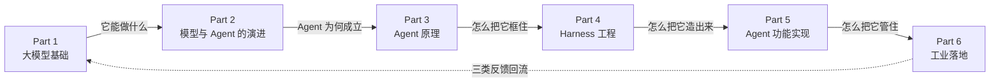
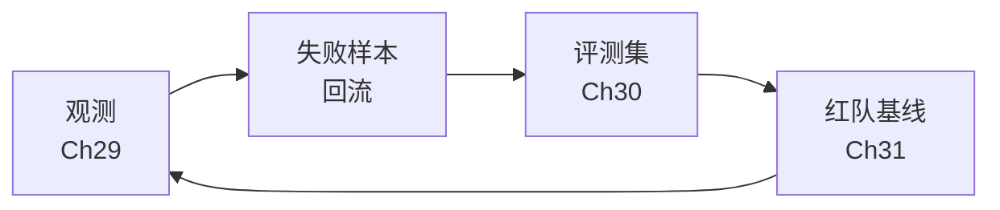

# Ch34 真实案例与全书小结

> 六个 Part 走完，最后落回地面：三个案例、一张地图、一份 30 天清单。

## 本章目标

读完本章你应当能：

- 看到一个流传很广的行业数字时，判断它能不能当事实引用，以及判断的依据是什么
- 说出三个落地案例各自的**机制级**教训（不依赖任何具体产品名或私有术语）
- 拿到一份「上线一个 Agent」的需求，说出第 1 周到第 4 周分别该做什么、为什么是这个顺序
- 遇到一个具体问题时，能从六个 Part 里判断该回查哪一章

## 本章导览

这是全书的一张地图。你现在只需要看懂两件事：**最左端是什么、最右端是什么**，中间六块扫一眼认个位置即可。34.5 会回来逐块讲。



从左往右读，是本书的顺序。但真实使用时你多半是**反着用的**——你手上有一个具体问题，翻到 34.5 那张对照表，找到对应的那一格，进去读那一章。

---

## 34.1 案例一：一个被讲错的故事，和它真正的教训

先讲一个你几乎一定会遇到的故事。

2024 年初，一家欧洲金融科技公司公开宣布，它的 AI 客服助理"一个人顶 700 名全职客服"。这个数字被反复转述，成了整个行业里引用最多的案例之一。一年半后，同一家公司宣布重新扩充人工客服，并在多个场合承认此前的服务质量出现了下滑。

如果不查证，你从这两次声明里读到的故事是：**他们上了 AI，然后翻车了。**

这个印象大体没错，但它掩盖了真正值得学的那件事。

### 34.1.1 这些数字为什么不能当事实引用

上面那个"700"，本章只当它是一个你几乎一定会听到的故事，**不把它当事实引用**——接下来这段讲的就是为什么。

写这一节的时候，我们逐条去找上面那些数字的一手出处——公司新闻稿、CEO 访谈原文、监管披露。结论是：**公开渠道里能查到的具体数字，几乎全部转自同一批聚合站和二次转述文章，彼此互抄，找不到可独立核对的原始出处。**

而且这些数字本身的含义就有争议。「一个人顶 700 名客服」按该公司自己的解释，更接近"本来打算要扩招的 700 个岗位没有招"，而不是"裁掉了 700 个人"——前者是**省掉的增量**，后者是**砍掉的存量**，这是两件在成本、舆情、法律风险上完全不同的事。

所以本章的规矩是：**凡找不到一手出处的具体数字，一律不写，只保留站得住的机制。**

这不是谨慎过度，这正是本书 Part 6 一直在讲的那件事。你的 Agent 出问题时，你需要的不是"感觉变差了"，而是一条能回放的轨迹（见 Part 6 Ch29）；同样，你读别人的案例时需要的也不是"听说降了"，而是原始出处。**同一个标准用在别人身上，也用在自己身上。**

### 34.1.2 真正的教训：兜底通道

站得住的那句话来自该公司 CEO 的公开表态，大意是：成本在组织这件事的时候权重太高了，最后得到的是更低的质量。

把它翻译成工程语言，教训只有一句：

> **用 AI 顶掉了人工，却没有把「转人工」这条通道一起设计进去。**

打个比方：**消防通道。**

一栋楼从图纸开始，每一层都装消防喷淋、烟感、灭火器——这是日常的消防系统。但图纸上还画着另一样东西：**一条从每层都能走到室外的楼梯。**

为什么要在平时就开始造楼梯？因为火情发生的时候，你不可能临时凿一栋楼出来。**逃生通道的价值不在于它经常被用，而在于它必须一直在那儿。**

「转人工」就是客服系统里的消防通道。

它的日常成本极低——99% 的时候没人用，因为 AI 直接答了。但剩下那 1%：账户被冻结了、钱扣了两次、用户已经在电话里带着情绪了——那里如果只有一条 AI 通道，服务体验的崩塌几乎是必然的。

| 设计 | 平时看起来 | 出问题时 |
|---|---|---|
| 只有 AI 通道 | 省掉全部人工成本 | 用户无路可退 |
| AI 优先 + 转人工通道常驻 | 多付一份"闲置"成本 | 用户有出口 |
| 分级处理：简单自动、复杂转人 | 要设计分流规则 | 分流错也能兜住 |

### 34.1.3 翻译成三个工程动作

机制讲完了，把它落成能今天就做的事：

1. **转人工的入口要长在 AI 的每一次回答旁边**，而不是藏在某个页面底部的"联系客服"里。一个人在情绪高点上翻菜单，是最不该让他做的事。→ 见 Part 5 Ch23
2. **人工坐席必须能看到这段对话的完整上下文**，包括 AI 已经试过什么、为什么没答上来。切断了上下文的转接等于让用户从头再说一遍——这是很多团队做"兜底"时漏掉的一环。→ 见 Part 6 Ch29
3. **「转人工率」是一个要被监控的核心指标，不是一个失败率。** → 见 Part 6 Ch30

第 3 点值得停下来多说一句。

多数团队在看板上是把它当成"AI 能力不足"的证据的，于是拼命往零压。压到零的方式无非两种：把不该自动答的问题也自动答了，或者在入口处故意设障碍。这两种做法都会让指标变好看，而体验变差。

**正确的读法是：转人工率是一个你希望它稳定在某个区间、并且异常波动能触发报警的指标，不是越低越好的指标。** 它的突然升高是质量信号，它的长期为零是危险信号。

---

## 34.2 案例二：一个编码 Agent 的观测实践

> **先说清楚这一节是什么。** 34.2 与 34.3 是**合成案例**——把公开可查的常见做法整理成一个完整、可复现的形态，**不是某家公司的真实披露**。写明这一点，是为了让你清楚：这两节讲的是"应该长什么样"，而不是"某公司确实这么做了"。

### 34.2.1 症状：它能改文件，但没人说得清它改了什么

场景：一个给工程师用的编码 Agent。它读代码、改文件、跑测试。演示效果很好。

三个月后出事了：有用户发现 Agent 顺手把一个看起来毫不相关的配置文件也改了，导致 CI 挂掉。事后复盘只能靠人肉翻聊天记录，整个排查花了三天。

问题不在于 Agent 改错了——模型犯错是必然的，可以靠评测降低频率。问题在于**你事后拿不出证据**：哪一轮、哪个工具、哪个上下文导致的改动，你答不上来。

打个比方：**行车记录仪。** 它不阻止事故，它只决定"出事后能不能说清"。没装记录仪的车，出了事只能靠双方口供。

一个能上线的编码 Agent，至少要记三类东西：

1. **一次用户意图从提出到完成的完整轨迹**——经过哪些轮次、每轮调了什么工具、每次工具调用的入参出参、每轮的上下文里都装了什么
2. **每一次工具调用的耗时与成败**
3. **每一次模型调用的 token 数与费用**

第一类是骨架，另外两类挂在它上面。

### 34.2.2 成本要归因到工具，不是笼统计到请求

最容易犯的错，是把一个请求的总账单记成一行。"这个请求花了 3 块钱"——然后就没了。你无法回答是哪一步花的。

真实情况通常长这样：一次编码任务里有十几轮模型调用，其中大部分是廉价的"读一个文件、改一行"，只有一轮是"通读整个仓库做架构决策"。成本几乎全部集中在那一轮，但请求级的账单把它和其余十几轮混成了一坨。

正确的做法是**每一轮都带自己的用量记录，并且把这一轮的上下文构成也记下来**。后者比前者更重要——同样的 token 数，上下文里装的是"用户这轮说的话"还是"整个仓库的目录树"，成本和效果完全是两回事。

按轮次拆开之后，一次「把这个函数改成异步」的任务长这样：

```text
轮次 1   读 3 个相关文件            输入 12k / 输出  400      占比  6%
轮次 2   提出方案                    输入  8k / 输出  900      占比  8%
轮次 3   改文件                      输入 13k / 输出  500      占比  7%
轮次 4   跑测试                     输入  5k / 输出  300      占比  4%
...
轮次 9   测试失败，读取完整错误栈      输入 31k / 输出 1200      占比 41%
```

这个例子想说明的**不是**"第 9 轮花得多"。它想说明的是：

- 如果你只有请求级的账单，你会得到一个结论——**"这个类型的任务就是很贵"**，于是去换更贵的模型或者砍功能。
- 有了轮次级归因，你会看到真正的事实——**是错误处理那一轮吃掉了预算，而这一轮的上下文构造是可以改的**：只回传相关的几行栈，而不是整段日志。

同一份账单，两个完全不同的下一步动作。

| 归因粒度 | 能不能回答"为什么贵" |
|---|---|
| 按请求 | 不能 |
| 按模型调用轮次 | 能，但只能定位到"哪一轮" |
| 按轮次 × 上下文构成 | 能，能定位到"哪一段上下文" |

### 34.2.3 失败样本要能一键变成回归用例

第三个关键设计：观测数据不只是给人看的，它要**喂回评测**。

具体说：每一条用户明确表示不满的对话——点了"这个答案不对"、手动撤销了 Agent 的改动、或者中途转人工了——都应该能被**一键**转成一条评测用例，带着当时的输入、期望行为、实际行为、失败原因。

关键在于"一键"这两个字。如果需要有人手工整理，三个月后你会有一个已经腐烂的评测集，而团队会误以为"我们已经有评测了"。**评测集腐烂的真正原因从来不是没人维护，而是维护成本太高。**

一旦失败样本自动回流，评测集就变成一个只增不减的集合。而"线上评测数据源"这件事，本来是很多团队到第三年才想明白怎么建的东西——它就是从这个按钮长出来的。→ 见 Part 6 Ch30

反向的连接同样重要：每一次改提示词、换模型、改工具描述，都跑一遍这个集合。这条链路正好是 Part 6 的前三章串起来的那根线：



---

## 34.3 案例三：一家中型企业的知识库问答

同样是合成案例（理由见 34.2 开头的声明）。

### 34.3.1 症状：能回答，但答得不对，而且没人知道为什么

场景：一家公司做内部知识库问答。员工问"差旅住宿的报销标准是多少"，系统给出了一个答案，看起来很像样，金额是错的。

典型做法：改知识库、换检索模型、调切分大小。改了一周，没用。

为什么没用？因为**你不知道错在哪一环**。

一个最终答案由三段拼成：检索到的片段、重排之后的顺序、模型根据这些片段生成的话。答案错了，可能是压根没检索到，可能是检索到了但排在后面被截掉了，也可能是片段里根本没有这个数字、模型自己编了一个。**这三段共用同一个"答案"出口，而答案本身不告诉你它来自哪一段。**

### 34.3.2 第一刀：让每个答案带上它的证据

改法非常小：输出的时候，把实际用到的片段原文一并返回，显示在答案下方。工程量大概一天。

这一刀做了两件事：员工能自己判断该不该信它；更重要的是，**你第一次有了"这个答案对不对"的判断依据**，不用再靠猜。

这类设计有个通用叫法——**引用溯源**。它和 Part 6 Ch29 的轨迹是同一类东西：把黑盒的一个出口打开一条缝。区别只在于这里给用户看，那里给你自己看。→ 见 Part 5 Ch23

### 34.3.3 第二刀：先看召回，再动别的

有了引用，你才第一次能区分两种失败——而它们的修法完全不同：

| 你看到的现象 | 归因 | 该动的地方 |
|---|---|---|
| 引用里没有相关段落 | 没召回 | 切分粒度、查询改写 |
| 引用里有，但排在第 5 位被截掉了 | 召回了没用上 | 重排、top-k 数量 |
| 引用里有正确段落，答案还是错 | 生成了错的 | 提示词、要求必须依据引用 |

之前的做法，是在这三种之间来回猜。

结论：**这类系统调优的第一步永远是加引用溯源，不是换检索模型。** 没有这一步，后面每一次调整都是赌博。

### 34.3.4 一个容易踩的坑：切分粒度

第三个细节，也是最容易被忽略的一个：**切分的粒度，决定了后面所有调优的上限。**

打个比方：**菜谱。**

一本菜谱如果每道菜只写一行——「宫保鸡丁：鸡肉切丁，干辣椒，花生，猛火快炒」——你知道它是什么菜，但你**照着做不出一道菜来**：盐放多少？火开多大？炸到什么时候？任何一处含糊，做出来就是另一个味道。

反过来，如果一道菜独占一页，从选料讲到摆盘，一页里塞了四道菜，那你就更没法用了。

文档切分完全是这个道理。一段话只切成一行，检索命中了但信息不全，模型只能猜；切成一大段，命中了里面混着七件事，模型被干扰。**合适的状态是：一个切块刚好是一段能独立回答一个问题的内容。**

Part 5 Ch23 讲过怎么选这个粒度，这里只补一条实践顺序：**先用默认粒度跑通全链路，把引用溯源接上，看真实的失败样本，再回来调粒度。** 顺序反了，你就是在黑暗里拧旋钮。

---

## 34.4 三个案例的共性

三个案例表面上毫无关系——客服、编码、知识库。但把它们的教训并排放，会看到同样三件事。

| 案例 | 看不见的地方 | 兜底通道 |
|---|---|---|
| 客服 | 质量是什么时候掉的 | 转人工 |
| 编码 | Agent 到底改了什么 | 撤销与回滚 |
| 知识库 | 这个答案的依据是什么 | 引用溯源 |

**第一，可观测先行。** 三个案例里，每个问题的定位都卡在同一个地方——看不见。客服案例看不出质量从什么时候开始降；编码案例三天复盘靠人肉翻记录；知识库案例分不清是没检索到还是生成了错。**没有轨迹的时候，你所有的优化都是猜。**

**第二，改动要能小步验证。** 三个案例的修复都不是一次上线，而是先在极小流量上跑、拿指标对比、确认没退化、再放大。**一次上线的改动，你既学不到东西，出事了也退不回去。**

**第三，兜底永远要留。** 三个案例的兜底形式完全不同——转人工、撤销回滚、引用溯源——但它们是同一件事：**主路径可能失效，所以必须有一条成本不高、但一直存在的退路。** 34.1.2 那个消防通道的比喻，在这里可以再回来用一次。

这三条正好是 Part 6 前五章的顺序：**可观测 → 评测 → 安全 → 成本 → 合规**，不是随手排的。

**而且这三条不能倒着做。** 很多团队的排期恰恰是反的：先做功能（一周），再补安全（上线前一天），最后想起来要监控（出事了以后）。

倒着做的代价在每一步都是实的：

- 没有观测就上安全——你写了一份攻击清单，但没法验证防御有没有生效，只能靠"我觉得挡住了"
- 没有评测就控成本——你砍了缓存、换了小模型，然后**没有任何办法知道质量是不是掉了一点**
- 没有评测就先上灰度——灰度本身没有意义。灰度比的是两组，**没有基线分数的两组，只是两个不同的数字**

一句话：**后面每一步的产物，都必须是前面某一步流下来的东西。** 这就是为什么 34.6 那份清单是四周而不是一周。

---

## 34.5 全书：六个 Part 各回答了哪个问题

现在回到开头那张地图。

六个 Part，每个只回答一个大问题。把它当目录用：**遇到问题时，先判断这是哪一类问题，再回查对应 Part。**

| 你遇到的问题 | 去哪 | 具体章节 |
|---|---|---|
| 模型为什么这么答 / 它是怎么训出来的 | Part 1 | Ch3 注意力、Ch4 训练、Ch5 对齐 |
| 这个能力是什么时候出现的 / 协议从哪来 | Part 2 | Ch6 家族编年史、Ch9 协议起源 |
| Agent 到底由哪几部分组成 | Part 3 | Ch11 认知架构、Ch12 三大范式 |
| 怎么把它框住 | Part 4 | Ch17 七项职责、Ch21 权限与沙箱 |
| 某个具体功能怎么做出来 | Part 5 | Ch23 工具与检索、Ch26 代码执行 |
| 上线之后的所有事 | Part 6 | Ch29–Ch33 |

如果你想快速判断该从哪读，有三条路径：

- **你从零开始做 Agent**：Part 4 → Part 5 → Part 6。Part 1、Part 2 先跳过，等遇到看不懂的术语再回来查。这样你能最快拿到一个能跑的东西。
- **你已经有一个能跑的 Agent 了**：直接读 Part 6。你现在缺的不是功能，是可控性。
- **你做的是平台/框架**：Part 3 → Part 4 → Part 5。你要回答的是"别人拿我的平台能做什么"。

全书最重要的一句话，Part 4 Ch17 第一次说出口，这里是唯一一次重复：

> **Agent = 模型 × 外壳（harness）。模型是零件，外壳是产品。**

整本书的其余内容——Part 1 讲零件有多强、Part 3 讲零件怎么协作、Part 5 讲怎么造出零件和外壳、Part 6 讲怎么管住一整套系统——都是这句话的注脚。

### 34.5.1 三条贯穿全书的线索

如果你只带走三样东西，应该是下面这三条。它们在书里各处反复出现，读到后面回头看会非常省力。

**线索一：触发权在流程手里，不在模型手里。**

模型的输出永远只是**一个提议**。要不要执行、能不能重试、要不要先过一道闸，决策权在外壳手里。这条线索第一次出现在 Part 3 的推理循环里，在 Part 4 Ch21 变成一张权限表，在 Part 5 变成每个工具的输入契约，在 Part 6 变成灰度和回滚。→ 见 Part 3 Ch12、Part 4 Ch21

**线索二：上下文是有限预算，而且每一轮都在重新分配。**

不是"模型记性差"，是窗口就那么大、注意力就那么多。每次调用工具的返回、每次检索的结果、每段长期记忆，都在抢同一个额度。这条线索在 Part 4 Ch20 最集中，在 Part 5 Ch24 变成三层记忆的选型，在 Part 6 Ch32 变成一张成本账单。→ 见 Part 4 Ch20、Part 6 Ch32

**线索三：外壳是产品。**

用户抱怨的从来不是"模型不够聪明"，是"它又做了一件我没让它做的事"。这些全是外壳的问题。这条线索在 Part 4 Ch17 定调，在 Part 5 变成实现任务，在 Part 6 变成合规与兜底。→ 见 Part 4 Ch17

三条合起来是一句话：**模型提议，流程决定，上层负责。**

---

## 34.6 上线一份 Agent 的 30 天清单

四周，每周一个主题：

| 周 | 主题 | 一句话 |
|---|---|---|
| 第 1 周 | 让它能被看见 | 可观测 |
| 第 2 周 | 让它能被衡量 | 评测 |
| 第 3 周 | 让它能被攻击 | 安全 |
| 第 4 周 | 让它能被收回 | 成本与兜底 |

**这个顺序不是随便排的：看不见 → 衡量不了 → 守不住 → 撤不回。** 每一步都依赖前一步的产物。

### 第 1 周：让它能被看见

- [ ] 每次模型调用记下用量，输入 / 输出 / 缓存命中**分开记**
- [ ] 每轮对话记下：模型调了几次、调了哪些工具、上下文里装了什么
- [ ] 接一个能按单条轨迹查询的面板，而不是只出聚合图表的面板
- **完成的标志**：你能回答"昨天最贵的 20 个会话分别是哪些、贵在哪一步"

### 第 2 周：让它能被衡量

- [ ] 攒 30–50 条真实样例，手工标好期望行为
- [ ] 定义 3–5 条硬规则指标（格式、工具选择、是否触发禁止项）+ 1 条主观指标
- [ ] 跑一个基线，把结果记下来
- **完成的标志**：你在改动任何东西之前，能说出"现在大概多少分"

### 第 3 周：让它能被攻击

- [ ] 权限默认拒绝，逐条打开（见 Part 4 Ch21）
- [ ] 会改动世界的动作要过一道闸；只读动作可以放心重试
- [ ] 写一份针对**你这个** Agent 的攻击清单：提示注入、越权、工具滥用、数据外泄
- **完成的标志**：清单上的每一条，你都能说出防御在哪一段逻辑里

### 第 4 周：让它能被收回

- [ ] 把账单按"任务类型 × 模型档位"拆开（见 Part 6 Ch32）
- [ ] 先做最省事的那一刀：缓存命中、提示词顺序
- [ ] 上线兜底通道（转人工 / 可撤销 / 可回滚），并让它**容易找到**
- [ ] 小流量灰度：先放 5% 的用户，跑满一周
- **完成的标志**：你能在 1 分钟内把系统退回上一个版本

最后强调一次：这是一份**顺序**，不是一份流程。

第 1 周没做完，第 2 周的评测就建立在猜的上面；第 3 周的红队找不到回归基线；第 4 周的成本优化会把你自己当成唯一的数据源。跳步的代价不是"效率低一点"，是后面三周全部返工。

---

## 34.7 未来 12–24 个月

这一节写短一点。给方向，不给日期——**任何带具体时间点的技术预测，超过一年基本都会被打脸。**

五个我认为会持续发酵的方向：

**一，模型能力的提升会越来越多地被外壳吃掉。** 同一件事今年可能要写五步提示词，明年可能一步就够。但权限、审计、灰度、回滚这些东西不会因为模型变强而消失——因为它们解决的不是"能不能做到"的问题，而是"做到了之后能不能交代"。→ Part 4

**二，跨 Agent 的互操作，会比单个 Agent 的能力更快地拉开差距。** 当 Agent 之间可以互相调用，能把一个复杂任务拆给不认识的合作方时，"我的 Agent 有多好"这个问题会部分地变成"我的 Agent 能和多少人配合"。协议层目前还在早期，标准一年一变的概率不低，这里值得持续跟，但不要把赌注全押在上面。→ Part 2 Ch9、Part 4 Ch18/Ch19

**三，合规会从文档工作变成工程工作。** 现在多数团队把监管要求当成一份要归档的材料。往后它更可能出现在一个你必须当场回答的问题里——"你这个系统为什么这么判"、"这条决策的依据能给我看看吗"。那时候能给出答案的，是那些**当时就把依据记下来了**的系统，而不是当初写了一篇漂亮的合规文档的团队。→ Part 6 Ch33

**四，评测集会从"人造"变成"自产"。** 现在大部分团队的评测集是三年前写的几十条样例，早就和线上真实分布脱节了。34.2.3 讲的那个"失败样本一键回流"如果做扎实，评测集会自己长大、自己更新。但这也带来一个今天就该想的问题：**当评测集由系统自己的失败生成时，它会不会只覆盖系统已经会的那类问题？** 怎么给它留出"故意不会"的部分，是后面两年评测工程的主要议题之一。→ 见 Part 6 Ch30

**五，工具会从"被调用"变成"被谈判"。** 现在的形态是模型提出一次调用，外壳批准或拒绝。再往前一步，多个工具并行、互相知道对方的存在、需要协商顺序和资源的时候，"工具"就更接近"同事"了。这会同时冲击权限模型和沙箱模型——**你很难给一个会互相商量的东西划权限**。→ 见 Part 5 Ch23、Part 4 Ch21

五个方向的共同点很清楚：**它们的受益者，都是那些把外壳当产品做的团队。**

---

## 本章小结

- **本章第一个例子刻意不把任何具体数字当事实引用**，因为找不到可独立核对的一手出处。**凡是只有二手来源的行业数字，一律降级为"公开报道口径"或者不写**——这是本书对读者和对自己用的同一条标准。
- 那个案例真正的教训不是"上了 AI 会翻车"，而是**用 AI 顶掉人工时，没有把兜底通道一起设计进去**。兜底通道的价值不在于它经常被用，而在于它必须一直在。
- **转人工率是一个要被监控的指标，不是越低越好的指标。** 升高是质量信号，长期为零是危险信号。
- 编码 Agent 的观测要记三类东西，成本要**归因到轮次和上下文构成**，失败样本要能**一键**变成回归用例——"一键"两个字决定了评测集三个月后是活的还是腐烂的。
- 知识库问答调优的第一刀是**加引用溯源**，不是换检索模型。看不见失败在哪一环时，后面每次调整都是赌博。
- 三个案例的共性只有三条：**可观测先行、改动小步验证、兜底永远要留**——它们恰好就是 Part 6 前五章的顺序。
- 全书六 Part 各回答一个大问题，**四周的顺序是：先看得见，再衡量，再攻击，最后才谈回收。** 跳步的代价是后面全部返工。
- 记住 **Agent = 模型 × harness，模型是零件，外壳是产品**，这一句就够。

## 本章参考

本章不引入新的必读论文——所有一手资料在它们原本那一章的末尾都已列全、且已逐条核实。这里只列两类东西：**回查全书时的地图**，以及**几个随时会变、需要你自己回去核对一次的规范与标准入口**。

### 必读

- 本书的六个 Part README——每个 Part 开头都有一句话简介和边界说明，是最快的定位入口
- Part 4 Ch17 §17.4 的七项职责表——它是全书最常用的一张表，跨 Part 通用，**做任何设计之前先把它抄出来贴在墙上**

### 推荐博客 / 教程

- [MCP 规范](https://modelcontextprotocol.io/) 与 [A2A 规范](https://a2a-protocol.org/v1.0.0/specification/) —— 34.7 第二条提到的协议层，规范一年一变的概率不低，动手前各回去核一次当前版本
- [AIUC-1](https://aiuc.com/) —— Agent 该测什么的清单，34.6 第 2、3 周可以直接拿它当起点
- [OWASP LLM Top 10](https://genai.owasp.org/llm-top-10/) —— 34.6 第 3 周那份攻击清单的模板，但它是一份通用清单，**必须按你自己的 Agent 重写一遍**（详见 Part 6 Ch31）

### 视频 / 课程

本章刻意不列。这一章全是"收口与对照"，视频的吸收率明显低于读原文。
